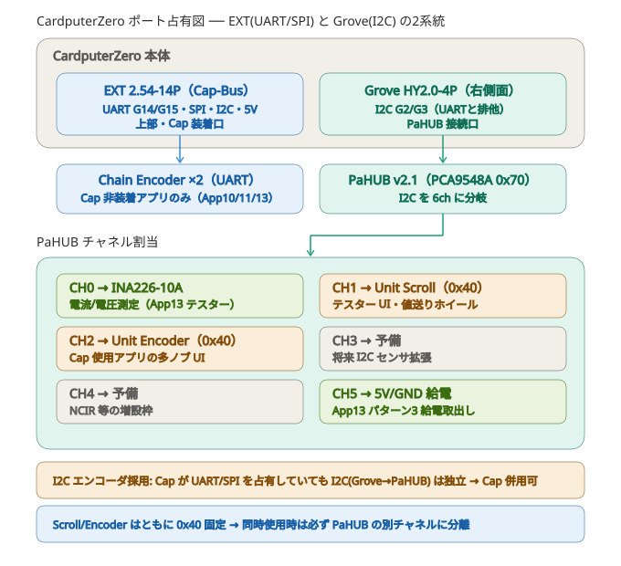
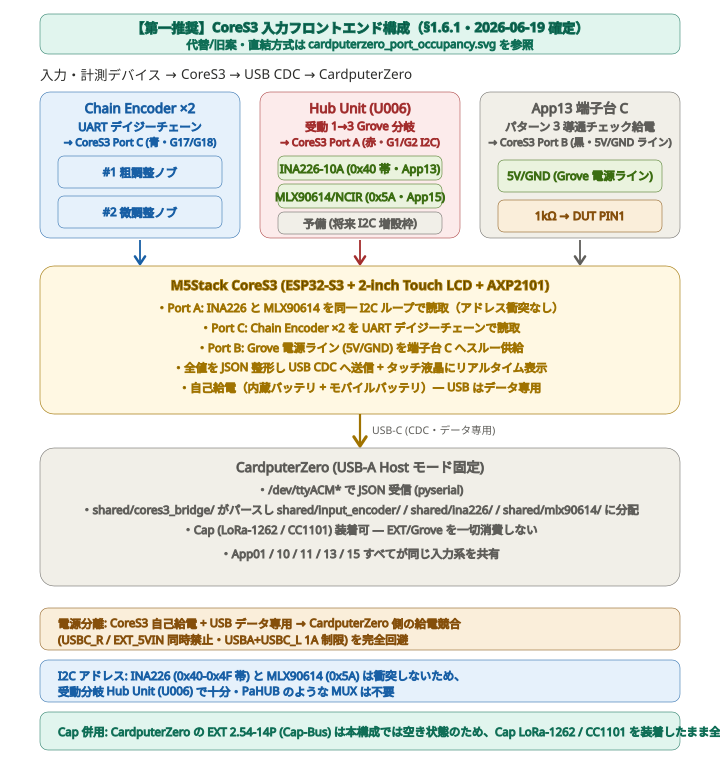

# HANDOFF: CardputerZero 開発ガイド

> **作成日**: 2026-05-24 / **最終更新**: 2026-08-13（**§2.8 競合ランドスケープ新設**＝公式レジストリ全 38 アプリ精査／KS Update #11 反映：**BMM150 は EOL＝KS 版のみ搭載・retail 版非搭載**／USB-C 1 ポート充電専用の疑い／Hub は beta／出荷 11 月。加えて公式サイト `cardputer.cc` 公開確認・§1.1 スペック確定〈1750mAh・native 170×320・I2C アドレスマップ〉・§2.7/§4.1 に `.deb`＋`app-builder.json`＋レジストリ先着順を反映）  
> **対象デバイス**: M5Stack CardputerZero (Raspberry Pi CM0 搭載)  
> **開発者**: 総司 (osprey74)  
> **開発方針**: Spec-Driven / Claude Code + czdev ワークフロー  
> **リポジトリ予定**: `osprey74/cardputerzero-apps`

| 更新日 | 変更内容 |
|--------|----------|
| 2026-05-24 | 初版作成 |
| 2026-05-27 | KS 開始確認・§2.5 Tailscale 連携・§2.6 日本語入力 追記 |
| 2026-05-27 | Cap B (Hacker Cap: CC1101+NFC) 詳細仕様追記・App 03/04 更新・App 08/09 追加 |
| 2026-05-27 | 公式ドキュメント確認・Cap B ピンマップ確定・App 10 (SDR 広帯域受信) 追加・TODO 更新 |
| 2026-05-27 | App 10: RTL-SDR V4 USB-C 専用ドライバ手順・トラブルシューティング追記 |
| 2026-05-27 | App 11 (LAN 調査ツール) 追加・法令テーブル・CLAUDE.md 更新 |
| 2026-06-06 | App 12 (汎用電波受信アプリ) 追加 |
| 2026-06-07 | AppStore URL 確定（CardputerZeroRepository）・Cap LoRa-1262 技適メモ・C6L ゲートウェイ・App02 LoRa 構成・App05 二系統受信に再設計・MSYS2 Windows 対応・HANDOFF2 統合 |
| 2026-06-07 | App 12 を App 10 の「自作統合モニターモード」として吸収（重複解消） |
| 2026-06-07 | 入力デバイス拡張（Scroll Unit / Chain Encoder）追記・App 10 物理 UI 拡張サブセクション追加 |
| 2026-06-07 | App 01 に Sky Plot（天球図）表示仕様を追加（LCD 分割ビュー + HDMI フルスクリーン） |
| 2026-06-07 | `shared/input_encoder/` 共通入力ドライバを新設（App01 / App10 / App11 で共有） |
| 2026-06-07 | Scroll Unit を仕様から外し Chain Encoder 一本化・App 11 に Chain Encoder 連携機能を追加 |
| 2026-06-07 | §10 購入リスト・見積もり、§11 Phase ロードマップ を新設 |
| 2026-06-11 | App 13 (テスター) 追加・INA226-10A (絶縁型±10A) + PaHUB v2.1 構成確定・Chain Encoder 経路を Grove → 2.54mm UART ヘッダに変更・結線図 (ポンチ画) 追記・`shared/ina226/` 新設・§10 購入リスト・§11 Phase 1.5 更新 |
| 2026-06-11 | App 13 「接続パターン」サブセクション追記（内部構造図 + パターン 1: 直列挿入 / パターン 2: 電圧プローブ / パターン 3: 導通チェック）・機能一覧をパターン別に再構成・§9.1 に端子物理ラベル確認・IN 浮き挙動・1kΩ 治具製作 TODO 追加 |
| 2026-06-11 | INA226-10A 公式回路図 V0.3 確認反映: 内部構造図を実回路（B0505S + ADuM1250 + PTC ヒューズ + R10 + 5mΩ shunt）に差替・**端子トポロジを 4 端子（IN+/IN-/OUT+/OUT-）→ 3 端子 + NC（PIN1=NC / PIN2=+V_IN / PIN3=GND / PIN4=+V_OUT）に訂正**・接続パターン 3 つを新トポロジに更新・§8 に回路図 PDF/PNG・INA226 データシート URL 追加 |
| 2026-06-11 | §1.2 に「Grove (HY2.0-4P) 配色規約」サブセクション追加: M5Stack 全製品共通の配色（黒=GND / 赤=5V / 黄=SDA or RX or IO1 / 白=SCL or TX or IO2）を Port A/B/C モード別表で整理、PaHUB CH1～5 増設時の配線ガイドとして記録 |
| 2026-06-11 | **INA226-10A 実機写真確認による端子トポロジ最終確定**: 「3 機能 + 1 NC」誤読を訂正し、**4 端子すべて機能（PIN1=INPUT + / PIN2=INPUT - / PIN3=OUTPUT - / PIN4=OUTPUT +）**に修正。I2C 絶縁チップを **CA-IS3020S**（Chipanalog 製、実機裏面ブロック図にて確認）に訂正。§9 に「情報源の優先順位ポリシー」§9.0 を新設し、今後は実機写真・テスタ計測を最優先とすることを明文化 |
| 2026-06-11 | App 13 PoC 整備: 事前検証用 Python スクリプト [`apps/tester/tests/ina226_terminal_check.py`](apps/tester/tests/ina226_terminal_check.py) を新規作成（PaHUB CH0 選択 + INA226 初期化 + V/I/P 連続読み出し + Mfg ID/Die ID 検証）。§3 App 13 に「動作確認手順」サブセクション追加（4 ステップでの段階的検証手順を明記）。§11 Phase 1.5 完了基準を 3 条件に細分化 |
| 2026-06-13 | App 13 INA226-10A の VH3.96-4P 端子台を**着脱式（プラガブル）ネジ式 cage clamp** タイプと確定（総司確認）。§3 App 13 ユニット仕様表・§9.1 確認済み項目・§10 購入リストに反映。1kΩ 治具製作要件に**用途別端子台モジュール化**運用案を追加 |
| 2026-06-13 | App 13 §3 接続パターンに「**プラガブル端子台によるモジュール運用**」「**結線の本質理解（補足解説）**」サブセクションを追加。INA226 ハイサイド方式の概念、INPUT/OUTPUT 端子名の意味、VBUS ピンが shunt 出力側にあるためパターン 2 が OUTPUT 側受けとなる根拠、信号線を経由させない原則を明文化 |
| 2026-06-13 | **EXT 2.54-14P ヘッダの完全ピンマップを §1.2 に追加**（公式ドキュメント画像より確定）。Pin 4=GND, Pin 6=5V OUT, Pin 8=G2/SDA, Pin 10=G3/SCL, Pin 12=G15/RX, Pin 14=G14/TX。§3 App 13 パターン 3 の給電経路を Pin 6 / Pin 4 として確定。§9.1 関連 TODO を確認済み (`[x]`) に移行。§8 関連リンクに公式ドキュメント URL を追記 |
| 2026-06-13 | **App 14 (QR コードリーダー / アナライザー `qr-toolkit`) 追加**。標準版搭載 IMX219 8MP CSI カメラ + `picamera2` + `pyzbar` + Google Safe Browsing API 構成。総司様作 QR 構造学習ウェブアプリ [osprey74.com/qr-anatomy.html](https://osprey74.com/qr-anatomy.html) をネイティブ移植する「ナレッジモード」（バージョン・モジュール数・ECC・8 種マスクパターン・データ領域可視化）を仕様化 |
| 2026-06-13 | **App 15 (非接触温度計 `ncir-thermometer`) 追加**。M5Stack NCIR Unit (Melexis MLX90614 / Grove I2C) を PaHUB v2.1 CH1 経由で接続。業務（機材点検 / CPU・GPU サーマル）と個人（料理補助）の 3 用途に絞ったプリセット温度・閾値判定・ログ機能を仕様化。`shared/mlx90614/` 共通ドライバ新設 |
| 2026-06-13 | **App 10 に BCL ログモード（UpNote 連携）追加**。総司様が RTL-SDR V4 + 15m ロングワイヤーで短波放送受信を開始（最初の特定局: ラジオ NIKKEI 第1）。UpNote 公式 API は不在のため、`x-callback-url` URL スキーム経由で Tailscale 接続中の Mac Mini で `open` コマンドを実行し UpNote.app に `BCL_LogBook` ノートブックへの自動投稿を実現。オフライン耐性のため microSD への一旦保存 → 接続復帰時の一括同期方式を採用。既知局データベース (`data/bcl_stations.yaml`) を内蔵 |
| 2026-06-13 | **BCL ログモードの確定値を反映**: BCL_LogBook の `notebookId` = `019ecfdf-7134-7428-aa52-4aa6eaa18d3f`、Mac Mini Tailscale 固定 IP = `100.108.134.69`、初回受信ノート（ラジオ NIKKEI 第1）の `noteId` = `019ecfe3-f686-7612-93d0-3685b7e9057d`。設定ファイル `~/.config/cardputerzero/bcl_config.yaml` の構造を仕様化。Python サンプルに MagicDNS フォールバックロジック (`resolve_ssh_target()`) を追加 |
| 2026-06-13 | **BCL ログモードの実機検証 4 回で UpNote x-callback-url 仕様を確定**: (1) `note/new` の正しいパラメータは **`notebook`（名前指定）** であり `notebookId` ではない、(2) `tag` パラメータは公式ドキュメント未記載だが**実機で必須**、(3) **`tag` は URL 末尾に配置**しないと title/text が文字化け、(4) 本文中の `#BCL` のみではタグ自動認識されない、(5) 連続投稿時の確認ダイアログなし。Python サンプルを `list of tuples` 版に刷新 |
| 2026-06-13 | **BCL ログモードの全仕様確定（運用方針 A〜⑤ 全パラメータ決定）**: 1 受信 1 ノート方式・案 ③（録音は Mac Mini に scp 転送して永続保存・CZ 側削除）・アンテナはプリセット選択方式・SFI は NOAA SWPC から 1 時間キャッシュ・App 01 GPS 連携で受信地点座標取得。Markdown テンプレート最終確定（機材 + 受信記録 + 録音ファイル Mac Mini パス記載）。既知局 DB 初期 15 局（日本短波・北海道中波・国際短波局）登録。UI フロー設計確定（ノブA でフロー進行、ノブB で SINPO 値） |
| 2026-06-13 | **App 13 パターン 3 給電経路を EXT Pin 4/6 → PaHUB CH5 に変更**（総司様ご指摘より）。当初設計では EXT 2.54-14P の Pin 4 (GND) / Pin 6 (5V OUT) から端子台 C への給電を想定していたが、これらは Chain Encoder #1 の電源ピンとして占有されており物理的にバッティングするため、PaHUB v2.1 の空きチャネル CH5 から Grove ケーブル経由で 5V/GND を取り出す方式に変更。結線図ポンチ画・配線サマリー表・パターン 3 結線図・用途別端子台モジュール表を更新。§9.1 に「PaHUB の電源スルー配線確認」TODO を追加 |
| 2026-06-13 | **PaHUB v2.1 の電源スルー配線を公式回路図で確認・確定**。[公式回路図 PNG](https://static-cdn.m5stack.com/resource/docs/products/unit/Unit-PaHub2.1/img-103440a9-d7e4-4aab-b784-825aa9b35614.png) を直接読解し、各 Grove 出力ポート J1〜J6 の VCC/GND が全 CH 共通バスとしてスルー配線されていること、入力 J7 の 5V がそのまま CH0〜CH5 の Pin 3 へ届くことを確認。HT7533 LDO で生成される 3.3V は PCA9548A 内部 + SDA/SCL プルアップ専用で Grove ポートには出力されない。§9.1 該当 TODO を ✅ 確認済みに移行。§8 に PaHUB 公式ドキュメント・回路図 PNG・PCA9548A データシート URL を追加。App 13 パターン 3 結線図の注記から「※要実機確認」を確定情報に格上げ |
| 2026-06-17 | **App 10 BCL ログモードを ClockworkPi uConsole (CM4) で先行構築・実機 e2e 検証成功**。サブプロジェクト [`apps/sdr-receiver/bcl_log/`](apps/sdr-receiver/bcl_log/) を新設（Python 3.9 / `feat/app10-bcl-uconsole` ブランチ）。CardputerZero 実機到着前に UpNote x-callback-url 連携・Tailscale 経由 Mac Mini SSH ディスパッチ・既知局 DB 検索・`_pending/` キュー・Markdown 本文生成を機種非依存ロジックとして実装。Win 開発機 → uConsole (`100.85.21.75`) → Mac Mini (`100.108.134.69`) → UpNote.app への全経路 e2e ノート投稿に成功（タイトル / 本文 / タグ / ノートブック指定すべて期待通り）。実機検証で判明した不具合 1 件を修正: **リモート zsh が URL 内 `&` をシェル区切りとして解釈**するため、`upnote.dispatch()` で `shlex.quote()` によるリモートコマンド側エスケープを必須化。CZ 用 LVGL UI は実機到着後に同モジュールを共通コアとして再利用予定。録音 (rtl_fm) / NOAA SWPC / GPS 連携は uConsole 版では未実装（手動運用） |
| 2026-06-17 | **RTL-SDR Blog V4 を uConsole 上で動作確認・実装の `scripts/setup_rtlsdr.sh` を本格化**。`rtl-sdr-blog` 公式ドライバの自動ビルドスクリプト（DVB ブラックリスト → initramfs 更新 → cmake/make → udev ルール反映）を実装し uConsole で実行成功。`rtl_test -t` で `RTLSDRBlog, Blog V4` / `Rafael Micro R828D tuner` / `RTL-SDR Blog V4 Detected` を確認。**重要な HW 制約を発見**: ClockworkPi uConsole の USB-C ポートは **電源入力専用 (データ非対応)** であり、RTL-SDR V4 (USB-C 端子) をそのまま挿しても `lsusb` に現れない。USB-C → USB-A 変換アダプタ経由で USB-A ポートに接続することでエニュメレーション成功。RTL-SDR Blog 多目的ダイポール (長エレメント 93cm 水平展開) で AIR-G' 80.4 MHz FM の音声受信を確認（札幌市内）。短波 BCL 用途には本ダイポールキットは非効率のため、別途 HF 専用アンテナを検討中 |
| 2026-06-17 | **uConsole バッテリーインジケータ精度問題を発見・OCV ベースの代替モニタを実装**。AXP223 PMIC ドライバ (`axp20x_battery`) の電圧→容量カーブが粗く、`sysfs capacity` が高電圧帯で 99-100% に張り付く現象を実機計測で確認（4.05V / 放電 3.7W で sysfs=99% / OCV 再計算=83% / 乖離 +16%）。対処として `scripts/uconsole_battery.py` (CLI: 1 行表示 / `--json` / `--compare` / `--watch`) と `scripts/uconsole_battery_hud.py` (GTK フロート HUD・画面隅常駐・残量に応じた色変化・残時間表示) を新設。LXPanel が `_NET_SYSTEM_TRAY_S0` 未登録かつ SNI ホスト未提供のため通常のトレイインジケータが表示できないことを実機検証で発見し、`Gdk.Monitor.get_workarea()` ベースの 4 隅選択可能フロートウィンドウに方針変更（autostart 設定済み）。本ツール群は uConsole 専用だが、CZ 実機到着後に同等 PMIC が搭載されていれば再利用可能 |
| 2026-06-19 | **【重大訂正】Cap と Chain Encoder の同時併用は不可能であることが公式ピンマップ照合で判明**。3 点の公式ドキュメント（[CardputerZero](https://docs.m5stack.com/ja/CardputerZero) / [Cap LoRa-1262](https://docs.m5stack.com/en/cap/Cap_LoRa-1262) / [Cap CC1101](https://docs.m5stack.com/en/cap/Cap_CC1101)）を直接読解した結果、従来「上部 Cap スロット」と「2.54mm UART ヘッダ（EXT 2.54-14P）」を**別ポートとして扱っていたのは誤り**であり、両者は**同一の 14 ピン物理バス（= Cap-Bus = EXT 2.54-14P）**であることが確定。Cap 装着時はこのバスの全ピン（SPI/UART/I2C/電源）が Cap に占有されるため、同じ Pin 12/14（G15/G14 = UART）を使う Chain Encoder と**物理的に共存できない**。特に Cap LoRa-1262 は GPS が G14/G15 UART を使用し Chain Encoder と完全衝突。§1.2〜1.4 を全面改訂し「Cap-Bus = EXT 同一」「Cap 常駐時 Chain Encoder 併用不可」を明記。§1.4 早見表の CC1101 受信感度・アンテナ等を公式値に訂正。代替案（Grove UART / キーボード操作 / I2C エンコーダ）を §1.5 として新設。Chain Encoder を前提とする App01/10/11 の物理 UI 記述に「Cap 非装着時のみ」の条件を付記。§9.1 に回路図 PDF での Grove/EXT UART 排他確認 TODO を追加（総司様ご指摘より） |
| 2026-06-19 | **App13 導通チェックの 5V 取得を CoreS3 Port B（黒・Grove 電源ライン）から行う構成を追加**。公式マニュアルで CoreS3 の Port A/B/C が GND/5V/GPIO 結線と確認（Grove は全ポート共通で 5V/GND を持つ）。Port B のデータピン（G8/G9）を使わず**電源ライン 5V/GND のみを App13 パターン 3（端子台 C）の給電に流用**できる。これにより PaHUB CH5 からの 5V 取得（直結方式の名残）が不要になり、App13 が CoreS3 完結型に。§1.6.1 の接続表・構成図・ポイント整理、App13 パターン 3 配線・端子台 C モジュール表を更新（第一推奨=CoreS3 Port B / 代替=PaHUB CH5）。⚠️ Port B 5V は常時出力の電源ライン（GPIO 制御不可）・供給電流上限は実機確認・DUT が CoreS3 電源系と導通する点に注意 |
| 2026-06-24 | **App13 端子台 A/B/C を実機機能検証（全て PASS）**。10A 版 INA226＋CoreS3 シリアル(`ina`)で確認。**B（電圧プローブ）**: 3V 電池で V=3.19V / I=0 → OK。**A（直列 V/I/W）**: 3V＋330Ω で **I=+9.81mA ≒ V/330**（初回は極性逆で I が負→クリップ入替で + 確定。**正配線=電源 + → PIN1(INPUT+) / 負荷 → OUTPUT 側 PIN4・PIN3**）。**C（導通チェック）**: Port B 5V 給電・開放 I=0 / 短絡 **I=+5.10mA ≒ 5V/1kΩ**・V→0 → OK。精度確認（端子台D・0.1% 抵抗）は部品到着後 |
| 2026-06-24 | **App13 INA226-10A 精度ベンチ調査（端子台D・100Ω）→ ±1A 版 INA226 と 0.1% 基準抵抗の購入を決定**。既存 端子台D（100Ω・1% 1W）に電池を繋ぎ CoreS3 シリアルの `ina` を実測。9V/93mA で **I が +4.8%（見かけ抵抗 95.4Ω）**、3V/32mA で **+1.15%（98.87Ω・ただし 10A 版は 32mA で量子化 ±1% と粗い）**。**見かけ抵抗が電流で変化＝電流依存ゲイン誤差**で、一律 CAL 補正では直らないと判明。低電流（常用域）は ~1% 以内で実用可、高電流ほど誤差増。DMM は「あれば App13 不要」になるため非採用とし、代わりに **(a) 高精度金属皮膜 100Ω ±0.1% 1/2W（[秋月 g108509](https://akizukidenshi.com/catalog/g/g108509/)）**と **(b) M5Stack INA226 ±1A 版（[switch-science 10736](https://www.switch-science.com/products/10736)・80mΩ・32µA・絶縁・**既定 I2C 0x41＝既存と同一でアドレス衝突注意**）**を購入決定。⚠️ 1/2W 100Ω の電源上限は実用 5V／絶対 7V／**理想 3V（0.09W・冷間で 0.1% 維持）**。到着後: 端子台D を 0.1% 抵抗へ載せ替え 3V で両ユニット差し替え共用 → 複数電流点で電流依存性を特性化、2 ユニット対応ファーム（要アドレス解決） |
| 2026-06-24 | **Chain Encoder の UID 個体識別を実装・実機確定**。`chain.getUID()`（4バイト UID）で各ノードを識別し、ファーム内テーブルと突合して役割(色)を**配線順非依存で恒久固定**。確定 UID = 赤 `4E001B00` / 青 `78001C00`。送信 JSON 各エンコーダ要素に `role`(R/B)・`uid` を追加、液晶は RED/BLUE を該当色表示。`firmware/cores3-frontend/src/main.cpp` 更新・COM5 書込み・ライブ検証済み（id1→RED/id2→BLUE 解決確認）。詳細は §1.6.1 注記9 |
| 2026-06-24 | **`shared/cores3_bridge/`（CoreS3 受信ブリッジ）を新規実装**。実機到着前に着手可能な第一推奨経路の受信側。CoreS3 が送る JSON を機種非依存データモデルに変換する Python ライブラリ（`models.py`/`parse.py`/`reader.py`/`cli.py` ＋ tests）。Chain Encoder は `frame.encoder(role=/uid=)` で配線順非依存に個体取得、`nan`/`inf` を `null` 正規化。単体テスト 8 件＋実機 COM5 ライブ検証済み。§9.4 の cores3_bridge TODO を ✅ に更新 |
| 2026-06-24 | **CoreS3 を単体多機能化: 2 ページ UI（左右スワイプ）＋ Wi-Fi/NTP 時計を実装・実機検証**。CoreS3 が橋渡し専用なのは惜しいとの判断で、能力プローブ（フル版確定: タッチ/IMU/RTC/カメラ/近接/マイク/Wi-Fi）を踏まえ単体機能を追加。①液晶を [METER]（従来）/[INFO] の 2 ページ化し FT6336 静電タッチの**左右スワイプ**で切替（下部ページドット・`wasFlicked()`+`distanceX()` で判定）。②[INFO] に **Wi-Fi 接続＋NTP 時計（JST）**＋ SSID/RSSI/IP/MAC 表示。Wi-Fi 認証情報は `src/secrets.h`（**`.gitignore` 済み・非コミット**、`secrets.h.example` を同梱・`__has_include` で未設定時もビルド可）。実機検証: スワイプ/ドット/INFO 表示 OK、Wi-Fi 接続→NTP 同期（state 1→2→3・JST 時刻取得）をシリアルログで確定。1番(情報パネル)の BSAF 連携は bot 側 MQTT publish 未実装のため次段 |
| 2026-06-24 | **3 ページのセクション間余白を METER に統一**。INFO/SYS のセクション境界余白が METER より 2px 詰まっていた（INFO の room 行 +26・SYS の mac 行 +18）のを、METER 基準の「テキスト下端 +12px」（`SEC_GAP=12`）に揃えた（room→`16+SEC_GAP`、mac→`8+SEC_GAP`）。各セクション最終行の増分 = テキスト高(8×サイズ)+SEC_GAP のルールを明文化 |
| 2026-06-24 | **ネットワーク処理を core 0 バックグラウンドタスク化（表示フリーズ解消）＋ SYS ページ整形**。①WiFiMulti 化で `wifiMulti.run()`/HTTPS がメインループをブロックし常時表示が接続中フリーズ（初回フレーム 13.5s・断続）していた回帰を修正。Wi-Fi 接続・NTP・天気取得を `netTask`（`xTaskCreatePinnedToCore` core 0・20KB スタック）へ隔離し、メインループ（core 1: 表示/センサ/JSON）は常時 5Hz 維持（初回フレーム 1.8s・接続/取得中も無瞬断を実機確認）。②SYS ページの項目名を最長ラベル+2 で左詰めし値との間隔を確保（半角2空き以上で読みやすく）。③heap/psram を「空き/合計」表示化（`getFreeHeap`/`getHeapSize`・`getFreePsram`/`getPsramSize`）。heap の数値は**現在の空き**（最大確保でも使用中でもない） |
| 2026-06-24 | **Wi-Fi を WiFiMulti 化（複数 AP 登録）＋ METER エンコーダ表示の桁揃え**。①`secrets.h` を `WIFI_APS` の X-macro リスト（`X("ssid","pass")` を必要なだけ並べる）に変更し、`WiFiMulti` で電波の強い既知 AP に自動接続（自宅/テザリング/職場の併記が可能）。旧 `WIFI_SSID`/`WIFI_PASS` 単一指定も後方互換でサポート。`wifiTask()` は `wifiMulti.run(5000)` で接続。起動時 `{"log":"wifi_cfg","ap_count":N}` を出力。②METER のエンコーダ行を `%-4s %+ld` 化し名前を 4 桁左詰めで揃え、回転値の桁を縦に揃えた（"RED  +0"/"BLUE +0"）。実機検証: AP 1 件登録→接続→NTP→天気 OK |
| 2026-06-24 | **INFO パネル拡充: 3 ページ化＋天気（気象庁）＋室温＋システム情報を実装・実機検証**。[METER]/[INFO]/[SYS] の 3 ページに拡張。[INFO]=時計（曜日 日赤/土青・大表示）＋室温（NCIR amb）＋**天気**。[SYS]=ネットワーク詳細（SSID/RSSI/IP/GW/MAC）＋システム（uptime/heap/psram/fw）。**天気は気象庁 forecast JSON**（`area=016000` 札幌・API キー不要・HTTPS）を `WiFiClientSecure`+`HTTPClient`+`ArduinoJson v7`（**PSRAM allocator で全パース**・本体ヒープ非圧迫）で取得し、天気コード先頭桁で 1=晴/2=曇/3=雨/4=雪 に分類（**日本語フォント不要**）＋今日の直近気温・明日の最高/最低・降水確率。NTP 同期後に初回＋30 分毎更新。実機検証: 今日 Sunny/24℃、明日 Sunny/26-16℃/降水10% を `{"log":"wx",...}` で確定、全ページ目視確認済み。RAM 15.8%/Flash 16.1% |
| 2026-06-19 | **HANDOFF 全体査読し「CoreS3 併用案＝第一推奨」で齟齬を解消**。方針決定（CoreS3 フロントエンド方式を第一推奨／直結方式は代替・旧案として残す）に基づき以下を修正: §1.6 冒頭にアーキテクチャ方針バナーを追加／§1.5 を「直結方式（代替/旧案）の運用方針」と位置づけ明記／App10 物理 UI に CoreS3 経由（第一推奨）と EXT 直結（代替）の 2 構成を併記／App13 に接続方式の方針注記を追加し PaHUB・端子台系を「直結方式の参照情報」と明記／App01 衛星リスト送りを「CoreS3 経由なら Cap A 使用でも可」に更新／`shared/` ツリーに `cores3_bridge/` を追加し input_encoder・ina226 を 2 バックエンド化（CoreS3 経由＝第一推奨 / 直結＝代替）／CLAUDE.md のデバイス接続・制約・共有ドライバを更新／§9.4 ドライバ API 設計を多バックエンド化／購入リストに CoreS3・データ専用ケーブルを追加し PaHUB・変換ハーネスを「直結方式の場合のみ」と注記／Phase 1.5 を CoreS3 経由優先に改訂し Phase 1.55（CoreS3 連携確立）を新設／Cap B 表記を公式名「Cap CC1101」に統一 |
| 2026-07-03 | **App13 端子台D で 1A 版 INA226 の絶対精度を実機校正・確定（CAL 誤りを発見し修正）**。0.1% 精密抵抗（100Ω 1/2W）到着に伴い端子台D を載せ替え、2×AA（≈3.1V）で 1A 版を校正検証。当初ファームは 1A 版にも 10A 版の **CAL=3200 を書いており電流・電力が約 1.6 倍過大**（I=49.8mA / 期待 31.3mA・見かけ 62.8Ω）と判明。原因は **1A 版シャントを 50mΩ と誤想定**していたこと。M5 公式 Product Compare で **1A=80mΩ / 10A=5mΩ** を確定し、**CAL をユニット別**（10A=3200 / 1A=2000＝0.00512/(32µA×0.08)）に修正。再フラッシュ後の実測は **V=3.100V / I=30.8mA（対 V/R −0.65%）/ P=96.0mW（−0.1%）**で合格。残差 −0.65% はシャント電圧 2.46mV と低くオフセット誤差が効くためで、5V 化で縮小見込み。`firmware/cores3-frontend/src/main.cpp`（`Ina226Unit.cal` 追加・切替時 CAL 再書込み）、`apps/tester/tests/ina226_terminal_check.py`（1A r_shunt 0.05→0.08）、本 §App13 仕様注記（50mΩ→80mΩ）を更新。⚠️ 10A 版の絶対精度は高電流基準が用意でき次第、同手順で要再検証 |
| 2026-07-03 | **App13 1A 版を 2 点校正で確定（合格・補正不要）＋ 絶縁ユニットの給電制約を確定**。100Ω±0.1% 基準で 2 電圧点を実測。**3V 点**: V=3.100V / I=30.8mA（−0.65%）/ P=96.0mW（−0.1%）・見かけ 100.6Ω。**4.5V 点（単三×4 ケースの 1 本分をボルト短絡し 3 本＝実測 4.644V）**: I=46.2mA（−0.52%）/ P=215.2mW（−0.2%）・見かけ 100.5Ω。**見かけ抵抗が両点で 100.5〜100.6Ω 一致 → CAL=2000 が正しく桁・ゲイン異常なし**。**素の精度は P ベースで 0.1〜0.2%（≒内蔵 80mΩ シャント公差）**、I 表示の −0.5〜0.65% は 1A レンジ品を 3〜5% の低電流で使う **32µA 量子化**が主因（電流を上げると縮小: 31mA −0.65%→46mA −0.52%＝オフセット的挙動）。**ゲイン補正しても量子化ノイズに埋もれるため CAL=2000 のまま補正しない**方針で確定。**HW 知見**: 絶縁型 1A 版は **CoreS3 Port B（GND 共有）給電では I=0（電流検出不成立）**、電池等の絶縁電源が必須と実機確認（非絶縁 10A 版は Port B で可）。1A 版の精密検証は電池給電で行う運用に確定。コード変更なし（ドキュメントのみ） |
| 2026-07-07 | **App 16 (星座盤 `stellar-map`) 追加**。ESP32 版 [wisnc/stellar-map](https://github.com/wisnc/stellar-map)（M5Stack Cardputer-ADV 向けオフライン・プラネタリウム）に着想。CardputerZero は Linux 機ゆえ ESP32 版より格段に容易・高精度に実現可能と判断（512MB RAM で全カタログ常駐／**Skyfield 等の天文ライブラリで惑星・月の位置計算を関数呼び出し化**／内蔵 **RX8130CE RTC** ＋ **AT6668 GNSS** ＋ **NTP** で ESP32 版の弱点「起動毎 UTC 手入力」を解消／**HDMI 1080p フルスクリーン・プラネタリウム**が可能）。アーキテクチャは技術方針どおり **Python(Skyfield) サイドカー＋Rust/LVGL UI**、地平座標→LCD 投影は App01 の Sky Plot ロジックを流用。⚠️ IMU は BMI270 6軸（**地磁気なし＝絶対方位不可**）のため AR プッシュツーは手動アライン or 外付けコンパスで対応。データ（HYG / OpenNGC / Stellarium 星座線）と元コードのライセンスは §9 で調査。 |
| 2026-07-07 | **App 16 投影 PoC 実装＋ライセンス調査確定＋CoreS3 地磁気の流用を実機確定**。①**PoC**（`apps/stellar-map/poc/star_poc.py`・Pillow のみ）: 恒星＋星座線は Skyfield 不要（恒星時→地平座標の古典変換で自己完結）と判断し 320×170 に投影→PNG 出力。札幌 2026-07-07 21:30 で北斗七星/夏の大三角/はくちょう座を天文的に妥当に描画・地平線下を除外（23/35 星）。②**ライセンス調査**: 元 [wisnc/stellar-map](https://github.com/wisnc/stellar-map)=**無ライセンス（全権留保）→コード非流用・一次データから再実装**、HYG/OpenNGC=**CC BY-SA 4.0**（表示+継承）、Stellarium 現代星座線=**MIT**（Xalioth 再許諾）、Skyfield=**MIT**、JPL DE 暦=実質 PD。③**方位=CoreS3 の BMM150 を流用**（総司様指示）: CoreS3 の BMM150 は BMI270 補助 I2C 配下で i2cdetect に出ないが `M5.Imu.getMag()` で取得可能と COM5 実機で確定（過去の「BMM150 非検出」は読み方の問題）。`firmware/cores3-frontend` が `"mag":{ok,x,y,z,heading}` を USB CDC JSON に追加、`shared/cores3_bridge` に `Mag` データクラス追加（単体テスト 11/11 PASS）。※heading は要ハード/ソフトアイアン・傾き補正 |
| 2026-07-09 | **App10 に SCOPE ページ（スペクトラム＋ウォーターフォール）を新設・実機表示確認**。proc スレッドが復調に使う IQ から `np.fft`(4096 点・Hann 窓)でパワースペクトラムを算出し `sdr.spectrum`(320 列 dB)＋`spec_seq` を公開（span 切替=広帯域±480kHz / ズーム±12kHz は FFT 中心ビンの拡大）。UI に SCOPE 状態を追加（RX の次）: 上段スペクトラム折れ線＋中央=同調マーカー、下段ウォーターフォール（numpy H×320×3 バッファを `np.roll`＋`pygame.surfarray` で高速転送・黒→青→シアン→黄→赤 の LUT）。操作: 赤ノブ=同調 / 青ノブ=バンド / **青ノブ押下=スパン切替** / 赤ノブ押下=ログへ。dB 表示レンジは実測(雑音≈-67 / FM ピーク≈-20)から -70〜-15 に設定。uConsole 実画面で FM 80.4 の山・WF の帯を目視確認。320×170 でも実用的に表示可能と実証。 |
| 2026-07-08 | **App10 SDR を pyrtlsdr ライブ同調版に全面再設計し、実機で FM 受信・ライブ同調・S メータ・音途切れ解消まで確認**。rtl_fm サブプロセス方式は RTL-SDR V4 が close→reopen でストリーム停止する不具合＋再同調で音切れを招いたため廃止。新方式（`sdr.Receiver`）: **librtlsdr を pyrtlsdr で 1 回だけ open**し `center_freq` をライブ変更（開き直さない）。**reader スレッド=生バイトを read_bytes で読むだけ**（bytes→複素数変換を proc スレッドへ回し読取の合間を最小化）→**proc スレッド=numpy/scipy で AM/FM 復調**（2 段 FIR デシメーション＋FM 75µs デエンファシス）→ aplay(pulse)。S メータは **IQ 電力（10·log10 の平均 IQ パワー）ベースの相対 RF レベル**。実機検証（uConsole・pyrtlsdr 0.2.93/numpy/scipy）: FM 80.4MHz 受信・ライブ同調（回すと即切替・開き直さない）・SIG バー妥当・**音途切れ解消**（原因＝旧 read_samples の変換オーバーヘッドで実効供給 46420Hz＜48000→aplay underrun、read_bytes 化で ~48000 に整合）。総司様確認済み（残歪みは uConsole 小型スピーカー由来で許容）。⚠️ **設計指針**: この HW では (a) デバイス close→reopen 厳禁（ストリーム停止）、(b) ストリーミング中の `set_center_freq` は async 経路だと i2c `-6` で落ちる→**同期読みの合間に適用**、(c) 供給レートは実時間一致が必須（変換は読取ループ外へ）。RTL-SDR V4 は生存（Mac Mini で確認・判定は `rtl_test`/libusb で）。 |
| 2026-07-08 | **App10 RX 画面に S メータ追加＋受信の堅牢化**。`sdr.Receiver` を rtl_fm→(Python tee で RMS 算出)→aplay 構成に変更し、UI RX 画面に **SIG バー**（復調音声 RMS ベースの相対レベル・0..1・EMA 平滑）を追加。**再同調の堅牢化**: tune/band 変更は周波数を変えるだけにし、回転が **0.4s 落ち着いてから 1 回だけ**受信し直す（コアレス・`service()` を UI ループから毎フレーム呼ぶ）＝毎クリック再起動によるデバイス取り合い/音切れを解消。stop 時は SIGTERM 送信後にプロセス終了を待って**デバイス解放してから**次の start が RTL-SDR を再取得（無音バグの修正）＋終了プロセスを非ブロッキング reap（ゾンビ蓄積防止）。青ボタンのチャタリング二重トグルに 0.30s デバウンス。健全時に FM 復調（RMS≈0.6）と再同調後の受信維持を確認。⚠️ **RTL-SDR V4 は rtl_fm の高速 start/stop 反復で firmware がハング→USB 再列挙不能**（`kill -9` に限らず短時間の多数サイクルでも発生）→物理抜き挿しでも戻らない場合は uConsole USB サブシステムの再起動が必要。実機での SIG バー最終目視は次回（デバイス復旧後）。 |
| 2026-07-08 | **App16 星座盤を uConsole 実画面で実働確認＋App10 に SDR 受信統合（rtl_fm）を実装・実機で FM 音声受信成功**。(1) **App16**: `DISPLAY=:0` で実 LCD に星図描画をライブ確認（これまでスクショのみ）。(2) **App10 SDR 統合**: `apps/sdr-receiver/bcl_log/bcl_log/sdr.py` 新設＝`rtl_fm`→`aplay` の受信コントローラ（バンド FM/MW/SW・同調・ON/OFF・setsid でプロセス群一括停止）。UI に **RX 画面**を追加（赤ノブ=同調, 青ノブ=バンド, **青ノブ押下=受信ON/OFF**, 赤ノブ押下=受信周波数から既知局サジェスト→ログへ）。**実機検証**: RTL-SDR V4 で FM 80.4MHz(AIR-G' 札幌) 復調(RMS≈4500)→PulseAudio 経由でスピーカー再生を総司様が試聴確認。(3) **修正/知見**: 青ボタンのチャタリング二重トグル→**0.30s デバウンス**、UI 終了時 SIGTERM で `rtl_fm` を確実停止（`finally`+シグナルハンドラ・孤児化防止を実証）、音声は `aplay -D pulse`＋`XDG_RUNTIME_DIR` 補完で SSH 起動でもデスクトップの単一シンク(`bcm2835 analog-stereo`)へ（`BCL_APLAY_DEVICE` で上書き可）。⚠️ **`rtl_fm` に `kill -9` 厳禁**（SIGKILL は USB 未解放で RTL-SDR V4 がバス脱落→要抜き挿し・実際に発生）。残: S メータ、SW/MW 実用アンテナ、SINPO 完全編集、CZ 実機 LCD/音声。 |
| 2026-07-08 | **CoreS3 を uConsole に USB 接続してセンサーapp を実機テスト可能に＋App10 BCL UI スケルトンを uConsole 実画面で実働**。(1) **B 疎通確認**: CoreS3(ESP32-S3 native USB `303a:1001`)→uConsole `/dev/ttyACM1`→`shared/cores3_bridge` で実センサーデータ取得成功（bat 4.15V / NCIR 実室温 / Chain Encoder R・B の UID 個体識別）＝`cores3_bridge` が Linux でそのままセンサーサイドカーとして機能。(2) **App10 オンデバイス UI 新設** `apps/sdr-receiver/bcl_log/bcl_log/ui.py`（**pygame・320×170 厳守**）: BCL ログフロー STATION→FREQ→SINPO→CONFIRM→DONE を Chain Encoder（ノブA=選択/前進, ノブB=SINPO 値）＋キーボードで操作、既存 `stations`/`markdown_template`/`upnote`/`config` ロジックを結線（UpNote 投稿は既定 dry-run・`BCL_DISPATCH=1` で実投稿）。入力は `cores3_bridge`（USB CDC・by-id 自動検出）をバックグラウンドスレッドで読取。(3) **uConsole 実機検証**: ヘッドレス(dummy)で 3 画面スクショ目視→`DISPLAY=:0` で実画面表示（`/dev/ttyACM1` fd オープン確認＝センサー接続）→**総司様が実 Chain Encoder/キーで操作し正常動作を確認**。日本語局名は IPA Gothic で描画。⚠️ 途中修正: AA テキストが SDL1.2/dummy でベタ塗り→不透明背景レンダリングで回避、日本語豆腐→CJK フォント読込で解決。uConsole に `libsdl2-dev`/pygame(既存)/`cores3_bridge` 利用。残: SDR(rtl_fm)受信統合・SINPO 完全編集・常駐イベント応答・CZ 実機 LCD。 |
| 2026-07-08 | **雛形を 3 種に拡張（SDL2 版・Python サイドカー版を追加）し、App16 星座盤を e2e 実働**。`templates/rust-sdl2-app/`（SDL2 直描画・`src/draw.rs`＋public-domain `font8x8`・320×170 厳守・`CZ_SCREENSHOT`+`SDL_VIDEODRIVER=dummy` でヘッドレス検証）と `templates/python-sidecar-app/`（JSON Lines サイドカーの型・`legacy-deb-only` Python）を新設。**App16 星座盤の UI を LVGL スタブ→SDL2 実描画へ置換**（`apps/stellar-map/ui/` に `sdl2` 依存・`draw.rs`/`font8x8.rs` 流用、`Cargo.lock` 更新）＋ハイブリッド packaging（UI バイナリ＋Python サイドカー＋`shared/star_catalog`＋カタログデータ＋`launcher.sh`）追加。**uConsole(aarch64・rustc 1.96.1・SDL2 2.0.14) で全経路実証**: 両雛形ネイティブビルド→`.deb`→スクショ/JSON 出力、星座盤は サイドカー(Python 天体計算)→UI(SDL2)→320×170 描画（地平線円・方位・星座線・恒星・DSO・情報パネル stars=389/lines=256/dso=169）を e2e 目視確認、`.deb` を `apt install`→インストール先ランチャー起動→描画まで確認しクリーン削除。font8x8 の鏡像バグ（MSB=左のため `0x80>>col`）を修正。`.gitattributes` の `postinst` 等をバス名一致に修正（templates 配下にも eol=lf 適用）。uConsole に `libsdl2-dev` 導入（保持）。 |
| 2026-07-08 | **CZ アプリ雛形 `templates/rust-fb-app/` を新設し uConsole(aarch64) で全経路を実機実証**。§2.7.6 方針（`legacy-deb-only` スタンドアロン・ネイティブバイナリ／framebuffer 直描画）に沿った "型" を作成: Rust framebuffer アプリ（`/dev/fb0` 直描画・`APPLAUNCH_LINUX_FBDEV_DEVICE` 尊重・SIGTERM で画面消去終了・16/32bpp 両対応）＋ `app-builder.json`(runtime:legacy-deb-only)＋`packaging/{meta.env,build.sh,stage.sh,postinst}`。非公開ローカル配布の自前ツール `scripts/pack_deb.sh`（meta.env→build→stage→`dpkg-deb`）と `scripts/deploy.sh`（pack→scp→apt install）も新設。**検証（uConsole = CM4 aarch64 Debian 11）**: rustup(rustc 1.96.1) 導入→**cargo ネイティブビルド成功（警告0）**→ELF aarch64 PIE/stripped 270KB→**`.deb` 生成成功**（control/postinst/.desktop 正常・追加 Depends 不要）→**`/dev/fb0` オープン・フレーム書込み成功**（実機パネル `720x1280 16bpp`＝RGB565 パス実証、CZ の 320×170 もジオメトリ自動追従で動作見込み）。コンパイラ警告 `function_casts_as_integer` を `as *const () as usize` で解消。⚠️ APPLaunch が `.desktop` を実際に認識するかは CZ 実機でのみ確定（残 TODO）。uConsole に rustup 保持（今後の実ビルド検証機）。 |
| 2026-07-08 | **配布・言語方針を確定し §2.7.6 を「設計方針層【確定】」に更新**（総司様決定）。**配布=非公開ローカルのみ**（公式 AppStore 公開 PR せず／`czdev deploy` SSH と自前の非公開 apt リポジトリを併用）。**言語/ランタイム=`legacy-deb-only` スタンドアロン・ネイティブ実行バイナリ**（実機は全てネイティブ実行・SDL2 エミュレータには非依存／UI は framebuffer 直描画 or SDL2 直叩き／`lvgl-dlopen` の dlopen 方式は不採用）。コンパイル言語は **Rust 第一・C フォールバック**、本質 Python なサイドカー（App16 Skyfield/App14 picamera2 等）は Python 継続。APPLaunch 統合は `meta.env` の `APP_NAME`/`APP_ICON` で維持。開発反復は実機（到着まで uConsole/QEMU 代替）へ SSH デプロイ。 |
| 2026-07-08 | **公式 AppBuilder / 配布リポジトリ 2 件を精査し §2.7 に「暫定（公式観測）層」として記録**。[CardputerZero-AppBuilder](https://github.com/m5stack/CardputerZero-AppBuilder)（czdev **v0.1.0**・MIT）と [CardputerZeroRepository](https://github.com/m5stack/CardputerZeroRepository)（apt・`ci/bootstrap` 段階）を実体調査。判明: (1) アプリは **2 系統** = `lvgl-dlopen`（C 共有ライブラリ・`app_main`/`app_event` ABI・LVGL 9.5・エミュレータ/APPLaunch 統合）と `legacy-deb-only`（独立実行ファイル＝Framebuffer C / **Python** / SDL / Qt / **Rust も可**）、(2) マニフェストは CLAUDE.md 記載の `app.yaml` **ではなく** `app-builder.json`（lvgl 系）または `packaging/meta.env`＋`build.sh`＋`stage.sh`（framebuffer/python 系）、(3) 配布は `.deb` 生成 →`czdev publish`→ apt リポジトリへ PR（publish 系は Python 3 のみで可・Rust 不要）、(4) **公式は 2026-06-01 に Rust フロントエンド/エミュレータを削除**し C/SDL2 へ舵、(5) **Windows 開発ループは未完成**（QUICKSTART 明記: mac/Linux のみ e2e サポート）、(6) `docs/architecture.md`（Tauri 2 + QEMU 構想）と実体（czdev + SDL2 + dlopen）に不整合＝流動的。**設計方針（Rust 維持 vs C 移行）は実機到着後に確定**（本記録は観測層・変更前提）。 |
| 2026-07-19 | **【重大訂正】CardputerZero は BMM150 磁力計を本体内蔵（公式 Kickstarter スペックで確定）**。従来 HANDOFF は「内蔵 IMU=BMI270 6軸・地磁気非搭載」と誤記し、App16 の絶対方位は CoreS3 の BMM150 流用を前提としていたが、公式スペック画像に **BMI270 + BMM150 IMU (gyroscope + accelerometer + magnetometer)** と明記。§1.1 IMU 行・App16「必要ハードウェア」/制約ブロック/タスク（§方位・§要較正）を「CardputerZero 単体で BMM150 heading 取得可・外付けコンパス不要・CoreS3 流用は冗長/検証用」に訂正。CoreS3 mag JSON 経路（`cores3-frontend`/`cores3_bridge`）は相互検証・較正用として保持。**併せて §1.1 を公式スペックへ完全準拠化**: ディスプレイ ST7789V2→**v3**、カメラに **3280×2464 / CSI 4-Lane**、バッテリに **BQ27220 燃料計**、新規行 **音声（ES8389 codec・MEMS mic・1W SP・3.5mm TRS）／ビデオコーデック（H.264・MPEG-4 @1080p30）／赤外線（IR TX&RX）** を追加。§App10 の「スピーカー/イヤフォンジャック要確認」注記（L1507 付近）を確定情報へ更新。⚠️ スペックは preliminary（出荷時変更あり得る）につき実機到着後 `i2cdetect`／実測で最終確認 |
| 2026-07-20 | **App16 キーボード操作（CZ 単体・Chain Encoder 非接続時）**（uConsole）。UI がサイドカーを**子プロセス起動**し（`STELLAR_SIDECAR`/`STELLAR_SIDECAR_ARGS`）、キー操作を**サイドカーの stdin へ送る**双方向構成に（従来のパイプ運用＝エンコーダ用は STELLAR_FROM_STDIN で維持）。サイドカーに `StdinNav`（stdin 行読みスレッド）＋`_apply_nav` を追加し、キーボードとエンコーダ両対応の状態機械に。キー割当: **Enter=一段深く（盤→星座リスト/リスト→拡大）・Tab=惑星/月/星リスト・↑↓=カーソル/拡縮・Esc=一段戻る**。launcher を子プロセス起動モードに変更。stdin へ nav コマンドを流す方式でサイドカー側の遷移を検証（enter/down/enter→ZOOM 等）。実機（uConsole）で UI＋サイドカー起動確認。 |
| 2026-07-20 | **App16 拡大表示の拡縮＋天球円/方角＋1等星リスト化**（uConsole）。(1) 拡大表示中の**拡縮**＝CZOOM は青回転／PZOOM は赤回転（×1.15/段・0.3〜8倍・目印星も同倍率・`build_zoom_scene(zoom_mult)`/`build_pzoom_scene(zoom)`）。(2) 拡大表示に**天球外周円＋方角 N/S/E/W**（`_zoom_chrome`＝変換後の地平線円＋方角を画面端にクランプ＝コンパス表示・中心十字は出さず `chrome.cross=false`・UI に cross フラグ追加）。(3) **1等星（mag≤1.5・23 星）を惑星/月リストへ**（`_bright_star_catalog`・`up/--` 付き・リスト名 "PLANETS/MOON/STARS"）。1等星が星座所属なら PZOOM で**星座線・星座名**も描画（`build_pzoom_scene(group=)`）。render_scene で全確認（PLIST 星入り・PZOOM Arcturus/Bootes・CZOOM Cyg 方角）。UI 再ビルド済。 |
| 2026-07-20 | **App16 星座リスト強化＋惑星/月リスト・拡大モードを追加（5 モード状態機械）**（uConsole）。(1) 星座リストを **IAU 略号＋ラテン正式名**表示（`catalog.IAU_LATIN` 88 対応表・Ori Orion 等）＋各行に **up/--**（重心高度で地平線上判定・`load_constellation_groups(cat)` が球面重心 ra/dec を付与）。(2) **拡大表示に目印の明るい星**（星座/天体に含まれない 1・2 等星を同変換で投影・**1等=3×3十字（Scene `crosses`）/2等=1ドット**・`_bright_landmarks`）。(3) **惑星/月のリスト・拡大モード**（青起点・星座と逆操作）＝MAP→青→PLIST（青回転/赤押込→PZOOM/青→MAP）、PZOOM→赤→PLIST。`build_plist_scene`/`build_pzoom_scene`（天体中心＋目印星）。状態機械は 5 モード（MAP/LIST/ZOOM/PLIST/PZOOM）。UI に `crosses` 描画（3×3 十字）追加・再ビルド。render_scene で全モード描画確認。 |
| 2026-07-20 | **App16 星座リスト/拡大表示を Chain Encoder で操作（3 モード状態機械）**（uConsole）。MAP→赤押込→LIST（赤回転=カーソル/青押込=選択→ZOOM/赤押込=MAP）、ZOOM→青押込→LIST。状態機械はサイドカー（`build_frame`）。`heading_source` にエンコーダ入力（`_process_encoders`/`drain_input`＝回転累積＋押下エッジ・mag と同じリーダで読む）追加。`catalog.load_constellation_groups`（iau/name/pairs）＋`scene.build_list_scene`（カーソルハイライト rect＋スクロール）/`build_zoom_scene`（選択星座を現在 heading の投影のまま画面いっぱいに拡大）追加。Scene に `rects`（塗り矩形）と `meta.mode`、UI（`main.rs`）に rects 描画・mode 別（LIST/ZOOM は地平線円と情報パネルを省く）を追加＋再ビルド。render_scene も対応。`--enc-sensitivity`/config `enc_sensitivity`。LIST/ZOOM の描画は render_scene＋UI(CZ_SCREENSHOT)で確認。⚠️ 実エンコーダ操作は物理操作で要目視。 |
| 2026-07-20 | **App16 傾き残差を加速度ゲートで改善＋楕円体フィット較正を実装**（uConsole）。極端姿勢の残差の主因は soft-iron でなく**動的加速度**（傾け動作中の非重力加速度で pitch/roll が狂う）と判明。`heading_source` に**加速度ゲート**（`accel_gate` 0.12g・加速度の大きさが 1g から外れる動作中は heading 更新停止）を追加→**静止＋実用傾き角(≤55°)で残差 3.7°**（従来 ~37〜60°）を実機確認＝実効的。`tools/calib3d.py` に**楕円体フィット**（offset+3×3 soft-iron 行列・最小二乗）、`compass.tilt_compensated_heading(offset,matrix)` の行列補正経路（テスト 17/17）も実装したが、球面度改善（std 0.148→0.109）に対し傾き残差は不変（主因が動的加速度）＝**既定未使用・config で任意有効化可**。極端姿勢(>90°)は幾何学的悪条件で依然不確実（実用外）。 |
| 2026-07-20 | **App16 スクリーンショット PNG 保存（UI `S` キー）**（uConsole）。`ui/src/main.rs` に `save_png`（`png` crate・純 Rust）を追加、`S` キーで現在フレームを `STELLAR_SHOTS_DIR`（既定 `$HOME/stellar_shots`）に `stellar_<epoch>.png` 保存。**重要修正**: `read_pixels` は `present()` 後だと実 X でバックバッファ未定義＝黒になるため、`draw_scene` から `present()` を外し**描画後・present 前**に読む方式へ（CZ_SCREENSHOT の実 X キャプチャ黒問題も同時に解消＝非黒 BMP を実機確認）。UI キー割当に `S` 追加。 |
| 2026-07-20 | **App16 惑星・月の名前トグル＋星座名の表示トグルを追加**（uConsole）。惑星・月の名前は既存 `labels` 配列を UI `P` キーで ON/OFF（既定 ON）。星座名は `constellation_lines.json` の既収録グループ（iau/name/pairs）から `load_constellation_names` が**各星座の構成星 HIP を単位ベクトル平均した重心 RA/Dec**を計算、`compute_sky`→Scene 独立配列 `cnames`（IAU 3 文字略号）として出し、UI `C` キーで ON/OFF（既定 OFF＝低解像度の混雑回避）。`render_scene.py` も対応。UI 再ビルド済。実機で 36 星座名（Aql/Cyg/UMa…）＋惑星名の描画を確認。キー割当: L=星座線 / D=DSO / P=惑星月名 / C=星座名。 |
| 2026-07-20 | **App16 恒星投影の時間キャッシュ＋星座線/DSO のランタイム切替**（uConsole）。(1) `scene.py` を `compute_sky`（時刻・地点→alt/az・heading 非依存・重い＝`--sky-interval` 秒キャッシュ）と `build_scene`（alt/az→画素の投影・heading 回転のみ毎フレーム）に分離。**毎フレーム 63ms→4.8ms（約13倍・209fps 相当）** で回転が滑らかに。(2) DSO を Scene の独立配列 `dso` に分離し、UI(`main.rs`)に SDL キーボード処理を追加＝**`L` で星座線・`D` で DSO を ON/OFF**（切替時は最新フレーム即再描画）。`render_scene.py` も `dso` 配列描画に対応。UI 再ビルド済み。 |
| 2026-07-20 | **App16 惑星・月をライブ UI で有効化**（uConsole）。Skyfield 1.54 を uConsole に導入（`pip install --user`・numpy 2.0.2 既存・DE421 16MB 初回自動DL→`data/raw`）。launcher の `--no-planets` を除去。Skyfield 計算は ~65ms/call と重いため**惑星・月は低頻度キャッシュ**（サイドカー `--bodies-interval` 既定10秒・恒星＋heading 回転は毎フレーム）＝惑星有効化による fps 劣化なし（律速は恒星投影の ~3.8fps）。`render_scene.py`(Pillow) で planets up:3(Mercury/Jupiter/Venus)＋Moon 39% wax の描画を確実に確認（⚠️ 実 X では scrot が古フレーム/CZ_SCREENSHOT が二重バッファ黒＝表示キャプチャ不可、描画確認は render_scene が確実）。 |
| 2026-07-20 | **App16 傾き補正を実機検証成功＋3D 較正確定**（uConsole＋CoreS3・FW 0.7.0 フラッシュ済）。当初 x/y のみの較正で tilt が暴れた（水平でも 69°ズレ）＝**z 軸未較正で mz が桁違いに支配**が原因と特定。`tools/calib3d.py`（全方位に転がして x/y/z min/max）で 3D ハードアイアン **offset −1215/438/144・span 348/336/309**（span は全磁場≈340・水平成分 186 とは別）を採取、z も同一スケール正規化。結果、傾け時 heading 振れを ~100°→~37°（中心安定）に圧縮・水平一致回復。較正変更に伴い `zero_offset` を **190.5**（正面=西で再測定）に再確定。config に 3D 較正（mag_offset/span_z 追加）＋no_tilt 保存。heading_source を z 対応（tilt は 3 軸・水平前提は x/y）に。残: 極端姿勢の残差±15°は楕円体フィットで改善余地。 |
| 2026-07-20 | **App16 傾き補正（tilt compensation）をソフト実装**。`cores3-frontend` FW **0.7.0** で加速度を `"acc":{ok,x,y,z}`（getMag と同じ M5Unified 共通フレーム・raw・g 単位）で JSON 送出（ビルド成功・**未フラッシュ**）。`shared/cores3_bridge` に `Accel`（parse・テスト 14/14）、`shared/compass` に `tilt_compensated_heading`（AN4248・**水平時は `heading_from_xy` と一致＝既存 zero_offset 流用**）＋`HeadingFilter.update_tilt`（テスト 15/15）。`heading_source` は加速度があれば tilt 補正・無ければ水平フォールバック、サイドカー `--no-tilt`/config `no_tilt` で切替。⚠️ CoreS3 に FW 0.7.0 フラッシュ（COM5）後に実機検証（tilt の符号・z 軸較正の要否は実測で確定）。詳細は §11 App16 タスク。 |
| 2026-07-20 | **App16 方式A（自機の向きを画面上に固定して全天図を回転）を実装し uConsole＋CoreS3 で実機実証**。回転は投影段階で完結（`shared/star_catalog/transform.py`・`scene.py` に `heading` 追加、方位ラベルも投影で回転追従）。地磁気処理を機種非依存コア **`shared/compass/`**（`HeadingFilter`＝円周 EMA＋偏角＋取付オフセット、`heading_from_xy`＝ハード/ソフトアイアン補正・単体テスト 11/11）に切出し、方位ソースを抽象化（`sidecar/heading_source.py`＝Fixed/CoreS3・**CZ 内蔵 BMM150 は実装追加のみで流用**）。**実機で 2 件解決**: ①ハードアイアン較正必須（生 mag は 360°で raw heading が 16°しか動かない＝offset x≈−1212/y≈468 が地磁気の~30倍。`tools/calib_probe.py` の 360°スイープで推定→除去で全方位追従）②UI 画面固着（SDL イベント未ポンプ→`ui/src/main.rs` に `EventPump` 追加・再ビルド）。物理 90°回転→画面 90°回転を before/after 確認。残: 絶対方位アライン（真北=上）・傾き補正。詳細は §3 App16「方位アライン（方式A）と実機較正」節。 |
| 2026-08-01 | **App15 非接触温度計 `ncir-thermometer` PoC 実装・実機検証・コミット**（`apps/ncir_thermometer/`）。CoreS3 の MLX90614 温度を `shared/cores3_bridge` 経由で受け、NORMAL/WARN/ALERT 色分け＋Min/Max＋Rich TUI。単体テスト 6/6・実機 COM5 で常温 NORMAL(max 40.7℃)／ハンダゴテ ALERT(max 106.2℃) 確認。ディレクトリはアンダースコア（`-m` import 整合）。冒頭フックの「372℃」は未到達＝実測 106.2℃ を正とする旨を app 内 HANDOFF §10 に明記。 |
| 2026-08-13 | **§2.8 競合ランドスケープ 新設**。公式レジストリ [`CardputerZero/packages`](https://github.com/CardputerZero/packages) の `pool/main/*/meta.json`（**全 38 アプリ直接取得**）＋公式 org first-party アプリを精査し、ストア公開アプリ一覧・我々×競合マトリクス・戦略メモを記録。**直接競合**: App10=zerosdr／App07=pwnagotchi,czconsole／App11=packetscope,netsim,netterm／App03=rfid／App01=Cap-LoRa-1262-GPS,location-tracker／App06=xiaozhi(クラウド)／App14=fxcam,camstreamemu。**ホワイトスペース(競合不在)**: App05(防災)/App13(INA226)/App15(NCIR)/App16(観測星座盤※astro-box は重力シミュで別物)/App04(SubGHz 受信解析)。 |
| 2026-08-13 | **KS Update #11「A Closer Look at the Real Device」反映**。🔴**BMM150（地磁気）は EOL＝KS 版のみ搭載・将来の retail 版は非搭載**（当 PJ の実機は KS 版＝搭載あり。§1.1 に注記。App16 は CoreS3 BMM150 経由のため実装影響なし・retail 配布時のみ要注意）。**USB-C の 1 ポートが "5V CHG ONLY"（充電専用の疑い・要実機確認）**を §1.1 に追記。**公式 Hub は beta**（§2.7 に明示）。内蔵アプリ=Compass/Camera/Voice Recorder/Music Player/IR Remote/Files。SD 32GB。Powered by Raspberry Pi 使用許可取得。**出荷 11 月・オンスケジュール**。 |
| 2026-08-13 | **公式サイト公開を確認し §1.1/§2.7/§4.1/§8 を更新**。[cardputer.cc](https://cardputer.cc/)（Hub/AppStore & Registry・SPA・多言語）／[dev.cardputer.cc](https://dev.cardputer.cc/)（開発者ポータル）／[Web エミュレータ](https://cardputer.cc/emulator/) を §8 に追加。§1.1 を公式 docs で確定：**バッテリ 1750mAh**（NTC 内蔵・BQ27220YZFR・充電 5V/2A）・**ディスプレイ native 170×320**（本 PJ は 320×170 横運用）・**I2C アドレスマップ**（TCA8418=0x34/BMI270=0x68/BMM150=0x10/RX8130CE=0x32）。§2.7 に「配布=`.deb`／メタ=`app-builder.json`／レジストリ先着順（名前は `-_.` 無視）／スクショ 320×170 PNG 最大6・正方形アイコン」を追記。§4.1 の旧 `app.yaml` を「非公式・参考」と明示。SDK/Kernel docs は公式に "coming soon"。 |
| 2026-09-01 | **PaperMono 購入（LoRa/Meshtastic ピア）＋ App02 に到達距離フィールド計測ツールを新設**。PaperMono（ESP32-S3R8 / SX1262 内蔵 868〜923MHz）は Meshtastic 公式ファーム対応で、追加購入予定の **C6L Meshtastic Unit**（技適 **211-250603** 確認済）と設定一致で相互通信可。実機前に「C6L=固定送信 / PaperMono=移動受信 / Garmin GPSMAP 67i=GPX トラック源」で到達距離を先行検証できる解析ツール [`apps/lora-mesh-node/tools/rangetest_analyze.py`](apps/lora-mesh-node/tools/rangetest_analyze.py) を新規作成（rangetest.csv × GPX を時刻突合し 距離 vs RSSI/SNR・到達率・受信マップを出力。numpy/matplotlib・合成データで動作確認済み）。§3 App02 に「到達距離フィールド計測ツール」サブセクション追加。 |
| 2026-09-05 | **C6L 実機セットアップ＋GPS 統合を実機検証し §3 App02 に反映**。C6L 到着→`meshtastic` CLI(USB)で工場既定 EU_868/27dBm を **JP/13dBm/LongFast/固定局** に是正、FW を **2.7.26** へ更新（OTA不可→USB Web Flasher・設定初期化→バックアップ復元）。**Unit GPS v1.1(AT6668)を Port.X 接続で移動ノード化を実証**：Meshtastic GPS UART は **`rx_gpio=4`/`tx_gpio=5`**（推測の逆）、**「NO SAT」は GPS 出力中の電源再投入で解消**（起動時検出仕様）、`LOC_INTERNAL` で 22 衛星・座標が Garmin 実測と **~7m 一致**。スマホ位置混入は **iOS 位置権限「しない」**で遮断（デバイス側拒否設定なし）。**PC からの BLE 遠隔制御**（`--ble`・FIXED_PIN 123456）も確認。§3 App02 に「C6L に GPS を接続して移動ノード化」サブセクション追加。C6L 設定バックアップ [`apps/lora-mesh-node/C6L_settings_2026-09-03.yaml`](apps/lora-mesh-node/) は .gitignore（自宅座標・秘密鍵のため非コミット）。 |
| 2026-11-17 | **CardputerZero 実機到着（本体＋Cap LoRa-1262＋Cap CC1101）＋KS Update #15（2026-11-10）を反映**。以後 §9 の「実機到着後」TODO は着手可能。**初回起動**: セットアップウィザードでユーザー名・ネットワーク・SSH を設定（既定ユーザーの記載なし＝本書の `pi@cardputerzero.local` は仮・実機の設定値に読み替え）。**⚠️ カメラ不具合（Update #15）**: ソフト更新や追加アプリ導入後にカメラが動かなくなる報告あり（ソフト起因・ハード故障ではない）。カメラ正常時は**現状構成を維持し不要なシステム更新を避ける**のが公式推奨。対処は ①公式 OTA 待ち（11/10 時点で「来週」予定）②Camera 1.0.3／FactoryTest 1.0.2 の `.deb` を手動導入 ③[工場イメージ再書込](https://docs.m5stack.com/en/compute/cardputerzero/image)（データ消去）。App14（IMX219）に直結するため、**開発用パッケージ導入前に microSD のイメージバックアップを取得**する。**公式 docs 確認事項**: Cap はホットプラグ不可（電源 OFF で着脱）／Grove・EXT の 5V 出力は既定 OFF（Settings > ExtPort）／ADB は Settings > Developer＋USB Switch=Slave＋USB-C2／再インストールは M5 Imager＋カードリーダ推奨（USB/rpiboot 非推奨）。出荷は 1 日約 1,000 件・11/9 時点で backer #4357 まで処理。**公式バッテリー試験（Update #15・新品/工場イメージ/追加アプリ無し・輝度 100%・5 分間隔サンプル・参考値）**: 充電は低残量→100% で平均約 2h05m（3 回・2h〜2h10m）。駆動時間は カメラ連続プレビュー（Wi-Fi/BT ON）**2h20m**／動画連続再生 online **4h15m**・offline **4h50m**／スタンバイ（画面消灯 30 秒）online **5h20m**・offline **5h25m**。残量表示は約 7% で横ばいになった後に停止する挙動。**設計上の含意（推定・公称 1750mAh×3.7V≒6.5Wh から逆算）**: 待機でも約 1.2W を消費し、画面消灯や無線 OFF の節電効果は小さい（online/offline 差 5 分）。カメラは約 2.8W。→ App01 GPX ロガー等の長時間運用は**内蔵電池のみで 5 時間強が上限**（Cap 装着時はさらに短い見込み・要実測）、それ以上はモバイルバッテリー給電が前提。 |
| 2026-11-17 | **技適照合結果とピン訂正を §1・§3・§7・§10・§11 に展開**。§1.3 に「Cap ピンアサイン（ADV 用⇔CardputerZero 用の対応表）」と「Cap 技適 確定情報」を新設（旧「技適状況メモ」を置換）、§1.4 早見表に国内送信可能範囲・認証値・認証アンテナを追記。**App01**: 電池持ち（連続ログ 5 時間前後）・LoRa 位置共有は認証条件を満たすまで無効・周波数 920.8→922.0MHz。**App02**: 「周波数・電波法注意事項」を全面改訂（8 波・125kHz/5mW・500kHz/1.5mW・1 回 0.4 秒未満・キャリアセンス）＋送信時間（ToA）の計算表を追加し、**Meshtastic 既定 LongFast は Cap から送信不可（推定）**・当面は受信のみと明記。**App03/App04**: ピンを CardputerZero 用に訂正、App04 は帯域別の送信可否を明記しリプレイ送信を保留。**App05**: LoRa 副系統は受信のみで成立と明記。**App08/App09**: Cap ホットプラグ不可に伴う運用見直し（電源 OFF 交換・別個体構成）、App09 は 0.4 秒制限内のパケット設計。**App14**: カメラ不具合の対処確認まで関連パッケージ導入を保留・プレビューは読取時のみ。§7 法令表・§10（920MHz 外付けアンテナは認証外のため購入見送り）・§11 を更新。README（EN/JA）と `apps/lora-mesh-node/tools/README.md` も同期。C6L（211-250603）の認証条件は未照合で要確認。 |
| 2026-11-17 | **C6L の技適を照合し、現行設定が認証条件の外と判明**。工事設計認証 211-250603 は 2 件登録（第2条第8号＝LoRa 922〜923.4MHz・8 波・1.5〜5.0mW／第2条第19号＝2.4GHz BLE・Wi-Fi）。LoRa の条件は Cap LoRa-1262 と同一（125kHz/5mW・500kHz/1.5mW・1 回 0.4 秒未満・キャリアセンス）。**2026-09-05 に設定した JP/13dBm/LongFast は出力・帯域幅とも認証外**のため、是正まで C6L の送信を停止する方針を §1.3・§3 App02 に記載（是正手順案と未解決事項を含む）。 |
| 2026-11-17 | **PaperMono の技適を照合し、3 機種の LoRa 認証条件の比較表を §3 App02 に追加**。PaperMono＝工事設計認証 211-260514（令和8年8月11日・第2条第8号＝LoRa 922〜923.4MHz・8 波・7mW／第2条第19号＝2.4GHz）。試験成績書では LoRa は **500kHz 幅・7mW のみ**（125kHz は対象外）・内蔵アンテナ −6.13dBi。3 機種共通で送信できる帯域幅は 500kHz のみ、125kHz 送信は Cap LoRa-1262 と C6L。Nostos `docs/COMPLIANCE.md`（2026-09-10）に C6L ビーコンの認証内ガードレールが先行定義済みである旨を相互参照し、C6L の現行ファーム確認を要確認事項に追加。 |
| 2026-11-17 | **本体（Raspberry Pi Compute Module 0）の技適を照合し §1.3 に追記**。工事設計認証 020-260249（令和8年9月28日・Raspberry Pi Limited・第2条第19号・登録証明機関 TAC）。2.4GHz 帯の Wi-Fi（2412〜2472MHz）と Bluetooth のみで 5GHz 帯の記載なし。試験成績書の認証アンテナ 3 種の 1 つに「CardputerZero」FPC アンテナ（0.071dBi）が明記されており、内蔵 Wi-Fi／BT は出荷状態で国内使用可。 |
| 2026-11-17 | **C6L の現行ファームを確認し記述を確定**。C6L は Nostos の自作ビーコン（923.0MHz・125kHz・+6dBm・キャリアセンス）で稼働中＝認証条件内で、旧 Meshtastic 設定（13dBm・LongFast）の是正は完了済みと判明（総司確認）。§1.3・§3 App02 の「要是正」を「解消済み」に改め、Meshtastic 前提のゲートウェイ構成は認証条件内の設定が確認できるまで保留と明記。本体の技適番号表示（020-260249）も確認済みに更新。 |
| 2026-11-17 | **CoreS3 の技適を照合し §1.6 に追記**。工事設計認証 219-239073（令和5年3月13日・第2条第19号・2.4GHz BLE／Wi-Fi・内蔵メタルアンテナ 2.46dBi）。本プロジェクトは USB CDC が第一推奨経路のため無線は必須でない。これで本体・Cap 2 種・C6L・PaperMono・CoreS3 の 6 機種の照合が完了。 |
| 2026-11-17 | **実機の初回セットアップ完了・初回調査結果を §9.1 に追加**。ユーザー `pi`・`ssh pi@cardputerzero.local` で接続確認（鍵認証登録）。工場状態の microSD をイメージバックアップ済み（PC ローカル保管）。SSH 経由の読み取り調査で、OS が **Debian 13 (trixie)・Python 3.13.5**（Bookworm 前提は誤り）、OS から見えるメモリが **352MB**、Cap 用 SPI が `/dev/spidev0.1`（CS1＝GPIO7・ピン対応表の推定と一致）、I2C に BMM150（0x10）ほか、picamera2／rpicam-apps が導入済み、Camera 1.0.2（修正版未適用）であることを確認。標準の LoRa／SubG Chat アプリは送信設定が未確認のため送信操作を保留。 |
| 2026-11-17 | **カメラ不具合を実機で再現し、原因を特定して復旧**。KS Update #15 の手動手順（Camera 1.0.3）を適用したところ Camera アプリが起動不能に。原因は Camera アプリと libcamera の版の食い違い（1.0.2⇔rpt20260817／1.0.3⇔rpt20261009／1.0.4⇔0.8.0）で、配布元が 11 月上旬に libcamera 0.8 系へ移行したため告知の手順が成立しなくなっていた。Camera 1.0.2 へ戻して復旧し、工場出荷の組み合わせを維持する方針に。§9.1 に「カメラ不具合の原因と対処」を新設、§3 App14 の注意書きを原因に即して改訂。 |
| 2026-11-17 | **メモリ節約策を実測にもとづき検討し、`gpu_mem` を 128→64 に変更**。OS から見えるメモリが 352MB→415MB（+62MB）に増え、カメラ（プレビュー・撮影）の正常動作を確認。スワップが zram（メモリ内圧縮）であること、標準ランチャーの実使用が約 10MB にとどまることも判明し、独自ランチャーへの置き換えは見送り。§9.1 の初回調査結果に内訳を追記。 |
| 2026-11-17 | **Cap LoRa-1262 の GPS を実機確認**。標準 GPS アプリで測位成功。GPS 出力は `/dev/serial0`・**115200bps**（従来記載の 9600 は誤り）、Cap の電源は EXT 5V 出力（`/sys/class/leds/ext_5v_out/brightness`）に依存し自作アプリ側で ON にする必要があること、IO エキスパンダ 0x43 は給電中のみ現れることを確認。§9.1 と §3 App01 のデバイスパスを更新。 |
| 2026-11-17 | **Cap LoRa-1262 の SX1262 を実機で確認（送信なし）**。EXT 5V を ON にして GPIO26 でリセットし、`/dev/spidev0.1` で状態・識別文字列・同期語レジスタを読み取り。**RST=G26・BUSY=G22・NSS=G7・SPI0 の推定が確定**（IRQ=G23 は未検証）。リセット直後のエラー値から TCXO（DIO3 給電）構成の可能性を把握。§1.3 ピン対応表の確度と §9.1 を更新。 |
| 2026-11-17 | **Cap CC1101 の両チップを実機で確認し、CS の取り違えを訂正**。CC1101＝`/dev/spidev0.1`（CS=G7・VERSION 0x14）、ST25R3916＝CS=G22（手動 CS・IC Identity 0x2A）で応答。ラベル写真の読取で CC_CS と NFC_CS を逆に記載していたため、§1.3 ピン対応表・§3 App03／App04・§9.1 を訂正。取り違えた状態での最初の読み取りで CC1101 に意図しないレジスタ書き込みが 2 件発生したが、送信ストローブは発行しておらず電波は出していない。EXT 5V を切っても CC1101 の状態が残る挙動を確認し、初期化時の SRES を必須と記載。 |

---

## 1. ハードウェア概要

### 1.1 本体スペック

| 項目 | 仕様 |
|------|------|
| SoC | Broadcom BCM2837 (Raspberry Pi CM0) |
| CPU | Quad-core Cortex-A53 @ 1GHz |
| GPU | VideoCore-IV @ 400MHz |
| RAM | 512MB LPDDR2 |
| ストレージ | microSD (標準版: 32GB 付属) |
| ディスプレイ | 1.9" LCD ST7789v3（**native 170×320 縦**・本プロジェクトは 320×170 横向き運用） |
| キーボード | 46キー マトリクス（コントローラ TCA8418RTWR・I2C `0x34`） |
| バッテリー | 3.7V **1750mAh** Li-Po（NTC 内蔵・BQ27220YZFR 燃料計・推奨充電 5V/2A・アイドル 2.5W） |
| Wi-Fi | 2.4GHz 802.11 b/g/n |
| Bluetooth | 4.2 / BLE |
| 有線LAN | 10/100M Ethernet |
| USB | USB-C × 2 (Host/Slave 切替) + USB-A × 1 ※**1 ポートは "5V CHG ONLY"（充電専用・データ非対応の可能性）**＝KS Update #11 ステッカー表記より・要実機確認 |
| カメラ (標準版) | Sony IMX219 8MP (3280×2464) / CSI 4-Lane |
| IMU (標準版) | Bosch BMI270（6軸: ジャイロ＋加速度）＋ BMM150（3軸地磁気）＝9軸相当 ※**BMM150 は KS 版のみ搭載**（下記注記） |
| RTC | Epson RX8130CE |
| HDMI | 最大 1080p30 出力 |
| ビデオコーデック | デコード H.264/MPEG-4 @1080p30・エンコード H.264 @1080p30 |
| 音声 | ES8389 コーデック・MEMS マイク・1W スピーカー・3.5mm TRS 出力 |
| 赤外線 | IR トランシーバ（送信 TX + 受信 RX） |
| サイズ | 84.0 × 54.0 × 23.1mm (クレジットカードサイズ) |

> **I2C アドレスマップ（公式 docs 確定・2026-08-13）**: キーボード TCA8418=`0x34` / IMU BMI270=`0x68` / 地磁気 BMM150=`0x10` / RTC RX8130CE=`0x32`。
> 本体 I2C1（G2=SDA/G3=SCL）上の既知アドレスとして、Grove/PaHUB に増設するセンサ（例: INA226=`0x40`・NCIR MLX90614=`0x5A`・PaHUB=`0x70`）と衝突しないことを設計時に確認する。

> 🔴 **BMM150（地磁気）は Kickstarter 版限定（KS Update #11・2026-08-13）**：BMM150 は**生産終了（EOL）**。
> M5Stack は残余在庫を KS バッカー分に確保し、**KS 版 CardputerZero は約束どおり BMM150 を搭載**（当プロジェクトの実機は KS 版＝搭載あり）。
> ただし**将来の retail 版は BMM150 非搭載**（`CardputerZero-Lite` は元々 IMU 無し）。
> → **「CZ 単体で方位取得可」は KS 版限定の前提**。App16 星座盤は方位を **CoreS3 の BMM150（getMag）経由**で取る設計のため実装は EOL の影響を受けないが、**retail 版へ配布する場合は CoreS3 フロントエンド or 手動アライン**が必須になる。M5Stack 内蔵アプリ "Compass" も KS 版でのみ動作する点に注意。

### 1.2 拡張インターフェース

| ポート | 仕様 | 主な用途 |
|--------|------|----------|
| Grove (HY2.0-4P) | I2C / UART 切替（内蔵電子スイッチ・既定は UART） | GNSS, センサー類 |
| **EXT 2.54-14P（= Cap-Bus）** | **2.54mm 2 列 14 ピンヘッダ（本体上部）** | **SPI / I2C / UART / USB / GPIO / 5V / GND をすべて集約。Cap モジュールはここに装着される** |
| CSI | カメラコネクタ | IMX219 |

> 🔴 **最重要（2026-06-19 訂正）**: **「上部 Cap スロット」と「EXT 2.54-14P（2.54mm UART ヘッダ）」は同一の物理ヘッダ**である。
> 公式ドキュメントでは Cap モジュールの接続バスを **「Cap-Bus」** と呼ぶが、これは本体側の **EXT 2.54-14P** そのものを指す。
> したがって **Cap（A/B）を装着すると EXT 2.54-14P の 14 ピンは Cap に占有され、同じヘッダに依存する Chain Encoder とは併用できない**（詳細は §1.3・§1.5）。

#### EXT 2.54-14P（Cap-Bus）ピンマップ（公式ドキュメントより確定・2026-06-19 訂正）

本体上部の 2.54mm 2 列 14 ピンヘッダ。SPI/I2C/UART/USB/電源すべてが集約されており、
**Cap モジュールはこのヘッダに装着される（Cap-Bus）**。Cap 非装着時は App 13 (テスター) 等で
本ヘッダから 5V 給電・GND・I2C・UART を取り出せる。

| Pin | 信号 | 主な用途 / 備考 |
| --- | --- | --- |
| 1 | HAT_P0 (USB4_D_P / G26) | USB / GPIO 切替（既定 GPIO26） |
| **2** | **5V IN** | 外部給電入力 |
| 3 | HAT_P1 (USB4_D_N / G23) | USB / GPIO 切替（既定 GPIO23） |
| **4** | **GND** | グランド |
| 5 | G22 | GPIO |
| **6** | **5V OUT** | 5V 出力 |
| 7 | G11 / SPI0_CLK | SPI クロック |
| 8 | **G2 / SDA** | **I2C データ**（I2C1_SDA） |
| 9 | G10 / SPI0_MOSI | SPI MOSI |
| 10 | **G3 / SCL** | **I2C クロック**（I2C1_SCL） |
| 11 | G9 / SPI0_MISO | SPI MISO |
| 12 | **G15 / UART_RXD** | **UART 受信**（Cap LoRa-1262 では GPS-TX が接続。Chain Encoder の入力と競合） |
| 13 | G7 / SPI0_CS1 | SPI チップセレクト |
| 14 | **G14 / UART_TXD** | **UART 送信**（Cap LoRa-1262 では GPS-RX が接続。Chain Encoder の出力と競合） |

- ピン番号は左から「上段 → 下段 → 上段 → 下段 …」の交互順
- Pin 1/3（HAT_P0/P1）は `M5IOE1` の `PYG1_HAT_SW` で USB Hub(USB4) / GPIO を切替（既定 GPIO）
- ⚠️ **Pin 12/14（G15/G14 UART）は Cap LoRa-1262 の GPS UART と同一**。Cap 装着時はこの UART が Cap に占有される
- 出典: [CardputerZero 公式ドキュメント (M5Stack 公式)](https://docs.m5stack.com/ja/CardputerZero)
- ヘッダ近傍には microSD スロット（Raspberry Pi OS 書き込み済み標準版）が配置

#### Grove (HY2.0-4P) 配色規約

M5Stack の Grove ケーブル配色は**全製品共通の規約**として固定されており、
PaHUB v2.1 経由で複数センサーを増設する際も配線ミスが起きにくい。
モード（Port A / B / C）により黄/白ピンの信号意味のみが変わる:

| ピン | 色 | Port A (I2C) | Port C (UART) | Port B (ADC/IO) |
|------|----|-------------|--------------|----------------|
| 1 | **黒** | GND | GND | GND |
| 2 | **赤** | 5V | 5V | 5V |
| 3 | **黄** | SDA | RX | IO1 / ADC |
| 4 | **白** | SCL | TX | IO2 / ADC |

- 黒=GND・赤=5V は**全モード共通**（配線ミス時の安全性を確保）
- 黄/白の信号線の意味のみがモードで変化
- INA226-10A（App 13）/ PaHUB v2.1 / Chain Encoder はすべて HY2.0-4P コネクタを採用
  - INA226-10A・PaHUB は **Port A (I2C)** モード
  - Chain Encoder は **Port C (UART)** モード（→ EXT 2.54-14P の Pin 12/14 経由で接続。**Cap 非装着時のみ利用可** — §1.5 参照）
- 将来 PaHUB CH1～5 にセンサー増設する際も、Port A 系統センサーであれば Grove ケーブルそのままで接続可能

### 1.3 装着確認済みモジュール

| モジュール | 接続方式 | 確認方法 |
|------------|----------|----------|
| **Cap A**: Cap LoRa-1262 (SX1262 + ATGM336H-6N@AT6668) | **EXT 2.54-14P（Cap-Bus）に装着** | ✅ [公式ドキュメント](https://docs.m5stack.com/en/cap/Cap_LoRa-1262)でピンマップ確認 / ✅ **工事設計認証 211-251216**（2026-11-17 実機ラベル＋総務省 DB＋試験成績書で照合・条件は下記「Cap 技適 確定情報」） |
| **Cap B**: Cap CC1101 (CC1101 + ST25R3916 NFC) | **EXT 2.54-14P（Cap-Bus）に装着** | ✅ [公式ドキュメント](https://docs.m5stack.com/en/cap/Cap_CC1101)でピンマップ確認 / ✅ **工事設計認証 219-269336**（2026-11-17 同上・315MHz／922〜923.4MHz のみ対象） |
| Grove センサー 100+種 | Grove HY2.0-4P | ✅ 互換 |

> 🔴 **Cap-Bus 占有制約（2026-06-19 全面訂正・総司様ご指摘より）**
>
> 1. **Cap A と Cap B は同一の EXT 2.54-14P（Cap-Bus）を使う**ため、従来どおり**同時装着は不可**（用途に応じて付け替え運用）。
> 2. **【新たに判明】Cap 装着時は Chain Encoder と併用できない**。Chain Encoder は EXT 2.54-14P の Pin 12/14（G15/G14 = UART）を使うが、**Cap も同じ 14 ピンバスを占有**するため物理的に衝突する。
>    - 特に **Cap LoRa-1262 は GPS(AT6668) が G14/G15 の UART を使用**しており、Chain Encoder の UART と**完全に同一ピン**。回避不能の衝突。
>    - Cap CC1101 も同バスの SPI/制御ピンを占有するため、同様に Chain Encoder と共存不可。
> 3. 従来 HANDOFF では「上部 Cap スロット」と「2.54mm UART ヘッダ」を別ポートと誤認していた。**両者は同一ヘッダ**であり、この前提は撤回する。
>
> → **対処方針は §1.5「Cap と入力デバイスの排他関係・代替案」を参照**。

#### 公式ピンマップ照合の根拠（2026-06-19）

| 観点 | CardputerZero 本体 EXT 2.54-14P | Cap LoRa-1262 Cap-Bus | Cap CC1101 Cap-Bus |
|------|-------------------------------|----------------------|--------------------|
| Pin 12 (G15) | UART_RXD | GPS_TX | （SPI/NFC 制御に割当） |
| Pin 14 (G14) | UART_TXD | GPS_RX | （SPI/NFC 制御に割当） |
| SPI (Pin 7/9/11/13) | SPI0 CLK/MOSI/MISO/CS | LoRa SX1262 の SPI | CC1101 + ST25R3916 の SPI |

- いずれも**同一 14 ピンバス**を共有しており、Cap 装着で全ピンが Cap 機能に割り当てられる
- 出典: [CardputerZero](https://docs.m5stack.com/ja/CardputerZero) / [Cap LoRa-1262 PinMap](https://docs.m5stack.com/en/cap/Cap_LoRa-1262) / [Cap CC1101 PinMap](https://docs.m5stack.com/en/cap/Cap_CC1101)

#### Cap ピンアサイン：Cardputer-ADV 用と CardputerZero 用の対応（2026-11-17・実機ラベル）

公式 Cap ドキュメント／回路図のピン番号（G40・G39・G13・G5 等）は **Cardputer-ADV（ESP32-S3）用**であり、CardputerZero では使えない。
Cap CC1101 の実機ラベルに機種別のピン表があり、Cap-Bus のヘッダ位置ごとに次のとおり対応する。

| Cap-Bus 上の信号位置 | ADV 用 | **CardputerZero 用** | Cap CC1101 での信号 | Cap LoRa-1262 での信号 |
|---|---|---|---|---|
| 上段 1 | G3 | **G26** | RST | RST |
| 上段 2 | G4 | **G23** | NFC_IRQ | IRQ（DIO1） |
| 上段 3 | G6 | **G22** | **NFC_CS**（ST25R3916・GPIO 手動 CS） | BUSY |
| 上段 4 | G40 | **G11**（SPI0 SCLK） | SCK | SCK |
| 上段 5 | G14 | **G10**（SPI0 MOSI） | MOSI | MOSI |
| 上段 6 | G39 | **G9**（SPI0 MISO） | MISO | MISO |
| 上段 7 | G5 | **G7**（SPI0 CE1） | **CC_CS**（CC1101・ハードウェア CS） | NSS |
| 下段 4 | G8 | **G2**（I2C1 SDA） | SDA | SDA（PI4IOE5V6408＝0x43） |
| 下段 5 | G9 | **G3**（I2C1 SCL） | SCL | SCL |
| 下段 6 | G13 | **G14**（UART TXD） | RF_SW0 | GPS RX |
| 下段 7 | G15 | **G15**（UART RXD） | GDO0 | GPS TX |

- **確度**: Cap CC1101 は **2026-11-17 に実機で両チップの応答を確認済み**。当初ラベル写真の読取で CC_CS と NFC_CS を逆に記載していたが、実機で **CC1101＝G7（CE1）／ST25R3916＝G22** と確定（公式回路図 V0.3 の ADV 用 CS=G5・NFC_CS=G6 と位置対応で一致）。Cap LoRa-1262 はラベルに ADV 用しか無く同じ位置対応を当てはめたものだが、**2026-11-17 に実機で RST／BUSY／NSS／SPI／GPS UART を確認済み**（IRQ=G23 のみ未検証・§9.1）
- Zero 側は Raspberry Pi 標準の **SPI0（`/dev/spidev0.1`）＋ I2C1 ＋ UART** に載る。CC1101 は CE1（G7）でそのまま扱える。**ST25R3916 の CS（G22）は SPI0 のハードウェア CE ではない**ため、spidev の `no_cs` を有効にして GPIO 手動 CS で扱い、その間 CC1101 側（CE1）が選択されないようにする。SPI モードは CC1101＝モード 0・ST25R3916＝モード 1
- G14/G15 を Cap が使う点は変わらず、**Chain Encoder との排他は従来どおり**

#### 関連デバイス（自宅 LoRa ゲートウェイ用）

| デバイス | 役割 | 主な仕様 |
|----------|------|----------|
| [M5Stack C6L Meshtastic Unit](https://www.switch-science.com/products/10809) | 自宅 LoRa ゲートウェイ（App02 §家側） | SX1262 + ESP32-C6 / Wi-Fi 6 (2.4GHz) / Meshtastic 対応 / USB-C 給電 / ¥4,290 |

- CardputerZero の Cap LoRa-1262 と**同一の SX1262** を搭載しているため LoRa レイヤで完全互換
- Wi-Fi 内蔵のため**デスクトップ PC への接続は必須ではない**。USB 充電器に挿すだけで MQTT ⇔ LoRa ブリッジとして稼働可能（構成A）
- 必要なら USB Serial 経由で PC からカスタム制御も可能（構成B、§3 App02 参照）
- **技適（2026-11-17・総務省 DB＋試験成績書で照合）**: 工事設計認証 **211-250603**（令和7年9月9日・型式 Unit C6L・相互承認 MRA）は **2 件登録**
  - **第2条第8号（LoRa）**: F1D 922〜923.4MHz（200kHz 間隔 8 波）1.5〜5.0mW。試験成績書（ATC 2504U29565E-RF）の条件は **Cap LoRa-1262 と同一**＝LoRa 125kHz/5mW・500kHz/1.5mW、1 回 0.4 秒未満・1 時間合計 720 秒未満、キャリアセンス必須、アンテナ申請利得 1.67dBi
  - **第2条第19号（2.4GHz）**: BLE 2402〜2480MHz 2mW／Wi-Fi 2412〜2472MHz（11b 4mW/MHz・11g/n20/ax20 2mW/MHz）・2422〜2462MHz（n40 1mW/MHz）。アンテナ申請利得 2.77dBi
  - 🔴 **2026-09-05 に設定した「JP/13dBm/LongFast」（バックアップ上は txPower 13・帯域幅 250kHz・SF11）は、出力（20mW＞5mW）と帯域幅（250kHz は試験対象外）の両方で認証条件の外**だった。**現在の C6L は Nostos の自作ビーコン（923.0MHz・125kHz・+6dBm・キャリアセンス）に書き換え済みで認証条件内**（2026-11-17 総司確認）。Meshtastic ファーム＋旧設定には戻さない（§3 App02「周波数・電波法注意事項」）

#### 関連デバイス（入力デバイス拡張）

App 10（SDR 受信機）の周波数選択、その他 LCD 上での一覧スクロールやズーム操作に
利用するロータリーエンコーダモジュール。

| デバイス | 役割 | 主な仕様 |
|----------|------|----------|
| [M5Stack Chain Encoder](https://www.switch-science.com/collections/m5stack/products/10919) | 多ノブ入力（採用）| UART デイジーチェーン (2× HY2.0-4P) / STM32G031 内蔵 / AB 相 / ノブ押下検知 / WS2812 RGB / ¥1,122 |

- **エンコーダ方式**: AB 相**増分（incremental）エンコーダ**で、機械的なストッパーがなく**物理的には無限回転**する。回転検出はソフトウェア側でパルスを積算する方式
- **採用構成**: **Chain Encoder × 2 個デイジーチェーン**（ノブA = 周波数粗調整 / ノブB = 周波数微調整 or ゲイン）。UART 1 系統だけで多ノブ運用が可能
- **接続経路**: 本体の **EXT 2.54-14P（Cap-Bus）の Pin 12/14（G15/G14 = UART）**に接続。HY2.0-4P コネクタは Grove ケーブルを切断改造、もしくはピンソケット変換アダプタで配線
- 🔴 **Cap との排他制約（2026-06-19 訂正）**: Chain Encoder が使う EXT の UART ピンは **Cap-Bus と同一**である。**Cap（A/B）を装着するアプリ（App01/02/03/04/05/08/09 等）では Chain Encoder を併用できない**。Chain Encoder を前提とする物理 UI は **Cap 非装着のアプリ（App10 SDR / App11 LAN Scanner / App13 テスター 等）でのみ有効**。代替案は §1.5 を参照
- **他アプリへの転用**: App 10（SDR 受信機: 周波数選択）、App 11（LAN Scanner: ホストリスト送り）等、**Cap を使わない LCD 一覧操作**にも利用
- **設計指針**: アプリ側は `shared/input_encoder/` 共通ドライバ経由で抽象 API（`RotateDelta` / `ButtonPress` / `LedSet`）を扱う。Cap 使用アプリでは本ドライバを無効化し、キーボード操作にフォールバックする

#### Cap 技適 確定情報（2026-11-17・実機ラベル＋総務省 DB＋試験成績書）

到着前（2026-06-07 時点）は一次情報に技適番号の記載が無く未確定だったが、実機到着により確定した。
**送信機能を実装する際の上限は、制度上の一般値ではなく下表の認証値である。**

| 項目 | Cap LoRa-1262 | Cap CC1101 |
|---|---|---|
| 工事設計認証番号 | **211-251216**（相互承認 MRA） | **219-269336**（相互承認 MRA） |
| 認証日 | 令和8年2月12日 | 令和8年8月21日 |
| 種別 | 第2条第8号 | 第2条第8号 |
| 総務省 DB の記載 | F1D 922〜923.4MHz（200kHz 間隔 8 波）1.5〜5.0mW | F1D 315〜315MHz 0.04mW ／ F1D 922〜923.4MHz 75mW |
| 周波数 | 922.0〜923.4MHz・200kHz 刻み 8 波 | 315MHz 1 波 ／ 922.0・922.8・923.4MHz の 3 波 |
| 変調・帯域幅 | LoRa **125kHz**（定格 5mW）／**500kHz**（定格 1.5mW）。250kHz は試験対象外 | FSK・占有帯域幅 200kHz 以下（920MHz 帯） |
| 送信時間 | 1 回 **0.4 秒未満**・休止 2ms 超・1 時間合計 720 秒未満（1 チャネル 360 秒未満） | 920MHz 帯: 4 秒以下・休止 50ms 以上 ／ 315MHz: 送信時間制限装置が要件 |
| キャリアセンス | 必須（−80dBm） | 920MHz 帯: 必須（−74dBm・5ms 以上） |
| 認証アンテナ | 付属の「868MHz」表記ホイップ（申請利得 2.14dBi） | 920MHz 帯＝付属「868MHz」表記（2.14dBi）／315MHz＝付属「315MHz」表記（−3.13dBi）。**433MHz 表記は認証構成外** |
| 試験時の親機 | Cardputer-ADV（M5Stack エンジニアリングモード） | STAMPS3A（M5Stack 提供の制御ソフト） |

- **アンテナ**: 表記は 868MHz だが、付属品が認証構成そのもの。**市販の 920MHz 用・高利得アンテナへ交換すると認証外**になる
- **433MHz・868MHz・915MHz は認証外＝国内送信不可**（受信のみ）
- **自作ソフトで送信する場合**、周波数・出力・帯域幅・送信時間・キャリアセンスを認証内に保つ責任は当方にある。試験は M5Stack 製ファームで行われており、Zero 上の自作実装は試験時と異なる構成である点に留意（業務・対外利用前に専門家へ確認）
- 試験成績書 PDF はローカル `docs/Cap技適資料/` に保管（複製制限のため非コミット）。照合の詳細は §9.1
- 出典: [総務省 技術基準適合証明等を受けた機器の検索](https://www.tele.soumu.go.jp/giteki/SearchServlet?pageID=js01)

#### 本体（Raspberry Pi Compute Module 0）の技適（2026-11-17・総務省 DB＋試験成績書）

| 項目 | 内容 |
|---|---|
| 工事設計認証番号 | **020-260249**（登録証明機関: (一社)TAC） |
| 認証日 | 令和8年9月28日 |
| 認証を受けた者 | Raspberry Pi Limited |
| 型式 | Raspberry Pi Compute Module 0 又は Raspberry Pi Compute Module Zero |
| 種別 | 第2条第19号（2.4GHz 帯） |
| Wi-Fi | 2412〜2472MHz（5MHz 間隔 13 波）G1D 0.007W/MHz ／ D1D,G1D 0.004W/MHz |
| Bluetooth | 2402〜2480MHz（40 波）F1D 0.005W（BLE）／ 2441MHz F1D・G1D 0.00025W/MHz |
| 認証アンテナ | 3 種が申請されており、その 1 つが **「CardputerZero」FPC アンテナ（R-CardputerZero v2.0・0.071dBi）**。他は ED-ANT-C（FPC・3.5dBi）と外付け YH2400-5800-SMA-108（2dBi） |

- CardputerZero の内蔵アンテナは CM0 の認証構成に明記されており、**本体の Wi-Fi／Bluetooth は出荷状態のまま国内で使用できる**
- 認証は **2.4GHz 帯のみ**（5GHz 帯の記載なし）。App07 `wifi-analyzer`・App11 `lan-scanner` の対象も 2.4GHz 帯に限られる
- 本体に技適番号（020-260249）の表示あり（2026-11-17・総司確認。この表示の番号から総務省 DB を検索）
- 試験成績書（DEKRA 2670360R.701〜703）はローカル `docs/Cap技適資料/CardputerZero/` に保管（非コミット）

### 1.4 Cap 構成早見表

| | Cap A: Cap LoRa-1262 | Cap B: Cap CC1101 |
|---|---|---|
| SKU | U214 | U219 |
| 無線チップ | SX1262 (LoRa 専用変調) | CC1101 (汎用 Sub-GHz) |
| 対応周波数（ハード） | 868〜923 MHz | 315 / 433 / 868 / 915 MHz |
| **国内で送信可能な範囲** | 922.0〜923.4MHz（8 波） | 315MHz ／ 922.0〜923.4MHz（3 波）。433/868/915MHz は受信のみ |
| 変調方式 | FSK / GFSK / MSK / LoRa / OOK | 2-FSK / 4-FSK / GFSK / MSK / ASK / OOK |
| 送信出力 | ハード最大 +22 dBm／**国内認証値 5mW（125kHz）・1.5mW（500kHz）** | **国内認証値 0.04mW（315MHz）・75mW（920MHz 帯）**／当面は受信のみ運用 |
| 受信感度 | -147 dBm (LoRa 低速) | 最大 -99.5 dBm |
| 測位チップ | AT6668 GNSS (GPS/QZSS/BD2/BD3/GAL/GLO) | なし |
| NFC チップ | なし | ST25R3916 (13.56 MHz) |
| NFC プロトコル | なし | NFC-A/B (ISO14443A/B) · NFC-F (FeliCa) · NFC-V (ISO15693) |
| NFC 動作モード | なし | R/W · カードエミュレーション (NFC-A/F) |
| NFC 最大読取距離 | なし | 45mm |
| 接続バス | EXT 2.54-14P（Cap-Bus）+ HY2.0-4P(I2C) | EXT 2.54-14P（Cap-Bus）+ Grove |
| RF アンテナ | SMA（LoRa・868MHz 表記 1 本付属＝認証アンテナ）+ 内蔵（GPS） | SMA（315／433／868MHz 表記の 3 本付属。315 と 868 が認証アンテナ・433 は受信用） |
| LoRa I/F | SPI | — |
| GPS I/F | UART (115200bps, Zero: G14/G15) | — |
| RF I/F | — | SPI |
| 主用途 | GPS ロガー / Meshtastic / BSAF | NFC 解析 / RF スニファー |

> 補足: 旧版で「Hacker Cap」と通称していたモジュールは公式名 **Cap CC1101 (SKU: U219)** である。受信感度・NFC 動作モード等を公式スペックに訂正済み。
> 出典: [Cap LoRa-1262 公式](https://docs.m5stack.com/en/cap/Cap_LoRa-1262) / [Cap CC1101 公式](https://docs.m5stack.com/en/cap/Cap_CC1101)

### 1.5 UI 入力デバイスのアプリ別運用方針（2026-06-19 確定）

> 🟡 **位置づけ（2026-06-19 更新）**: 本節は **CoreS3 を使わない「直結方式」（= 代替/旧案）** における入力デバイスの運用方針を扱う。**第一推奨は §1.6 の CoreS3 フロントエンド方式**であり、そちらでは Cap 装着の有無に関わらず入力系が使えるため、本節の「Cap 装着時は Chain Encoder 不可」等の制約は CoreS3 を使わない場合にのみ当てはまる。CoreS3 を使わない最小構成・暫定運用の参照用として本節を残す。

#### 前提となる物理制約（直結方式の場合）

1. **右側面 HY2.0-4P（Grove）と上部 EXT 2.54-14P（Cap-Bus）は同一信号を共有**する。公式ピンマップ上、UART は両者とも **G14/G15**、I2C は両者とも **G2/G3** であり、本体内蔵の電子スイッチ（`G4_I2C/UART_SW`）で切り替えて引き出している。
   - → **Cap を装着すると上部 EXT が Cap に専有され、同じ信号を引く右側面 Grove も実質的に使えなくなる**。
2. **Chain Encoder は UART デバイス**（STM32G031・UART デイジーチェーン）。直結方式での接続経路は EXT 2.54-14P の Pin 12/14（G14/G15 UART）一択。
3. **第一の判断軸は「I2C の有無」ではなく「Cap を装着するか否か」**。Cap 装着時点で UART 系（Chain Encoder）はどの経路でも使えなくなる（直結方式の場合。CoreS3 経由ならこの制約は無い）。

#### 運用方針マトリクス（確定版・2026-06-19 改訂）

| アプリ分類 | 第一推奨 (CoreS3 経由) | 代替 (直結方式) |
|-----------|------------------------|-----------------|
| **テスター（App13）** | **Chain Encoder ×2**（CoreS3 Port C UART → USB CDC・§1.6.1） | EXT 2.54-14P UART 直結（Cap 非装着時のみ・要 HY2.0 変換ハーネス） |
| **Cap 非装着アプリ（App10 SDR / App11 LAN Scanner）** | **Chain Encoder ×2**（CoreS3 Port C UART → USB CDC） | EXT 2.54-14P UART 直結 |
| **Cap 使用アプリ（App01-05 / 08 / 09）** | **Chain Encoder ×2**（CoreS3 Port C UART → USB CDC） | **キーボード**（Cap が EXT UART を専有するため直結方式での Chain Encoder 不可） |

> 📌 **方針の整理（2026-06-19）**: CoreS3 をフロントエンドにすれば Cap 装着の有無に関わらず Chain Encoder ×2 が全アプリで素直に使えるため、**全アプリ共通の標準入力デバイスを Chain Encoder ×2 (CoreS3 経由) に統一**する。
> 当初検討していた **Scroll Unit ×2 (PaHUB CH1/CH2 分離) 構成** は、CoreS3 経由方式の採用により Cap 装着時の制約が無くなったため不要となり、不採用とした（経緯は本節末尾「検討したが不採用」表に追記）。

#### ポート占有図 + PaHUB チャネル割当



本体は **EXT（UART/SPI・上部・Cap 装着口）** と **Grove（I2C・右側面・PaHUB 接続口）** の 2 系統。Grove → PaHUB v2.1（0x70）で I2C を 6ch に分岐し、各チャネルへ機器を割り当てる。

| CH | 割当 | 用途 |
|----|------|------|
| CH0 | INA226-10A（要実機アドレス確認） | 電流/電圧測定（App13 テスター・直結方式時のみ） |
| CH1 | MLX90614（NCIR・0x5A） | 非接触温度測定（App15・直結方式時のみ） |
| CH2 | 予備 | 将来 I2C センサ拡張 |
| CH3 | 予備 | 将来 I2C センサ拡張 |
| CH4 | 予備 | 将来 I2C センサ拡張 |
| CH5 | 5V/GND 給電 | App13 パターン3 給電取出し（直結方式時のみ） |

> ℹ️ **PaHUB の位置づけ（2026-06-19 更新）**: 上記割当は **直結方式（代替/旧案）** 専用。第一推奨の **CoreS3 経由方式**では、INA226 と MLX90614 を CoreS3 Port A の I2C バスに **Hub Unit (U006)** で 1→3 分岐して同居させるため PaHUB は不要（両者の I2C アドレスが 0x40-0x4F と 0x5A で衝突しないため MUX が不要・§1.6.1 参照）。
> 旧 CH1/CH2 への Scroll Unit 割当（粗・微 2 ノブ構成）は CoreS3 経由 Chain Encoder ×2 に置換され不採用となった。

#### Cap 使用アプリで多ノブ操作を実現する代替策（優先度順）

**【推奨①】I2C 接続エンコーダを使う（本命だが前提に重要な訂正あり）**

> 🔴 **回路図確認による前提訂正（2026-06-19）**: 当初「Cap が占有するのは UART/SPI のみで I2C は独立」と記載していたが、**公式回路図で否定された**。実際は次のとおり。
> - CardputerZero の **Grove(I2C) と HAT Port(EXT/Cap-Bus) の I2C は同一の I2C1 バス（G2=SDA / G3=SCL）**。Grove の電子スイッチ（GROVE_SW: L=UART / H=I2C1）は Grove ポートのモード切替であり、別バスを作るものではない。
> - **Cap LoRa-1262 は装着時にこの I2C1 を内部で使用する**（GPS モジュール GP-02 の SCL/SDA、IO エキスパンダ PI4IOE5V6408 の SCL/SDA が I2C1 にぶら下がる）。
> - したがって I2C エンコーダ／PaHUB／後述の CoreS3 は、いずれも**「独立 I2C」ではなく「Cap が使用中の I2C1 バスへの相乗り」**になる。

成立条件は **(1) 追加デバイスの I2C アドレスが Cap 内部デバイス（GP-02 / PI4IOE5V6408）と衝突しないこと**、**(2) 共有バスのプルアップ合成値・容量・タイミングが安定範囲に収まること**。これらを満たせば、Cap 装着のまま I2C エンコーダを相乗りできる。PaHUB を噛ませると、PaHUB 自身（0x70）が I2C1 上の 1 デバイスとなり、その配下は別チャネルに分離できるため、**アドレス衝突回避の観点では PaHUB 経由が安全**。

| ユニット | SKU | I2C アドレス | 分解能 / 形状 | アドレス変更 | 備考 |
|----------|-----|-------------|----------------|:---:|------|
| Unit 8Encoder | U153 | 0x41 | 8 ノブ + トグル + 8×RGB | 可 | 5V→3.3V DC-DC 内蔵。多ノブ用途の最有力 |
| Unit Encoder | U135 | 0x40 | 30 ポジション + ボタン + 2×RGB | 不可 | Chain Encoder 同等のノブ型 |
| Unit Scroll | U186 | 0x40 | 12 パルス/回転 ホイール + ボタン + RGB | 不可 | スクロール/一覧送りに好適 |
| Unit ExtEncoder | U161 | 0x59 | 外部エンコーダ依存（AB/ABZ） | 可 | 高級エンコーダを自前接続 |

> ⚠️ **アドレス衝突注意**: Unit Encoder と Unit Scroll はともに **0x40 固定**。同時使用や同一バス上の他 0x40 機器がある場合は、必ず **PaHUB の別チャネル**に分離する。複数同時運用なら 8Encoder(0x41)/ExtEncoder(0x59) が無難。INA226-10A の実アドレスは実機 `i2cdetect` で要確認。

**【推奨②・要検証】Cap LoRa-1262 の Grove(G8/G9 I2C) を活用**

[Cap LoRa-1262 公式ピンマップ](https://docs.m5stack.com/en/cap/Cap_LoRa-1262)によれば、本 Cap は内部 IO エキスパンダ（PI4IOE5V6408）用の **I2C(SDA=G8 / SCL=G9)** を **HY2.0-4P ポートとして外部に引き出している**。

- もしこの G8/G9 I2C が CardputerZero 上で独立 I2C として機能するなら、**Cap LoRa-1262 を装着したまま Cap 上の Grove に I2C エンコーダを直結**できる（App01 GPS ロガー等で多ノブ UI が可能に）。
- 🔴 **ただし当該ピンマップは Cardputer-Adv（ESP32-S3 機）用**。CardputerZero（CM0 機）では G8/G9 が LCD-CS / SPI0-MISO 等に割当られている可能性があり、**動作保証なし → §9.1 で実機検証必須**。
- PI4IOE5V6408 の I2C アドレスとエンコーダ(0x40)の衝突有無も要確認。
- **Cap CC1101 の Grove は I2C ピンアサインが公式非公開**のため、現時点では設計に組み込めない（公式問い合わせ TODO）。


**【代替③】USB-UART 変換で独立 UART を増設（Chain Encoder 資産を活かす場合）**

Chain Encoder（UART）を Cap 併用のまま使いたい場合は、本体 USB(Host) に **USB-シリアル(TTL)変換器**を挿し、`/dev/ttyUSB0` 等の独立 UART を生やす。

- 変換器候補: CP2102 / CH340 / FT232 系モジュール、または純正 **ESP32 Downloader Kit (A105, CP2104/CH9102)**
- ⚠️ **3.3V ロジック**を厳守（STM32G031 は 3.3V 系。5V 直結は損傷リスク）。TX/RX はクロス結線
- ⚠️ USB は **Host モード固定**が前提（Slave 時は左 USB・HAT USB・Ethernet が無効）
- ソフトは `shared/input_encoder/` の接続先を `/dev/ttyAMA0`（内蔵）→ `/dev/ttyUSB0`（変換器）に変えるだけで流用可

**【代替④】キーボード操作（追加ハード不要・確実）**

CardputerZero 内蔵の 46 キーマトリクスキーボードで周波数調整・一覧送りを代替。確実に動作する最終フォールバック。

#### 検討したが不採用の選択肢（参考記録）

| 製品 | 機能 | 不採用理由 |
|------|------|-----------|
| Grove Converter (U208) | 2→1 受動結合 + USB 給電 | 信号パススルーのみ。USB-UART 変換機能なし。9.8mm 間隔制約あり |
| USB TypeC2Grove | USB→5V 給電のみ | データ通信不可。給電補助にしか使えない |
| Scroll Unit ×2 構成（PaHUB CH1/CH2 分離） | I2C 0x40 ホイール ×2 を粗・微 2 ノブとして使う | CoreS3 経由 Chain Encoder ×2（§1.6.1）が第一推奨に格上げされ、Cap 装着時の制約が解消したため不要となった（2026-06-19 撤回）。直結方式時のフォールバックとしても CoreS3 不使用なら Chain Encoder ×2 を EXT 直結すれば足りる |
| Grove T (U039-B) | 1→2 受動 Y 分岐 | 新規通信経路を作らない。同一信号を分けるだけ |
| PaHUB v2.1 | I2C 1→6ch MUX | （これは採用。ただし I2C アドレス衝突回避用であり UART 増設はできない） |

> ⚠️ いずれの推奨策も実機・回路図での裏取りが必要。現時点で**追加ハード無しで確実に動くのはキーボード操作のみ**。
> Grove(UART) と EXT(UART) の排他/独立、および Cap LoRa-1262 の G8/G9 I2C の CardputerZero での可否は、[CardputerZero 回路図 V0.3 PDF](https://m5stack-doc.oss-cn-shenzhen.aliyuncs.com/1243/C154-CardputerZERO_SCHE_PRJ_V0.3_20260430.pdf) の `G4_I2C/UART_SW` 結線確認と実機 `i2cdetect` で確定する。

---

### 1.6 CoreS3 併用構成（フロントエンド/サブシステム連携）

> 🟢 **アーキテクチャ方針（2026-06-19 決定）**: 入力・計測デバイス（Chain Encoder / INA226 等）は **CoreS3 をフロントエンドにして接続し、USB 経由で CardputerZero へ流す方式を第一推奨**とする。これにより Cap 装着の有無に関わらず入力系が使え、CardputerZero の EXT/Grove も消費しない。
> 従来の「Chain Encoder を CardputerZero の EXT UART に直結」「INA226 を PaHUB(Grove I2C) 経由で CardputerZero に直結」という**直結方式は「代替/旧案」として残す**（CoreS3 を使わない最小構成や、CoreS3 到着前の暫定運用向け）。直結方式には Cap 非装着時のみ・配線改造が必要等の制約があるため、§1.5 の各記述には「直結方式の場合」という条件が付く点に注意。

CardputerZero（Raspberry Pi CM0 = Linux 機）と **M5Stack CoreS3（ESP32-S3 マイコン + タッチ液晶）** を併用し、CoreS3 を「入力・センサ・表示のフロントエンド」、CardputerZero を「処理・ネットワーク・集約のバックエンド」として役割分担する構成。CoreS3 が UART/I2C ユニットを受け、整形した値を CardputerZero へ流し込む。

#### CoreS3 の技適（2026-11-17・総務省 DB＋試験成績書）

| 項目 | 内容 |
|---|---|
| 工事設計認証番号 | **219-239073**（相互承認 MRA・評価機関 KL-Certification GmbH） |
| 認証日 | 令和5年3月13日 |
| 認証を受けた者 / 型式 | M5Stack Technology Co., Ltd / CoreS3 |
| 種別 | 第2条第19号（2.4GHz 帯） |
| Bluetooth | 2402〜2480MHz F1D 0.0015W（BLE・定格 1.5mW） |
| Wi-Fi | 2412〜2472MHz G1D・D1D 0.0005W／D1D 0.0003W、2422〜2462MHz D1D 0.0003W（試験成績書: 11b・11g 0.5mW/MHz、11n HT20・HT40 0.3mW/MHz） |
| 認証アンテナ | 内蔵メタルアンテナ（申請利得 2.46dBi） |

- 本プロジェクトの第一推奨経路は **USB CDC（有線）**のため、CoreS3 の無線は使わなくても成立する。Wi-Fi 連携（経路 A）や BLE を使う場合も、内蔵アンテナのまま標準のファームウェア設定で使う限り認証内
- 試験成績書（AiT AIT23012901 系）はローカル `docs/Cap技適資料/CoreS3/` に保管（非コミット）

#### CoreS3 ポート割当（公式確定 2026-06-19）

| ポート | 色 | 機能 | GPIO | 排他関係 |
|--------|----|------|------|----------|
| Port A | 赤 | I2C | SDA=G2 / SCL=G1 | 独立（Port B/C と同時使用可） |
| Port B | 黒 | GPIO/ADC・DAC | G8 / G9 | 独立 |
| Port C | 青 | UART | RX=G18 / TX=G17 | 独立 |

> ✅ **CardputerZero との決定的な違い**: CardputerZero の Grove は I2C/UART が同一ピン（G2/G3・G14/G15）で**排他**だったが、**CoreS3 は Port A(I2C)・Port C(UART) が別 GPIO のため同時使用できる**。これが CoreS3 をフロントエンドにする最大の利点。
> 内蔵デバイス（BMI270=0x68 / AXP2101 / AW9523 / BMM150 等）は**別系統の内部 I2C バス**にあり、外部 Port A(G1/G2) とは分離。外部 I2C ユニット追加時のアドレス衝突は原則回避される（最終確認は実機 `i2cdetect`）。
> 出典: [ESPHome CoreS3](https://devices.esphome.io/devices/m5stack-cores3/)（Port A=G2/G1, B=G9/G8, C=G18/G17）／ [M5Stack Community](https://community.m5stack.com/topic/5583/)（実機: GPIO1/2=外部I2C, PC_RX=G18/PC_TX=G17=2nd serial）
>
> 🔬 **実機確定（2026-06-24）**: CoreS3 + INA226 + MLX90614（Hub Unit U006 経由・Port A）を `firmware/cores3-frontend/` のスキャンファームで検証。**Port A の I2C ピン順は `SDA=G2 / SCL=G1`**（ESPHome 記述が正、当初の表記 `SDA=G1/SCL=G2` は誤りだったため訂正）。この順で **INA226=0x41 / MLX90614=0x5A** を検出（アドレス衝突なし・Hub Unit 同居 OK）。逆順では検出ゼロ。

#### 役割分担の考え方

| | CardputerZero (CM0/Linux) | CoreS3 (ESP32-S3) |
|---|---|---|
| 得意 | Python・ネットワーク・デーモン・重い処理 | リアルタイム制御・センサ常時読み・タッチ UI |
| 役割 | バックエンド（集約・クラウド連携・最終処理） | フロントエンド（ユニット受け・前処理・表示） |

#### 連携経路の評価（CardputerZero ← CoreS3）

| 経路 | 概要 | Cap 併用との両立 | 遅延 | 評価 |
|------|------|:---:|:---:|------|
| **A: Wi-Fi（MQTT/HTTP/WS）** | CoreS3 の Wi-Fi で CardputerZero(Linux) のブローカ/サーバへ送信 | ✅ 物理配線ゼロで完全両立 | 中（数〜数十ms） | **本命**。既存のクラウド/BSAF 資産と親和。拡張性最大 |
| **B: USB シリアル** | CoreS3(自己給電) 内蔵 USB を CardputerZero(USB Host) に接続、`/dev/ttyACM*` 等で受信。USB はデータ専用 | ✅ EXT/Grove/I2C1 を一切消費せず完全両立 | 低 | **第一推奨**。CoreS3 自己給電で給電競合・電流制限を回避。途中で値整形・集約も可 |
| **C: I2C（CoreS3=スレーブ）** | CoreS3 を I2C スレーブ化し Grove(I2C) に接続 | ⚠️ 条件付き（下記） | 低 | 回路図確認の結果、**独立バスではなく Cap 占有 I2C1 への相乗り**。非推奨寄り |
| **D: UART 直結** | CoreS3 ↔ CardputerZero の Grove/EXT UART を直結 | ❌ Cap 装着時 UART は Cap 専有 | 低 | Cap 併用とは両立不可 |

#### 🔴 経路 C（I2C）の回路図確定事項（重要）

経路 C を本命にしたいという検討があったが、**公式回路図の確認により、当初の期待（Cap を避けた独立 I2C 経路）は成立しないことが判明した**。

- CardputerZero の **Grove(I2C) と HAT Port(EXT) の I2C は同一の I2C1 バス（G2/G3）**。Grove の `GROVE_SW`（L=UART / H=I2C1）はモード切替であり別バスを生成しない。
- **Cap LoRa-1262 装着時、I2C1 は Cap 内部の GPS（GP-02）と IO エキスパンダ（PI4IOE5V6408）が使用中**。よって Grove(I2C) に CoreS3 を挿しても「独立経路」にはならず、**Cap 占有 I2C1 バスへの相乗り**になる。
- 相乗り自体は I2C のバス特性上、**(1) CoreS3 のスレーブアドレスが GP-02 / PI4IOE5V6408 と衝突しない**、**(2) プルアップ合成値・バス容量・タイミングが安定範囲**、を満たせば理論上は可能。ただし「使用中の共有バスへの相乗り」であり、安定性・プルアップ重複のリスクを伴うため**設計としては非推奨寄り**。
- ⚠️ Cap CC1101 の I2C 使用状況は回路図未確認（別途要確認）。GP-02 / PI4IOE5V6408 の正確な I2C アドレスも各データシートで要確認。

#### 推奨構成（CoreS3 自己給電を前提に更新 2026-06-19）

**前提**: CoreS3 は**内蔵バッテリー＋モバイルバッテリーで自己給電**する。これにより CardputerZero 側の USB 給電容量（USBA+USBC_L: 1A 制限）や給電競合警告（USBC_R と EXT_5VIN の同時給電禁止）の影響を受けない。

- **第一推奨: 経路 B（USB-A シリアル・データ専用）**。CoreS3 を自己給電とし、CardputerZero(USB-A Host) とは **USB をデータ通信のみ**に使う。電源は各機独立のため給電競合・電流制限を完全に回避。Cap 占有 I2C1 とも UART とも独立した経路で、Cap 併用と完全両立。低遅延で CoreS3 側からの自発送信（イベント駆動入力）も可能。**最もクリーンで安全な構成**。
- **代替: 経路 A（Wi-Fi）**。物理ケーブルすら不要にしたい場合や、CardputerZero から離れた位置に CoreS3 を置く場合に有効。既存のクラウド/BSAF/MQTT 資産とも親和。
- 経路 C（I2C 相乗り）/ D（UART 直結）は Cap 併用時の制約・バス安定性リスクが大きく、積極採用しない。

> 💡 **給電分離のポイント**: CoreS3 自己給電なら、USB は「データ線中心」で扱える。給電競合を確実に避けたい場合は、VBUS(5V) を結線しない**データ専用 USB ケーブル**の利用も検討（要動作確認）。USB CDC のデータ線（D+/D-）と GND が繋がっていれば通信は成立する。

#### CoreS3 側の実装メモ

- **モード**: CardputerZero を **USB Host モード**に固定（Slave 時は USB-A 等が無効）。CoreS3 はデバイス側。
- **デバイス名**: CoreS3 の ESP32-S3 ネイティブ USB を使えば CDC-ACM として `/dev/ttyACM*`、UART ブリッジ経由なら `/dev/ttyUSB*`。実機 `dmesg` / `ls /dev/tty*` で確認。
- 経路 B: CoreS3 はシリアル送信（JSON over serial 等）。CardputerZero 側は `pyserial` で `/dev/ttyACM*` を読む。`shared/input_encoder/` に「CoreS3 経由バックエンド」を 1 つ追加する形が綺麗。CoreS3 側で複数 UART/I2C ユニットを集約し、デバウンス・加速・単位変換まで前処理して整形済みの値だけ渡せる。
- 経路 A: CoreS3 は MQTT publisher または HTTP client。CardputerZero(Linux) 側に Mosquitto 等のブローカ、または FastAPI 等のエンドポイントを立てる。
- CoreS3 は AXP2101 電源管理・タッチ液晶・内蔵バッテリーを搭載。**現在値をタッチ液晶に表示しつつ USB で送信するハイブリッド UI** が可能。
- 給電は CoreS3 自己給電（内蔵バッテリー / モバイルバッテリー）、CardputerZero は別途給電。**USB はデータ専用**とし給電競合を回避。

> 出典: CardputerZero 回路図 P08（USBA "Only Output"、USBA+USBC_L 1A 制限、USBC_R/EXT_5VIN 同時給電禁止、GROVE_SW=L:UART/H:I2C1）／ Cap LoRa-1262 回路図（P1 の SDA/SCL が GP-02・PI4IOE5V6408・Grove に接続）／ [M5Stack CoreS3 公式](https://docs.m5stack.com/en/core/CoreS3)

#### 1.6.1 確定構成例：CoreS3 入力フロントエンド（INA226 + Chain Encoder ×2）

CoreS3 に以下のユニットを接続し、CardputerZero へ USB 経由で値を流し込む確定構成。CardputerZero 側は Cap 装着の有無に関わらず（EXT/Grove を消費しないため）この入力系を利用できる。

**接続ユニット**

| 接続先ポート | ユニット | 台数 | 通信 | CoreS3 GPIO |
|--------------|----------|:---:|------|-------------|
| **Port A（赤・I2C）** | M5Stack INA226 電流電圧測定ユニット ±10A レンジ | 1 | I2C | SDA=G2 / SCL=G1 |
| **Port C（青・UART）** | M5Stack Chain Encoder（デイジーチェーン） | 2 | UART | RX=G18 / TX=G17 |
| **Port B（黒・GPIO）** | （App13 導通チェック用）5V/GND 電源取り出し | — | 電源ラインのみ | 5V / GND（G8/G9 は未使用） |

> 💡 **Port B の 5V 活用**: M5Stack の Grove は全ポート共通で 4 線のうち 1 本が **5V**、1 本が GND（公式マニュアルで CoreS3 の Port A/B/C が GND/5V/GPIO 結線と確認済み）。Port B のデータピン（G8/G9）を使わず、**電源ライン（5V/GND）だけを App13 の導通チェック（端子台 C）給電に流用できる**。これにより従来の「PaHUB CH5 から 5V 取得」（直結方式の名残）が不要になり、App13 が CoreS3 だけで完結する。

**全体構成図**



```
[INA226 ±10A]──I2C──┐
                     ├─ CoreS3 Port A (G1/G2)
                     │
[Chain Encoder #1]   │
   └[Chain Encoder #2]──UART デイジーチェーン── CoreS3 Port C (G17/G18)

[App13 端子台C]──5V/GND──── CoreS3 Port B (5V/GND・G8/G9未使用)
                                                     │
                                          CoreS3（ESP32-S3）
                                          ・INA226 を I2C で読取
                                          ・Encoder ×2 を UART で読取
                                          ・Port B から導通チェック用 5V 供給
                                          ・タッチ液晶に現在値表示
                                          ・値を整形し JSON 化
                                                     │ USB-C (OTG/CDC)
                                                     │ ※CoreS3 は内蔵バッテリ/モバイルバッテリ自己給電
                                                     │ ※USB はデータ専用
                                          ┌──────────┘
                                   CardputerZero (USB-A Host)
                                   ・/dev/ttyACM* で受信（pyserial）
                                   ・Cap 装着可（EXT/Grove 非消費）
```

**ポイント整理**

1. **同時稼働**: INA226（Port A=I2C）と Chain Encoder ×2（Port C=UART）は別 GPIO のため**同時に動作**する（CoreS3 の Port A/C は独立）。
2. **Chain Encoder ×2 のデイジーチェーン**: Chain Encoder は UART デイジーチェーン対応のため、Port C 1 系統に 2 台を数珠つなぎできる。粗調整ノブ A / 微調整ノブ B として役割分担（§1.5 の 2 ノブ構成と同じ思想）。
3. **INA226 ±10A レンジ**: 1 台を Port A に直結。CoreS3 内蔵 I2C デバイスとは別系統のため、アドレス（INA226 既定 0x40〜0x4F 帯）の衝突は原則回避（実機 `i2cdetect` で確認）。
4. **CardputerZero との独立性**: この入力系は CoreS3 ＋ USB で完結し、CardputerZero の EXT(Cap-Bus)・Grove(I2C1) を一切使わない。よって **Cap LoRa-1262 / CC1101 を装着したままでも、この INA226 計測値と Encoder 操作を CardputerZero で受けられる**。
5. **給電**: CoreS3 は自己給電（内蔵バッテリ / モバイルバッテリ）。USB はデータ専用とし給電競合を回避。
6. **App13 導通チェック 5V を Port B から取得**: Port B の Grove 電源ライン（5V/GND）を、App13 のパターン 3（導通チェック）端子台 C の給電に流用。1kΩ 制限抵抗は従来どおり直列に入れる。これにより **PaHUB CH5 からの 5V 取得が不要**になり、App13 が CoreS3 完結型になる。
   - ⚠️ Port B の「V」は GPIO 制御の 5V ではなく**常時出力の Grove 電源ライン**（CoreS3 の AXP2101 電源経路由来）。導通チェックのような常時 5V 用途には合致するが、GPIO で ON/OFF はできない。
   - ⚠️ Port B 5V の最大供給電流は公式未確認。パターン 3 は 1kΩ 制限の微小電流のため問題ないと見込まれるが、実機で電圧・電流確認のこと。
   - ⚠️ 導通チェックの 5V は DUT（被測定物）側に流れるため、CoreS3 電源系と DUT が電気的に繋がる（CardputerZero からは USB により絶縁）。DUT の電位状態に注意。
7. **⚠️ Hub Unit (U006) は I2C MUX ではない**: U006 は Grove を物理的に **1→3 分岐する受動スプリッタ**であり、PaHUB（PCA9548A の I2C チャンネル MUX）とは別物。3 分岐すべてが**同一の 4 線（同一 I2C バス）を共有**するだけなので、(1) チャンネル選択・バス絶縁はできない、(2) **アドレスが衝突しない I2C デバイス同士の同居専用**（今回 INA226=0x41 / MLX90614=0x5A で成立）、(3) UART と I2C を混在させることはできない（同一線を奪い合うため）。
8. **🔬 実機検証済み (2026-06-24)**: `firmware/cores3-frontend/` にて Port A 同居の INA226（Mfg ID=0x5449/Die ID=0x2260・校正 CAL=3200/Current_LSB=0.32mA で電圧/電流/電力読取）と MLX90614（実温度読取）を確認。Chain Encoder ×2 も Port C で M5Chain ライブラリ（115200bps・device id 1 始まり・`getEncoderIncValue`/`getEncoderButtonStatus`）により**ライブ検証済み**：デイジーチェーン列挙（enc_num=2・CHAIN_OK）、上流 id=1／下流 id=2 の回転増分と押下を正しく取得。未接続時は CHAIN_TIMEOUT で `enc:[]` に degrade。
9. **🔬 Chain Encoder の UID 個体識別を確定 (2026-06-24)**: `chain.getUID(id, UID_TYPE_4_BYTE, ...)`（CMD 0xF8）で各ノードの STM32 固有 UID（4 バイト）を読み出し、ファーム内の既知 UID テーブルと突合して**役割(色)を物理位置(=チェーン上の id)によらず恒久固定**する方式を実装・実機検証済み。**M5Chain の `id` はチェーン上の位置（マスタ=CoreS3 寄りが 1）を指すためケーブル接続順を入れ替えると赤/青が入れ替わる**が、UID は個体固有のため不変。`device_type` は両機ともエンコーダ（0x0001）で区別不可、UID 固定 API（setId 等）は非提供のため UID 突合が唯一の個体識別手段。**確定 UID**: **赤（採取時 上流 id=1）= `4E001B00`** / **青（採取時 下流 id=2）= `78001C00`**。送信 JSON の各エンコーダ要素に `"role"`（`R`/`B`/`?`）と `"uid"` を併記し、受信側（`shared/cores3_bridge/`）が配線順によらず個体を束ねられるようにした。液晶も UID 解決した役割名（RED/BLUE）を該当色で表示。未解決時は従来の位置ベース（id1=赤/id2=青）にフォールバック。

**データフロー（実装イメージ）**

- CoreS3 側（ESP32-S3 / Arduino or M5Unified）:
  - `Wire.begin(1, 2)` で Port A の I2C を初期化し INA226 を読取（電圧/電流/電力）。
  - `Serial2.begin(baud, SERIAL_8N1, 18, 17)` で Port C の UART を初期化し Chain Encoder ×2 を読取。
  - 両者を 1 つの JSON（例: `{"ina":{"v":..,"i":..,"p":..},"enc":[{"id":0,"delta":..,"btn":..},{"id":1,...}]}`）にまとめ、`Serial`（USB CDC）へ定期送信。
  - タッチ液晶に現在値（電圧/電流、ノブ位置）を表示。
- CardputerZero 側（Linux / Python）:
  - `pyserial` で `/dev/ttyACM*` を開き、JSON 行を読んでパース。
  - `shared/input_encoder/` に「CoreS3 経由バックエンド」を追加し、Encoder 値を既存の抽象 API（`RotateDelta` / `ButtonPress`）へマッピング。
  - INA226 計測値はテスター系アプリ（App13 相当）やロギングへ。

> ⚠️ INA226 の実 I2C アドレス、Chain Encoder のデイジーチェーン UART プロトコル（コマンド/識別）、Port C の baud は実機で確定。CoreS3 を **USB Host 側の CardputerZero に対してデバイス（CDC）として認識**させるため、CardputerZero は Host モード固定。
> 出典: [M5Stack CoreS3 公式](https://docs.m5stack.com/en/core/CoreS3) ／ [Chain Encoder 公式](https://docs.m5stack.com/en/chain/Chain_Encoder) ／ ESPHome CoreS3 ポート割当 ／ M5Stack 製品 I2C アドレス表

---

## 2. ソフトウェア環境

### 2.1 OS・Launcher

- **OS**: Raspberry Pi OS (Debian Linux ベース)
- **Launcher**: GUI ランチャー搭載 (1.9" LCD 上でグラフィカル起動)
- **AppBuilder フレームワーク**: LVGL (Light and Versatile Graphics Library)
- **AppStore**: `https://github.com/m5stack/CardputerZeroRepository` (公式 Debian apt リポジトリ / GitHub Pages 配信)
  - 配布形式: `.deb` パッケージ (GitHub Release アセットとして保管)
  - インストール: デバイス上から `apt install` で直接導入可能
  - 信頼性: GPG 署名 (`KEY.gpg`) による検証

### 2.2 開発ツールチェーン

```
# czdev CLIのセットアップ (Mac / Linux)
sudo apt install -y build-essential cmake pkg-config \
  libsdl2-dev libsdl2-image-dev libsdl2-mixer-dev libfreetype-dev

# Rust ツールチェーン
curl --proto '=https' --tlsv1.2 -sSf https://sh.rustup.rs | sh

# AppBuilder リポジトリ
git clone --recursive https://github.com/m5stack/CardputerZero-AppBuilder.git
cd CardputerZero-AppBuilder
cargo build --release -p czdev
```

### 2.3 開発ワークフロー

```
1. PC 上で Claude Code を使い設計・実装
   ↓
2. czdev エミュレータで 320×170 LCD 画面を確認 (デバイス不要)
   ↓
3. SSH でデバイスへデプロイ & 実機テスト
   ↓
4. AppStore へ登録 → Launcher から起動
```

### 2.4 Claude Code 統合

```bash
# SSH 経由で CardputerZero に直接 Claude Code セッション
ssh pi@cardputerzero.local
claude  # デバイス上で直接実行 (軽量タスク向け)

# または PC 側から SSH リモートとして利用 (推奨: 512MB RAM 節約)
# PC 側で claude → SSH 経由でデプロイ
```

### 2.5 Tailscale VPN 経由 Claude 連携

CardputerZero の 512MB RAM ではフル Claude モデルのローカル実行は現実的でない。
自宅の Mac Mini を Tailscale でピアツーピア接続し、Claude Code をリモート実行する構成を標準とする。

#### アーキテクチャ

```
CardputerZero (フィールド)
  └── tailscale up        # 自宅 Mac Mini とピアツーピア接続
       └── [WireGuard トンネル / NAT 越え自動]
            └── Mac Mini @ 自宅 (Tailscale ノード)
                 ├── claude code  (フル Sonnet / Opus)
                 ├── Rust / czdev ビルド環境
                 └── scp → CardputerZero へデプロイ
```

#### セットアップ (CardputerZero 側)

```bash
# Tailscale インストール (Raspberry Pi OS / Debian)
curl -fsSL https://tailscale.com/install.sh | sh
sudo tailscale up

# 接続確認
tailscale status          # Mac Mini の 100.x.x.x を確認
ping mac-mini             # Tailscale MagicDNS 名で疎通確認

# Claude Code セッション開始
ssh mac-mini              # Mac Mini へ SSH
claude                    # フルモデルで起動
```

#### ユースケース別の使い分け

| シーン | 手段 | Tailscale 要否 |
|--------|------|---------------|
| フィールドでコード生成・相談 | SSH → Mac Mini の claude | ✅ 必要 |
| GPS ロガー単独動作 | CardputerZero ローカルアプリ | ❌ 不要 |
| BSAF 受信 (停電時) | CardputerZero ローカル (オフグリッド) | ❌ 不要 |
| アプリビルド | Mac Mini でクロスコンパイル → scp 転送 | ✅ 必要 |
| LTE テザリング時 | Tailscale が NAT 越えを自動処理 | ✅ 透過的 |

#### ポートフォワーディング (claude.ai Web UI)

1.9" LCD (320×170) での Web ブラウザ操作は実用困難。
フィールドでの Claude 操作は **SSH + CLI が基本**。
HDMI 外部モニター接続時のみ Chromium Web UI が現実的。

### 2.6 日本語入力環境

#### 結論: 動作は可能だが制約あり

CardputerZero はフル Linux (Raspberry Pi OS) なので、
`fcitx5-mozc` を導入すれば日本語かな漢字変換は**技術的に動作する**。
ただし 46 キーの特殊レイアウトと 1.9" の極小画面に起因する
実用上の制約が複数存在する。

#### インストール手順

```bash
# パッケージ導入
sudo apt update
sudo apt install -y fcitx5-mozc \
  fonts-noto-cjk \
  fonts-noto-cjk-extra

# ロケール設定
sudo raspi-config
# → Localisation Options → Locale → ja_JP.UTF-8
# → Localisation Options → Keyboard → Generic 104-key (後述のカスタムマップで上書き)

# 入力メソッド設定
im-config -n fcitx5

# 再起動
sudo reboot
```

#### IME 切替キーの問題と対処

CardputerZero の 46 キーには **半角/全角キーが存在しない**。
デフォルトの切替キーは `Ctrl+Space` だが、
これは claude / vim 等と競合する場合がある。

```bash
# fcitx5 の切替キーをカスタマイズ
# ~/.config/fcitx5/config を編集
[Hotkey]
TriggerKeys=Super+Space   # Win/Cmd 相当キー + Space に変更
                           # CardputerZero の Fn キーとの組み合わせで要検証
```

#### 46 キーレイアウトとキーマップ

CardputerZero のキーボードは独自 USB HID デバイスとして認識される見込み。
キーマップが正しく設定されないと、`@` や `[` などの記号が
期待通りに入力できない可能性がある。

```bash
# キーマップ確認
xev   # キー入力イベントを確認
# → KeySym が期待値と異なる場合、カスタム xkb ルールを作成

# 暫定対処: US 配列として設定
setxkbmap us
# その後 fcitx5-mozc で日本語入力レイヤーを追加
```

#### 実用シナリオ別の評価

| シナリオ | 実用性 | 備考 |
|----------|--------|------|
| **HDMI 外部モニター + USB キーボード接続** | ◎ 快適 | 1080p 表示でIME候補も見やすい |
| **1.9" 本体 LCD + 46 キー入力** | △ 厳しい | 変換候補ウィンドウが極小、画面占有率大 |
| **SSH 先 (Mac Mini) で日本語入力** | ◎ 快適 | Mac 側の IME を使うため問題なし |
| **CLI のみ (vim / nano)** | ○ 可能 | fcitx5 + Ctrl+Space で切替 |
| **LVGL アプリ内日本語入力** | ✗ 要実装 | fcitx5 は X11/Wayland 向け、LVGL は独自対応が必要 |

#### LVGL アプリへの日本語入力統合 (要開発)

Launcher (LVGL) アプリ内での日本語入力は fcitx5 が使えないため、
アプリ側で IME 相当を実装する必要がある。

```
実装方針案:
  A) 簡易ローマ字→かな変換テーブルをアプリ内に組み込む (軽量)
  B) Unix ドメインソケット経由で fcitx5 プロセスと通信 (高品質)
  C) 入力が必要な場面は SSH → Mac Mini 側に委譲 (最も現実的)
```

GPS ロガー / BSAF クライアント等、**日本語入力が不要なアプリを優先開発**し、
日本語入力が必要な用途（メッセージ送信など）は
Mac Mini への Tailscale SSH セッションを使うことを推奨。

---

### 2.7 公式 AppBuilder / 配布プラットフォーム精査結果

> **出所スタンプ**: 観測 2026-07-08 JST / `CardputerZero-AppBuilder@main`（リリース `czdev-v0.1.0`）/ `CardputerZeroRepository@ci/bootstrap`（リリース `apt-pool`）
> **扱いの格**: 本節は **「暫定（公式観測）層」** = 公式リポジトリ由来の事実だが**確定仕様ではなく変更前提**。実機・自前検証で確定した項目は別途「確定」として上書きすること。設計上の意思決定（Rust 維持 vs C 移行等）は末尾の「設計方針層」に分離し、本節の観測が変わっても方針が巻き込まれないようにする。

> 🆕 **公式ハブ／開発者ポータル公開（確認 2026-08-13）**：M5Stack が開発者・利用者向け情報サイトを公開。**Hub は beta 段階**（KS Update #11 で "The hub is still a work in progress" と明言）。
> - **[CardputerZero Hub / AppStore & Registry](https://cardputer.cc/)**（**beta**・多言語: 簡体中文/英語/日本語。SPA）— `#/apps`・`#/documents`・`#/registry` と **Web エミュレータ（`/emulator/`・ブラウザで 320×170 を再現）** を提供。
> - **[開発者ポータル `dev.cardputer.cc`](https://dev.cardputer.cc/)**。
> - **確定・裏付けされた事実**：配布は **`.deb`**／ショップ情報は **`app-builder.json`** に格納（＝本プロジェクトの `legacy-deb-only`＋`app-builder.json` 方針が公式に整合）。**レジストリはパッケージ名「先着順（包名先到先得）」**で、名前照合は **ハイフン/アンダースコア/ピリオドを無視**（`ncir-thermometer` と `ncir_thermometer` は同一名扱い）。**共有ディレクトリのファイル/ディレクトリ名はパッケージ名で名前空間化**が必須。
> - **ショップ掲載メタ**：カテゴリはカンマ区切り最大 6・アイコンは**正方形 PNG**（無ければ `.deb` 埋め込みを流用）・**スクリーンショットは 320×170 PNG 最大 6 枚**（自動クロップ）。
> - **未確定**：SDK / Kernel ドキュメントは公式に "coming soon"。登録フローの最終形（PR か `czdev publish` か）は §2.7.0 の観測どおり流動的。
> - **本プロジェクトの立場**：配布は非公開ローカルのみ（§2.7 末尾「設計方針層」）のため公開登録は当面不要。ただし「先着順パッケージ名」は将来公開時の名前先取りリスクとして記録。

#### 2.7.0 両リポジトリの成熟度（＝観測の揺れ幅）

| リポジトリ | 役割 | 成熟度（観測時点） |
| --- | --- | --- |
| [CardputerZero-AppBuilder](https://github.com/m5stack/CardputerZero-AppBuilder) | 開発ツールキット（`czdev` CLI + エミュレータ）＋オンラインビルドサービス | MIT・活発（最終 push 2026-06-30）だが **単一タグ `czdev-v0.1.0`**。ABI/スキーマ/publish 方式は破壊的変更あり得る |
| [CardputerZeroRepository](https://github.com/m5stack/CardputerZeroRepository) | 公式 apt 配布リポジトリ（`.deb` 配信） | **極めて未成熟**。デフォルトブランチが `ci/bootstrap`、コミット 3 件（全 2026-05-06）、中身は `hello` の `.deb` 1 個。Issue #1 が「パイプライン疎通実証中」＝登録フローは変わる前提 |

> ⚠️ 特に配布リポジトリ側は骨組み段階。登録フロー（`incoming/` への PR か `czdev upload/publish` か）は**確定していない**。

#### 2.7.1 AppBuilder とは何か

README 定義: *"Online build system & desktop development toolkit ... Submit any public Git repository and get a ready-to-install `.deb` package — no local toolchain required. Or develop locally with the built-in emulator."*

2 つの機能が同居する:

- **(A) オンラインビルドサービス** — public な Git リポジトリを投げると CI が x86_64→aarch64 クロスビルド（`aarch64-linux-gnu-`）して `.deb` を返す。`app-builder.json` を自動検出し並列ビルド。ローカルツールチェーン不要。
- **(B) デスクトップ開発キット `czdev`（Rust 実装）** — 320×170 LCD をキーボードスキン付きで再現する SDL2 エミュレータ。`doctor` / `list` / `build` / `run` / `watch`（ホットリロード）/ `deploy` の各コマンド。公開系は `login` / `logout` / `bump` / `publish` / `unpublish`（**Python 3 のみで動作・Rust 不要**）。

#### 2.7.2 【重要】アプリ形式は 2 系統（`app-builder.json` の `runtime`）

`docs/APP_BUILDER_JSON.md` より、アプリは runtime で 2 モデルに分かれ、**言語の縛りが全く異なる**:

| runtime | 実体 | 言語 | czdev エミュレータ | 例 |
| --- | --- | --- | --- | --- |
| **`lvgl-dlopen`**（既定・新方式） | `app_main`/`app_event` を export する共有ライブラリを `dlopen`/`LoadLibrary` で読み込み | **C 前提**（LVGL **9.5**、host と major.minor 一致必須） | ✅ 統合（`run`/`watch` で即実行） | `hello_cz` |
| **`legacy-deb-only`** | 独立実行ファイル。`czdev run` はスキップするが CI の `.deb` パイプラインは通す | **何でも可**（Framebuffer C / **Python** / SDL / Qt / **Rust バイナリ**） | ❌ 非統合 | `Demo_SysDashboard`(Python)・`Demo_Clock`(FB-C) |

- `runtime` 省略時: `app_main` を export していれば `lvgl-dlopen`、さもなくばエラーで `legacy-deb-only` 指定を促す。
- **`lvgl-dlopen` の C ABI**（`sdk/include/cz_app.h`）:

  ```c
  #include <cz_app.h>
  void app_main(lv_obj_t *parent) { /* LVGL UI をここに構築 */ }
  void app_event(int type, void *data) { (void)type; (void)data; }
  ```

- **`lvgl-dlopen` の CMake**（3 行）:

  ```cmake
  cmake_minimum_required(VERSION 3.16)
  list(APPEND CMAKE_MODULE_PATH "${CMAKE_CURRENT_LIST_DIR}/../../sdk/cmake")
  include(CZApp)
  cz_add_lvgl_app(my_app SOURCES src/my_app.c)
  ```

#### 2.7.3 マニフェスト形式（`app.yaml` は誤り）

CLAUDE.md が例示する `app.yaml`（`com.osprey74.gps-logger` 形式）は**公式には存在しない**。実体は 2 系統:

**(a) `app-builder.json`**（`lvgl-dlopen` 系・packaging と desktop dev の両用）:

```jsonc
{
  "package_name": "hello_cz",     // Debian パッケージ名（小文字・ダッシュ）
  "version":      "0.1",
  "app_name":     "Hello CZ",     // APPLaunch 表示名
  "bin_name":     "hello_cz",     // .so ベース名（lib 接頭辞なし）
  "description":  "...",
  "runtime":      "lvgl-dlopen",  // "lvgl-dlopen"(既定) | "legacy-deb-only"
  "entry":        "app_main",     // C シンボル名（既定 app_main）
  "event_entry":  "app_event",    // 既定 app_event
  "lvgl_version": "9.5",          // host と major.minor 不一致は拒否
  "caps":  ["keyboard","audio","network"],  // 予約語（enforcement は将来）
  "assets": ["assets/fonts/"]     // ビルド .so の隣にコピー
}
```

- `caps` 予約語: `keyboard` / `audio` / `network` / `filesystem` / `pty` / `process`（現状メタデータのみ）。

**(b) `packaging/meta.env`＋`build.sh`＋`stage.sh`（＋任意 `postinst`）**（framebuffer C / Python 系の実 example が採用）:

```sh
# meta.env（例: Demo_SysDashboard = Python）
PKG_NAME=demo-sysdash
PKG_VERSION=0.1
PKG_REVISION=m5stack1
PKG_DEPENDS="python3, python3-pil, python3-numpy, iproute2, procps"
APP_NAME="SysDash"
APP_EXEC=/usr/share/APPLaunch/bin/demo-sysdash
APP_TERMINAL=false
APP_ICON=share/images/demo-sysdash.png
```

- `build.sh`（ビルド）→ `stage.sh`（`$STAGE$INSTALL_PREFIX/bin/` へ install）→ `postinst`（例: `pi` を `video`/`input` グループへ追加）の 3〜4 段。
- インストール先は `/usr/share/APPLaunch/bin/`、**APPLaunch ホーム画面**に `APP_NAME`/`APP_ICON` 付きで並ぶ。

#### 2.7.4 配布/登録フロー（＝「簡単」の中身）

```
アプリ開発 → czdev で .deb 生成 → czdev publish → CardputerZeroRepository へ PR
                                                    → デバイス側 apt install <app> で導入
```

- デバイスへ直接: `czdev deploy --host pi@<ip> --deb <pkg>.deb`
- apt 経由インストール（デバイス上）:

  ```bash
  echo 'deb [arch=arm64] https://m5stack.github.io/CardputerZeroRepository stable main' \
    | sudo tee /etc/apt/sources.list.d/cardputer.list
  sudo apt update && sudo apt install <appname>
  ```

- `.deb` バイナリは Git LFS ではなく **GitHub Release アセット**として保管（2026-06-30 に LFS 廃止へ変更済み）。GPG 署名 `KEY.gpg` で検証。

#### 2.7.5 環境・注意点

- **Windows 開発ループは未完成**: QUICKSTART 明記 *"the mac/Linux loop below is what's supported end-to-end today"*、`DESKTOP_DEV.md §4` で Windows は "work still in progress"。→ **総司様の Windows 11 主開発機ではエミュレータ即実行ループが安定しない可能性大**（現状は実機待ちのため影響は限定的）。
- 前提ツール: macOS=`brew install cmake pkg-config sdl2 sdl2_image sdl2_mixer freetype`、Linux=`libsdl2-dev` 系、全 OS で Rust ツールチェーン（エミュレータ用のみ）。`git clone --recursive`（submodule あり）→ `czdev doctor` で環境検証。
- **ドキュメント不整合（流動性の証拠）**: `docs/architecture.md` は「Tauri 2 デスクトップ IDE + QEMU aarch64 user-mode エミュレータ」を描くが、QUICKSTART の実体は「Rust `czdev` CLI + SDL2 + dlopen」。設計が 2 案並走 or 移行中と見られる。

#### 2.7.6 設計方針層【確定 2026-07-08】

> 本項は「暫定（公式観測）層」ではなく **総司様が決定した設計方針**。公式仕様（§2.7.0〜2.7.5）が変わっても、方針の意図は維持し手段のみ読み替える。

**■ 配布方針【確定】: 非公開ローカル配布のみ**

- 公式 CardputerZeroRepository への**公開 PR は行わない**。理由: (1) NFC/SubGHz/Wi-Fi/SDR 系は法令上「自己所有・教育目的のみ」で公開は用途逸脱を助長しかねない、(2) App10 BCL ログ等は UpNote `notebookId`・Tailscale 固定 IP・Mac Mini パスに密結合し汎用配布物にならない、(3) CoreS3 フロントエンド併用等の固有 HW 前提。
- 配布手段は 2 経路を併用:
  1. **`czdev deploy --host pi@<ip> --deb <pkg>.deb`（SSH/scp）** — 開発反復の主経路。
  2. **自前の非公開 apt リポジトリ** — 複数台・再インストールを `apt install` で一元管理（公式方式＝GitHub Pages + Release アセット + `KEY.gpg` 署名を踏襲しつつ private 運用）。
- ※ 将来、星座盤・タイマー等の汎用・無害アプリに限り公開を再検討する余地は残す（現時点では非公開一本）。

**■ 言語/ランタイム方針【確定】: `legacy-deb-only` スタンドアロン・ネイティブ実行バイナリ**

- 実機は低スペック ARM Linux。**デバイス上にエミュレーション層は存在せず全てネイティブ実行**される（czdev の SDL2 エミュレータは PC 開発時のみの補助で、Windows 未完成でもあり**依存しない**）。
- アプリは **`lvgl-dlopen`（APPLaunch ホストへ dlopen される共有ライブラリ）ではなく、単体起動する自己完結ネイティブ実行バイナリ = `legacy-deb-only`** として構築する。UI は framebuffer 直描画（`/dev/fb0`・公式 `FrameBuffer_*`/`Demo_Clock` 系が実証）または SDL2 直叩き。
- **APPLaunch 統合は失わない**: `legacy-deb-only` でも `packaging/meta.env` の `APP_NAME`/`APP_ICON`/`APP_EXEC` により Launcher ホーム画面へアイコン付きで登録される（`lvgl-dlopen` 専用機能ではない）。
- コンパイル言語:
  - **Rust を第一候補**（workspace/CLAUDE.md 主軸・既存資産）。framebuffer/SDL2 を直接叩くスタンドアロン ELF を `legacy-deb-only` で配布。
  - **C はフォールバック**（公式 example が最多。Rust の aarch64 クロス + 描画ライブラリが難航した場合）。
  - **本質的に Python なサイドカー**（App16 Skyfield・App14 picamera2/pyzbar・App13 検証スクリプト等）は従来どおり **Python（`legacy-deb-only` Python）** で継続。SysDashboard 等 Python example の成立実績あり。
- 開発反復: czdev SDL2 エミュレータに依存せず、**実機（到着まで uConsole / QEMU aarch64 を代替）へ SSH デプロイして実行確認**する。

**■ 標準雛形【実機実証済み 2026-07-08】: `templates/`（3 種）**

上記方針を体現する "型" を新設・uConsole(aarch64 Debian 11) で全経路検証済み。新規アプリはいずれかを `apps/<name>/` へコピーして作る（詳細は各雛形の `README.md`）。**表示は全て 320×170 厳守**。

- **`templates/rust-fb-app/`** — framebuffer 直描画（`/dev/fb0`・`APPLAUNCH_LINUX_FBDEV_DEVICE` 尊重・SIGTERM で画面消去終了・16/32bpp 両対応）。X/ライブラリ不要で最軽量。
- **`templates/rust-sdl2-app/`** — SDL2 直描画。`src/draw.rs`（点=塗り四角/線/円/8×8 文字）＋ public-domain `font8x8`。`CZ_SCREENSHOT=<bmp>`＋`SDL_VIDEODRIVER=dummy` でヘッドレス検証。イベント/キーボードが要る UI 向け。Depends: `libsdl2-2.0-0`。
- **`templates/python-sidecar-app/`** — 重い計算を Python で行い 320×170 プリミティブを **JSON Lines** で stdout に吐くサイドカーの型（`legacy-deb-only` Python）。UI（SDL2 派生）とパイプ/子プロセス連携。Skyfield/picamera2/pyzbar 等はこの型。
- 共通の描画契約（Scene/frame）: `points[[x,y,side,r,g,b]]` / `lines[[x1,y1,x2,y2]]` / `labels[[x,y,text,r,g,b]]`。
- ローカル配布ツール: `scripts/pack_deb.sh <app-dir>`（meta.env→build→stage→`dpkg-deb` で `.deb` 生成）、`scripts/deploy.sh <app-dir> [pi@host]`（pack→scp→apt install＝`czdev deploy` 相当の自前版）。`CZ_TARGET=` でネイティブビルド、既定は aarch64 クロス。`CZ_SKIP_BUILD=1` でパッカー単独検証。
- **実機検証結果（uConsole aarch64・rustc 1.96.1・SDL2 2.0.14）**: fb 版=ネイティブビルド→`.deb`→`/dev/fb0` 書込み成功（`720x1280 16bpp`＝RGB565 実証・ジオメトリ自動追従）。SDL2 版=ネイティブビルド→`.deb`→ヘッドレス(dummy)スクショ 320×170 目視 OK（文字は font8x8 が MSB=左のため `0x80>>col` で描画・鏡像バグ修正済み）。Python 版=`py_compile`→`.deb`→JSON Lines 出力 OK。**App16 星座盤**でサイドカー(Python)＋SDL2 UI の連携を e2e 実証（下記）。
- 残 TODO: APPLaunch の `.desktop` 認識パス/形式は CZ 実機で確定（暫定 `$INSTALL_PREFIX/share/applications/`）。fbdev bpp・SDL2 の実機 LCD 出力ドライバ（KMSDRM/fbdev）も CZ 実機で最終確認。

**■ 実アプリ第1号【e2e 実働 2026-07-08】: App16 星座盤（`apps/stellar-map/`）**

既存の「サイドカー↔UI Scene プロトコル」（`shared/star_catalog/scene.py` が 320×170 プリミティブを生成、`sidecar/stellar_sidecar.py` が JSON Lines 出力）の UI 側を、**LVGL スタブから SDL2 実描画へ置換**（`ui/src/main.rs`＋雛形の `draw.rs`/`font8x8.rs` 流用）。uConsole で **サイドカー(Python 天体計算)→UI(SDL2)→320×170 描画** を e2e 実証: 地平線円・十字・方位(N/S/E/W)・星座線・恒星(等級で色/サイズ)・DSO・情報パネル(時刻/座標/stars=389,lines=256,dso=169)。ハイブリッド packaging（`packaging/{meta.env,build.sh,stage.sh,launcher.sh,postinst}`）で `.deb` 化→`apt install`→**インストール先ランチャーから起動→描画**まで確認・アンインストールもクリーン。惑星/月は skyfield 未導入時は自動無効（`--no-planets` 相当・graceful）。Depends: `libsdl2-2.0-0, python3`。残: 実機 LCD 出力・RTC/GNSS/BMM150 入力連携・常駐時のイベント応答（現状は行読み取りブロッキング）。

---

### 2.8 競合ランドスケープ（公式ストア／内蔵アプリとの機能重複）

> **出所**: 公式レジストリ [`CardputerZero/packages`](https://github.com/CardputerZero/packages) の `pool/main/<app>/meta.json`（**全 38 アプリを直接取得・確認 2026-08-13**）＋公式アプリ org [github.com/CardputerZero](https://github.com/CardputerZero/) の first-party リポジトリ＋KS Update #11 の内蔵アプリ。**確度: 高**（一次データ）。
> **要旨**: 我々のロードマップと重複する既存アプリは **SDR・WiFi/ネットワーク解析・NFC/RFID・カメラ・GPS・AI** の各領域に既に存在する。一方 **防災(App05)・電力テスター(App13)・非接触温度(App15)・観測星座盤(App16)・SubGHz 受信解析(App04)** は**競合不在のホワイトスペース**。

#### 2.8.1 公式ストア公開アプリ一覧（レジストリ 38 件・2026-08-13 スナップショット）

| カテゴリ | 公開アプリ（package_name） |
| --- | --- |
| **RF / SDR / 無線** | **zerosdr**（RTL-SDR 受信・spectrum/waterfall・FM/NFM/AM 復調・fb 描画）／**location-tracker**（LoRa SX1262 + AT6668 GPS メッシュ受信・**Cap LoRa-1262 使用**）／cardputerzero-radio（インターネットラジオ） |
| **ネットワーク / セキュリティ** | **cardputerzero-pwnagotchi**（WiFi セキュリティ）／**czconsole**（nmap/gobuster 等を叩くフィールドコンソール）／**packetscope**（pcap を Wireshark 風解析）／**netsim**（2 ポート LAN ラボ・遅延/損失測定）／netterm（SSH/telnet/serial 端末）／flint（Security・詳細不明）／nc2000（詳細不明） |
| **NFC / RFID** | **rfid**（NFC Unit/PN532/UHF で read/dump/emulate・NTAG21x/MIFARE 等） |
| **AI / 音声** | **cardputerzero-xiaozhi**（xiaozhi.me クラウド音声アシスタント・server-side VAD） |
| **カメラ** | **fxcam**（106 エフェクトのクリエイティブカメラ）／**camstreamemu**（PacketScope profile からカメラ映像を再生成） |
| **音楽 / メディア** | lofibox／mmusic／zeromp3／noirsonance-check（WAV 解析）／noirsonance-toolkit（音響ユーティリティ 6 種） |
| **生産性 / メモ** | calendar／void-notes（Markdown）／void-room（集中執筆）／creative-pressure（執筆タイマー）／fontpreview／signal-vs-noise／noirsonance-control-center（デバイスヘルス） |
| **ゲーム / 娯楽 / 教育** | 2048／battleship／quicktap／zeno-runner／waterfiresimulator（傾き流体/燃焼シム）／**cardputerzero-astro-box**（重力 N 体シミュ＝**観測星座盤ではない**）／yaoyiyao（六爻占い）／signal-vs-noise |
| **開発 / インフラ / その他** | harrisontest（ビルド検証）／launcherespflasher／icon-takeover／chainled（Graphics）／spin3d／czconsole（※上記にも） |

**first-party（公式 org）アプリ**：内蔵＝Compass / Camera / Voice Recorder / Music / Files / IR-Remote、Cap 系＝**Cap-LoRa-1262-GPS**（GPS）・**Cap-CC1101-NFC**（NFC）・**Cap-CC1101-SubG-Chat**（Sub-GHz チャット）、その他 Piano / Calculator / Retro-Zero 等。

#### 2.8.2 我々のロードマップ × 競合マトリクス

| 我々のアプリ | 主な競合 | 重複度 | 差別化 / 対応方針 |
| --- | --- | --- | --- |
| **App10 SDR 受信** | **zerosdr**（ほぼ同一機能） | 🔴直接 | ADS-B / 気象衛星 / BCL 統合モニタ等の**用途特化**で差別化。単なる汎用 SDR は zerosdr に譲る |
| **App07 wifi-analyzer** | pwnagotchi・czconsole | 🔴大 | 「解析・可視化」に寄せ、攻撃系は非注力（法令 §7 とも整合） |
| **App11 lan-scanner** | packetscope・netsim・netterm・czconsole | 🔴大 | ライブ探索/可視化に限定。pcap 解析は packetscope に譲る |
| **App03 nfc-toolkit** | **rfid**（PN532/UHF で read/dump/emulate）＋ Cap-CC1101-NFC | 🔴大 | ST25R3916 前提の**学習/構造解析**に軸足。汎用読取は rfid が先行 |
| **App14 qr-toolkit** | fxcam・camstreamemu・内蔵 Camera | 🟡中 | カメラ取得は重複。**QR 読取・解析・構造学習**が独自 |
| **App01 gps-logger** | Cap-LoRa-1262-GPS・location-tracker（LoRa GPS メッシュ） | 🟡中 | **GPX 記録 → Rindo 連携**が独自。既存は表示/メッシュ受信で用途が別 |
| **App06 edge-ai** | cardputerzero-xiaozhi（**クラウド**音声） | 🟡中 | 我々は**オフライン Q4 LLM**。ネット不要・プライバシーが差別化軸 |
| **App02 lora-mesh-node** | location-tracker（同 Cap を GPS 用途で使用） | 🟢小 | **Meshtastic 互換メッセージング**は未実装領域 |
| **App05 bsaf-client** | なし | ⚪️白地 | **BSAF エコシステム連携**（bsaf-protocol/jma-bot/kazahana）が独自資産 |
| **App13 tester (INA226)** | なし | ⚪️白地 | 電力/電流テスターは競合不在 |
| **App15 ncir-thermometer** | なし | ⚪️白地 | 非接触温度は競合不在 |
| **App16 stellar-map** | 内蔵 Compass（方位のみ）／astro-box（重力シミュ＝別物） | ⚪️白地 | **観測プラネタリウム**（HYG/惑星/月/星座線）は競合不在 |
| **App04 subghz-sniffer** | Cap-CC1101-SubG-Chat（チャット・TX） | ⚪️白地 | **受信解析（sniffer）**の角度は未占有 |

#### 2.8.3 戦略メモ

- **注力（ホワイトスペース）**: App05・App13・App15・App16・App04。差別化が明確で先行者利益を取りやすい。
- **用途特化で差別化**: App01（Rindo 連携）・App06（オフライン）・App10（BCL/ADS-B 統合）・App14（QR 解析）。
- **要再定義 or 優先度見直し**: App07・App11・App03。既存アプリ（pwnagotchi/czconsole/packetscope/rfid）が成熟しつつあり、真正面からの汎用実装は差別化困難。
- **留意**: 公式ストアは beta・レジストリは急拡大中（38 件・2026-08-13 時点）。**再評価は定期的に**（`CardputerZero/packages` の `pool/main/` を再取得）。多くはコミュニティ個人開発段階で、成熟度は未知数。

---

## 3. アプリ開発仕様

### App 01: GPS ロガー (`gps-logger`)

**優先度**: ★★★★★ (最優先)

#### 概要
Cap LoRa 1262 の AT6668 GNSS チップを使い、走行・サイクリングルートを記録するツール。Launcher から起動し、1.9" 画面上でリアルタイム表示。

> **2026-11-17 実機到着後の追記**
>
> - **電源**: 公式バッテリー試験ではスタンバイ（画面消灯）でも約 5 時間 20 分（KS Update #15）。**内蔵電池のみの連続ログは 5 時間前後が上限**で、Cap 装着時はさらに短い見込み（要実測）。半日以上のライドはモバイルバッテリー給電を前提とし、残量表示は約 7% で頭打ちになる挙動を踏まえて早めに警告する
> - **GPS の接続**: Cap LoRa-1262 の GPS は Zero では UART（G14/G15）に載る（§1.3 ピン対応表・推定）。**Cap はホットプラグ不可**のため着脱は電源 OFF で行う
> - **LoRa 位置共有（拡張）は送信を伴う**ため、§3 App02「周波数・電波法注意事項」の認証条件（922.0〜923.4MHz・5mW・1 回 0.4 秒未満・キャリアセンス）を満たすまで無効とする。GPX 記録自体は受信のみで制約なし

#### 技術スタック

| レイヤー | 採用技術 |
|----------|----------|
| GPS 受信 | `/dev/ttyS*` UART → NMEA 解析 |
| パースライブラリ | `pynmea2` (Python) または `nmea` crate (Rust) |
| ログ形式 | GPX 1.1 / GeoJSON / CSV |
| ストレージ | `/mnt/sdcard/gps_logs/` (microSD) |
| UI フレームワーク | LVGL (czdev) |
| Sky Plot 描画 | LVGL 円グラフィック + 仰角/方位角 → 極座標変換 |
| 地図表示 (将来) | MapLibre GL (HDMI 外部出力時) |

#### 機能一覧

- [ ] NMEA センテンス受信・パース (GGA, RMC, GSV)
- [ ] リアルタイム座標・速度・高度表示 (LCD)
- [ ] GPX ファイル記録 (microSD)
- [ ] トラック統計 (総距離・平均速度・最高速度・累積標高)
- [ ] 衛星捕捉数・精度 (HDOP) 表示
- [ ] 起動時の衛星ロック待機画面
- [ ] 記録開始 / 一時停止 / 終了 操作
- [ ] Rindo (りんどう) との GPX インポート連携
- [ ] **天球図（Sky Plot）表示**: 円形ビュー（170×170）+ 衛星リスト分割
- [ ] 衛星カラーコード（GPS / QZSS / GLO / GAL / BDS の 5 色）
- [ ] SNR をドットサイズで可視化
- [ ] 衛星リスト送り・プロット連動ハイライト（入力は **CoreS3 経由の Chain Encoder/エンコーダ**（第一推奨、`shared/input_encoder/` の CoreS3 バックエンド）。App01 は Cap A 使用のため EXT 直結は不可だが、CoreS3 経由なら利用可。CoreS3 非使用時はキーボードにフォールバック）
- [ ] HDMI 接続時は PRN ラベル付きフルスクリーン Sky Plot に切替

#### Sky Plot（天球図）表示仕様

GPS 衛星の天球上の見え方を視覚化するビュー。1.9" LCD では分割ビューを基本仕様、
HDMI 外部出力時はフルスクリーン詳細プロットへ自動切替する。

##### 基本仕様: 分割ビュー（LCD 320×170）

```
┌────────────────┬──────────────────┐
│      N         │ G07 ███████ 32   │
│  ●         ●   │ G15 ████    28   │
│ ●  ○○●        │ R12 ██████  29   │
│●   ●  ●    ●   │ E11 ██      18   │
│●  ●  ●     ●   │ Q01 █       12   │ ← Q=QZSS みちびき
│ ●  ○○●        │ ──────────────── │
│  ●         ●   │ Total: 12 / Fix: │
│      S         │ 3D / HDOP: 1.4   │
└────────────────┴──────────────────┘
   170×170          150×170
```

- **左 170×170**: 円形プロット（衛星はカラードットのみ、ラベルなし）
  - 中心 = 天頂（仰角 90°）/ 外周 = 水平線（仰角 0°）
  - 北 = 上、東 = 右
  - SNR をドットサイズで表現（強信号 = 大 / 弱信号 = 小）
- **右 150×170**: PRN / SNR バー / 仰角リスト（Chain Encoder ノブで選択スクロール）
- 選択行の衛星はプロット上で**白縁取り表示**して紐付け

##### 衛星系カラー割り当て

| 系統 | PRN プレフィックス | 色 | NMEA Talker ID |
|------|-------------------|-----|---------------|
| GPS | G | 緑 | $GPGSV |
| QZSS (みちびき) | Q | 赤 | $QZGSV |
| GLONASS | R | 青 | $GLGSV |
| Galileo | E | 黄 | $GAGSV |
| BeiDou | B | 紫 | $BDGSV / $GBGSV |

##### フォールバック: HDMI フルスクリーン Sky Plot

HDMI 外部モニター接続検出時は自動切替。1080p で全衛星 PRN ラベル付きの
詳細プロットを描画する。LCD 側は「ロック中衛星数」「HDOP」だけ大きく
表示する**運用判断モード**となり、フィールドでは LCD、解析時は HDMI、と使い分け。

##### 極座標変換ロジック

```python
import math
from dataclasses import dataclass

@dataclass
class Satellite:
    prn: str       # "G07", "Q01" 等
    elev: float    # 仰角 0-90°
    azim: float    # 方位角 0-360° (北=0, 東=90)
    snr: int       # 0-99 dBHz
    talker: str    # "GP" / "QZ" / "GL" / "GA" / "GB"

def to_lcd_xy(sat: Satellite, cx: int = 85, cy: int = 85,
              radius: int = 80) -> tuple[int, int]:
    """仰角・方位角を LCD のピクセル座標に変換 (左 170x170 ビュー基準)"""
    # 仰角 90° → 中心 / 0° → 外周
    r = radius * (1.0 - sat.elev / 90.0)
    # 方位角: 北=上=-Y方向、時計回り
    theta = math.radians(sat.azim - 90)  # 北を 12 時方向に
    x = cx + r * math.cos(theta)
    y = cy + r * math.sin(theta)
    return int(x), int(y)

def snr_to_dot_size(snr: int) -> int:
    """SNR を 3-8px のドット直径にマッピング"""
    if snr < 15:  return 3
    if snr < 25:  return 4
    if snr < 35:  return 6
    return 8
```

#### デバイスパス (仮)

```python
GPS_UART  = "/dev/serial0" # AT6668 NMEA 出力（→ ttyS0・実機確認済み 2026-11-17）
EXT_5V    = "/sys/class/leds/ext_5v_out/brightness"  # 1 を書いて Cap に給電してから開く
GPS_BAUD  = 115200          # 実機確認済み（2026-11-17）。9600 では受からない
LOG_DIR   = "/mnt/sdcard/gps_logs"
```

#### LoRa 位置共有 (拡張)

```python
LORA_SPI  = "/dev/spidev0.1"   # SX1262（NSS=G7=SPI0 CE1・RST=G26・BUSY=G22／実機確認済み 2026-11-17）
LORA_FREQ = 922.0              # MHz（認証範囲 922.0〜923.4MHz の 8 波から選ぶ。旧記載 920.8 は認証外）
# 送信条件は §1.3「Cap 技適 確定情報」: 125kHz/5mW 以下・1 回 0.4 秒未満・キャリアセンス必須
# Meshtastic POSITION パケットで周囲ノードへブロードキャスト
```

---

### App 02: LoRa Meshtastic ノード (`lora-mesh-node`)

**優先度**: ★★★★☆

#### 概要
SX1262 を使い CardputerZero を Meshtastic 互換のオフグリッド通信ノードとして動作させる。BSAF プロトコルの送受信にも対応。

#### 機能一覧

- [ ] Meshtastic 互換パケット送受信
- [ ] 近隣ノードマップ表示 (LCD)
- [ ] テキストメッセージ送信 (キーボード入力)
- [ ] GPS 座標の自動ブロードキャスト (App01 連携)
- [ ] BSAF v1 アラートパケット受信・表示
- [ ] 中継 (Router) モード動作
- [ ] Wi-Fi ゲートウェイ (LoRa ↔ MQTT ブリッジ)

#### 自宅 LoRa ゲートウェイ構成

App02 を実用化するには、インターネット ↔ LoRa の橋渡しをする**自宅側ゲートウェイ**が必要。
推奨ハードウェアは **M5Stack C6L Meshtastic Unit**（§1.3 関連デバイス表参照）。

##### 構成A: C6L 単独ゲートウェイ（推奨）

```
[bsaf-jma-bot (Fly.io)]
       ↓ MQTT publish
[MQTT Broker (HiveMQ / Mosquitto)]
       ↓ MQTT subscribe (Wi-Fi 経由)
[C6L (自宅・USB充電器給電)]
       ↓ LoRa 920MHz 送信（C6L 側の認証条件内・§1.3）
[CardputerZero (外出先)]
```

- PC 起動不要・24 時間稼働・消費電力数 W
- C6L の Meshtastic ファームウェア標準機能で MQTT ⇔ LoRa ブリッジが完結

##### 構成B: デスクトップ PC + C6L（カスタム制御）

```
[bsaf-jma-bot] → [デスクトップ PC (custom bridge)] → USB Serial → [C6L] → LoRa → [CardputerZero]
```

- BSAF パケットのフィルタリング・整形を PC 側で柔軟に実施可能
- PC ダウン時にゲートウェイ停止する点に注意

#### 想定到達距離（日本国内・SX1262 / 13dBm / SF12-BW125kHz）

> ⚠️ **2026-11-17 追記**: 下表は到着前の一般的な想定値（13dBm・SF12）。**Cap LoRa-1262 の認証条件（5mW≒7dBm・1 回 0.4 秒未満）では SF12 は使えず、出力も 6dB 低い**ため、Cap から送信する場合の到達距離はこれより大幅に短くなる。Cap を受信側として使う場合の目安としてのみ参照し、実測（下記レンジテスト）で置き換えること。

| 環境 | 実用到達距離 |
|------|--------------|
| 都市部（札幌中心部）| 500m〜2km |
| 郊外住宅地 | 2〜5km |
| 田園・農地 | 5〜10km |
| 見通し条件（山岳・海上）| 10〜30km |

メッシュ拡張により 3〜5 ホップで実効カバレッジ拡大可能。Rindo サイクリング想定スコープ
（道央圏 札幌〜近郊）であれば自宅ゲートウェイ 1 + 中継 1〜2 ノードで実用範囲を確保できる。

#### 到達距離フィールド計測ツール（`tools/rangetest_analyze.py`）

上表は理論見積り。**実測で裏取り**するための解析ツールを `apps/lora-mesh-node/tools/` に整備済み
（実機前に PaperMono＋C6L で先行検証可能）。

##### 計測構成

```
[C6L (自宅・固定・USB-C 給電)]                 [PaperMono (移動・バッテリ)]
   Meshtastic Range Test = sender      →920MHz→    Range Test = receiver
   連番を数分おきに自動送信                          受信ごとに rangetest.csv へ記録
                                                    （time / rx_rssi / rx_snr / num / payload）
        ┌─────────────────────────────────────────────────────┐
        │ 位置は GPX 側から与える（両機 GPS 非搭載）             │
        │ Garmin GPSMAP 67i でトラック記録（時間ベース 1 秒推奨）│
        └─────────────────────────────────────────────────────┘
```

- **PaperMono**（ESP32-S3R8 / SX1262 内蔵 / 868〜923MHz）を移動受信機、**C6L**を固定送信機として使用。
  両機とも ESP32 系で Meshtastic 公式ファーム対応のため、`Region=JP`・同一 Channel/PSK・同一 Modem
  preset を合わせれば疎通する（詳細は §1.3 関連デバイス表・購入メモ）。
- **技適**: C6L は技適マーク＋工事設計認証番号 **211-250603**（FCC ID 2AN3WM5UNITC6L / CE 併載）を実ラベルで確認。
  PaperMono は工事設計認証 **211-260514**（2026-11-17 照合・下記「周波数・電波法注意事項」）。LoRa の認証は **500kHz 幅・7mW のみ**で、受信専用で使う限り制約なし。送信する全機が技適済みかつ認証条件内であること。

##### ツールの処理内容

受信ログ `rangetest.csv` と GPX トラックを**時刻をキーに突合**し、位置と距離を復元して可視化する。

- 受信点ごとに GPX 最近傍時刻の位置を引き当て → 固定局座標から haversine 距離を算出
- **距離 vs RSSI / SNR** 散布図（`dist_vs_rssi_snr.png`）
- **距離 vs パケット到達率**（`delivery_vs_distance.png`）… 「最遠で1発届いた」ではなく実運用指標の
  到達率。欠落連番は前後受信の時刻を線形補間して発信時刻を推定し、位置化してビン集計（`--interval`
  指定で区間外欠落も外挿）
- 受信点を RSSI で色分けした**受信マップ**（`track_rssi_map.png`）＋固定局・欠落点
- `enriched.csv`（連番/received/距離/RSSI/SNR/GPX時刻差）＋標準出力サマリ（最遠受信距離・到達率50%維持距離・RSSI レンジ）

##### 実装上の勘所

- ⚠️ **時計合わせが命** — receiver（PaperMono）の RTC が UTC 同期していないと突合がズレる。出発前に
  Meshtastic アプリ等で時刻同期。ツールは突合時刻差の中央値を診断表示し、`--max-dt` 超で警告。
  ズレが既知なら `--rx-clock-offset <秒>` で補正、位置不正確な点は信号グラフから自動除外（到達率には保持）。
- 連番は Meshtastic の `num`（パケット ID）ではなく `payload` 末尾の整数を抽出（Range Test sender の送信本文）。
- Windows cp932 コンソール文字化け対策で stdout/stderr を UTF-8 強制（既存 App15 ncir と同方式）。
- 依存は numpy / matplotlib のみ（`tools/requirements.txt`）。合成データで end-to-end 動作確認済み。
- 67i の inReach（Iridium 衛星）は本計測と無関係。67i は純粋に GPS トラック源として使用。

```bash
# 例: 固定局(C6L)座標を与えて解析
python apps/lora-mesh-node/tools/rangetest_analyze.py \
    --gpx track.gpx --csv rangetest.csv \
    --fixed 43.06282,141.35357 --out-dir ./rangetest_out --interval 30
```

> このフィールド計測は **App01（gps-logger）× App02（lora-mesh-node）の合わせ技**の予行演習にもなる
> （GPX 突合ロジックは App01 の実データ活用へ転用可能）。

#### C6L に GPS を接続して移動ノード化（Unit GPS v1.1・実機検証済 2026-09-05）

C6L（Meshtastic ノード）の Port.X に **M5Stack Unit GPS v1.1（AT6668 / UART 115200 / NMEA0183）**を
Grove 接続し、C6L 自身に測位させる構成を実機で確認。移動側ノードが自前で測位できるため、
**レンジテストで移動側の位置が LoRa Position パケットに載り、Garmin GPX 突合が不要**になる。

- **配線（確定）**: Port.X 信号 = G4 / G5。Meshtastic の GPS UART は
  **`position.rx_gpio=4`（C6L RX=G4 ← GPS TX）/ `position.tx_gpio=5`（C6L TX=G5 → GPS RX）**。
  ⚠️ 当初 M5 配色規約から推測した rx=5/tx=4 は**逆で不通**。実機で rx=4/tx=5 が正と判明。
- **有効化**: `position.gps_mode=ENABLED`＋`position.fixed_position=false`。
- ⚠️ **「NO SAT」時は電源再投入**: Meshtastic は**起動時に GPS を検出**する。GPS が未出力の
  タイミングで再起動すると見失い「NO SAT」固定になる。**GPS 出力中（ユニット LED 点滅＝fix）に
  電源再投入 or RESET**すれば再検出される。
- **実証結果**: `locationSource=LOC_INTERNAL`・22 衛星・座標 43.084647/141.2856925 を取得＝
  Garmin GPSMAP 67i 実測（43.084645/141.285780）と **~7m 一致**。
- **スマホ位置の混入注意**: Meshtastic アプリの Provide Location が ON だとノード位置が
  `LOC_EXTERNAL`（スマホ由来）で上書きされる。デバイス側に外部位置拒否設定は無い（position 全項目確認）。
  **iOS の位置情報アクセスを「しない」**にすれば恒久遮断（アプリが端末位置を取得不可）。
- **PC からの BLE 遠隔制御**: `meshtastic --ble Cfix_bbe0` で USB なし読み取り可。要 Windows
  ペアリングのため `bluetooth.mode=FIXED_PIN`/PIN=123456 に設定。窓際の距離では BLE がやや不安定。
- 固定局へ戻す時は `apps/lora-mesh-node/C6L_settings_2026-09-03.yaml`（.gitignore／秘密鍵除外）を
  `--configure`＋`gps_mode DISABLED`。

#### エコシステム連携：帰路ナビ「Nostos」（姉妹リポジトリ）

App02 の LoRa／Meshtastic 位置受信を土台に、**オフライン「出発点（車）まで戻る」簡易ナビ**を最終形とする構想。

- **最終形（本リポジトリ側）**: 登山・ハイキングで **CardputerZero を携行**（自機 GPS＝App01 gps-logger）、
  **車内に C6L を設置**（車の位置を Meshtastic 送信）。CZ が **App02 の LoRa で C6L の位置を受信**し、
  **移動履歴ルート＋車への帰路方向（方位・距離）**を表示。App01 × App02 の融合アプリ。
- **PaperMono プロトタイプ**: 受信＋ブレッドクラム描画のロジックを先行実装するのは
  **別リポジトリ [`Nostos`](../Nostos/)（`g:\dev\Nostos`）**。ツールチェーン／ライセンス（Meshtastic=GPL）分離のため独立。
- 距離・方位算出（haversine / bearing）は言語非依存で CZ 版と共通化する。

#### 周波数・電波法注意事項（2026-11-17 全面改訂・技適照合結果を反映）

Cap LoRa-1262 は工事設計認証 **211-251216** を取得済み。送信は次の**認証条件の範囲内に限る**（詳細は §1.3「Cap 技適 確定情報」）。

```
周波数      : 922.0 / 922.2 / 922.4 / 922.6 / 922.8 / 923.0 / 923.2 / 923.4 MHz（8 波）
帯域幅と出力: LoRa 125kHz → 5mW（≒7dBm）以下 ／ LoRa 500kHz → 1.5mW（≒1.8dBm）以下
送信時間    : 1 回 0.4 秒未満・休止 2ms 超・1 時間合計 720 秒未満（1 チャネル 360 秒未満）
キャリアセンス: 必須（−80dBm で送信停止）
アンテナ    : 付属の 868MHz 表記ホイップのみ（交換は認証外）
※ アマチュア無線局免許では使用不可 (特小扱い)
```

- 旧記載の「920.6〜928.0MHz・20mW（13dBm）」は 920MHz 帯特定小電力の制度上の一般値であり、**この Cap に許される範囲ではない**。モジュール仕様上の最大 +22dBm はもちろん不可
- SX1262 の出力設定は **7dBm 以下（125kHz 時）に固定**し、設定ファイルから変更できない実装とする

##### Meshtastic プリセットとの適合（推定・要実測）

1 パケットの送信時間（ToA）の計算値（プリアンブル 16・明示ヘッダ・CRC あり。バイト数は Meshtastic の 16 バイトヘッダ込み）:

| 設定 | 20B | 32B | 48B | 64B | 100B | 認証条件との適合 |
|---|---|---|---|---|---|---|
| 125kHz SF7 CR4/5 | 65ms | 80ms | 106ms | 126ms | 183ms | ✅ |
| 125kHz SF8 CR4/5 | 119ms | 150ms | 191ms | 232ms | 324ms | ✅ |
| 125kHz SF9 CR4/5 | 218ms | 280ms | 341ms | 423ms | 587ms | △ 48B 程度まで |
| 125kHz SF10 CR4/5 | 436ms | 518ms | 641ms | 764ms | 1092ms | ❌ 0.4 秒超過 |
| 125kHz SF11 CR4/8（LongModerate 相当） | 1118ms | 1511ms | — | — | — | ❌ |
| 125kHz SF12 CR4/8（LongSlow 相当） | 1974ms | 2761ms | — | — | — | ❌ |
| 500kHz SF7 CR4/5（ShortTurbo 相当） | 16ms | 20ms | 26ms | 32ms | 46ms | ✅（1.5mW） |
| 500kHz SF9 CR4/5 | 55ms | 70ms | 85ms | 106ms | 147ms | ✅（1.5mW） |
| 500kHz SF11 CR4/8（LongTurbo 相当） | 247ms | 312ms | 411ms | 509ms | 738ms | △ 32B 程度まで |
| 250kHz SF11 CR4/5（**LongFast**） | 395ms | 477ms | 600ms | 723ms | 1010ms | ❌ **帯域幅が試験対象外**・時間も超過 |

- **結論（推定）**: Meshtastic 既定の **LongFast は Cap LoRa-1262 から送信できない**。標準プリセットで認証内に収まるのは 500kHz 幅の ShortTurbo 系のみで、125kHz 幅は SF7〜9 のカスタム設定が必要。プリセット名と SF/帯域幅の対応は Meshtastic 公式で要確認
- **周波数**: Meshtastic の JP リージョン既定スロットが 922.0〜923.4MHz の 8 波に一致するとは限らないため、**周波数の明示指定（override）が必要**（要確認）
- **キャリアセンス・送信時間管理**: Meshtastic／自作実装が上記条件を満たすかは未検証
- **C6L・PaperMono との相互通信**: 相手側も同じ周波数・帯域幅・SF に合わせる必要がある。**C6L（211-250603）の LoRa 認証条件は Cap LoRa-1262 と同一**と確認済み（§1.3）

##### 3 機種の LoRa 認証条件の比較（2026-11-17・総務省 DB＋試験成績書）

| 機体 | 工事設計認証 | 周波数 | 帯域幅と定格出力 | アンテナ申請利得 | 送信時間 |
|---|---|---|---|---|---|
| Cap LoRa-1262 | 211-251216（令和8年2月12日） | 922.0〜923.4MHz・8 波 | 125kHz＝5mW ／ 500kHz＝1.5mW | 2.14dBi（付属ホイップ） | 1 回 0.4 秒未満・1 時間 720 秒未満 |
| Unit C6L | 211-250603（令和7年9月9日） | 同上 | 125kHz＝5mW ／ 500kHz＝1.5mW | 1.67dBi | 同上 |
| PaperMono | 211-260514（令和8年8月11日） | 同上 | **500kHz＝7mW のみ**（125kHz は試験対象外） | −6.13dBi（内蔵） | 同上 |

- C6L と PaperMono はそれぞれ第2条第19号（2.4GHz BLE・Wi-Fi）の認証も別に登録されている
- **3 機種すべてが送信できる共通の帯域幅は 500kHz のみ**。125kHz で送信できるのは Cap LoRa-1262 と C6L の 2 機種
- 受信は帯域幅を問わず制約がないため、「C6L が 125kHz で送信 → PaperMono・CardputerZero が受信」という片方向構成は成立する
- PaperMono の DB 記載は 7mW だが、内蔵アンテナの利得が低く、試験成績書上の EIRP は約 0.5dBm（約 1.1mW）
- **姉妹リポジトリ Nostos の `docs/COMPLIANCE.md`（2026-09-10）に、ARIB STD-T108 の整理と C6L ビーコンの送信ガードレール（923.0MHz・125kHz・+6dBm・毎送信前の RSSI キャリアセンス −80dBm・送信 0.4 秒未満）が先行して定義・実機検証済み**。CardputerZero 側で送信を実装する際はこれを踏襲する。Meshtastic の JP LongFast は中心 923.375MHz・250kHz 幅で占有上端が約 923.5MHz となり、認証帯域（〜923.4MHz）も外れる

##### C6L の旧 Meshtastic 設定は認証条件の外だった（2026-11-17 判明・現在は解消済み）

| 項目 | 2026-09-05 の Meshtastic 設定（バックアップ値・現在は不使用） | 認証条件 | 判定 |
|---|---|---|---|
| 送信出力 | 13dBm（≒20mW） | 125kHz で 5mW（≒7dBm）以下 | ❌ 超過 |
| 帯域幅 | 250kHz（LongFast） | 125kHz または 500kHz | ❌ 試験対象外 |
| SF・送信時間 | SF11（20 バイトでも約 0.4 秒・通常は超過） | 1 回 0.4 秒未満 | ❌ |
| 周波数 | JP リージョン既定スロット（値未確認） | 922.0〜923.4MHz の 8 波 | 要確認 |

- ✅ **現在の C6L は Nostos の自作ビーコン（`firmware/c6l-beacon`）で稼働**（2026-11-17 総司確認）。923.0MHz・125kHz・+6dBm（約 4mW）・毎送信前の RSSI キャリアセンス（−80dBm）・送信 0.4 秒未満で、認証条件内（詳細は Nostos `docs/COMPLIANCE.md`）。**是正は完了しており、追加の対応は不要**
- 到着前の整理では「JP リージョン＋13dBm なら国内適合」と考えていたが、**上限は制度の一般値（20mW）ではなくこの機器の認証値（5mW）**だった。2026-09-05 までのレンジテスト・GPS 統合検証は旧設定で実施している
- **今後の制約**: C6L に Meshtastic ファームを書き戻して旧設定（13dBm・LongFast）で送信する運用は行わない。本書の Meshtastic 前提の記述（自宅ゲートウェイ構成 A/B・MQTT ブリッジ・C6L の Meshtastic 設定手順）は**認証条件内で成立する設定が確認できるまで保留**とする。Meshtastic は長いパケット（最大 250 バイト前後）を送り得るため 0.4 秒制限の担保が難しく、送信前チェックがキャリアセンス要件（−80dBm）を満たすかも未確認
- **CardputerZero 側の受信設定**: C6L ビーコンを受けるには 923.0MHz・125kHz と、ビーコンの SF・同期語・フレーム形式に合わせる（Nostos `crates/nostos-frame` を参照）。Meshtastic 互換の受信設定では受からない
- **当面の方針**: **Cap LoRa-1262 は受信のみで運用**（受信に技適上の制約は無い）。送信は上記を満たす設定を確定し、専門家に確認してから有効化する

---

### App 03: NFC セキュリティツール群 (`nfc-toolkit`)

**優先度**: ★★★★☆  
**必要ハードウェア**: Cap B (Cap CC1101) — ST25R3916 NFC チップ

#### 概要
Cap CC1101 に内蔵の ST25R3916 (13.56 MHz NFC) を使い、カードの読み取り・書き込み・エミュレーションを行う実践的セキュリティ学習ツール。教育・研究・ペネトレーションテスト学習を目的とする。**EXT 2.54-14P（Cap-Bus）経由で SPI 接続される点に注意**（Grove 接続の Unit NFC とは別構成）。本アプリは Cap-Bus を占有するため **Chain Encoder は併用不可**（入力はキーボード操作）。

#### ハードウェア接続（2026-11-17 訂正・実機ラベルの CardputerZero 行）

```
Cap CC1101 — ST25R3916 (NFC)
  接続バス: SPI0 (Cap-Bus 共有) → /dev/spidev0.1・SPI モード 1
  ピンアサイン（CardputerZero・2026-11-17 実機で応答確認）:
    NFC_CS:  G22  （GPIO 手動 CS。spidev は no_cs を有効にし、CE1＝CC1101 が選択されないようにする）
    NFC_IRQ: G23  （ラベル記載・未検証）
    RST:     G26  （ラベル記載・未検証）
    SCLK: G11 / MOSI: G10 / MISO: G9 （CC1101 と共有）
  識別: IC Identity レジスタ 0x3F = 0x2A（ST25R3916 rev 2）
  電源: EXT 5V 出力（/sys/class/leds/ext_5v_out/brightness）を ON にしてから使う
  ※ 同じ Cap の RF_SW0=G14・GDO0=G15 が本体 EXT の UART と同一ピン → Chain Encoder と排他
  ※ 旧記載（NFC_IRQ=G4 / NFC_CS=G6 / G40・G14・G39）は Cardputer-ADV 用の番号（§1.3 ピン対応表）
```

> NFC（13.56MHz）は Cap CC1101 の工事設計認証 219-269336 の記載対象（315MHz／922〜923.4MHz）には含まれない。NFC リーダとしての電波法上の扱いは未確認のため、対外利用前に確認すること。

#### サポートプロトコル

| プロトコル | 用途 |
|------------|------|
| ISO 14443A | Mifare Classic, NTAG2xx, Mifare DESFire |
| ISO 14443B | 一部住基カード・運転免許証 |
| FeliCa | Suica / PASMO / nanaco (読み取り学習) |
| ISO 15693 | HF-RFID (物流タグ・図書館カード等) |

#### 機能一覧

- [ ] カード UID 読み取り・表示 (LCD)
- [ ] NDEF メッセージ読み取り / 書き込み
- [ ] カードエミュレーションモード (アクセスバッジ学習)
- [ ] UID スプーフィング (教育目的・自己所有カードのみ)
- [ ] パケットキャプチャ・カスタムプロトコルダンプ
- [ ] Mifare Classic セクター解析 (MFCUK / Mfoc 学習)
- [ ] FeliCa サービスコード探索 (自己所有カードのみ)
- [ ] ログ記録 (JSON 形式 → microSD)

#### ライブラリ

```python
# Python: nfcpy (ISO 14443A/B, FeliCa, ISO 15693)
# ST25R3916 の nfcpy 対応状況は実機確認後に検証
pip install nfcpy

# 代替: libst25r3916 公式 C ライブラリ + Python ctypes バインディング
# ST25R3916 Linux ドライバ (STMicroelectronics 公式)
# https://github.com/STMicroelectronics/st25r3916

# Rust: libnfc-sys クレート (nfc-nci バックエンド)
cargo add libnfc-sys
```

#### ⚠️ 法的注意事項

```
・他者所有のカードへの無断アクセスは不正アクセス禁止法に抵触する可能性あり
・Suica 等交通系カードへの書き込みは電子計算機損壊等業務妨害罪に該当する可能性あり
・本ツールは自己所有カードの学習・研究目的にのみ使用すること
・ペネトレーションテストは書面による事前合意がある場合のみ実施
・FeliCa の仕様は Sony が非公開部分を含む — 逆解析は利用規約に注意
```

---

### App 04: Sub-GHz スニファー (`subghz-sniffer`)

**優先度**: ★★★☆☆  
**必要ハードウェア**: Cap B (Cap CC1101) — CC1101 Sub-GHz チップ

#### 概要
Cap CC1101 に内蔵の CC1101 を使い、Sub-GHz 帯の無線信号を受信・解析する。Flipper Zero の Sub-GHz 機能に相当するが、フル Linux 上で動作するため Python で高度な解析が可能。**EXT 2.54-14P（Cap-Bus）経由で SPI 接続**するため Chain Encoder は併用不可（入力はキーボード操作）。

#### CC1101 チップ詳細スペック

| 項目 | 仕様 |
|------|------|
| 対応周波数 | 315 / 433 / 868 / 920 MHz (マルチバンド) |
| 変調方式 | 2-FSK / 4-FSK / GFSK / MSK / ASK / OOK |
| 受信感度 | 最大 -99.5 dBm（公式値） |
| 送信出力 | 最大 +10 dBm |
| インターフェース | SPI (4線式・Cap-Bus 共有) |
| データレート | 0.6 〜 600 kbps |

#### ハードウェア接続（2026-11-17 訂正・実機ラベルの CardputerZero 行）

```python
# CC1101 SPI 接続 (Cap CC1101 経由 / CardputerZero 用ピン)
CC1101_SPI   = "/dev/spidev0.1"  # CS=G7（SPI0 CE1・ハードウェア CS）・SPI モード 0／実機で応答確認 2026-11-17
CC1101_CS    = "G7"
CC1101_SCLK  = "G11"   # SPI0 SCLK
CC1101_MOSI  = "G10"   # SPI0 MOSI
CC1101_MISO  = "G9"    # SPI0 MISO
CC1101_RF_SW0 = "G14"  # RF スイッチ制御 ※ 本体 EXT UART_TXD と同一ピン → Chain Encoder と排他
CC1101_GDO0  = "G15"   # 割り込み出力   ※ 本体 EXT UART_RXD と同一ピン → Chain Encoder と排他
# 識別: PARTNUM=0x00 / VERSION=0x14。同じバスの ST25R3916 は CS=G22（手動）なので常に H に保つ
# 電源は EXT 5V 出力を ON。5V を切っても内部状態が残ることがあるため、初期化時に必ず SRES を発行
# 旧記載（CS=G5 / G40 / G14 / G39 / RF_SW0=G13）は Cardputer-ADV 用の番号（§1.3 ピン対応表）
# ラベルには RF_SW1 / GDO2 の表記もあるが、Zero 側の割当は未確認
```

#### 対応周波数と用途 (日本国内)

| バンド | 主な用途 | 変調 | 備考 |
|--------|----------|------|------|
| 315 MHz | 旧式リモコン類 | OOK/ASK | 受信のみ運用。認証対象（1 波・FSK・片方向・EIRP 0.04mW・付属 315MHz アンテナ）だが OOK/ASK の送信は対象外 |
| 433 MHz | 欧州 IoT センサー・温湿度計 | OOK/FSK | **受信のみ（認証外＝国内送信不可）**。付属 433MHz アンテナは受信用 |
| 868 MHz | 欧州 LoRa / 特小 | FSK | **受信のみ（認証外＝国内送信不可）**・参考観測 |
| 920 MHz | 日本特小・スマートメーター | FSK | 受信のみ運用。認証対象は 922.0／922.8／923.4MHz の 3 波（FSK・200kHz 以下・75mW・キャリアセンス必須） |

> 技適の認証条件は §1.3「Cap 技適 確定情報」（工事設計認証 219-269336）を参照。受信は付属 3 本のどのアンテナでも制約なし。

#### 機能一覧

- [ ] 信号受信・RSSI グラフ表示 (LCD / HDMI)
- [ ] OOK / ASK / FSK / GFSK デコード
- [ ] 信号ダンプ・保存 (`.sub` 形式 / Flipper Zero 互換)
- [ ] 周波数スキャン (受信レベルヒートマップ)
- [ ] 温湿度センサー (433MHz) プロトコル自動解析
- [ ] rtl_433 互換デコーダー統合
- [ ] スペクトラムアナライザーモード (HDMI 出力時)
- [ ] ~~リプレイ送信 (自己所有デバイスへの教育目的のみ)~~ → **保留（2026-11-17）**: 認証対象は 315MHz（FSK・1 波・0.04mW）と 922〜923.4MHz（FSK・3 波）のみ。433MHz や OOK/ASK のリプレイは認証外で実施不可。認証内の送信も条件（キャリアセンス・送信時間・識別符号）の実装と専門家確認が前提

#### ライブラリ

```bash
# Python: pyCC1101 / smbus2 (SPI 経由)
pip install pyCC1101 smbus2

# rtl_433 互換デコーダー (多数のセンサープロトコル対応)
sudo apt install rtl-433
# CC1101 バックエンドで動作させるには要パッチ (コミュニティ実装あり)

# Rust: cc1101 crate
cargo add cc1101
```

#### ⚠️ 法的注意事項

```
・電波の受信は原則合法 (ただし通信の秘密侵害に注意)
・送信は技術基準適合証明 (技適) 取得済み機器で、認証された条件の範囲内でのみ可能
  Cap CC1101 は工事設計認証 219-269336 を取得済みだが、対象は 315MHz と 922〜923.4MHz のみ
  （433 / 868 / 915MHz は認証外＝送信不可）。本アプリは当面「受信のみ」で運用する
・他者の通信内容の傍受・漏洩は電波法・通信傍受法に抵触する可能性あり
・スマートメーター信号の受信は合法だが内容の利用には注意
・リプレイ送信は自己所有システムへの教育目的のみとする
```

---

### App 05: BSAF 防災受信クライアント (`bsaf-client`)

**優先度**: ★★★★☆

#### 概要
BSAF v1 アラートパケット（気象警報・地震情報）を受信し、画面表示する。
**Wi-Fi 経由（主系統）と Meshtastic LoRa 経由（副系統）の二系統受信**に対応する。

#### 受信経路設計

BSAF の本来の配信チャネルは Bluesky（AT Protocol / HTTPS）であり、LoRa から直接
インターネットには接続できない。そのため受信経路は以下の二系統で構成する。

##### 主系統: Wi-Fi 経由（MQTT 購読）

```
[bsaf-jma-bot (Fly.io)] → MQTT publish → [MQTT Broker] → CardputerZero (Wi-Fi で購読)
```

- 通常時の主経路。低遅延・高信頼
- 前提: bsaf-jma-bot 側に MQTT publish 機能の追加が必要（§9 関連 TODO 参照）

##### 副系統: Meshtastic LoRa 経由（オフライン耐性）

```
[bsaf-jma-bot] → MQTT → [自宅 C6L ゲートウェイ] → LoRa → CardputerZero
```

- Wi-Fi 未接続エリア（サイクリング中・郊外）でも受信可能
- 自宅 C6L が稼働している限り、メッシュ経由で外出先まで届く
- **2026-11-17 追記**: CardputerZero 側は**受信のみ**で成立する経路であり、Cap LoRa-1262 の送信条件には抵触しない。ただし C6L 側の送信設定（周波数・帯域幅・SF）に Cap の受信設定を合わせる必要があり、C6L の認証条件（211-250603）の照合が前提（§1.3）。中継（Router）動作や ACK 返送など CardputerZero から送信する機能は §3 App02 の認証条件を満たすまで無効とする
- App02 (`lora-mesh-node`) と共通の LoRa ドライバを利用
- ⚠️ 大規模停電で自宅ゲートウェイ・MQTT ブローカー共にダウンする場合は受信不可
  （完全オフグリッド受信には別途専用送信局が必要で、個人開発の範囲を超える）

#### BSAF v1 タグ構造

```json
{
  "bsaf": "v1",
  "type": "earthquake",
  "value": "7",
  "time": "2026-05-24T09:00:00Z",
  "target": "北海道",
  "source": "JMA"
}
```

#### 機能一覧

- [ ] BSAF v1 パケット受信・パース（MQTT / LoRa 共通フォーマット）
- [ ] Wi-Fi 経由 MQTT 購読（主系統）
- [ ] Meshtastic LoRa 経由受信（副系統、App02 と共通ドライバ）
- [ ] 二系統重複受信時の de-duplication（同一 BSAF パケットの重複表示防止）
- [ ] 地震情報表示 (震度・震源地・時刻)
- [ ] 津波警報表示 (bsaf-jma-bot 対応後)
- [ ] 気象警報表示
- [ ] アラート音・バイブレーション (スピーカー経由)
- [ ] 受信ログ保存
- [ ] 接続状態インジケータ（Wi-Fi / LoRa / 両系統 / どちらも切断）

#### 関連リポジトリ・依存

- `bsaf-protocol` (仕様): `osprey74/bsaf-protocol`
- `bsaf-jma-bot` (供給側): MQTT publish 機能の追加が必要（§9 関連 TODO）
- App02 (`lora-mesh-node`): 共通 LoRa / Meshtastic ドライバを `shared/` に切り出し

---

### App 06: Edge AI アシスタント (`edge-ai`)

**優先度**: ★★★☆☆

#### 概要
OpenClaw 等の軽量 LLM エッジツールを使い、オフラインでのコード補完・質問応答を実現。

#### 候補フレームワーク

| ツール | 特徴 |
|--------|------|
| OpenClaw | M5Stack 公式推奨 |
| llama.cpp | Llama 3 / Phi-3 対応 |
| whisper.cpp | 音声認識 (マイク活用) |

#### 制約

```
RAM: 512MB → モデルは Q4_K_M 量子化 1B 以下推奨
ストレージ: microSD に格納 (読み込み速度がボトルネック)
```

---

### App 07: Wi-Fi 解析ツール (`wifi-analyzer`)

**優先度**: ★★★☆☆

#### 概要
Linux の `iw` / `hostapd` / `aircrack-ng` 系ツールを活用した Wi-Fi 環境解析・ペネトレーションテスト学習環境。

#### 機能一覧

- [ ] 周辺 AP スキャン・チャンネルマップ表示
- [ ] RSSI グラフ (時系列)
- [ ] WPA ハンドシェイクキャプチャ (自己所有 AP のみ)
- [ ] アクセスポイントモード (Wi-Fi ホットスポット化)
- [ ] Wireshark リモート連携 (SSH 経由)

---

### App 08: NFC × GPS チェックポイント (`nfc-checkpoint`)

**優先度**: ★★★☆☆  
**必要ハードウェア**: Cap A (GPS記録) + Cap B (NFC読取) を場面ごとに交換

#### 概要
サイクリング・ハイキング中に各スポットへ設置した NFC タグをタッチ→ GPS 座標と組み合わせてチェックポイントとして記録する。Michi-Navi の道の駅スタンプラリーとの連携も視野に入れる。

```
動作フロー:
  NFC タグ読取 (Cap B) → UID / NDEF 取得
  → GPS 座標記録 (Cap A / 既取得座標) と紐付け
  → GeoJSON / GPX にチェックポイントとして書き込み
  → Rindo / Michi-Navi へエクスポート
```

#### 機能一覧

- [ ] NFC タグ UID スキャン
- [ ] チェックポイント名・メモの NDEF 読み取り
- [ ] GPS 座標と紐付けて記録 (GeoJSON)
- [ ] チェックポイント一覧表示 (LCD)
- [ ] Rindo / Michi-Navi 向け GPX エクスポート
- [ ] Cap 交換ガイド UI (「Cap A に交換してください」等の案内)

> **2026-11-17 追記**: **Cap はホットプラグ不可**（公式 docs）。Cap A⇔B の交換は**電源 OFF →交換→再起動**が必須で、「場面ごとに交換」の運用は 1 スポットごとに再起動を伴う。Cap 交換ガイド UI はシャットダウン誘導と再起動後の状態復帰（直前の GPS 座標・記録中トラックの保持）を含めて設計する。現実的には「Cap B 常用＋既取得座標／スマホ等からの座標入力」または「Cap A 常用＋後から NFC 記録を突合」の片側運用を第一候補とする。

---

### App 09: NFC × LoRa オフグリッド認証 PoC (`nfc-lora-auth`)

**優先度**: ★★☆☆☆ (研究・学習用途)  
**必要ハードウェア**: Cap A (LoRa) + Cap B (NFC) を場面ごとに交換

#### 概要
NFC でバッジ認証 → LoRa で管理ノードへ結果を中継する、インターネット不要の入退場管理プロトタイプ。既存インフラのない野外イベント・災害時等での利用を想定した PoC。

```
認証フロー:
  参加者 NFC バッジ読取 (Cap B)
  → UID ハッシュを LoRa パケットへ変換 (Cap A)
  → Meshtastic ノードが中継
  → 管理端末 (別の CardputerZero) で受信・ログ
```

> **2026-11-17 追記（技適・運用）**
>
> - **LoRa 送信は Cap LoRa-1262 の認証条件内に限る**（922.0〜923.4MHz・125kHz/5mW・1 回 0.4 秒未満・キャリアセンス必須／§3 App02）。認証結果は UID ハッシュ＋最小限のメタ情報に絞り、**1 パケット 0.4 秒未満**に収まるペイロード長・SF で設計する（例: 125kHz SF7〜8 なら 64 バイトでも 0.25 秒以内）。Meshtastic 既定の LongFast は使用不可
> - **Cap はホットプラグ不可**。NFC 読取（Cap B）と LoRa 送信（Cap A）の切替には電源 OFF →交換→再起動が必要で、1 台での逐次運用は実用的でない。**読取機（Cap B）と送信機（Cap A）を別個体に分ける構成**、または読取結果を保存して後からまとめて送信する構成を前提とする
> - 送信の有効化は条件を満たす実装の確認と専門家確認の後とし、それまでは受信側ロジックとパケット設計の検討に留める

#### ⚠️ 注意事項

```
・本 App は研究・PoC 目的のみ
・実運用での個人認証システムとしての利用には
  個人情報保護法・不正アクセス禁止法への適合が必要
・専門家への法的確認を推奨
```

---

### App 10: SDR 広帯域受信 (`sdr-receiver`)

**優先度**: ★★★★☆  
**必要ハードウェア**: RTL-SDR V4 ドングル (USB-C ポートへ接続、M5Stack 純正品不要)

#### 概要

Cap LoRa-1262 (868-923 MHz) と Cap CC1101 (315/433/868/915 MHz) は特定バンドの
狭帯域トランシーバーであり、アマチュア無線受信機のような広帯域受信には対応しない。
CardputerZero の USB-C ポートに **RTL-SDR V4 ドングル** を接続することで、
500 kHz〜1.75 GHz の全帯域をカバーするソフトウェア無線受信環境を構築できる。
Raspberry Pi OS は librtlsdr を標準サポートしており、追加ドライバ不要で動作する。

#### 推奨ハードウェア

| 機器 | 型番 / 型式 | 周波数範囲 | 価格目安 |
|------|------------|-----------|---------|
| **RTL-SDR Blog V4** (推奨) | RTL2832U + R828D + 1PPM TCXO | 500 kHz〜1.75 GHz | $30〜40 |
| Nooelec NESDR Smart v5 | RTL2832U + R820T2 + TCXO | 25 MHz〜1.75 GHz | $25〜35 |
| HackRF One (送受信が必要な場合) | HackRF | 1 MHz〜6 GHz | $300〜 |

> RTL-SDR V4 の HF 受信 (500 kHz 〜) は R828D チューナーと 1PPM TCXO により
> 同価格帯で最高の性能を発揮する。アンテナキット同梱版を推奨。

#### 接続構成

```
CardputerZero
  └── USB-C ポート
       └── RTL-SDR V4 ドングル (SMA-F コネクタ)
            ├── RP-SMA → SMA 変換アダプタ (Cap のアンテナ共用可)
            ├── 付属ディスコーンアンテナ (広帯域受信)
            └── 帯域別専用アンテナ (ADS-B: 1090 MHz、気象衛星: 137 MHz 等)
```

#### 受信可能帯域と用途

| 帯域 | 周波数 | 内容 | ソフトウェア |
|------|--------|------|------------|
| 中波 AM | 535〜1705 kHz | AM ラジオ (要アップコンバーター) | GQRX / SDR++ |
| 短波 HF | 3〜30 MHz | 国際放送・アマチュア無線 (要アップコンバーター) | GQRX |
| FM ラジオ | 76〜108 MHz | FM ステレオ受信 | rtl_fm / GQRX |
| 航空 VHF | 118〜137 MHz | 管制交信・ATIS (航空情報放送) | GQRX / dump1090 |
| 気象衛星 | 137〜138 MHz | NOAA APT 画像受信 | WXtoImg / noaa-apt |
| 船舶 AIS | 161〜162 MHz | 近海船舶追跡 | rtl_ais |
| 特小・業務 | 400〜470 MHz | 簡易無線・業務無線 (傍受のみ) | GQRX |
| 920 MHz IoT | 920 MHz 帯 | スマートメーター・特小 | rtl_433 |
| ADS-B 航空機 | 1090 MHz | 航空機位置追跡 | dump1090 / readsb |

#### ⚠️ V4 USB-C 版の重要注意事項

> RTL-SDR Blog V4 (USB-C 版) は **`apt install rtl-sdr` の標準ドライバでは動作しない**。
> R828D チューナー対応の RTL-SDR Blog 専用ドライバが必須。
> 標準ドライバを入れた状態で接続しても「信号が受信できない」となるため、
> 必ず以下の手順でセットアップすること。

#### ステップ 0: 事前準備（CardputerZero を USB-C ケーブルで接続する前に実施）

```bash
# 既存の標準 rtl-sdr パッケージが入っている場合は先に削除
sudo apt purge -y rtl-sdr
sudo apt autoremove -y

# DVB ドライバのブラックリスト登録（必須）
# これをしないとカーネルが先に掴んでしまい RTL-SDR が認識されない
echo 'blacklist dvb_usb_rtl28xxu' | sudo tee /etc/modprobe.d/blacklist-rtlsdr.conf
echo 'blacklist rtl2832'          | sudo tee -a /etc/modprobe.d/blacklist-rtlsdr.conf
echo 'blacklist rtl2830'          | sudo tee -a /etc/modprobe.d/blacklist-rtlsdr.conf
sudo update-initramfs -u

# ビルド依存パッケージのインストール
sudo apt install -y git cmake build-essential libusb-1.0-0-dev pkg-config
```

#### ステップ 1: RTL-SDR Blog 専用ドライバのビルド・インストール

```bash
# RTL-SDR Blog 公式リポジトリ（V4 R828D 対応版）をクローン
git clone https://github.com/rtlsdrblog/rtl-sdr-blog.git
cd rtl-sdr-blog

# ビルド
mkdir build && cd build
cmake .. -DINSTALL_UDEV_RULES=ON
make -j$(nproc)
sudo make install
sudo ldconfig

# udev ルール反映（USB 認識権限の設定）
sudo cp ../rtl-sdr.rules /etc/udev/rules.d/
sudo udevadm control --reload-rules
sudo udevadm trigger
```

#### ステップ 2: 再起動・接続確認

```bash
# 再起動（ブラックリストとドライバを確実に反映）
sudo reboot

# 再起動後、V4 USB-C を USB-C ケーブルで CardputerZero に接続してから確認
rtl_test -t
# 正常時の出力例:
#   Found 1 device(s):
#     0:  Realtek, RTL2838UHIDIR, SN: 00000001
#   Using device 0: Generic RTL2832U OEM
#   Found Rafael Micro R828D tuner   ← R828D と表示されれば成功

# デバイス情報詳細確認
rtl_eeprom
```

#### ステップ 3: アプリケーションのインストール

```bash
# GQRX (GUI スペクトラムアナライザー) — HDMI 外部出力推奨
sudo apt install -y gqrx-sdr

# 起動コマンド (SSH X11 転送 or HDMI 直接)
gqrx

# SDR++ (軽量代替、低リソース消費)
# GitHub Releases から ARM64 バイナリを取得
wget https://github.com/AlexandreRouma/SDRPlusPlus/releases/latest/download/sdrpp_debian_bookworm_arm64.deb
sudo dpkg -i sdrpp_debian_bookworm_arm64.deb

# ADS-B 航空機追跡 (新千歳・丘珠の発着確認)
sudo apt install -y dump1090-fa
sudo systemctl enable dump1090-fa
sudo systemctl start dump1090-fa
# → http://cardputerzero.local:8080 でブラウザ地図表示

# 気象衛星 NOAA APT 画像受信
pip install noaa-apt --break-system-packages
# 受信周波数:
#   137.500 MHz → NOAA-15
#   137.620 MHz → NOAA-18
#   137.912 MHz → NOAA-19
# 衛星通過予測: https://www.n2yo.com/?s=25338 (NOAA-15)

# 船舶 AIS
sudo apt install -y rtl-ais
# 起動: rtl_ais -n (標準出力にデコード結果)

# IoT センサー自動デコード (Cap CC1101 との役割補完)
sudo apt install -y rtl-433
# 起動: rtl_433 -f 433.92M -A (433MHz 帯の自動デコード)

# FM ラジオ (CLI 音声再生)
# 音声出力: 本体 1W スピーカー / 3.5mm TRS 出力（ES8389 codec・公式スペック確定）
rtl_fm -f 76.1M -M wbfm -s 200000 | aplay -r 48000 -f S16_LE
```

#### ステップ 4: V4 動作確認チェックリスト

```
□ rtl_test -t で "Found Rafael Micro R828D tuner" が表示される
□ rtl_test -t で "No samples were lost" が表示される (サンプルロスなし)
□ GQRX 起動後、FM 放送帯 (76-108 MHz) でスペクトラムが表示される
□ dump1090-fa 起動後、ブラウザで航空機が表示される
□ USB バスパワーが安定している (V4 は約 320mA 消費)
   → 不安定な場合は USB-C 充電しながら使用
```

#### トラブルシューティング

| 症状 | 原因 | 対処 |
|------|------|------|
| `No RTL-SDR devices found` | DVB ドライバが掴んでいる | ステップ 0 のブラックリスト設定を確認・再起動 |
| `R820T` と表示される | 標準ドライバが使われている | `apt purge rtl-sdr` 後に専用ドライバを再インストール |
| 信号が全く受信できない | R828D 未対応ドライバ | rtlsdrblog リポジトリのドライバを使っているか確認 |
| サンプルロスが多い | USB 帯域不足・電力不足 | USB ハブを外す・充電しながら使用 |
| GQRX が起動しない | X11/Wayland 未設定 | SSH の `-X` オプション使用、または HDMI 直接接続 |

#### LVGL Launcher アプリとしての統合

1.9" LCD (320×170) でのリアルタイム受信は表示解像度の制約上、
既存ツール経由のテキスト情報表示と自作統合 UI 経由のスペアナ表示を
モード切替で使い分ける。

```
受信モード選択画面 (LCD):
  [1] ADS-B 航空機追跡          ← dump1090 連携
  [2] FM ラジオ (音声)          ← rtl_fm 連携
  [3] 気象衛星スケジュール表示  ← noaa-apt 連携
  [4] AIS 船舶追跡              ← rtl_ais 連携
  [5] IoT センサーデコード      ← rtl_433 連携
  [6] 統合モニターモード        ← 自作 UI（次節）
  → 選択後は LCD 簡易表示 or HDMI 出力で起動
```

#### 自作統合モニターモード（`sdr-monitor` mode）

スペクトラムアナライザー・周波数スイムレーン・自動信号分類・最強信号の大型表示を
1つの画面に統合した汎用電波受信モード。HDMI 接続時にフル機能を発揮し、
1.9" LCD では簡易モード（大型周波数表示 + 検出リスト）で動作する。

```
画面構成（HDMI フルスクリーン）:
  ┌─────────────────────────────────┐
  │ [最強信号] 137.912 MHz  気象衛星 │  ← 42px 大型表示
  │ RSSI: -58 dBm  ● 受信中         │
  ├──────────────┬──────────────────┤
  │ スペアナ波形  │ 自動検出リスト   │
  │ (2.4MHz幅)   │ (RSSI 強順)      │
  ├──────────────┴──────────────────┤
  │ スイムレーン (25 MHz ─ 1.1 GHz) │
  └─────────────────────────────────┘
```

##### 技術スタック

| レイヤー | 採用技術 |
|----------|---------|
| SDR バックエンド | `pyrtlsdr` (RTL-SDR Python バインディング) |
| FFT 処理 | `numpy.fft` |
| 自動分類 DB | 周波数→用途マッピング JSON (自作) |
| RSSI 検出 | FFT ピーク検出アルゴリズム |
| LCD UI (1.9") | LVGL (czdev) — 簡易モード |
| HDMI UI | PyQt6 / GTK4 — フルスクリーン |

##### 周波数分類データベース (抜粋)

```json
[
  {"range": [76.0, 108.0], "label": "FM ラジオ",     "badge": "fm",  "color": "#1D9E75"},
  {"range": [108.0, 137.0],"label": "航空 VHF",      "badge": "air", "color": "#378ADD"},
  {"range": [137.0, 138.0],"label": "気象衛星",      "badge": "wx",  "color": "#7F77DD"},
  {"range": [161.0, 162.5],"label": "船舶 AIS",      "badge": "ais", "color": "#EF9F27"},
  {"range": [400.0, 470.0],"label": "業務/特小",     "badge": "sig", "color": "#D85A30"},
  {"range": [915.0, 928.0],"label": "920MHz IoT",    "badge": "iot", "color": "#639922"},
  {"range": [1089.5,1090.5],"label":"ADS-B",         "badge": "ads", "color": "#E24B4A"}
]
```

##### コアロジック (Python)

```python
import numpy as np
from rtlsdr import RtlSdr
import json

FREQ_DB = json.load(open("freq_db.json"))

def classify(freq_mhz: float) -> dict:
    for entry in FREQ_DB:
        lo, hi = entry["range"]
        if lo <= freq_mhz <= hi:
            return entry
    return {"label": "不明", "badge": "unknown", "color": "#888"}

def scan_peaks(sdr: RtlSdr, center_mhz: float, bw_mhz: float = 2.4) -> list[dict]:
    sdr.center_freq = center_mhz * 1e6
    sdr.sample_rate = bw_mhz * 1e6
    sdr.gain = "auto"

    samples = sdr.read_samples(256 * 1024)
    fft = np.abs(np.fft.fftshift(np.fft.fft(samples)))
    fft_db = 20 * np.log10(fft + 1e-12)
    freqs = np.fft.fftshift(
        np.fft.fftfreq(len(samples), 1 / sdr.sample_rate)
    ) / 1e6 + center_mhz

    # ピーク検出 (簡易: ノイズフロア + 15dB 以上)
    noise_floor = np.percentile(fft_db, 30)
    threshold = noise_floor + 15
    peaks = []
    for i in range(1, len(fft_db) - 1):
        if fft_db[i] > threshold and fft_db[i] >= fft_db[i-1] and fft_db[i] >= fft_db[i+1]:
            freq = round(freqs[i], 3)
            rssi = round(fft_db[i], 1)
            peaks.append({
                "freq_mhz": freq,
                "rssi_dbm": rssi,
                **classify(freq)
            })
    return sorted(peaks, key=lambda x: -x["rssi_dbm"])
```

##### モニターモード機能一覧

- [ ] FFT スペクトラムアナライザーリアルタイム表示
- [ ] 25 MHz〜1.1 GHz スイムレーン (帯域ガイド)
- [ ] 自動ピーク検出・周波数用途分類
- [ ] 検出信号の RSSI 強順リスト表示
- [ ] 最強信号の大型周波数表示 (HDMI: 42px / LCD: 24px)
- [ ] 受信信号ログ保存 (JSON → microSD)

#### 物理 UI 拡張（Chain Encoder × 2 デイジーチェーン）

CardputerZero の 46 キーキーボードだけでは SDR の周波数微調整が困難。**M5Stack Chain Encoder × 2** をデイジーチェーン接続し、Flipper Zero ライクな物理ノブ操作を実現する。

> 🟢 **第一推奨は CoreS3 経由（§1.6.1）**: Chain Encoder ×2 を **CoreS3 の Port C（UART）に接続**し、CoreS3 が読取・整形して **USB 経由で CardputerZero へ**流す。この方式なら配線改造不要で、Cap 装着の有無にも左右されない。App10 では INA226 等を同時に CoreS3 Port A に載せることも可能。
>
> 🟡 **代替/旧案: EXT 直結方式**: CoreS3 を使わない最小構成では、本体の **EXT 2.54-14P（Cap-Bus）の Pin 12/14（UART）**に Chain Encoder を直結する。App 10 は Cap を装着しない（RTL-SDR は USB 接続）ため EXT UART が空いており直結可能。ただし HY2.0-4P → 2.54mm 変換ハーネスの自作が必要。Cap を装着するアプリ（App01〜05/08/09）では EXT UART が Cap に占有され直結不可（§1.5 参照）。

> 実装は **`shared/input_encoder/` 共通入力ドライバ**経由で行う（App11 ホストリスト送りと同じ抽象 API を使う）。ドライバは **CoreS3 経由バックエンド（第一推奨）／ EXT UART 直結バックエンド（代替）** を切り替えられる設計とする。抽象 API 仕様は §9.4 共通モジュール設計 参照。

##### 推奨ハードウェア構成（第一推奨: CoreS3 経由）

```
[Chain Encoder #1 (粗調整)]
   └[Chain Encoder #2 (微調整)] ──UART デイジーチェーン── CoreS3 Port C (G17/G18)
                                                              │ USB (CDC)
                                                       CardputerZero (USB-A Host, /dev/ttyACM*)
```

##### 代替ハードウェア構成（旧案: EXT 直結）

```
CardputerZero
  └── EXT 2.54-14P Pin 12/14 (UART_RX / UART_TX) + Pin 4/6 (GND / 5V)
       └── 自作 HY2.0-4P 変換ハーネス
            └── Chain Encoder #1 (粗調整)
                 └── Chain Encoder #2 (微調整)  ← デイジーチェーン
```

| ノブ | 役割 | 押下時の動作 |
|------|------|--------------|
| ノブA (#1) | 周波数 **粗調整** （1 MHz 刻み / バンド送り） | プリセット確定・モード戻る |
| ノブB (#2) | 周波数 **微調整** （10 kHz 刻み）または ゲイン | センター周波数リセット |

> ℹ️ Chain Encoder は AB 相**増分エンコーダ**のため**物理的には無限回転**する
> （回転角の上限なし）。ノブ位置は STM32G031 が累積パルスとして保持し、
> ホスト側ソフトウェアでオーバーフロー処理する。
> 必要に応じて「最大周波数で停止」「ラップアラウンドして反対端へ」等の
> 挙動はソフトウェアでカスタマイズする。

##### Python 読み取りサンプル

```python
import serial, struct

# 第一推奨(CoreS3経由): /dev/ttyACM* を開く / 代替(EXT直結): /dev/ttyAMA0
# ※下記は EXT 直結時の例。CoreS3 経由なら CoreS3 が整形した JSON を /dev/ttyACM* から読む（§1.6.1）
ser = serial.Serial("/dev/ttyAMA0", baudrate=115200, timeout=0.1)

def read_encoders():
    """デイジーチェーン上の全 Chain Encoder の状態を取得"""
    ser.write(b"\xAA\x55\x01")          # 状態取得コマンド (仮)
    raw = ser.read(8)                    # ノブ A/B の状態を 4byte ずつ受信
    if len(raw) < 8:
        return None
    knobA_delta, knobA_btn, knobB_delta, knobB_btn = struct.unpack("<hBhB", raw)
    return {"A": {"delta": knobA_delta, "btn": bool(knobA_btn)},
            "B": {"delta": knobB_delta, "btn": bool(knobB_btn)}}

# 周波数チューニングループ
center_mhz = 137.5
while True:
    s = read_encoders()
    if s is None: continue
    center_mhz += s["A"]["delta"] * 1.0       # ノブA: 1 MHz 刻み
    center_mhz += s["B"]["delta"] * 0.01      # ノブB: 10 kHz 刻み
    center_mhz = max(25.0, min(1750.0, center_mhz))  # V4 受信帯域内に clamp
    if s["A"]["btn"]:
        confirm_preset()
```

> ⚠️ 上記コマンド仕様（0xAA55... 8byte レスポンス）は **仮**。
> 実機到着後に Chain Encoder の公式 Arduino ライブラリを参照し、
> Linux ホストからアクセスする UART プロトコルを確定する必要あり（§9.1 TODO 参照）。

##### 統合モニターモードでのキー割り当て

| 入力 | アクション |
|------|----------|
| ノブA 回転 | 中心周波数 粗調整 (1 MHz / 1 step) |
| ノブB 回転 | 中心周波数 微調整 (10 kHz / 1 step) |
| ノブA 押下 | バンドプリセット 1 周（FM → 航空 → AIS → ADS-B → IoT → 戻る） |
| ノブB 押下 | ゲイン Auto / Manual トグル |
| 両ノブ同時押下 | モニターモード終了 |
| 46 キー | コマンド入力・録音開始/停止 |

#### BCL ログモード（UpNote 連携）

短波放送 (BCL: Broadcasting Listening) 趣味のための受信記録モード。
RTL-SDR で受信中の放送局情報・SINPO レポート・受信状況をその場で記録し、
**Tailscale 経由で自宅 Mac Mini の UpNote アプリへ 1 受信 1 ノートとして
リアルタイム自動投稿**する。録音した音声ファイルは Mac Mini に転送・永続保存。
オフライン時は microSD に蓄積し、次回 Tailscale 接続時に未送信分を一括同期する。

##### 運用方針（2026-06-13 確定）

| 項目 | 確定方針 |
| --- | --- |
| ノート粒度 | **1 受信 1 ノート**・リアルタイム投稿（案 B） |
| ノートタイトル | `YYYY-MM-DD HH:MM — 局名 (周波数 kHz)` |
| アンテナ選択 | アプリ起動時のみ選択、以降は記憶（明示変更で切替） |
| 「内容」入力 | 空欄のまま `ノブA 押下` で次へ進める（シンプル運用） |
| 音声録音 | BCL ログ作成時に自動 60 秒録音 → 投稿時に Mac Mini へ scp 転送 → CZ 側削除（案 ③） |
| 録音転送失敗時 | 即時諦めて `_pending/` 蓄積、次回モード起動時に再試行 |
| 録音ファイル命名 | `YYYY-MM-DD_HHMMSS_<freq>kHz_<station_slug>.mp3`（秒精度で衝突回避） |
| SFI / K-index 取得 | 起動時 + 1 時間ごとキャッシュ（NOAA SWPC） |
| オフライン伝搬条件 | キャッシュ済み最新値を使用（取得時刻併記） |
| BCL ログモード起動 | App 10 内のモード切替方式 |

##### 背景・きっかけ

総司様が **RTL-SDR V4 + 15m ロングワイヤーアンテナ + Mac Mini + GQRX** で
短波放送受信を始められ、最初の特定局として **ラジオ NIKKEI 第1** を受信
（2026-06-13）。BCL 趣味として継続するため、受信記録を **UpNote の
`BCL_LogBook` ノートブック**に簡便に投稿する仕組みを App 10 に組み込む。

##### アーキテクチャ

UpNote には **公式 REST API は存在しない**が、**`x-callback-url` 経由の
URL スキーム**が公式サポートされており（[公式ドキュメント](https://help.getupnote.com/resources/x-callback-url-endpoints)
参照）、これを活用してノート自動作成を実現する。

URL スキーム (`upnote://`) は **OS の URL ハンドラ機構**に依存するため、
CardputerZero (Linux) からは直接呼び出せず、**Mac Mini (macOS) 経由が必須**。
本プロジェクトの Tailscale 連携 (§2.5) を活用する。

```
[CardputerZero (フィールド)]
   ① 受信開始 → 60 秒自動録音
       └─ 一時保存: /mnt/sdcard/bcl_recordings/<filename>.mp3
   ② ユーザがログ入力（局名 / SINPO / QSL / 内容）
   ③ NOAA SWPC キャッシュから SFI/K-index 取得
   ④ App 01 GPS から受信地点座標取得（可能なら）
   ⑤ Tailscale 接続中?
       ├─ YES → scp で Mac Mini へ録音転送
       │         └─ /Users/so4330/BCL_Recordings/<filename>.mp3
       │         └─ 転送成功時 microSD 側削除
       │         └─ UpNote へ note/new 投稿
       │              └─ ノート本文に Mac Mini 内パス記載
       │
       └─ NO  → /mnt/sdcard/bcl_logs/_pending/ に蓄積
                 録音は microSD に保持（接続復帰時に転送）
```

##### UpNote x-callback-url パラメータ仕様（実機検証で確定）

| パラメータ | 用途 | 本機能での値 |
| --- | --- | --- |
| `title` | ノートタイトル | `YYYY-MM-DD HH:MM — 局名 (周波数 kHz)` |
| `text` | ノート本文（Markdown） | 後述テンプレート |
| `notebook` | 投稿先ノートブック**名** | `BCL_LogBook` |
| `markdown` | Markdown 解釈フラグ | `true` |
| `tag` | タグ | `BCL` |

> ⚠️ **実装上の重要な制約（実機検証 v3-v4 で確定）**: `tag` パラメータは **必ず
> URL の末尾**に配置する必要がある。これより前に置くと、`title` と `text` の
> URL デコードが機能せず本文が文字化けする（UpNote 側の挙動）。Python では
> `dict` ではなく **`list of tuples`** で `params` を構築し、`("tag", "BCL")` を
> 末尾に置くこと。
>
> ⚠️ **公式ドキュメント未記載だが実機で必須なパラメータ**: `tag` パラメータは
> 公式 `note/new` テンプレートには記載がないが、**指定しないとタグ自動認識が
> 動作しない**（本文中に `#BCL` を書いてもタグ化されないことを 2026-06-13 v4-B で検証済み）。

##### 機材情報の取得方針

| 項目 | 取得方法 |
| --- | --- |
| **受信機** | 設定ファイルから固定取得（`RTL-SDR Blog V4 + GQRX`） |
| **アンテナ** | プリセット選択方式（電気的判別不可なため手動選択、Chain Encoder で切替） |
| **受信地点** | App 01 GPS 連携 or 設定ファイルの `default_location` |
| **SFI / K-index / A-index** | NOAA SWPC API (`services.swpc.noaa.gov/text/wwv.txt`) から取得・1 時間キャッシュ |

##### 自動入力 / 手動入力 / 後入力 の分類

| 分類 | 項目 | 取得元 |
| --- | --- | --- |
| **自動入力** | 受信機 / 受信地点 / 伝搬条件 / 周波数 / 時刻 / モード / バンド | 設定 / App 01 / NOAA SWPC / SDR 状態 / RTC |
| **アプリ側選択** | アンテナ / QSL 状況 | プリセットから Chain Encoder で選択 |
| **CardputerZero 入力** | 局名（DB 候補補完）/ SINPO / 内容（任意） | 46 キー + Chain Encoder |
| **UpNote 側で後入力** | 言語 / 番組 / 混信状況 | 空欄で送信、Mac で追記 |
| **既知局 DB から自動補完** | 国 / 地域 / 送信所 / 出力 | 局名選択時に DB 参照 |

##### Markdown テンプレート（UpNote ノート本文・確定版）

```markdown
## 機材
- **受信機**: RTL-SDR Blog V4 + GQRX
- **アンテナ**: 15m ロングワイヤー
- **受信地点**: 札幌市 (43.0618, 141.3545)
- **伝搬条件**: SFI 142 / K-index 2 / A-index 8 (取得: 2026-06-15 14:30 UTC)

## 受信記録
- **周波数**: 3925 kHz (75m バンド / 短波)
- **時刻**: 2026-06-15 14:32:11 JST
- **モード**: AM
- **局名**: ラジオ NIKKEI 第1
- **国 / 地域**: 日本
- **言語**: 日本語
- **送信所 / 出力**: 千葉県長柄町 / 50 kW
- **SINPO**: 45433
- **番組**:
- **混信状況**:
- **QSL**: 未送付
- **録音ファイル**: /Users/so4330/BCL_Recordings/2026-06-15_143211_3925kHz_radio_nikkei_1.mp3
- **内容**:

#BCL
```

##### UI フロー設計

```text
[BCL ログモード進入]
  ① 周波数・モード・時刻は SDR 状態 + RTC から自動取得（画面表示）
        ↓
  ② 局名候補リスト（既知局 DB から周波数近傍局を抽出）
        ノブA で選択 / 押下で確定
        DB に該当なしなら 46 キーで新規入力
        ↓
  ③ SINPO 入力（S を 5/4/3/2/1 で選択、ノブB / I,N,P,O も順次）
        ↓
  ④ QSL 状況選択（プリセット: 未送付 / 送付済 / 受領済 / 不要）
        ↓
  ⑤ 「内容」入力エリア（任意）
        テキスト入力、46 キー入力
        空欄のまま ノブA 押下で次へ
        ↓
  ⑥ 確認画面（タイトル + テンプレートサマリ表示）
        ↓
  ⑦ NOAA SFI キャッシュ取得 + GPS 座標取得 + Markdown 生成
        ↓
  ⑧ Tailscale 接続中?
        YES → 録音 scp 転送 → CZ 側録音削除 → UpNote 投稿
        NO  → _pending/ 蓄積（録音は保持）
```

##### Python 実装サンプル（確定版）

```python
import urllib.parse
import subprocess
from datetime import datetime
from pathlib import Path

BCL_LOGBOOK_NAME    = "BCL_LogBook"
BCL_TAG             = "BCL"
SSH_TARGET_PRIMARY  = "mac-mini"        # Tailscale MagicDNS
SSH_TARGET_FALLBACK = "100.108.134.69"  # Mac Mini Tailscale 固定 IP
LOCAL_REC_DIR       = Path("/mnt/sdcard/bcl_recordings")
REMOTE_REC_DIR      = "/Users/so4330/BCL_Recordings"
LOG_DIR             = Path("/mnt/sdcard/bcl_logs")
PENDING_DIR         = LOG_DIR / "_pending"

def resolve_ssh_target() -> str:
    """MagicDNS が解決できれば優先、失敗時は Tailscale 固定 IP を使用"""
    try:
        subprocess.run(
            ["ping", "-c", "1", "-W", "1", SSH_TARGET_PRIMARY],
            check=True, capture_output=True, timeout=2,
        )
        return SSH_TARGET_PRIMARY
    except (subprocess.CalledProcessError, subprocess.TimeoutExpired):
        return SSH_TARGET_FALLBACK

def recording_filename(now: datetime, freq_khz: float, station: str) -> str:
    """秒精度・局名 slug 付きでファイル名衝突を回避"""
    slug = station.replace(" ", "_").lower()
    return f"{now:%Y-%m-%d_%H%M%S}_{int(freq_khz)}kHz_{slug}.mp3"

def transfer_recording(local_path: Path, ssh_target: str) -> str | None:
    """microSD → Mac Mini へ scp 転送。成功時は Mac Mini 側パスを返す
    Q-β: 失敗時は即時諦めて None を返す（リトライしない）"""
    remote_path = f"{REMOTE_REC_DIR}/{local_path.name}"
    try:
        subprocess.run(
            ["scp", str(local_path), f"{ssh_target}:{remote_path}"],
            check=True, timeout=30,
        )
        local_path.unlink(missing_ok=True)   # 転送成功 → CZ 側削除
        return remote_path
    except (subprocess.CalledProcessError, subprocess.TimeoutExpired):
        return None

def build_upnote_url(*, title: str, body: str) -> str:
    # ⚠️ tag は必ず末尾配置 (UpNote URL パーサーの挙動)
    # list of tuples で順序を保証する
    params = [
        ("title",    title),
        ("text",     body),
        ("notebook", BCL_LOGBOOK_NAME),
        ("markdown", "true"),
        ("tag",      BCL_TAG),        # ★必ず末尾
    ]
    qs = urllib.parse.urlencode(params, quote_via=urllib.parse.quote)
    return f"upnote://x-callback-url/note/new?{qs}"

def send_to_upnote(url: str, ssh_target: str) -> bool:
    try:
        subprocess.run(
            ["ssh", ssh_target, "open", url],
            check=True, timeout=10,
        )
        return True
    except (subprocess.CalledProcessError, subprocess.TimeoutExpired):
        return False
```

##### 設定ファイル全体像（確定版）

確定値は CardputerZero 側の設定ファイルに集約。コード本体は値を環境変数 or
YAML 経由で読み込む構成とし、引っ越し・端末追加時の修正範囲を最小化する。

```yaml
# ~/.config/cardputerzero/bcl_config.yaml

mac_mini:
  hostname: mac-mini              # Tailscale MagicDNS
  ip:       100.108.134.69        # Tailscale 固定 IP（MagicDNS 不通時フォールバック）
  user:     so4330

upnote:
  notebook: BCL_LogBook           # note/new は名前指定（notebookId ではない）
  tag:      BCL                   # URL 末尾配置必須

bcl:
  default_receiver: RTL-SDR Blog V4 + GQRX
  default_location:
    name: 札幌市
    lat:  43.0618
    lng:  141.3545

  # アンテナプリセット（起動時のみ選択、以降は current_antenna に記憶）
  antennas:
    - id: longwire_15m
      name: 15m ロングワイヤー
      notes: 屋外、北西方向
    - id: dipole_7mhz
      name: 7MHz ダイポール
      notes: 自作、給電点 3m
    - id: active_loop
      name: アクティブループ
      notes: MLA-30+ ループ、室内設置
    - id: whip
      name: 付属ホイップ
      notes: ドングル直付
  current_antenna: longwire_15m   # 最後に選択したものを記憶

  qsl_status_options:
    - 未送付
    - 送付済
    - 受領済
    - 不要

  recording:
    enabled: true
    local_dir:                    /mnt/sdcard/bcl_recordings
    remote_dir:                   /Users/so4330/BCL_Recordings
    format:                       mp3
    bitrate:                      64k
    duration_sec:                 60
    transfer_method:              scp
    cleanup_local_after_transfer: true     # 転送成功時に CZ 側削除
    retry_on_failure:             false    # Q-β: 即時諦めて _pending/ へ

  propagation:
    enabled:       true
    source:        https://services.swpc.noaa.gov/text/wwv.txt
    cache_ttl_min: 60                      # 1 時間キャッシュ
    offline_use_cache: true                # Q5: オフライン時もキャッシュ使用

storage:
  log_dir:     /mnt/sdcard/bcl_logs
  pending_dir: /mnt/sdcard/bcl_logs/_pending
```

##### 既知局データベース（初期 15 局・確定版）

短波・中波の主要局を内蔵 YAML で持ち、Chain Encoder で局名候補を
スクロール選択できるようにする。各局には初回受信ノートへのダイレクトリンクも
保持し、過去の記録への素早いアクセスを可能とする。

```yaml
# data/bcl_stations.yaml (初期版)
stations:
  # ─── 日本国内（短波）───────────────────────────────
  - name: ラジオ NIKKEI 第1
    country: 日本
    languages: [日本語]
    transmitter_site: 千葉県長柄町
    power_kw: 50
    frequencies:
      - { freq_khz: 3925, band: 75m, active_time: 夜間 }
      - { freq_khz: 6055, band: 49m, active_time: 昼間 }
    first_reception:
      date: 2026-06-13
      location: 札幌市
      antenna: 15m ロングワイヤー
      receiver: RTL-SDR Blog V4 + GQRX
      upnote_link: upnote://x-callback-url/openNote?noteId=019ecfe3-f686-7612-93d0-3685b7e9057d
      note: 総司様の BCL 趣味初日の特定局（記念すべき 1 局目）

  - name: ラジオ NIKKEI 第2
    country: 日本
    languages: [日本語]
    transmitter_site: 千葉県長柄町
    power_kw: 50
    frequencies:
      - { freq_khz: 3945, band: 75m }
      - { freq_khz: 6115, band: 49m }

  - name: NHK ワールド・ラジオ日本
    country: 日本
    languages: [日本語, 英語, 多言語]
    transmitter_site: 茨城県八俣
    power_kw: 300
    frequencies:
      - { freq_khz: 5910,  band: 49m }
      - { freq_khz: 6045,  band: 49m }
      - { freq_khz: 9560,  band: 31m }
      - { freq_khz: 11945, band: 25m }
      - { freq_khz: 15445, band: 19m }

  # ─── 北海道地区（中波）─────────────────────────────
  - name: NHK 札幌 第1
    country: 日本
    languages: [日本語]
    frequencies: [{ freq_khz: 567, band: 中波 }]
  - name: NHK 札幌 第2
    country: 日本
    languages: [日本語]
    frequencies: [{ freq_khz: 747, band: 中波 }]
  - name: HBC ラジオ（北海道放送）
    country: 日本
    languages: [日本語]
    frequencies: [{ freq_khz: 1287, band: 中波 }]
  - name: STV ラジオ（札幌テレビ放送）
    country: 日本
    languages: [日本語]
    frequencies: [{ freq_khz: 1440, band: 中波 }]

  # ─── 国際短波局（アジア）──────────────────────────
  - name: KBS World Radio
    country: 韓国
    languages: [日本語, 韓国語, 英語]
    transmitter_site: 韓国・華城
    frequencies:
      - { freq_khz: 7235, band: 41m }
      - { freq_khz: 9580, band: 31m }
      - { freq_khz: 9745, band: 31m }
  - name: 中国国際放送 (CRI)
    country: 中国
    languages: [日本語, 中国語, 多言語]
    frequencies:
      - { freq_khz: 7325,  band: 41m }
      - { freq_khz: 9410,  band: 31m }
      - { freq_khz: 11650, band: 25m }
  - name: Radio Taiwan International
    country: 台湾
    languages: [日本語, 中国語, 英語]
    frequencies:
      - { freq_khz: 9740,  band: 31m }
      - { freq_khz: 11550, band: 25m }
  - name: 朝鮮の声 (Voice of Korea)
    country: 北朝鮮
    languages: [日本語, 朝鮮語, 多言語]
    frequencies:
      - { freq_khz: 7235,  band: 41m }
      - { freq_khz: 9445,  band: 31m }
      - { freq_khz: 11680, band: 25m }

  # ─── 国際短波局（欧米）────────────────────────────
  - name: BBC World Service
    country: イギリス
    languages: [英語]
    frequencies:
      - { freq_khz: 5970,  band: 49m }
      - { freq_khz: 9410,  band: 31m }
      - { freq_khz: 11945, band: 25m }
      - { freq_khz: 15400, band: 19m }
  - name: Voice of America (VOA)
    country: アメリカ
    languages: [英語, 多言語]
    frequencies:
      - { freq_khz: 7480,  band: 41m }
      - { freq_khz: 9760,  band: 31m }
      - { freq_khz: 15580, band: 19m }
  - name: Radio Romania International
    country: ルーマニア
    languages: [日本語, 英語, ルーマニア語, 多言語]
    transmitter_site: ルーマニア・ティギナ
    frequencies:
      - { freq_khz: 7330, band: 41m }
      - { freq_khz: 9540, band: 31m }
  - name: Radio Free Asia
    country: アメリカ（対アジア向け）
    languages: [中国語, 朝鮮語, ビルマ語等]
    frequencies:
      - { freq_khz: 9355,  band: 31m }
      - { freq_khz: 11750, band: 25m }
```

> ⚠️ 各局の周波数・送信所・出力は 2026 年時点の推測情報を含みます。BCL では
> 国際短波局の周波数は季節（A/B 季節シーズン）で変動するため、実機受信時に
> 都度修正していく運用とします。

##### BCL ログモード機能一覧

**自動取得・キャッシュ**

- [ ] 現在の SDR 中心周波数・モード・時刻の自動取得
- [ ] バンド自動判定（中波 / 短波 / FM / 業務無線等）
- [ ] NOAA SWPC API から SFI / K-index / A-index 取得（起動時 + 1 時間ごとキャッシュ）
- [ ] App 01 GPS 連携で受信地点座標自動取得（連携不可時は設定ファイル `default_location` 使用）
- [ ] 既知局 DB から国 / 言語 / 送信所 / 出力の自動補完

**ユーザ入力**

- [ ] アプリ起動時にアンテナプリセット選択 → 以降は記憶
- [ ] Chain Encoder ノブで局名候補スクロール（DB 候補補完）
- [ ] SINPO 入力 UI（S 値を 5/4/3/2/1 で選択）
- [ ] QSL 状況プリセット選択（未送付 / 送付済 / 受領済 / 不要）
- [ ] 「内容」自由入力（46 キー、空欄も可）
- [ ] 既知局 DB に該当なしの場合の新規局手動登録

**録音機能（案 ③）**

- [ ] BCL モード進入時に自動 60 秒録音開始（mp3 64kbps）
- [ ] ファイル名: `YYYY-MM-DD_HHMMSS_<freq>kHz_<station_slug>.mp3`（秒精度で衝突回避）
- [ ] 投稿時に Tailscale 経由 Mac Mini へ scp 転送
- [ ] 転送成功時に microSD 側を自動削除
- [ ] 転送失敗時は即時諦めて `_pending/` 蓄積（リトライしない）
- [ ] UpNote ノート本文に Mac Mini 内パスを記載（`/Users/so4330/BCL_Recordings/...`）

**投稿・同期**

- [ ] Markdown 生成 → microSD `/mnt/sdcard/bcl_logs/` 保存
- [ ] Tailscale 接続中なら `note/new` 経由で UpNote へリアルタイム投稿
- [ ] オフライン時は `_pending/` 蓄積
- [ ] 接続復帰時に未送信分一括同期（録音転送 + UpNote 投稿）

**UI フィードバック**

- [ ] LED フィードバック（緑=成功 / 黄=オフライン保存 / 赤=失敗）
- [ ] Chain Encoder のモード切替（統合モニター ⇔ BCL ログ）

##### 物理入力（Chain Encoder 連携）

| 入力 | アクション |
| --- | --- |
| ノブA 回転 | 局名候補スクロール（既知局 DB + 受信中周波数で自動絞込） |
| ノブA 押下 | フロー進行（局名確定 → SINPO → QSL → 内容 → 確認 → 投稿） |
| ノブB 回転 | SINPO 値切替（S→I→N→P→O 順、ノブで 5→4→3→2→1） |
| ノブB 押下 | モード切替（統合モニター ⇔ BCL ログ） |
| 両ノブ同時押下 | 未送信 `_pending/` の一括再送 |
| 46 キー | 局名手動入力 / 「内容」フリーテキスト入力 |

##### 事前準備事項（進捗）

| 項目 | 状態 | 備考 |
| --- | --- | --- |
| `BCL_LogBook` の `notebook` 名（`note/new` は名前指定） | ✅ 確定（2026-06-13） | `BCL_LogBook`（公式テンプレートに合わせ修正、`notebookId` は別アクション用） |
| Mac Mini Tailscale 固定 IP | ✅ 確定（2026-06-13） | `100.108.134.69` / MagicDNS 名 `mac-mini` |
| 初回受信ノートリンク | ✅ 確定（2026-06-13） | `noteId=019ecfe3-f686-7612-93d0-3685b7e9057d` を `data/bcl_stations.yaml` に紐付け |
| `text` パラメータの Markdown 動作 | ✅ 検証済み（2026-06-13） | `markdown=true` 指定時に Markdown 装飾が正しくレンダリングされる |
| `tag` パラメータの URL 末尾配置必須 | ✅ 検証済み（2026-06-13） | 末尾以外に置くと title/text が文字化け（UpNote 側の挙動） |
| 連続投稿時の UpNote 挙動 | ✅ 検証済み（2026-06-13） | 確認ダイアログなし、自動でノート作成（連続投稿可能） |
| Mac Mini 側 `BCL_Recordings/` フォルダ | ✅ 作成済み（2026-06-13） | `/Users/so4330/BCL_Recordings/` |
| Mac Mini SSH 鍵設定 | ⏳ 未検証 | CardputerZero → Mac Mini が鍵認証でパスフレーズなしで `ssh open ...` / `scp ...` 実行可能 |
| `rtl_fm` での録音 + mp3 変換パイプライン | ⏳ 未検証 | `rtl_fm` → `lame` or `ffmpeg` のチェーン確立要 |
| NOAA SWPC `wwv.txt` パース処理 | ⏳ 未検証 | 取得 → 正規表現で SFI/K/A 抽出 → キャッシュ JSON 保存 |

#### Cap との役割分担

| シナリオ | RTL-SDR | Cap CC1101 | Cap LoRa-1262 |
|----------|---------|-----------|--------------|
| 広帯域スキャン・傍受 | ✅ 主役 | ✗ | ✗ |
| IoT 433MHz 受信 | ✅ 可能 | ✅ 双方向 | ✗ |
| LoRa パケット送受信 | ✗ | ✗ | ✅ 主役 |
| GPS 測位 | ✗ | ✗ | ✅ 主役 |
| NFC カード操作 | ✗ | ✅ 主役 | ✗ |
| 信号リプレイ (送信) | ✗ | ✅ (教育目的) | ✗ |

#### ⚠️ 法的注意事項

```
・電波の受信は原則合法 (電波法に受信規制なし)
・受信した通信内容の第三者への漏洩は電波法・通信傍受法に抵触する可能性あり
・暗号化されていない業務無線・航空無線の傍受は合法だが内容の公開は不可
・RTL-SDR は受信専用のため送信による電波法違反のリスクなし
・HackRF 等の送受信機を使う場合は技適取得済み機器であることを確認すること
・アマチュア無線の送信には第三・四級以上のアマチュア無線技士免許が必要
```

---

### App 11: LAN 調査ツール (`lan-scanner`)

**優先度**: ★★★★☆  
**必要ハードウェア**: 本体内蔵 Wi-Fi / 有線 LAN (Ethernet) — 追加モジュール不要

#### 概要

業務で日常的に使用するネットワーク調査ツールを CardputerZero に集約する。
Wi-Fi と有線 LAN の両インターフェースを持つ CardputerZero は、
現場への持ち込みや素早い接続切替が可能なポケットサイズのネット診断機として機能する。
`nmap` を核とし、IP アドレス・MAC アドレス・OS・開放ポート・稼働サービスを
1.9" LCD に一覧表示、結果を JSON/CSV で microSD へ保存する。

```
典型的な業務ユースケース:
  現場ネットワークへ有線 LAN 接続
  → ホスト発見スキャン (arp-scan / nmap -sn)
  → 対象ホストの OS・ポート・サービス特定 (nmap -O -sV)
  → 結果を LCD 一覧表示 & microSD に保存
  → 帰社後 PC で詳細レポートを確認
```

#### ネットワークインターフェース構成

| I/F | デバイス名 (仮) | 用途 |
|-----|----------------|------|
| 有線 LAN (Ethernet 100M) | `eth0` | 調査対象ネットワークへの有線接続 |
| Wi-Fi 2.4GHz | `wlan0` | 調査対象 AP への無線接続 / 管理接続 |
| Tailscale VPN | `tailscale0` | 自宅 Mac Mini へのリモートアクセス |

#### 機能一覧

**ホスト発見**
- [ ] ARP スキャン (`arp-scan`) による高速ホスト一覧取得
- [ ] ICMP Ping スイープ (`nmap -sn`) によるサブネット全体スキャン
- [ ] ホスト名 (mDNS / NetBIOS / DNS) 解決・表示
- [ ] MAC アドレスベースのベンダー名解決 (OUI データベース)

**詳細調査**
- [ ] OS フィンガープリント (`nmap -O`)
- [ ] 開放ポートスキャン (`nmap -sS` / `-sT`)
- [ ] サービス・バージョン検出 (`nmap -sV`)
- [ ] よく使うポートのクイックスキャンプリセット
  - Web: 80/443/8080/8443
  - 管理: 22/23/3389/5900
  - DB: 3306/5432/1433/6379
  - IoT: 1883/8883 (MQTT), 502 (Modbus)

**結果管理**
- [ ] LCD 一覧表示 (IP・MAC・ホスト名・OS・主要ポート)
- [ ] JSON / CSV 保存 (microSD → `/mnt/sdcard/lan_scans/`)
- [ ] スキャン履歴比較 (前回との差分ハイライト)
- [ ] Tailscale 経由で Mac Mini へ結果を自動転送

**UI (LCD / HDMI)**
- [ ] スキャン対象 CIDR 入力 (例: `192.168.1.0/24`)
- [ ] プリセット選択: [クイック] [標準] [詳細] [カスタム]
- [ ] リアルタイム進捗表示 (発見ホスト数・残り時間)
- [ ] ホスト詳細ドリルダウン画面

**物理入力 (Chain Encoder 連携)**
- [ ] Chain Encoder（`shared/input_encoder/` 経由）でホストリスト送り
  - ノブA 回転: ホストリスト送り (1 件 / 1 step)
  - ノブA 押下: 選択ホストの詳細ドリルダウン表示
  - ノブB 回転: 列スクロール（IP / MAC / ホスト名 / OS / 主要ポートの表示切替）
  - ノブB 押下: スキャンプリセット切替 (クイック → 標準 → 詳細 → カスタム → 戻る)
- [ ] LED フィードバック (`LedSet`) でスキャン進捗を可視化（緑=完了 / 黄=進行中 / 赤=失敗）

#### 技術スタック

```bash
# コアスキャンエンジン
sudo apt install -y nmap arp-scan netdiscover

# OUI ベンダーデータベース更新
sudo nmap --script-updatedb

# Python バインディング (LVGL アプリから呼び出し)
pip install python-nmap --break-system-packages

# mDNS / Bonjour 解決
sudo apt install -y avahi-utils
avahi-browse -a  # mDNS サービス一覧

# ネットワーク詳細情報
sudo apt install -y net-tools iproute2 tcpdump
```

#### 主要コマンドリファレンス

```bash
# ① 高速ホスト発見 (ARP、有線 LAN 向け)
sudo arp-scan --localnet --interface eth0

# ② Ping スイープ (Wi-Fi / 有線共通)
sudo nmap -sn 192.168.1.0/24 --oJ /mnt/sdcard/lan_scans/$(date +%Y%m%d_%H%M).json

# ③ OS + サービス + ポート (標準調査)
sudo nmap -O -sV -T4 192.168.1.1 \
  --oX /mnt/sdcard/lan_scans/detail_$(date +%Y%m%d_%H%M).xml

# ④ よく使うポートのクイックスキャン
sudo nmap -p 22,80,443,3389,8080 192.168.1.0/24 --open

# ⑤ IoT デバイス向け (MQTT/Modbus)
sudo nmap -p 1883,8883,502 192.168.1.0/24 --open -sV

# ⑥ 前回スキャンとの差分確認
ndiff /mnt/sdcard/lan_scans/prev.xml /mnt/sdcard/lan_scans/latest.xml
```

#### Python ラッパー (LVGL アプリから呼び出す想定)

```python
import nmap
import json
from pathlib import Path
from datetime import datetime

def quick_scan(cidr: str, iface: str = "eth0") -> list[dict]:
    """ARP + OS フィンガープリントによる標準スキャン"""
    nm = nmap.PortScanner()
    nm.scan(hosts=cidr, arguments=f"-sn -O --interface {iface}")

    results = []
    for host in nm.all_hosts():
        results.append({
            "ip":       host,
            "mac":      nm[host]["addresses"].get("mac", "N/A"),
            "vendor":   nm[host].get("vendor", {}).get(
                        nm[host]["addresses"].get("mac",""), "Unknown"),
            "hostname": nm[host].hostname(),
            "os":       nm[host].get("osmatch", [{}])[0].get("name", "Unknown"),
            "state":    nm[host].state(),
        })

    # microSD へ自動保存
    out = Path(f"/mnt/sdcard/lan_scans/{datetime.now():%Y%m%d_%H%M}.json")
    out.parent.mkdir(parents=True, exist_ok=True)
    out.write_text(json.dumps(results, ensure_ascii=False, indent=2))

    return results
```

#### インターフェース切替ヘルパー

```bash
# 有線 LAN (eth0) を使ってスキャン
sudo ip route add 192.168.1.0/24 dev eth0
scan_target="192.168.1.0/24"

# Wi-Fi (wlan0) に切替してスキャン
sudo ip route add 10.0.0.0/24 dev wlan0
scan_target="10.0.0.0/24"
```

#### ⚠️ 法的・倫理的注意事項

```
・ネットワークスキャンは管理権限のあるネットワークのみ実施すること
・他者のネットワークへの無断スキャンは不正アクセス禁止法に抵触する
  (ポートスキャン自体は違法ではないが、
   不正アクセスの意図があると見なされる場合がある)
・業務利用では情報セキュリティポリシー・ISMS 規程に基づいた
  適切な手順と承認のもとで実施すること
・スキャン結果に含まれる IP・MAC・OS 情報は機密情報として扱うこと
・Polaris Solutions の ISMS 認証範囲内での利用は社内手順に従うこと
```

---

### App 13: テスター (`tester`)

**優先度**: ★★★★☆  
**必要ハードウェア**:
- [M5Stack Unit INA226-10A（絶縁型 ±10A 電流電圧測定ユニット）](https://docs.m5stack.com/en/unit/Unit_INA226-10A)
- [M5Stack Port A I2C 拡張ハブユニット PaHUB v2.1](https://www.switch-science.com/products/10192)
- いずれも Grove HY2.0-4P 接続

> 🟢 **接続方式の方針（2026-06-19）**: 本アプリの INA226-10A と Chain Encoder は、**第一推奨では CoreS3 をフロントエンドにして接続**する（INA226 → CoreS3 Port A / Chain Encoder → CoreS3 Port C、CoreS3 が USB で CardputerZero へ送信。§1.6.1 の確定構成例がそのまま App13 の構成に対応）。この方式なら CardputerZero 側で Cap 装着の有無に関わらずテスター機能が使え、PaHUB や EXT 直結配線・変換ハーネスが不要。
> 🟡 **代替/旧案: 直結方式**: CoreS3 を使わない場合は、INA226 を PaHUB(Grove I2C) 経由で、Chain Encoder を EXT 2.54-14P UART 直結で CardputerZero に繋ぐ（以降の結線図・端子台設計はこの直結方式の詳細）。App13 は Cap 非装着のため直結も成立するが、配線・変換ハーネスの手間がかかる。以降の PaHUB チャネル割当・ポンチ画・端子台モジュールは**直結方式を採る場合の参照情報**として残す。

#### 概要

ブレッドボードでの電子工作のお供となる簡易テスター。Raspberry Pi / Arduino /
各種センサーを組み立てている際の「この線、5V 来てる？」「このセンサー
何 mA 食ってる？」「導通あるか確認したい」といった日常的な通電チェック
用途に特化したユーティリティアプリ。

INA226-10A ユニット（INA226 IC + 5mΩ シャント + **絶縁回路** + 自己復帰
ヒューズ内蔵）を Grove I2C 経由で読み取り、LCD 320×170 にデカ文字で
電圧・電流・電力を表示する。市販マルチメータの代替ではなく、**電子工作机に
常駐させるクイック確認用ツール**という位置付け。

PaHUB v2.1（PCA9548A、6ch I2C マルチプレクサ）を CardputerZero と INA226-10A の
間に挟むことで、将来追加する他の I2C センサー（温湿度・気圧・加速度等）も
同一の Grove ポート経由で収容できる拡張性を確保する。

#### 想定ユースケース

| シーン | 機能 |
|---|---|
| 「この電源線、5V 来てる？」 | リアルタイム電圧表示（3.3V / 5V プリセット判定） |
| 「このセンサー、何 mA 食ってる？」 | 電流・消費電力リアルタイム表示 |
| 「I2C 動かない、3.3V 来てる？」 | 電圧 OK / NG 閾値判定（緑 / 赤 LED フィードバック） |
| 「ジャンパー線、断線してない？」 | 導通判定モード（電圧降下 < 閾値でブザー） |
| 「電源投入時の突入電流見たい」 | 直近 30 秒の電圧・電流ロガー（LCD グラフ） |
| 「USB ケーブルの給電能力は？」 | 負荷時電圧降下の長時間モニタ |

#### INA226-10A ユニット仕様

| 項目 | 仕様 |
|------|------|
| 電流センサ IC | Texas Instruments INA226AIDGSR (U2) |
| バス | I2C (Grove HY2.0-4P) / **固定アドレス 0x41**（A0=VS, A1=GND ハードウェア配線、ジャンパー不可） |
| 電圧測定範囲 | DC 0–30V |
| 電流測定範囲 | **±10A** 双方向 |
| 内蔵シャント抵抗 | **5mΩ** R11（変更不可） |
| 電流分解能 | **0.32mA** LSB |
| ADC | 16bit |
| 駆動電源 | DC 5.01V @ 16.55mA (Grove 5V バスパワー) |
| **電源絶縁** | M1: **B0505S-2W-W5**（5V→絶縁 5V、2W 出力、絶縁 DC-DC コンバータ） |
| **I2C 信号絶縁** | U1: **CA-IS3020S**（Chipanalog 製、実機裏面ブロック図で確認） |
| 過電流保護 | FUSE1: **BSMD120GC-2120T**（PTC 自己復帰ヒューズ）|
| 入力フィルタ | R10: 1Ω 1%（測定誤差低減フィルタ）|
| 出力過電圧保護 | LEDSDZ5.0CMT1G（TVS ダイオード）|
| ノイズ対策 | L1（120Ω@100MHz フェライトビーズ）+ L2（6.8μH インダクタ）|
| 測定端子 | **着脱式（プラガブル）ネジ式 cage clamp 端子台 VH3.96-4P**（付属、PIN1=**INPUT +** / PIN2=**INPUT -** / PIN3=**OUTPUT -** / PIN4=**OUTPUT +** — 実機シルク印刷で確認済み。基板から脱着可能、線材は被覆剥き単線または棒端子（フェルール）で挿入してネジ固定する一般的な工業用端子台形式。**用途別に複数個用意することでプローブを差し替えずに脱着運用が可能**） |
| インジケータ | 青色 LED（Grove 5V 電源表示） |
| サイズ | 58.0 × 24.0 × 10.2 mm |
| Grove ピン配 | GND (黒) / 5V (赤) / SDA (黄) / SCL (白) |

> 通常版「INA226-1A」は同じ筐体で **シャント 80mΩ / ±1A / 32μA LSB** の高分解能版
> （M5 公式 Product Compare。出典: <https://shop.m5stack.com/products/ina226-1a-current-voltage-power-monitor-unit>）。
> シャント値が 10A 版（5mΩ）と異なるため **CAL もユニット別**（10A=3200 / 1A=2000）。
> 一般的な電子工作用途では幅広いレンジを取れる **10A 版**を採用。

#### 結線図（ポンチ画）

> 🟡 **この結線図は「直結方式（代替/旧案）」の詳細図**である。第一推奨は §1.6.1 の CoreS3 経由構成（INA226→Port A / Chain Encoder→Port C / 5V→Port B / USB で CardputerZero へ）であり、その場合 PaHUB・EXT 直結・変換ハーネスは不要。以下は CoreS3 を使わない最小構成の参照図として残す。

CardputerZero ↔ PaHUB ↔ INA226-10A、および Chain Encoder × 2 を含む
全体の接続構成（直結方式）。Grove ポートは I2C モード固定で運用し、UART デバイス
（Chain Encoder）は本体の **EXT 2.54-14P（Cap-Bus）の Pin 12/14（UART）**で配線する。
App13 は Cap を装着しないため EXT-UART が空いており、直結方式でも Chain Encoder を利用できる。

```text
┌────────────────────────────────────────────────────────────────────┐
│                  CardputerZero (Raspberry Pi CM0)                  │
│                                                                    │
│   [Grove HY2.0-4P]         [EXT 2.54-14P]                          │
│    (I2C mode 固定)          ヘッダ                                 │
│       │                       │                                    │
└───────┼───────────────────────┼────────────────────────────────────┘
        │ I2C                   │ Pin 4 (GND) / Pin 6 (5V) / Pin 12 (RX) / Pin 14 (TX)
        │ SDA/SCL/5V/GND        │ ─ HY2.0-4P 変換ハーネス
        ▼                       ▼
┌──────────────────────────┐  ┌─────────────────────────┐
│   PaHUB v2.1             │  │ Chain Encoder #1        │
│   PCA9548A I2C MUX 6ch   │  │ (ノブA: モード切替)     │
│   Addr: 0x70~0x77 (DIP)  │  │ Grove IN  ◀─────────────┤
│   ※電源は全 CH 共通バス │  │ Grove OUT ─┐            │
├──┬──┬──┬──┬──┬──┬────────┤  └────────────┼────────────┘
│CH│CH│CH│CH│CH│CH│        │               │ daisy chain
│0 │1 │2 │3 │4 │5 │        │               ▼
└┬─┴┬─┴┬─┴┬─┴┬─┴┬─┘        │       ┌─────────────────────────┐
 │  │  │  │  │  │                  │ Chain Encoder #2        │
 │  │  │  │  │  └ (端子台 C 給電) ←─┤ (ノブB: 閾値・レンジ)   │
 │  │  │  │  └─── (空き)            │ 終端 (OUT は未使用)     │
 │  │  │  └────── (空き)            └─────────────────────────┘
 │  │  └───────── (空き)
 │  └──────────── CH1 → MLX90614 (App 15 NCIR)
 ▼ CH0
┌──────────────────────────────┐
│  INA226-10A                  │      ↑↑
│  絶縁型 ±10A / 30V           │      ││ パターン 3 用
│  I2C addr: 0x41 (固定)       │      ││ 端子台 C 給電
│  5mΩ shunt + PTC fuse        │      ││ (5V/GND のみ)
│  CA-IS3020S + B0505S 絶縁    │      ││
└─┬───────┬───────┬───────┬────┘      ││
  PIN1    PIN2    PIN3    PIN4 ◀──────┘│
 INPUT+  INPUT-  OUTPUT- OUTPUT+       │
   │       │       │       │           │
   ▼       ▼       ▼       ▼           │
┌────────────────────────────────────────┐
│  被測定回路 (DUT)                       │
│  ブレッドボード / センサーモジュール /  │
│  Raspberry Pi 等                        │
│                                         │
│  電源 (+) ──→ PIN1 (INPUT +)            │
│  電源 (-) ──→ PIN2 (INPUT -)            │
│  負荷 (-) ←── PIN3 (OUTPUT -)           │
│  負荷 (+) ←── PIN4 (OUTPUT +)           │
│                                         │
│  ※INA226-10A は絶縁型のため DUT GND と │
│   CZ GND は完全分離給電も可             │
│  ※INPUT/OUTPUT の負極は内部直結だが、   │
│   配線上は別端子として利用可能          │
└────────────────────────────────────────┘
```

**配線サマリー**

| 接続元 | 経路 | 接続先 | 用途 |
|--------|------|--------|------|
| CZ Grove (I2C) | HY2.0-4P ケーブル | PaHUB v2.1 IN | I2C バス本線 |
| PaHUB CH0 | HY2.0-4P ケーブル | INA226-10A | 電圧/電流測定 |
| PaHUB CH1 | HY2.0-4P ケーブル | MLX90614 (App 15 NCIR) | 非接触温度測定 |
| **PaHUB CH5** | **HY2.0-4P ケーブル（黄白は未使用）** | **パターン 3 端子台 C** | **5V/GND 給電（Chain Encoder と EXT Pin 4/6 競合を回避）** |
| PaHUB CH2〜CH4 | (将来追加) | 各種 I2C センサ | 拡張枠 |
| CZ EXT 2.54-14P (Pin 4/6/12/14) | HY2.0-4P 変換ハーネス | Chain Encoder #1 IN | 物理 UI 入力（5V/GND + UART） |
| Chain Encoder #1 OUT | HY2.0-4P ケーブル | Chain Encoder #2 IN | デイジーチェーン |
| INA226-10A PIN1 (INPUT +) | 端子台 | DUT 電源 +側 | ハイサイド電流測定（入力 +）|
| INA226-10A PIN2 (INPUT -) | 端子台 | DUT 電源 -側 | リターン経路（入力 -、PIN3 と内部直結）|
| INA226-10A PIN3 (OUTPUT -) | 端子台 | DUT 負荷 -側 | リターン経路（出力 -、PIN2 と内部直結）|
| INA226-10A PIN4 (OUTPUT +) | 端子台 | DUT 負荷 +側 | ハイサイド電流測定（出力 +）|

**通信プロトコル概要**

```
[CZ] ──I2C──▶ [PaHUB 0x70] ──(CH0 enable)──▶ [INA226-10A 0x41]
                            ──(CH1 enable)──▶ [未来センサ 0x44 等]
                            ...
```

PaHUB は制御レジスタへの 1 バイト書き込みで有効チャネルを切り替える。
複数チャネルの同時 enable も可能だが、I2C アドレス衝突がない場合のみ。
INA226-10A 単独で運用する初期段階では CH0 のみ enable で固定運用。

#### 接続パターン（DUT との結線）

INA226-10A は **「電源ライン直列挿入型ハイサイド電力モニタ」** が本来の用途。
ただし「電圧だけ見たい」「導通だけ見たい」場合は変則運用も可能。
アプリ側ではモード選択に応じて DUT 側結線をユーザに案内する。

##### INA226-10A 内部構造（公式回路図 V0.3 + **実機写真**確認済み）

[公式回路図 PDF](https://m5stack-doc.oss-cn-shenzhen.aliyuncs.com/1171/SCH_Unit_ina226-10A_SCH_Main_V0.3_20250625_2025_08_11_11_28_32.pdf)
および**実機表裏写真**（裏面に簡易ブロック図プリント済み）を確認した結果、
実構造は以下の通り（2026-06-11 最終確定）:

```
┌─── Grove (HOST) 側 ─────────┐          ┌─── 測定 (絶縁) 側 ──────┐
│                              │ガルバ完全│                          │
│ [Grove HY2.0-4P J1]          │ 絶縁     │                          │
│  HOST_5V ─→ U4 LDO ─→ 3V3    │          │                          │
│  D2 (青LED 電源表示)         │          │                          │
│                              │          │                          │
│  SDA/SCL                     │          │                          │
│   ├─ R3,R12 4.7K プルアップ  │          │                          │
│   ↓                          │          │                          │
│  [U1 CA-IS3020S]             │  I2C     │  4.7K プルアップ        │
│   Chipanalog I2C 絶縁IC      │ ────────→│   ↓                      │
│                              │          │  [INA226AIDGSR U2]      │
│  HOST_5V ─→ [M1 B0505S-2W-W5]│ 5V→絶縁5V│   I2C addr 0x41 (固定)  │
│              絶縁 DC-DC      │ ────────→│   A0=VS / A1=GND        │
│                              │          │   ALERT 出力あり        │
│                              │          │                          │
│                              │          │  L1 (120Ω@100MHz)       │
│                              │          │  L2 (6.8μH)             │
│                              │          │  LEDSDZ5.0 (TVS)        │
│                              │          │  U3 LDO → 絶縁 3V3      │
└──────────────────────────────┘          └──────────────────────────┘

  測定端子側 (VH3.96-4P J2、実機シルク印刷確認済み):
  ┌──────────────────────────────────────────────────────────┐
  │ PIN1      PIN2      PIN3       PIN4                      │
  │ INPUT +   INPUT -   OUTPUT -   OUTPUT +                  │
  │   │         │          │          ▲                      │
  │   ▼         │          │          │                      │
  │  R10        │          │          │                      │
  │ (1Ω)        │          │          │                      │
  │   │         │          │          │                      │
  │   ▼         │          │          │                      │
  │  FUSE1      │          │          │                      │
  │  BSMD120GC  │          │          │                      │
  │   │         │          │          │                      │
  │   ▼         │          │          │                      │
  │  R11 ─────→─────────→──────────→──┘                      │
  │ (5mΩ shunt) │          │                                 │
  │   │ │       │          │                                 │
  │   │ └→ INA226 IN- / VBUS                                 │
  │   └─→ INA226 IN+                                         │
  │                                                          │
  │  PIN2 (INPUT -) ─── 内部直結 ─── PIN3 (OUTPUT -)         │
  │     └─→ INA226 GND（測定側基準、絶縁側）                  │
  │                                                          │
  │  ※ PIN2 ⇄ PIN3 の内部直結は実機テスタで要最終確認       │
  └──────────────────────────────────────────────────────────┘
```

**主要部品**:

| 機能 | 部品 | 型番 |
|------|------|------|
| 電源絶縁 DC-DC | M1 | B0505S-2W-W5（5V→絶縁 5V、2W 出力）|
| I2C 信号絶縁 | U1 | **CA-IS3020S**（Chipanalog 製、実機シルク印刷で確認）|
| 電流センサ IC | U2 | INA226AIDGSR（I2C 0x41 固定）|
| 入力フィルタ | R10 | 1Ω 1%（測定誤差低減）|
| 過電流保護 | FUSE1 | BSMD120GC-2120T（PTC 自己復帰ヒューズ）|
| シャント抵抗 | R11 | **5mΩ 1%**（内蔵、変更不可）|
| 出力 TVS | LEDSDZ5.0CMT1G | 過電圧保護 |
| LDO | U3, U4 | XC6228D332VR-G × 2（HOST 側・絶縁側）|
| ノイズ対策 | L1, L2 | 120Ω@100MHz ビーズ + 6.8μH インダクタ |
| 電源表示 | D2 | 青色 LED 0603（Grove 5V 印加時に点灯）|

**重要な構造ポイント**:

- **完全ガルバニック絶縁**: 信号（CA-IS3020S）と電源（B0505S-2W-W5）の二重絶縁で、DUT 側と CardputerZero 側の GND を完全分離可能
- **端子は 4 ポート構成**: PIN1 = INPUT +、PIN2 = INPUT -、PIN3 = OUTPUT -、PIN4 = OUTPUT +（実機シルク印刷で確認済み）
- **PIN2 (INPUT -) と PIN3 (OUTPUT -) は内部直結**: 実機裏面のブロック図プリントより、負極側はシャントを介さず直接配線。配線上は別端子として用意されているため、INPUT ペア / OUTPUT ペアそれぞれで配線可能
- **電流経路**: PIN1 (INPUT +) → R10 → FUSE1 → 5mΩ shunt → PIN4 (OUTPUT +) という直列構成（負極側 PIN2 ⇄ PIN3 は直結）
- **INA226 IC 内部接続**: VIN+ ピンが shunt の入力側、VIN- ピン（= VBUS）が shunt の出力側 / OUTPUT + 相当

> ✅ **PIN1～4 の物理ラベル確認済み**（2026-06-11、実機写真にて）: INPUT + / INPUT - / OUTPUT - / OUTPUT + が表面ステッカーに明記。
> 残る確認事項は PIN2 ⇄ PIN3 の内部直結の最終テスタ確認のみ（§9.1 TODO）。

##### パターン 1: V/I 同時測定（推奨・本来の用途）

```
[電源 +]─→ [PIN1 INPUT +]                    [PIN4 OUTPUT +] ─→ [DUT +]
              │                                    ▲
              ▼                                    │
          R10(1Ω) → FUSE1 → 5mΩ shunt ─────────────┘

[電源 -]─→ [PIN2 INPUT -] ── 内部直結 ── [PIN3 OUTPUT -] ─→ [DUT -]
```

- 4 端子すべて使用、**DUT の電源ラインに直列挿入**
- V（DUT バス電圧）と I（消費電流）と P（電力）を同時取得
- INPUT ペア（PIN1/PIN2）と OUTPUT ペア（PIN3/PIN4）でそれぞれ独立配線できるため、太い電源線を二回りに分けて取り回せる
- 主な用途: センサー消費電流測定、突入電流ログ、電源モジュール出力モニタ
- アプリ側モード: V / A / W / 統合 / ログ
- 絶縁機能を活かす場合は DUT の電源を CZ から完全分離して給電（DUT 電源は別系統）

##### パターン 2: 電圧プロービングのみ（簡易テスター用途）

```
[テストポイント +]──→ [PIN4 OUTPUT +]
[テストポイント -]──→ [PIN3 OUTPUT -]

PIN1 (INPUT +) と PIN2 (INPUT -) は未接続・浮き
```

- **PIN4 (OUTPUT +) と PIN3 (OUTPUT -) のみ**をプローブ・クリップとして使う
- バス電圧のみ読める（電流値は無意味 → アプリ側で非表示にする）
- 主な用途: 「この電源線、5V 来てる？」「I2C プルアップ電圧出てる？」
- アプリ側モード: 電圧プローブモード（V のみ表示・I/P は非表示）
- ⚠️ INPUT + 浮き時の IC 内部挙動（VIN+ ピンが PTC 経由で浮いた状態）は実機検証要（§9.1 TODO）
- INA226 の VBUS ピンは shunt の出力側（OUTPUT + 相当）に接続されており、シャント両端電圧（電流値）に関わらず VBUS 電圧は読み取り可能なため、原理的にこのパターンは成立する

##### パターン 3: 導通チェック（電流リミッタ必須）

```
[PaHUB v2.1 CH5 (空き)] ─ Grove ケーブル ┬─ 5V → [外付 1kΩ] → [PIN1 INPUT +]
                                          │                          │
                                          │                    R10 → FUSE → 5mΩ shunt
                                          │                          │
                                          │                    [PIN4 OUTPUT +] ──→ [赤プローブ] ──→ [DUT +]
                                          │                                                            │
                                          │                                                        被測定物
                                          │                                                            │
                                          │                    [PIN3 OUTPUT -] ←── [黒プローブ] ←── [DUT -]
                                          │                          │
                                          │                    内部直結
                                          │                          │
                                          └─ GND ────────────── [PIN2 INPUT -]
```

> ⚠️ **設計改訂（2026-06-13）**: 当初は EXT 2.54-14P の Pin 4 (GND) / Pin 6 (5V OUT)
> から給電を取る設計だったが、これらは **Chain Encoder #1 の電源ピン**として
> 既に占有されており物理的にバッティングするため、**PaHUB v2.1 の空きチャネル
> （CH5 等）から Grove ケーブル経由で 5V/GND を取り出す方式に変更**した。
>
> ✅ **PaHUB v2.1 公式回路図にて電源スルー配線を確認済み**（2026-06-13）。
> 各 Grove 出力ポート J1〜J6 の VCC/GND は全 CH 共通バスとしてスルー配線、
> 入力 J7 の 5V がそのまま CH0〜CH5 の Pin 3 へ届く構造。
> HT7533 LDO で生成する 3.3V は PCA9548A 内部用のみで Grove ポートには出力されない。

- **電流制限抵抗（1kΩ 程度）を必ず 5V 供給源と PIN1 の間に直列に入れる**
- 線が断線していなければ約 3.3mA 程度が流れる → 「OK」判定
- 流れなければ「NG」判定（INA226 が 0A 近傍を報告）
- リターン経路は PIN3 (OUTPUT -) または PIN2 (INPUT -) のどちらでも可（内部直結のため等価）
- 解釈 A 採用時の推奨配線（プラガブル端子台 C モジュール内）:
  - 🟢 **第一推奨（CoreS3 経由）**: **PIN1** ← 1kΩ ← 赤線 → **CoreS3 Port B の 5V（Grove ピン 2 赤）** ／ **PIN2** ← 黒線 → **CoreS3 Port B の GND（Grove ピン 1 黒）**
  - 🟡 **代替（直結方式）**: **PIN1** ← 1kΩ ← 赤線 → **PaHUB CH5 の 5V** ／ **PIN2** ← 黒線 → **PaHUB CH5 の GND**
  - **PIN3** ← 黒 IC グラバー → DUT - 側（被測定物の戻り端）
  - **PIN4** → 赤 IC グラバー → DUT + 側（被測定物の入力端）
  - ⚠️ Grove ケーブルの SDA/SCL（黄/白）は未使用、切断改造するか未接続のまま放置
- アプリ側モード: 導通チェックモード（I 監視、閾値超過でブザー or LED）
- ⚠️ リミッタなしで 5V を直接 PIN1 にかけると、内蔵 5mΩ shunt にいきなり数 A 流れ、PTC ヒューズが作動する可能性
- ⚠️ 導通治具を作るなら **1kΩ 抵抗付きの専用ケーブル**を別途用意（プローブクリップ + 1kΩ 直列構造）
- ⚠️ CoreS3 Port B 5V を使う場合、5V は DUT 側に流れるため CoreS3 電源系と DUT が電気的に繋がる（CardputerZero からは USB で絶縁）。Port B 5V の供給電流上限は実機確認

##### 用途とポートの対応表

| 用途 | 使用端子 | アプリモード | 外付け部品 |
|------|---------|-------------|----------|
| 電源電圧の確認（通電チェック） | PIN4 (OUTPUT +) / PIN3 (OUTPUT -) | 電圧プローブ | プローブクリップのみ |
| 信号線の電圧確認 | PIN4 / PIN3 | 電圧プローブ | 同上 |
| 電圧レベル判定 (3.3V/5V/12V) | PIN4 / PIN3 | 電圧判定 | 同上 |
| センサー消費電流測定 | PIN1/PIN2 (INPUT ±) と PIN3/PIN4 (OUTPUT ±) | A / W / 統合 | DUT 電源ラインに直列挿入 |
| 突入電流ロギング | 同上 4 端子 | ログ | 同上 + microSD |
| 配線の導通テスト | PIN1 (INPUT +) と PIN3/PIN4 (OUTPUT 側) | 導通チェック | **1kΩ 制限抵抗必須**（PIN1 側に直列） |

##### アプリ側のモード切替仕様

ユーザがモードを変更するたびに LCD 上部に「**結線パターン X を使用してください**」の
ガイダンスを 3 秒表示する。誤結線による DUT 短絡を防ぐためのソフトウェア側ガード。

- ノブA 回転で **モード切替**: V プローブ → 電圧判定 → V/A/W 統合 → ログ → 導通
- モード遷移時にパターン番号と結線図ミニアイコンを表示
- 導通モード進入時は「外付け 1kΩ 抵抗を確認しましたか？ノブA 押下で続行」の
  確認ダイアログを必須化

##### プラガブル端子台によるモジュール運用

VH3.96-4P 端子台は基板から脱着可能なため、結線パターン別のプローブを
それぞれ別の端子台に常時固定し、本体側で差し替える「モジュール運用」が可能。
プローブの組み直し作業が不要となり、誤結線リスク・配線変更の手間ともに
大幅に低減できる。

```
[本体 INA226-10A]
      ▲▼ プラガブル接続部
      │
  ┌───┴────┐  ┌───┴────┐  ┌───┴────┐  ┌───┴────┐
  │ 端子台 A│  │ 端子台 B│  │ 端子台 C│  │ 端子台 D│
  │ パターン1│ │ パターン2│ │ パターン3│ │ 精度確認│
  │ 4 端子全│  │ PIN3/4  │ │ 1kΩ内蔵│  │ 100Ω内蔵│
  │ 直列   │  │ プローブ│  │ 導通制限│  │ 基準負荷│
  └────────┘  └────────┘  └────────┘  └────────┘
```

| モジュール | 用途 | 内蔵部品 | 推奨先端 | 結線 |
| --- | --- | --- | --- | --- |
| 端子台 A | パターン 1 (V/I/W 同時測定) | なし | ワニ口クリップ × 4 | PIN1 ～ PIN4 に赤黒のワニ口クリップを2対 |
| 端子台 B | パターン 2 (電圧プローブ) | なし | IC グラバー × 2 (赤/黒) | PIN3、PIN4 に赤黒のICグラバー1対 |
| 端子台 C | パターン 3 (導通チェック) | 赤側 (PIN1 ライン) に **1kΩ + 熱収縮チューブ** 内蔵（電流"制限"） | Grove ケーブル赤黒、IC グラバー赤黒 1 対 | 🟢 **第一推奨（CoreS3 経由）**: **PIN1 → 1kΩ → CoreS3 Port B の 5V（Grove ピン 2 赤）**、**PIN2 → CoreS3 Port B の GND（Grove ピン 1 黒）**<br />🟡 **代替（直結方式）**: **PIN1 → 1kΩ → PaHUB CH5 の 5V**、**PIN2 → PaHUB CH5 の GND**<br />いずれも **PIN3** に黒 IC グラバー（被測定物マイナス）、**PIN4** に赤 IC グラバー（被測定物プラス）<br />⚠️ CardputerZero の EXT Pin 4/6 は（直結方式時）Chain Encoder #1 に占有されるため使用不可 |
| 端子台 D | 精度確認 (既知負荷・校正検証) | PIN4⇄PIN3 間に **精密抵抗 100Ω 1% 1W**（基準"負荷"） | Grove ケーブル赤黒（PaHUB CH5 給電）または外部電源端子 | **PIN1 → 5V（PaHUB CH5 赤 or 外部+）**、**PIN2 → GND（同 黒 or 外部-）**、**PIN4⇄PIN3 間に精密抵抗を内蔵**。電流制限抵抗は入れない（負荷抵抗が電流を決める）。I≒V/R・P≒V²/R の成立で校正を検証 |

- VH3.96-4P プラガブル端子台は単体で 1 個 ¥100〜200 程度で入手可能
- 追加 ¥500 程度で 4 用途分のモジュールが揃う
- アプリ側のモード切替と端子台モジュールが一対一対応するため、ユーザ混乱が起きにくい

> ⚠️ **抵抗値の混同に注意（2026-06-24 追記）**: 端子台 C の **1kΩ は「導通チェックの電流制限抵抗」**であり、
> 短絡時に内蔵5mΩシャント／PTCヒューズへ大電流が流れるのを防ぐのが役目。導通は OK/NG の二値判定
> （5V/1kΩ≈5mA 流れれば導通）なので、INA226-10A の粗い電流分解能（Current_LSB=0.32mA）は無関係で、
> **1kΩ で適正・変更不要**。一方、**「INA226 の測定精度を検証したい」場合に推奨される 100Ω 級は別目的の抵抗**
> （後述の端子台 D・既知負荷）であり、端子台 C の 1kΩ を 100Ω に下げるのは誤り（5V直下で50mA・0.25W となり過剰）。
> 実機ベンチ検証（2026-06-24）: 1kΩ+3.6V Li-ion で V=4.289V / I≈4.29mA / P≈16mW（Power_LSB=8mW で量子化）
> を確認し CAL=3200 を実負荷確定。低電流域の量子化が粗いのは10A用シャントを数mAで使うためで、精度を見る
> には電流を増やす（端子台 D 参照）。

##### 端子台 D: 精度確認用（既知負荷・キャリブレーション検証）

INA226-10A の電流／電力読取が校正（CAL=3200）どおりかを、**既知の精密抵抗を負荷**にして検証するための
専用モジュール。導通チェック（端子台 C）と違い、抵抗は「電流制限」ではなく**「基準負荷」**として働く。

```
[電源 +]──→ [PIN1 INPUT +]
                 │
             R10(1Ω) → FUSE → 5mΩ shunt
                 │
           [PIN4 OUTPUT +]──→ [精密抵抗 R (例 100Ω 1% 1W)]──→ [PIN3 OUTPUT -]
                                                                   │
                                                             内部直結
                                                                   │
[電源 -]──→ [PIN2 INPUT -]──────────────────────────────────────────┘
```

- **精密抵抗 R を PIN4 (OUTPUT +) ⇄ PIN3 (OUTPUT -) の間に内蔵**（負荷側）。これがパターン1の DUT に相当する。
- 電源は PIN1/PIN2 (INPUT ±) から供給。**端子台 C と違い電流制限抵抗は入れない**（R 自身が電流を決めるため）。
- 給電元は 2 通り:
  - **PaHUB CH5 の 5V/GND**（端子台 C と同じ経路。手軽だが Grove 給電能力に依存）
  - **外部の安定化電源／電池**（より厳密。バッテリ実測時はこの方式）
- **検証方法**: INA226 が表示する V・I を読み、**I ≒ V ÷ R**、**P ≒ V² ÷ R** が成立するか確認する。
  精密抵抗が基準なので外部テスタ不要で自己検証できる（抵抗の許容差がそのまま検証精度の下限になる）。
- **抵抗値の選定**（電流を増やすほど 0.32mA 量子化の相対誤差が縮む。給電 5V 時）:

  | R | 電流(5V時) | 量子化相対誤差 | 消費電力 | 推奨定格 |
  | --- | --- | --- | --- | --- |
  | 100Ω 1% | ≈50mA | ≈0.6% | 0.25W | **1W（推奨・標準）** |
  | 47Ω 1% | ≈106mA | ≈0.3% | 0.53W | 1〜2W（高精度確認用） |
  | 1kΩ | ≈5mA | ≈6% | 25mW | 1/8W（粗い・非推奨） |

- **抵抗は金属皮膜 1%（理想は 0.1%）**を使用。これが基準値になるため許容差・温度ドリフトが効く。自己発熱で
  値が動くので、定格に余裕（実消費の 2〜4 倍）を持たせ、読み取り前に数十秒安定させる。
- ⚠️ PTC ヒューズ（BSMD120GC, 保持≈1.2A）の手前で十分小電流なので安全だが、47Ω 等で電流を上げる際は
  抵抗のワット数と発熱に注意。
- アプリ側モード: V/A/W 統合（パターン1 と同じ表示でよい）。「精度確認モード」として I−V/R の偏差%を併記すると便利。

##### 結線の本質理解（補足解説）

各パターンを正しく運用するための基礎概念整理。
初心者向けに教育的観点で記述する。

###### 「INPUT / OUTPUT」の意味

端子名の「INPUT / OUTPUT」は **INA226 から見た電流の流れる向き** を指す。
被測定回路 (DUT) の入出力という意味ではない点に注意。

```
[電源] ──→ [INPUT (PIN1/PIN2)] → INA226 内部 → [OUTPUT (PIN3/PIN4)] ──→ [DUT]
            ↑                                    ↑
       電源供給元から                       DUT へ電流を
       来た線を受ける側                       出す側
```

###### パターン 1 の本質: 電源ラインに「割り込ませる」

INA226-10A は **ハイサイド電力モニタ** 方式。
DUT が普段 1 本の電源ケーブルで動いているのを、INA226 経由に切り替えるイメージ。

```
Before (INA226 なし):
  [電源 +] ──────────────────→ [DUT VCC]
  [電源 -] ──────────────────→ [DUT GND]

After (パターン 1 = INA226 を割り込ませる):
  [電源 +] ─→[PIN1]…shunt…[PIN4]─→ [DUT VCC]
  [電源 -] ─→[PIN2]══直結══[PIN3]─→ [DUT GND]
```

家庭用「ワットチェッカー」を冷蔵庫の電源プラグとコンセントの間に挟むのと
同じ発想。対象が DC 低電圧になっただけ。

⚠️ **信号線 (I2C / SPI / UART / GPIO 等) は INA226 を経由させない**。
電源ライン (+ / -) のみを割り込ませる。信号線を通すと電圧降下・ノイズで
通信品質が劣化する。

###### パターン 2 が OUTPUT 側で受ける理由

INA226 IC の **VBUS ピン（バス電圧読み取り端子）は shunt の「出力側」**
に接続されている（公式回路図 V0.3 参照）。

```
[PIN1 INPUT+] → R10 → FUSE → ┃5mΩ shunt┃ → [PIN4 OUTPUT+]
                              ↑              ↑
                          VIN+ ピン       VIN- / VBUS ピン
                          (電流測定用)    (電圧測定用) ★ここで電圧を読む
```

そのためパターン 2 (電圧プローブ) では:

- ✅ **PIN4 (OUTPUT+) と PIN3 (OUTPUT-) にプローブを当てる**と、VBUS ピンに
  電位差が直接伝わり、バス電圧として読み取れる
- ❌ PIN1 (INPUT+) に当てても、INPUT- (PIN2) が浮いている状態では
  shunt に電流が流れず、VBUS ピンには電位が伝わらない

INPUT 側はあくまで「電源供給元からの引き込み口」であり、電圧測定の検出点
ではない点に注意。

###### ハイサイド方式の選択理由

INA226-10A はハイサイド方式（電源 + 側に shunt を挿入）を採用。
ローサイド方式（GND 側に shunt 挿入）と比較して以下の利点がある:

- DUT の GND が真の 0V を維持できる（ローサイドは shunt 分の電位上昇がある）
- DUT の動作に与える影響が最小
- ただし shunt 両端電位が高い側にあるため、INA226 IC 側は高電圧入力に
  対応している必要がある（INA226 は最大 36V まで対応）

#### 機能一覧

**基本測定モード（パターン 1: 直列挿入）**
- [ ] 電圧 (V) リアルタイム表示（デカ文字）
- [ ] 電流 (A / mA 自動切替) 表示
- [ ] 電力 (W / mW 自動切替) 表示
- [ ] V / A / W 統合表示モード（縦並びデカ文字）

**プローブモード（パターン 2: OUT+ / OUT- のみ）**
- [ ] 電圧プローブモード（V のみ表示、I/P は非表示）
- [ ] 電圧レベル判定（3.3V / 5V / 12V プリセット、±5% を緑表示・逸脱で赤）
- [ ] Min / Max / 平均 保持（手動リセット可）

**導通チェックモード（パターン 3: 外付け 1kΩ 必須）**
- [ ] 導通判定モード（電流値で判定: しきい値超過で「OK」、未達で「NG」）
- [ ] ブザー or LED アラート（OK 時の音 / NG 時の無音）
- [ ] **モード進入時の外付け抵抗確認ダイアログ**（誤結線防止のソフトウェアガード）

**ロガー機能**
- [ ] 直近 30 秒の電圧・電流グラフ表示（LCD 折れ線）
- [ ] CSV 保存 (`/mnt/sdcard/tester_logs/YYYYMMDD_HHMM.csv`)
- [ ] 突入電流キャプチャモード（最小サンプリング周期は INA226 平均化設定に依存）

**校正・設定**
- [ ] 内蔵シャント抵抗 5mΩ で初期化（INA226-10A の固定値、ユーザ変更不可）
- [ ] ゼロオフセット校正（無負荷時の電流オフセットを補正）
- [ ] 平均化サンプル数切替（応答性 vs ノイズ低減のトレードオフ）

**ガイダンス UI**
- [ ] モード切替時に**結線パターン番号と結線ミニアイコン**を 3 秒表示
- [ ] パターン 1 → パターン 2 等、結線変更が必要な遷移では「結線変更してください」表示

**物理入力（Chain Encoder 連携）**

> 入力は `shared/input_encoder/` 経由。第一推奨は **CoreS3 経由**（Chain Encoder を CoreS3 Port C に接続。§1.6.1）、代替は EXT UART 直結。以下のノブ機能割当はバックエンドに依存せず共通。

- [ ] ノブA 回転: モード切替（V プローブ → 電圧判定 → V/A/W 統合 → ログ → 導通）
- [ ] ノブA 押下: Min/Max リセット、モード進入確認ダイアログの OK
- [ ] ノブB 回転: 閾値・レンジ・プリセット電圧（3.3 / 5 / 12V）の調整
- [ ] ノブB 押下: ログ記録の開始 / 停止
- [ ] LED フィードバック（`LedSet`）でモード可視化（緑=測定 / 赤=NG / 青=ログ中 / 紫=要結線変更）

#### 技術スタック

| レイヤー | 採用技術 |
|----------|----------|
| I2C ドライバ | Linux `i2c-dev` (`/dev/i2c-1`) |
| Rust 側 | `linux-embedded-hal` + `ina226` crate（または自作レジスタ操作） |
| Python 側（代替） | `smbus2` + 自作レジスタ操作 |
| UI フレームワーク | LVGL (czdev) |
| ログ形式 | CSV (`timestamp_ms, voltage_v, current_a, power_w`) |
| ストレージ | `/mnt/sdcard/tester_logs/` |

```rust
// 想定コード片 (Rust + linux-embedded-hal)
use linux_embedded_hal::I2cdev;
use ina226::INA226;

let i2c = I2cdev::new("/dev/i2c-1")?;
let mut ina = INA226::new(i2c, 0x40);
ina.calibrate(0.1, 0.8)?;  // 100mΩ シャント、想定最大 0.8A

let v_bus = ina.bus_voltage()?;  // V
let i     = ina.current()?;       // A
let p     = ina.power()?;         // W
```

#### UI レイアウト (LCD 320×170)

```
┌──────────────────────────────────┐
│  V              5.018 V          │
│                                  │
│  I              234.6 mA         │
│                                  │
│  P              1.177 W          │
│                                  │
│ [V] [A] [W] [統合] [導通] [LOG]  │ ← Chain Encoder ノブA で選択
└──────────────────────────────────┘
```

- 統合モード: V / A / W を縦並びデカ文字で同時表示
- ロガーモード: 下部に折れ線グラフ（横軸 30 秒スライディング）
- 導通モード: 上半分に「OK / NG」大文字、下半分に電圧降下値

#### 共通ドライバ (`shared/ina226/`)

App 13 専用ではあるが、将来 App 02 (LoRa) や App 10 (SDR) の
消費電流測定にも転用しうるため、`shared/ina226/` として独立させる。

```
shared/ina226/
├── Cargo.toml
├── src/
│   ├── lib.rs           # INA226 抽象 API (read_voltage / read_current / read_power)
│   ├── registers.rs     # レジスタ定数 (CONFIG / SHUNT_V / BUS_V / POWER / CURRENT / CAL / MASK / ALERT)
│   └── calibration.rs   # シャント値からキャリブレーション値計算
└── tests/
    └── i2c_mock_test.rs
```

#### 動作確認手順（実機到着後の PoC）

INA226-10A の端子（PIN1～PIN4）が物理ラベル通りに動作することを、
段階的に確認するための手順。本格実装の前に必ず全 4 ステップを完了させる。

事前準備済みスクリプト: [`apps/tester/tests/ina226_terminal_check.py`](apps/tester/tests/ina226_terminal_check.py)

```bash
# CardputerZero 上で:
pip install smbus2 --break-system-packages
cd apps/tester
sudo python3 tests/ina226_terminal_check.py
```

| ステップ | 配線 | 期待値 | 確認事項 |
|---------|------|--------|---------|
| **1. ベースライン** | 何も繋がず | V ≈ 0V / I ≈ 0A | PaHUB → INA226 の I2C 通信が成立、Mfg ID = 0x5449 (TI) / Die ID = 0x2260 を確認 |
| **2. 電圧プローブ** | PIN4 (+) と PIN3 (-) に乾電池 1.5V or USB 5V を直結 | V ≈ 1.5V or 5V / I ≈ 0A | パターン 2（電圧プローブモード）の動作確認 |
| **3. 電流測定** | USB 5V (+) → PIN1 → PIN4 → 100Ω 抵抗 → PIN3 → USB GND | V ≈ 5V / I ≈ +50mA / P ≈ 250mW | パターン 1（直列挿入）の動作確認・電流は **正の値** |
| **4. 極性反転確認** | ステップ 3 の PIN1 と PIN4 を入れ替え（PIN4 から入って PIN1 から出る）| V ≈ 5V / **I ≈ -50mA** | INA226 が双方向計測であること、シルク印刷通りの極性であることの確認 |

**ステップ 4 まで完了すれば**:

- ✅ PIN1～PIN4 の物理ラベルと内部結線の整合性が確認できる
- ✅ I2C 通信・PaHUB チャネル選択・Calibration が正しく動作している
- ✅ 双方向電流計測（パターン 1 / 3 共通）の挙動が把握できる
- ✅ パターン 2（INPUT 側浮き）の電圧値が信頼できる挙動か判定できる

> 💡 **電子工作初心者向けポイント**: INA226 は双方向電流計測のため、配線の +/- を逆にしても**電流値の符号がひっくり返るだけ**でハード破損には繋がりません。さらに本ユニットは**自己復帰 PTC ヒューズと完全絶縁**を備えているため、5V や 3.3V の小信号テストなら気軽に試行錯誤できます。

#### 注意事項

- DC 専用。商用 AC 100V は絶縁耐圧（バス電圧 30V Max）の観点から**対象外**
- 最大電流は **±10A**（内蔵 5mΩ シャント固定、変更不可）
- ハイサイド測定のため、被測定回路の電源線（+ 側）に直列に挿入する必要あり
- 校正用標準器がないため**絶対精度は INA226 公称値に依存**（典型 ±0.1%）
- 市販マルチメータの代替ではなく、「電子工作中のクイック確認」用ツールとして割り切る

---

### App 14: QR コードリーダー / アナライザー (`qr-toolkit`)

**優先度**: ★★★★☆
**必要ハードウェア**: 本体内蔵 Sony IMX219 8MP CSI カメラ（**標準版限定**）— 追加モジュール不要

#### 概要

CardputerZero 標準版に搭載されている IMX219 8MP CSI カメラを活用し、
QR コードの読み取り・種別判定・構造解析を行う総合ツール。
**業務での現場確認用途・セキュリティ学習・QR 仕様学習** の 3 用途を一体化させる。

`libcamera` + `pyzbar` (zbar バインディング) でリアルタイムデコードし、
LCD 320×170 にファインダー画面 + デコード結果を表示。
ナレッジモードでは QR の内部構造（バージョン・誤り訂正レベル・マスクパターン・
データ領域）をビジュアル化して学習用途に活用する。

> ⚠️ 本アプリは **CardputerZero 標準版限定** （Lite 版はカメラ非搭載）。
>
> ⚠️ **2026-11-17 追記（KS Update #15・原因を実機で特定）**: カメラ不具合の正体は **Camera アプリと libcamera の版の食い違い**（§9.1「カメラ不具合の原因と対処」）。`apt` でカメラ関連パッケージ（`libcamera*`／`rpicam-apps*`／`python3-picamera2`／`python3-libcamera`）が更新されると、工場版の Camera 1.0.2 が起動しなくなる。**App14 で追加パッケージを入れる際は、これらが巻き込まれて更新されないことを `apt-get -s install`（試算）で必ず先に確認する**。`python3-picamera2` 0.3.37 は導入済みのため、まずは追加導入なしで使える範囲から着手する。libcamera 0.8 系へ移行する場合は Camera 1.0.4・FactoryTest 1.0.3・picamera2 を一式で更新し、動作確認とセットで行う。
> **消費電力**: 公式試験でカメラ連続プレビューは約 2 時間 20 分と最短。ファインダーは読取操作時のみ起動し、無操作で自動停止する設計とする。

#### 想定ユースケース

| シーン | 機能 | カテゴリ |
| --- | --- | --- |
| 業務現場で QR を読み取って内容確認 | リアルタイムデコード + 種別判定 | 業務 |
| 不審な QR コードの安全性を事前確認 | URL 安全性チェック (Google Safe Browsing) | セキュリティ |
| Wi-Fi QR からの自動接続 | Wi-Fi QR デコード + `nmcli` 接続 | 業務 |
| 出先で読み取った URL を作業 PC へ転送 | Tailscale 経由 Mac Mini への送信 | 業務 |
| QR コードの内部構造を学習 | ナレッジモード (バージョン・マスク・誤り訂正の可視化) | 教育 |
| 名刺の vCard を読み取って保存 | vCard デコード + microSD 保存 | 業務 |
| QR の仕様を実機で実験 | テキスト入力 → リアルタイム QR 生成 + 構造解説 | 教育 |

#### 機能一覧

**基本デコード機能**

- [ ] カメラプレビュー (LCD 320×170 にライブ映像表示)
- [ ] リアルタイム QR コード自動検出 (`pyzbar` 連続スキャン)
- [ ] シャッターモード (手動撮影 + デコード)
- [ ] 複数 QR コード同時検出
- [ ] 検出失敗時のヒント表示 (照明・距離・角度のガイダンス)

**種別判定 (QR ペイロード形式)**

- [ ] URL (`http://`, `https://`)
- [ ] Wi-Fi QR (`WIFI:T:WPA;S:SSID;P:password;;`)
- [ ] vCard (連絡先)
- [ ] mailto (メール送信先)
- [ ] tel (電話番号)
- [ ] geo (位置情報・Michi-Navi 連携候補)
- [ ] SMS
- [ ] イベント (`BEGIN:VEVENT`)
- [ ] プレーンテキスト

**セキュリティ機能**

- [ ] URL 安全性チェック (Google Safe Browsing API v4)
- [ ] 短縮 URL の展開 (HEAD リクエストで Location ヘッダ追跡)
- [ ] 不審ドメイン警告 (ドメイン年齢・SSL 証明書チェック)
- [ ] 危険判定時の LCD 赤色アラート + 開封確認ダイアログ

**ナレッジモード (QR 構造可視化)**

- [ ] QR バージョン表示 (1〜40)
- [ ] モジュール数 (21×21 〜 177×177)
- [ ] 誤り訂正レベル表示 (L=7% / M=15% / Q=25% / H=30%)
- [ ] 8 種マスクパターン (0〜7) の可視化・切替
- [ ] エンコードモード判定 (数字 / 英数字 / バイナリ / 漢字)
- [ ] データ領域・予約領域のカラー塗り分け
- [ ] ファインダーパターン / アライメントパターン / タイミングパターンのハイライト
- [ ] 文字マッピング表示 (デコードされた文字列が QR のどのデータ領域に対応するか)
- [ ] LCD 上でカラーオーバーレイ、HDMI 接続時はフルスクリーン詳細表示

**外部連携機能**

- [ ] Wi-Fi QR → `nmcli connection add` による自動接続
- [ ] URL → Tailscale 経由 Mac Mini ブラウザでオープン (SSH `open` コマンド)
- [ ] vCard → microSD `/mnt/sdcard/qr_contacts/` へ保存
- [ ] geo → Michi-Navi へ座標エクスポート (App 01 と同じ GeoJSON 形式)
- [ ] デコード結果を JSON ログとして保存 (`/mnt/sdcard/qr_logs/`)

**生成機能 (ナレッジ用)**

- [ ] テキスト入力からの QR コード生成 (`qrcode` Python ライブラリ)
- [ ] 誤り訂正レベル L/M/Q/H 切替プレビュー
- [ ] マスクパターン 0〜7 切替プレビュー
- [ ] 生成 QR を microSD に PNG 保存

**物理入力 (Chain Encoder 連携)**

- [ ] ノブA 回転: モード切替 (デコード → 種別 → 安全性 → ナレッジ → 生成 → ログ)
- [ ] ノブA 押下: シャッター撮影 / 検出 QR の確定
- [ ] ノブB 回転: ナレッジモード時のマスクパターン切替 (0〜7)、生成モード時は ECC レベル切替
- [ ] ノブB 押下: 検出結果を microSD へログ保存
- [ ] LED フィードバック (`LedSet`): 緑=安全 / 黄=未確認 / 赤=危険検出 / 青=ログ保存中

#### 技術スタック

| レイヤー | 採用技術 |
|----------|----------|
| カメラ制御 | `picamera2` (libcamera ベース・Python 公式) |
| QR デコード | `pyzbar` (zbar バインディング) |
| QR 生成 | `qrcode` (Python) または `qrcodegen` (Rust) |
| 画像処理 | `opencv-python` (前処理・歪み補正・ROI 抽出) |
| URL 安全性 | Google Safe Browsing API v4 / `requests` |
| Wi-Fi 接続 | `nmcli` (NetworkManager) |
| UI フレームワーク | LVGL (czdev) |
| ナレッジ可視化 | LVGL Canvas + 自作 QR モジュールパーサー |
| ストレージ | `/mnt/sdcard/qr_logs/` (JSON) / `qr_contacts/` (vCard) / `qr_generated/` (PNG) |

```python
# カメラ初期化とデコードのコア処理 (Python)
from picamera2 import Picamera2
from pyzbar.pyzbar import decode
import cv2

picam = Picamera2()
picam.configure(picam.create_preview_configuration(main={"size": (640, 480)}))
picam.start()

while True:
    frame = picam.capture_array()
    gray = cv2.cvtColor(frame, cv2.COLOR_BGR2GRAY)
    codes = decode(gray)
    for code in codes:
        payload = code.data.decode("utf-8")
        kind    = classify_payload(payload)   # URL / Wi-Fi / vCard / ...
        print(f"Type: {code.type} / Kind: {kind} / Data: {payload}")
```

```bash
# Wi-Fi QR 自動接続例 (デコード結果が WIFI:T:WPA;S:MyAP;P:pass;; だった場合)
nmcli device wifi connect "MyAP" password "pass"

# Tailscale 経由 Mac Mini のブラウザでデコード URL を開く
ssh mac-mini "open '<decoded_url>'"
```

#### UI レイアウト (LCD 320×170)

##### デコードモード

```
┌────────────────────────────┬──────┐
│                            │ TYPE │
│   カメラプレビュー         │ URL  │
│   (200×170)                │ ──── │
│   検出 QR を緑枠でハイライト│ v 7  │
│                            │ ECC: │
│                            │ M    │
│                            │ ──── │
│                            │ SAFE │ ← Safe Browsing 結果
└────────────────────────────┴──────┘
```

##### ナレッジモード（osprey74 ウェブ版相当）

```
┌────────────────────────────┬──────┐
│                            │ v 7  │
│   QR 構造ビジュアル        │ 45×45│
│   (200×170)                │ ECC: │
│   ・ファインダー = 赤      │ M    │
│   ・アライメント = 黄      │ MODE:│
│   ・タイミング   = 青      │ Byte │
│   ・データ領域   = グレー  │ MASK:│
│   ・マスクパターン重畳     │ 3/8  │
└────────────────────────────┴──────┘
```

ノブB でマスクパターンを 0〜7 切替し、QR の見え方の変化を学習可能。
HDMI 接続時は 1080p で詳細描画（osprey74 ウェブ版に近い情報密度を実現）。

#### ナレッジモード設計（osprey74 ウェブ版の組込）

総司様作の QR 構造学習ウェブアプリ
[osprey74.com/qr-anatomy.html](https://osprey74.com/qr-anatomy.html)
の主要機能を CardputerZero ネイティブアプリへ移植する。

| ウェブアプリ機能 | アプリへの移植方針 |
| --- | --- |
| テキスト入力 → QR 生成 | キーボード入力 → `qrcode` (Python) でリアルタイム生成 |
| 誤り訂正レベル L/M/Q/H 切替 | ノブB ロータリーで切替 |
| QR コード表示 / 構造表示 / 文字マッピング 切替 | ノブA でタブ切替 |
| 8 種マスクパターン可視化 | ノブB で 0〜7 切替 + 重畳表示 |
| データ領域・予約領域のカラー区別 | LVGL Canvas のレイヤー塗り |
| バージョン / モジュール数 / ECC / モード表示 | 右サイドバーに常時表示 |
| エクスポート機能 | microSD への PNG 保存 |

#### エコシステム連携

- **Michi-Navi**: geo QR（観光案内・道の駅 QR 等）の位置情報を Michi-Navi へ転送
- **Rindo (りんどう)**: GPX 経由ではなく geo QR を読み取って即座にルート登録
- **App 03 (`nfc-toolkit`)**: 同じセキュリティ学習枠として並列運用（NFC は近接通信、QR は光学）
- **App 11 (`lan-scanner`)**: 業務用途の現場ツール枠（QR で機材タグ読取 + LAN スキャン）

#### ⚠️ 法的・倫理的注意事項

```text
・他者所有の QR コード（決済 QR・他人の vCard 等）の解析は本アプリの対象外
・QR 決済 (PayPay / d 払い等) のリバースエンジニアリングは利用規約に抵触する
  可能性があるため、本アプリでは扱わない方針
・読み取った個人情報を含む QR (vCard 等) は外部送信・第三者共有を行わない
・読み取った URL は Safe Browsing API で危険判定したうえで、ユーザの明示的
  操作なしには自動アクセスしない
・Google Safe Browsing API の利用は無料枠の範囲内で個人利用とする
・業務利用時は所属組織の情報セキュリティポリシーに従うこと
```

---

### App 15: 非接触温度計 (`ncir-thermometer`)

**優先度**: ★★★☆☆
**必要ハードウェア**:

- [M5Stack 非接触温度センサユニット (NCIR / MLX90614)](https://www.switch-science.com/products/5220) — Grove HY2.0-4P 接続
- **第一推奨**: [M5Stack Hub Unit (U006)](https://www.switch-science.com/products/5696) — CoreS3 Port A I2C を 1→3 受動分岐し、INA226 (App13) と同居させる
- 代替: [PaHUB v2.1](https://www.switch-science.com/products/10192) — App 13 と共有（CH1 を本アプリに割当・**直結方式時のみ**）

#### 概要

Melexis **MLX90614** を搭載した M5Stack NCIR ユニットを使い、対象物の表面温度を
非接触で測定する簡易温度計アプリ。**業務用機材の発熱点検・PC/GPU サーマルチェック・
料理補助** を主な用途とする。

**接続方式（2026-06-19 更新）**:

- **第一推奨: CoreS3 Port A I2C 同居方式**（§1.6.1）。MLX90614 (I2C 0x5A) と
  App13 の INA226 (I2C 0x40-0x4F 帯) は**アドレスが衝突しない**ため、CoreS3 Port A
  の I2C バスに **Hub Unit (U006・受動 1→3 分岐)** を介して同居させられる。
  PaHUB のような MUX は不要。CoreS3 が両センサを同一ループで読み取り、JSON にして
  USB CDC で CardputerZero に流す。
- **代替: PaHUB v2.1 経由方式**（直結方式時）。CoreS3 を使わない最小構成では、
  PaHUB v2.1 の CH1 に NCIR を挿し、CH0 の INA226 と MUX で分離して使う。
  ハードウェア追加負担はセンサーユニット本体のみ。

#### 想定ユースケース（採用機能）

| シーン | 機能 | カテゴリ |
| --- | --- | --- |
| サーバラック・配電盤の接点温度上昇早期発見 | 単点温度 + 高温アラート閾値 | 業務（機材点検） |
| 業務 PC・自宅 PC の CPU/GPU 発熱モニタ | サーマルプリセット（CPU 75℃ / GPU 80℃ で警告） | 業務（サーマル） |
| 料理中のフライパン油温・オーブン表面温度確認 | プリセット温度（油 180℃ / 湯 100℃）と比較表示 | 個人（料理補助） |

> 体温測定・医療用途は本アプリの対象外（後述「法的注意事項」参照）。

#### MLX90614 仕様（Switch Science / Melexis データシートより）

| 項目 | 仕様 |
| --- | --- |
| センサ IC | Melexis **MLX90614** |
| バス | I2C（Grove HY2.0-4P） |
| I2C アドレス | **0x5A**（デフォルト、データシート準拠・実機確認要） |
| 検出範囲 | **-70℃ ～ +380℃**（物体温度） |
| 精度 | ±0.5℃（室温） |
| 視野角 (FOV) | 90°（広角タイプ） |
| 動作環境温度 | -40 ～ +125℃ |
| 取得値 | **物体温度 (T_obj)** + **環境温度 (T_amb)** の 2 系統 |

#### 機能一覧

**基本測定モード**

- [ ] 物体温度 (T_obj) リアルタイム表示（デカ文字）
- [ ] 環境温度 (T_amb) サブ表示（小文字、参考値）
- [ ] 単位切替 (℃ / ℉)
- [ ] Min / Max / 平均 保持（手動リセット可）
- [ ] 数値の安定化（移動平均ウィンドウ可変）

**プリセット・閾値判定モード**

- [ ] **業務プリセット**: CPU 70/80/90℃, GPU 75/85℃, サーバ機器 60/70℃ 等
- [ ] **料理プリセット**: 油揚げ 180℃, 焼く 200℃, 湯 100℃, 冷蔵 5℃ 等
- [ ] **カスタム閾値**: ユーザ定義の上限・下限値を保存（複数プリセット）
- [ ] 閾値超過時の LCD 赤表示 + アラート音（任意）
- [ ] 正常範囲時の緑表示

**ログ・履歴モード**

- [ ] 直近 30 秒 / 5 分 / 30 分の温度推移グラフ（LCD 折れ線、横軸スライディング）
- [ ] CSV 保存 (`/mnt/sdcard/ncir_logs/YYYYMMDD_HHMM.csv`)
- [ ] 複数測定点の比較（チェックポイント保存、最大 8 点）

**物理入力 (Chain Encoder 連携)**

- [ ] ノブA 回転: モード切替（単点 → プリセット → ログ → 比較）
- [ ] ノブA 押下: 測定値のチェックポイント保存（比較モード時）
- [ ] ノブB 回転: プリセット選択（CPU / GPU / 油 / 湯 等）または閾値調整
- [ ] ノブB 押下: Min/Max/平均 リセット
- [ ] LED フィードバック（`LedSet`）: 緑=正常 / 黄=注意 / 赤=閾値超過 / 青=ログ中

#### 技術スタック

| レイヤー | 採用技術 |
| --- | --- |
| 第一推奨: 入力経路 | **CoreS3 経由（USB CDC・JSON）** `shared/cores3_bridge/` で受信。CoreS3 側で I2C 読取・整形 |
| 代替: 入力経路 | Linux `i2c-dev` (`/dev/i2c-1`) + `smbus2` で PaHUB v2.1 CH1 enable → MLX90614 直読 |
| Rust 側 (代替経路) | `mlx9061x` crate (`embedded-hal` 経由) |
| PaHUB 制御 (代替経路) | `shared/pahub/` 共通ドライバ（CH1 enable・直結方式時のみ） |
| UI フレームワーク | LVGL (czdev) |
| ログ形式 | CSV (`timestamp_ms, t_obj_c, t_amb_c, preset_name`) |
| ストレージ | `/mnt/sdcard/ncir_logs/` |

##### 第一推奨経路（CoreS3 → USB CDC）

CoreS3 側 ESP32-S3 が Port A の I2C バス（Hub Unit 経由で INA226 と同居）から MLX90614 を読み、JSON 化して USB CDC で CardputerZero に流す。CardputerZero 側は `pyserial` で `/dev/ttyACM*` を開いてパースするだけ。MUX 制御コードは不要。

```c
// CoreS3 側 (Arduino / M5Unified) 抜粋
Wire.begin(1, 2);  // Port A: SDA=G1 / SCL=G2
// INA226 (0x40-0x4F 帯) と MLX90614 (0x5A) はアドレス衝突しないため
// Hub Unit (U006) で 1→3 受動分岐して同居読取可能
uint16_t raw = readWord(MLX_ADDR, REG_T_OBJ);
float t_obj_c = raw * 0.02f - 273.15f;
Serial.printf("{\"ncir\":{\"t_obj\":%.2f}}\n", t_obj_c);
```

##### 代替経路（CardputerZero 直結・PaHUB v2.1 CH1）

CoreS3 を使わない最小構成での参考実装。`shared/pahub/` で CH1 を enable してから MLX90614 を読む。

```python
# Python サンプル (smbus2 経由・PaHUB CH1 enable 想定・直結方式時のみ)
import smbus2

I2C_BUS = 1
PAHUB_ADDR = 0x70
MLX_ADDR = 0x5A
REG_T_OBJ = 0x07
REG_T_AMB = 0x06

bus = smbus2.SMBus(I2C_BUS)
bus.write_byte(PAHUB_ADDR, 0x02)  # CH1 enable

raw = bus.read_word_data(MLX_ADDR, REG_T_OBJ)
t_obj_k = raw * 0.02            # K (ケルビン)
t_obj_c = t_obj_k - 273.15      # ℃
print(f"Object: {t_obj_c:.2f}℃")
```

#### UI レイアウト (LCD 320×170)

##### 単点測定モード

```
┌──────────────────────────────────┐
│  ●●●                              │
│   55.2 ℃         ← T_obj（デカ文字）│
│                                  │
│  環境: 23.1 ℃    ← T_amb（小文字） │
│  Min: 24.5  Max: 78.2  Avg: 51.3 │
│                                  │
│ [単点][プリセット][ログ][比較]    │ ← Chain Encoder ノブA
└──────────────────────────────────┘
```

##### プリセットモード（CPU 例）

```
┌──────────────────────────────────┐
│  CPU 温度監視 (閾値: 80℃)        │
│                                  │
│        72.8 ℃    ← 緑表示（正常）│
│        ▒▒▒▒▒▒▒░░░░░  91%        │
│                                  │
│  ピーク: 78.4 ℃  到達回数: 0     │
└──────────────────────────────────┘
```

#### エコシステム連携

- **App 13 (`tester`)**: 第一推奨経路では **CoreS3 Port A I2C バスを共有**（Hub Unit U006 で 1→3 受動分岐し INA226 と同居・MUX 不要）。電圧/電流/温度を CoreS3 が同一ループで読取り JSON 化、CardputerZero 側は USB CDC から両者を同時受信できるため、**「電子工作モニタ」モード** の統合実装が容易。代替（直結方式）時のみ PaHUB v2.1 CH0=INA226 / CH1=MLX90614 で共有
- **`shared/cores3_bridge/`**: 第一推奨経路の USB CDC / JSON 受信ドライバ（App 13 / App 15 共通）
- **`shared/pahub/`**: 代替経路（直結方式）の I2C MUX 制御ドライバ（App 13 と共通）
- **`shared/mlx90614/`**: 本アプリ用 MLX90614 ドライバ（2 バックエンド: CoreS3 経由 = JSON フィールド読取 / PaHUB 直結 = `smbus2` + `pahub` CH1 enable）。将来 App 06 Edge AI のサーマル推論など、他アプリでの転用余地

#### ⚠️ 法的・倫理的注意事項

```text
・本アプリは「物体表面温度」の測定用途であり、医療機器ではない
・体温測定 (人体への使用) は薬機法・医薬部外品認可の対象となるため、
  本アプリの対象外とする
・UI 上に「物体温度測定用途・医療用ではない」旨を常時表示
・業務用機材の点検結果は機密情報として扱い、外部漏洩を行わない
・料理用途では食品衛生・火傷リスクに十分注意（センサ自体は接触しないが、
  測定対象物が高温の場合がある）
```

---

### App 16: 星座盤 (`stellar-map`)

**優先度**: ★★★☆☆
**必要ハードウェア**: 追加モジュール不要（本体内蔵で完結）。任意で GNSS（Cap LoRa-1262 の AT6668）

- 本体内蔵の **RX8130CE RTC**（電池バックアップ）・**BMI270＋BMM150 IMU**（ジャイロ＋加速度＋地磁気）・Wi-Fi/有線 LAN で完結
- 位置・時刻の自動取得に **AT6668 GNSS**（Cap LoRa-1262・UART）を任意併用（App 01 と共有）
- **絶対方位は本体内蔵 BMM150（3軸地磁気）で取得**（外付けコンパス不要）。要ハード/ソフトアイアン＋傾き補正（後述の制約に注意）

#### 概要

指定した日時・観測地点における星空（恒星・星座線・主要な惑星・月・深宇宙天体）を
1.9" LCD（および HDMI 外部モニタ）に描画する**オフライン・プラネタリウム**アプリ。
ESP32 版 [wisnc/stellar-map](https://github.com/wisnc/stellar-map)（M5Stack Cardputer-ADV 向け）に着想を得て、
**Linux 機である CardputerZero の資源を活かし、より高精度・高機能に再構築**する。

> 📌 **設計の勘所**: ESP32 版が C/C++ で手実装している天体位置計算（歳差・章動・座標変換・惑星/月の
> 位置）を、Linux では **Python の天文ライブラリ（Skyfield / Astropy）の関数呼び出しに置換**できる。
> これが「ESP32 で動く以上、上位互換の Linux 機で不可能な要素はない」と判断した根拠。本プロジェクトの
> 技術方針「Rust(czdev/LVGL) 主軸 ＋ Python サイドカー」にそのまま合致する。

#### ESP32 版に対する CardputerZero の優位点

| 項目 | ESP32 版 (Cardputer-ADV) | CardputerZero | 効果 |
| --- | --- | --- | --- |
| 天体計算 | C/C++ で自前実装 | **Skyfield / Astropy**（Python・DE ephemeris） | 高精度・実装容易・保守性 |
| メモリ | 数百 KB + PSRAM | **512MB** | HYG 全カタログ常駐可 |
| 時刻 | **RTC なし → 起動毎 UTC 手入力** | **RX8130CE RTC（電池）＋ NTP ＋ GNSS** | 手入力不要（弱点解消） |
| 位置 | GNSS（Cap Lora） | AT6668 GNSS（App 01 で NMEA 解析実装済み） | 自動測位 |
| 大画面 | なし | **HDMI 1080p30 出力** | フルスクリーン・プラネタリウム |
| 将来拡張 | — | IMX219 カメラ / 有線 LAN | AR オーバーレイ・データ更新 |

#### データソース

| データ | 内容 | 用途 | ライセンス（2026-07-07 調査確定） |
| --- | --- | --- | --- |
| **HYG データベース** | 恒星カタログ（裸眼可視 等級 ≤ 6.5 で約 9,000 星） | 恒星の描画 | **CC BY-SA 4.0**（表示＋継承・要出典明記） |
| **OpenNGC** | 深宇宙天体（星雲・星団・銀河） | DSO の描画 | **CC BY-SA 4.0**（Mattia Verga・表示＋継承） |
| **Stellarium 星座線データ（現代/西洋）** | 現代式の星座ライン（線分定義） | 星座線の描画 | **MIT**（作者 Xalioth が線分定義を MIT 再許諾。原典は GPLv2+。※星座絵は別ライセンスで対象外） |
| **惑星・月の暦（JPL DE ephemeris）** | DE421 / DE440 等 | 惑星・月の位置計算 | NASA/JPL 製・実質パブリックドメイン（再配布自由・NAIF 利用条件を確認） |
| **Skyfield（計算ライブラリ）** | 天体位置計算 | サイドカー本体 | **MIT** |
| ~~元アプリ wisnc/stellar-map のコード~~ | 着想元（ESP32 版） | — | **ライセンス表記なし＝全権留保。コード流用不可、着想のみ利用し再実装する** |

> 📋 **ライセンス方針（調査結果より確定）**: 元アプリ [wisnc/stellar-map](https://github.com/wisnc/stellar-map) は
> **LICENSE 表記が無く（＝著作権者に全権留保）、コードや前処理ツールの流用は不可**。よって本アプリは
> **一次データ（HYG/OpenNGC/星座線）から独自に再実装**する（元々その方針）。データのうち HYG と OpenNGC は
> **CC BY-SA 4.0（継承付き）**のため、①アプリ内クレジット/About 画面での**出典明記が必須**、②再配布する
> データファイル（変換後含む）は **CC BY-SA 4.0 を維持**する。CC BY-SA は*データ*への条項であり*アプリ本体の
> コード*には波及しない（データとソフトは別著作物＝単なる集約）ため、アプリのライセンスは自由に選べる。
> 星座線は MIT 版を採用、Skyfield は MIT、DE 暦は実質 PD で問題なし。
>
> データは Python 前処理ツール（元リポジトリのコードは使わず自作）で軽量な中間形式（バイナリ or
> JSON/CSV）に変換し、`/mnt/sdcard/stellar_map/data/` に配置。実行時はメモリに読み込む。
> クレジット表記例: HYG Database (CC BY-SA 4.0) / OpenNGC © Mattia Verga (CC BY-SA 4.0) /
> Constellation lines: Stellarium, © Xalioth (MIT) / Skyfield © Brandon Rhodes (MIT) / Ephemeris: NASA JPL。

#### 座標変換ロジック

1. **恒星**: カタログの赤道座標 (RA/Dec, J2000) → 観測時刻・緯度経度で**地平座標 (Alt/Az)** に変換
   （Skyfield が歳差・章動・視差を含めて計算）。
2. **地平座標 → LCD ピクセル**: App 01「Sky Plot 天球図表示仕様」の**極座標変換ロジックを流用**
   （仰角 90°=中心 / 0°=外周、北=上、時計回り）。全天ビューはこの方式、拡大時は接平面（ステレオ/正射）投影窓に切替。

```python
# App01 §Sky Plot の to_lcd_xy() を星座盤へ流用（全天・円形ビュー）
# 恒星の (alt, az) → 左 170x170 円形プロットのピクセル
r = radius * (1.0 - alt / 90.0)          # 仰角 90°=中心 / 0°=外周
theta = math.radians(az - 90)            # 北=12時方向・時計回り
x = cx + r * math.cos(theta)
y = cy + r * math.sin(theta)
```

#### 方位アライン（方式A）と実機較正【2026-07-20 uConsole 実証】

「自機の向いている方角を画面上（12 時方向）に固定して全天図を回転させる」方式を **方式A** と呼ぶ。
**回転は投影段階で完結**する（UI は回転済み座標を描くだけ・UI 側に回転処理は無い）。
`altaz_to_plot_xy(...)` に `heading` を渡し、方位角を `az_rel = (az - heading) % 360` で回すだけ。
方位ラベル N/S/E/W も地平線 (alt=0) を投影して置くため回転に自動追従する。

```python
# shared/star_catalog/transform.py（方式A の核・既定 heading=0 なら従来の北=上）
az_rel = (az - heading) % 360.0          # 自機の向き基準へ回転
a = (360.0 - az_rel) if mirror_ew else az_rel
theta = math.radians(a - 90.0)           # 向いている方位を 12 時方向へ
```

**地磁気処理は機種非依存コア `shared/compass/` に集約**（`HeadingFilter`＝円周 EMA〔sin/cos 平滑化で
359°↔0° 巻戻り回避〕＋磁気偏角＋取付オフセット＋反転、`heading_from_xy`＝ハード/ソフトアイアン簡易補正）。
方位ソースは抽象化（`apps/stellar-map/sidecar/heading_source.py`）: `FixedHeadingSource`（PC 検証）/
`CoreS3HeadingSource`（先行検証・`shared/cores3_bridge` を背景スレッド読取）。**CZ 実機到着後は内蔵
BMM150 を読む `HeadingSource` を足すだけで投影・compass は無改修流用**（設計どおり）。

> ⚠️ **実機で判明した最重要事実＝ハードアイアン較正が必須**。生 mag は地磁気（地表 30〜50µT）の
> **約30倍のオフセット**（実測 offset x≈−1212 / y≈468 µT）を持ち、**360°回しても raw heading が
> 16° しか動かない**。360° スイープで x/y の min/max からオフセットを推定（`apps/stellar-map/tools/
> calib_probe.py`）→ `heading_from_xy(offset, scale=1/半スパン)` で除去すると **12/12 セクタ被覆＝
> 全方位追従**になる。x/y スパンがほぼ等円だったため**自機由来のハードアイアン＝較正は安定**。
> 起動例: `--mag-port <by-id> --mag-offset-x -1212 --mag-offset-y 468 --mag-span-x 192 --mag-span-y 180`。
> ⚠️ 較正値はこの CoreS3 個体・設置向きの実測。個体/構成が変われば再較正（CZ 内蔵 BMM150 は別途取得）。
>
> ⚠️ **SDL イベントポンプ必須**: UI が SDL イベントを汲まないと X11/WM 上で初回フレーム以降**画面が
> 固着**する（実機で発生）。`ui/src/main.rs` の描画ループで毎フレーム `EventPump.poll_iter()`＋Quit 処理を回す。

**実証結果（2026-07-20・uConsole＋CoreS3）**: 物理 90°回転 → 画面 90°回転を before/after で確認
（S上→E上 とラベル1個分ぶん・天の川帯も一体回転）。

**取付姿勢オフセット＋絶対方位アライン 確定（2026-07-20）**: Lego テクニックのフレームに CoreS3 を
規定正面から左 90°回して固定した運用のため、正面と地磁気値に取付ズレがある。正面を**真西（270°）**に
正確に向けて較正後 heading を実測（112.4°・stddev 1.2°）→ **`zero_offset = 270 − 112.4 = 157.6°`** を確定。
この 1 つの `zero_offset` に **Lego 90°取付＋BMM150 軸ゼロ方向＋磁気偏角**をまとめて吸収（真方位基準で
実測したので偏角込み＝`--declination 0` と併用）。適用後、正面=西で **W が画面上**・正面を右 90°回すと
**N が上**（回転の向きも正常＝`--heading-invert` 不要）を実機確認。⇒ 表示は真方位アライン済み。

**個体・取付依存の永続化**: 較正値・姿勢オフセット・ポート・観測地は JSON 設定
`~/.config/cardputerzero/stellar_map.json`（例 `apps/stellar-map/config/stellar_map.json.example`）に保存し、
サイドカーが起動時に読む（CLI 引数が上書き）。`mag_port` も設定に入るため UI が子プロセス起動する
サイドカーでも設定だけで方位アラインが有効になる。⚠️ 個体/取付が変われば `calib_probe.py` で再較正。

残: **傾き補正**（加速度併用チルト補償・現状は水平前提＝手持ちで傾けると振れる）。

#### 機能一覧

**基本表示モード**

- [ ] 指定日時・観測地点の全天星図（円形・北=上）を LCD 左 170×170 に描画
- [ ] 恒星を等級に応じたドットサイズ／明るさで描画（明るい星ほど大）
- [x] 星座線の重ね描き（描画＋**ランタイム ON/OFF 切替**＝UI で `L` キー・2026-07-20）
- [x] 主要な惑星・月の描画（色分け＋ラベル）＋現在の月相（2026-07-20・uConsole ライブで有効化。Skyfield＋DE421・`--bodies-interval` 秒キャッシュ）
- [x] 深宇宙天体（OpenNGC）の描画（描画＋**ランタイム ON/OFF 切替**＝UI で `D` キー・DSO は Scene の独立 `dso` 配列・2026-07-20）
- [ ] 右 150×170 情報パネル（日時・観測地・視野中心の方位/高度・選択天体名）

**視点操作**

- [ ] キーボードによるパン（方位・高度の移動）／ズーム（画角の拡大縮小）
- [ ] 時刻の早送り／巻き戻し（天体の日周運動アニメーション）
- [ ] 「今」ボタン（RTC 現在時刻へ復帰）
- [x] **方式A: 地磁気で自機の向きを画面上に固定して全天図を回転**（相対追従・2026-07-20 uConsole＋CoreS3 実証。較正必須・詳細は「方位アライン（方式A）と実機較正」節）
- [ ] 方式A の絶対方位アライン（真北=上・偏角＋取付オフセット＋回転符号の確定）
- [ ] 傾き補正（加速度併用チルト補償・現状は水平前提）
- [ ] IMU（BMI270）による傾き連動パン（相対）

**時刻・位置の取得**

- [ ] RX8130CE RTC から現在時刻を取得（既定）
- [ ] Wi-Fi 接続時は NTP で RTC を同期
- [ ] AT6668 GNSS 接続時は測位座標・UTC を自動取り込み（App 01 の NMEA 解析を流用）
- [ ] 設定ファイル `~/.config/cardputerzero/stellar_map.yaml`（手動の緯度経度・タイムゾーン）

**HDMI フルスクリーンモード**

- [ ] HDMI 接続検出時、1080p の詳細プラネタリウム表示に自動切替（星名・星座名ラベル付き）
- [ ] LCD 側は簡易ステータス（日時・観測地・視野方位）に切替

**出力**

- [x] スクリーンショット保存（PNG）＝UI `S` キー（`STELLAR_SHOTS_DIR`→`$HOME/stellar_shots`・2026-07-20）

#### 技術スタック

| レイヤー | 採用技術 |
| --- | --- |
| 天体計算サイドカー | **Python + Skyfield**（DE ephemeris・RA/Dec→Alt/Az・惑星/月/月相）。Astropy は必要に応じ併用 |
| データ前処理 | Python（HYG/OpenNGC/Stellarium → 中間形式へ変換。元リポジトリ `tools/` 相当を再実装 or 流用） |
| UI フレームワーク | **LVGL (czdev)**。恒星/線はバッファ一括描画 → 転送（逐次描画は避ける） |
| 入力 | キーボード（主）／IMU BMI270（傾き連動・相対）／GNSS（位置・時刻） |
| 時刻 | `RX8130CE` RTC（`/dev/rtc` or `hwclock`）＋ NTP（`systemd-timesyncd`）＋ GNSS UTC |
| ストレージ | `/mnt/sdcard/stellar_map/`（data / shots） |
| HDMI 検出 | `libcamera`/DRM or `/sys/class/drm/*/status` を監視し LCD ⇔ HDMI レイアウト切替 |

> 弊機の推奨実装順: **① PC 上で Skyfield による「指定時刻・緯度経度の可視恒星＋星座線を
> 320×170 に投影 → PNG 出力」を Python 単体で作る**（実機不要・投影とデータ処理を先行検証）→
> ② czdev エミュレータで LVGL 描画に接続 → ③ 実機で RTC/GNSS/HDMI/IMU を結線。

#### UI レイアウト (LCD 320×170)

```
┌────────────────┬──────────────────┐
│      N         │ 2026-07-07 21:30 │ ← 日時 (RTC/NTP/GNSS)
│   ·  ✦    ·    │ 札幌 43.06N      │ ← 観測地 (GNSS/設定)
│ ✦   ·✦·   ·    │ 中心 方位 180°   │
│·  ✦   ✦    ✦   │      高度  45°   │
│  ·  ✦·✦   ·    │ ──────────────── │
│ ·   ·   ·   ·  │ 選択: Vega       │ ← キーボード/IMU で選択
│      S         │ 星座線 [ON] DSO[·]│
└────────────────┴──────────────────┘
   170×170          150×170
   円形全天図        情報パネル
```

- **左 170×170**: 円形全天図（中心=天頂・外周=地平線・北=上）。恒星は等級でサイズ可変
- **右 150×170**: 日時・観測地・視野中心の方位/高度・選択天体名・レイヤー切替状態
- **HDMI 接続時**: 上記を 1080p フルスクリーンの詳細プロット（星名・星座名ラベル付き）に自動切替

#### エコシステム連携

- **App 01 (`gps-logger`)**: AT6668 GNSS の **NMEA 解析ロジックを共有**（`shared/gnss_at6668/`）。
  観測地の緯度経度・UTC を取得。App 01 の「Sky Plot 天球図」**極座標変換ロジックを星図投影に流用**
- **`shared/gnss_at6668/`**: GNSS 共通ドライバ（App 01 / App 16 共通）
- **`shared/star_catalog/`**（新設想定）: HYG/OpenNGC/星座線の読み込み・座標変換の共通コア（Python）

#### ⚠️ 制約・注意事項

```text
・方位（絶対方角）は CardputerZero 本体内蔵の BMM150（3軸地磁気）で取得する
  【2026-07-19 公式スペックで訂正】。当初「内蔵 IMU=BMI270 6軸・地磁気非搭載」と誤記し
  CoreS3 の BMM150 流用を前提にしていたが、公式 Kickstarter スペックで本体が
  BMI270＋BMM150（ジャイロ＋加速度＋地磁気）搭載と判明。→ CardputerZero 単体で heading を
  算出でき、「空にかざすと該当方向を表示」する向き合わせが CoreS3 併用なしで実現できる。
・CoreS3 の BMM150 流用経路（shared/cores3_bridge の Mag・firmware/cores3-frontend の
  mag JSON）は App16 方位には不要になったが、実機での相互検証・較正用として残す。
・BMM150 の heading は要ハード/ソフトアイアン・傾き補正。生値の絶対方位はそのまま
  信用せず、上位で較正する。軸割当・符号は実機で要確認。単体で絶対方位が取れるため、
  北方向の手動アライン＋BMI270 ジャイロ相対追従のフォールバックは不要。
・データ（HYG / OpenNGC / Stellarium 星座線）および元リポジトリのコードは、それぞれ
  ライセンスが異なる。元 wisnc/stellar-map は無ライセンス＝コード非流用、一次データから
  再実装（詳細は本節データソース表・§9 調査結果）。
・LCD は 320×170 の横長（非正方形）。円形全天図は 170×170 に収め、残りを情報パネルに割く。
```

---

## 4. Launcher 登録仕様

### 4.1 アプリメタデータ形式 (AppStore)

> ⚠️ **実体は `app-builder.json`（下記 `app.yaml` は旧・非公式）**。§2.7.3 で判明したとおり公式マニフェストは
> `app-builder.json`（`package_name`/`version`/`runtime`/`caps` 等）で、ショップ掲載情報（カテゴリ最大6・正方形 PNG
> アイコン・**320×170 PNG スクリーンショット最大6枚**）もここに格納する（2026-08-13 公式サイトで確認）。本プロジェクトの各アプリ
> は既に `app-builder.json` を採用済み（例: `apps/stellar-map/`・`apps/ncir_thermometer/`）。以下の `app.yaml` は**歴史的経緯の参考**として残す。

```yaml
# app.yaml （★旧・非公式。実体は app-builder.json。参考掲載）
name: "GPS Logger"
id: "com.osprey74.gps-logger"
version: "1.0.0"
description: "AT6668 GNSS による GPX ロガー"
author: "osprey74"
category: "navigation"
icon: "assets/icon.png"         # 48x48 PNG
requires:
  - cap_lora_1262
entry: "src/main"               # czdev エントリポイント
```

### 4.2 Launcher 登録手順

```bash
# 1. ビルド (.deb パッケージ生成)
czdev build

# 2. ローカル開発時: デバイスへ直接転送・インストール
scp dist/*.deb pi@cardputerzero.local:/tmp/
ssh pi@cardputerzero.local "sudo apt install /tmp/<app-name>.deb"

# 3. AppStore 公開: czdev upload で公式リポジトリへ投稿
czdev upload   # m5stack/CardputerZeroRepository へ提出 (CI 検証 → 公開)
# 公開後、エンドユーザは「apt install <app-id>」または Launcher AppStore から取得
```

---

## 5. リポジトリ構成

```
osprey74/cardputerzero-apps/
├── CLAUDE.md                   # Claude Code 設定
├── HANDOFF_cardputerzero.md    # 本ドキュメント
├── apps/
│   ├── gps-logger/             # App 01 [Cap A]
│   │   ├── app.yaml
│   │   ├── src/
│   │   │   ├── main.rs
│   │   │   ├── gnss.rs         # NMEA パーサー
│   │   │   ├── gpx.rs          # GPX 出力
│   │   │   └── ui.rs           # LVGL 画面
│   │   └── tests/
│   ├── lora-mesh-node/         # App 02 [Cap A]
│   ├── nfc-toolkit/            # App 03 [Cap B]
│   ├── subghz-sniffer/         # App 04 [Cap B]
│   ├── bsaf-client/            # App 05 [Cap A + Wi-Fi]
│   ├── edge-ai/                # App 06 [本体]
│   ├── wifi-analyzer/          # App 07 [本体]
│   ├── nfc-checkpoint/         # App 08 [Cap A + Cap B 交互]
│   ├── nfc-lora-auth/          # App 09 [Cap A + Cap B 交互] PoC
│   ├── sdr-receiver/           # App 10 [RTL-SDR USB] (旧 App 12 統合済み・BCL ログモード内蔵)
│   │   ├── bcl_log/            # BCL ログモード関連
│   │   │   ├── upnote_sender.py    # x-callback-url 構築 + Tailscale SSH 送信
│   │   │   ├── recorder.py         # rtl_fm → mp3 録音 + scp 転送
│   │   │   ├── propagation.py      # NOAA SWPC SFI/K-index 取得・キャッシュ
│   │   │   ├── antenna_selector.py # アンテナプリセット選択 UI
│   │   │   ├── pending_sync.py     # 未送信 _pending/ の一括再送
│   │   │   └── stations_db.py      # 既知局データベース読込・補完
│   │   └── data/
│   │       └── bcl_stations.yaml   # 既知局データベース（15 局初期登録）
│   ├── lan-scanner/            # App 11 [本体 Wi-Fi / 有線 LAN]
│   ├── tester/                 # App 13 [Grove I2C INA226]
│   ├── qr-toolkit/             # App 14 [本体 IMX219 カメラ・標準版限定]
│   ├── ncir-thermometer/       # App 15 [第一推奨=CoreS3 Port A I2C (Hub Unit U006 経由・INA226 同居) / 代替=PaHUB CH1 直結]
│   └── stellar-map/            # App 16 星座盤 [Python(Skyfield) サイドカー + Rust/LVGL UI。RTC/GNSS/NTP で時刻・位置、HDMI フルスクリーン対応]
├── firmware/
│   └── cores3-frontend/        # CoreS3(ESP32-S3) 入力フロントエンド・ファーム (PlatformIO / Arduino + M5Unified)。§1.6.1。INA226+MLX90614+Chain Encoder を読み USB CDC で JSON 送信。CardputerZero 側 shared/cores3_bridge/ の送信元
├── shared/
│   ├── lora_sx1262/            # SX1262 共通ドライバ [Cap A]
│   ├── gnss_at6668/            # AT6668 共通ドライバ [Cap A]
│   ├── nfc_st25r3916/          # ST25R3916 共通ドライバ [Cap B]
│   ├── rf_cc1101/              # CC1101 共通ドライバ [Cap B]
│   ├── input_encoder/          # 入力デバイス共通ドライバ。第一推奨=CoreS3 経由(USB CDC)／代替=EXT 2.54-14P UART 直結。バックエンド切替式
│   ├── ina226/                 # INA226-10A 共通ドライバ。第一推奨=CoreS3 経由(USB CDC)／代替=Grove I2C(PaHUB CH0) 直結
│   ├── cores3_bridge/          # CoreS3 フロントエンド連携ドライバ (USB CDC / JSON 受信・パース)。input_encoder/ina226 のバックエンドとして使用
│   ├── pahub/                  # PCA9548A I2C MUX 共通ドライバ (PaHUB v2.1)。直結方式の場合のみ使用
│   ├── camera_imx219/          # IMX219 共通カメラドライバ [picamera2 ラッパー]
│   ├── mlx90614/               # MLX90614 共通ドライバ。第一推奨=CoreS3 経由 (USB CDC JSON フィールド) / 代替=Grove I2C + PaHUB CH1 直結。バックエンド切替式
│   ├── star_catalog/           # 星表共通コア (Python)。HYG/OpenNGC/星座線の読込＋赤道→地平座標変換 [App 16]
│   └── ui_theme/               # 共通 UI テーマ (osprey74 カラー)
└── scripts/
    ├── setup_device.sh         # デバイス初期セットアップ
    ├── setup_rtlsdr.sh         # RTL-SDR 環境セットアップ (App 10)
    ├── swap_cap_a.sh           # Cap A 用デバイスパス切替ヘルパー
    ├── swap_cap_b.sh           # Cap B 用デバイスパス切替ヘルパー
    └── deploy_all.sh           # 全アプリ一括デプロイ
```

---

## 6. 開発環境セットアップ

### 6.1 PC 側 (開発機)

#### macOS

```bash
# 1. Rust
curl --proto '=https' --tlsv1.2 -sSf https://sh.rustup.rs | sh
rustup target add aarch64-unknown-linux-gnu   # クロスコンパイル

# 2. SDL2 (エミュレータ用)
brew install sdl2 sdl2_image sdl2_mixer

# 3. CardputerZero AppBuilder
git clone --recursive https://github.com/m5stack/CardputerZero-AppBuilder.git
cd CardputerZero-AppBuilder
cargo build --release -p czdev
export PATH="$PATH:$(pwd)/target/release"

# 4. エミュレータ起動テスト
czdev run examples/hello_cz
```

#### Linux (Debian / Ubuntu)

```bash
# 1. 依存パッケージ
sudo apt install -y build-essential cmake pkg-config \
  libsdl2-dev libsdl2-image-dev libsdl2-mixer-dev libfreetype-dev

# 2. Rust
curl --proto '=https' --tlsv1.2 -sSf https://sh.rustup.rs | sh
rustup target add aarch64-unknown-linux-gnu

# 3. AppBuilder (macOS と同じ手順)
git clone --recursive https://github.com/m5stack/CardputerZero-AppBuilder.git
cd CardputerZero-AppBuilder
cargo build --release -p czdev
```

#### Windows 11

AppBuilder は **MSYS2 MINGW64 シェル**経由で公式サポート対象
（AppBuilder リポジトリの `DESKTOP_DEV.md §4` Windows-specific notes 参照）。

```powershell
# 1. MSYS2 インストール (https://www.msys2.org/)
#    インストール後、MSYS2 MINGW64 シェルを起動して以下を実行

# 2. MSYS2 MINGW64 シェル上で:
pacman -Syu
pacman -S --needed base-devel mingw-w64-x86_64-toolchain \
  mingw-w64-x86_64-cmake mingw-w64-x86_64-pkg-config \
  mingw-w64-x86_64-SDL2 mingw-w64-x86_64-SDL2_image mingw-w64-x86_64-SDL2_mixer \
  mingw-w64-x86_64-freetype mingw-w64-x86_64-rust

rustup target add aarch64-unknown-linux-gnu

# 3. AppBuilder クローン・ビルド
git clone --recursive https://github.com/m5stack/CardputerZero-AppBuilder.git
cd CardputerZero-AppBuilder
cargo build --release -p czdev
```

> 補足: WSL2 (Ubuntu) を使えば Linux 手順がそのまま使えるが、SDL2 エミュレータの
> ウィンドウ表示には WSLg または X サーバが必要。MSYS2 ネイティブ実行のほうが
> エミュレータの表示は安定する。

### 6.2 デバイス側 初期セットアップ

```bash
# SSH でデバイスに接続
ssh pi@cardputerzero.local  # デフォルトホスト名 (要確認)

# 必要パッケージ
sudo apt update && sudo apt install -y \
  python3-pip \
  gpsd gpsd-clients \
  python3-gps \
  nfcpy \
  wireshark-common

# SPI 有効化 (raspi-config または config.txt)
sudo raspi-config  # Interface Options → SPI → Enable
# または /boot/config.txt に追記:
# dtparam=spi=on

# UART 有効化 (GPS 用)
# /boot/config.txt:
# enable_uart=1
# dtoverlay=disable-bt  # BT との競合回避

# GPS デーモン起動
sudo systemctl enable gpsd
sudo systemctl start gpsd
```

### 6.3 Claude Code 設定 (CLAUDE.md)

```markdown
# CLAUDE.md - CardputerZero Apps

## プロジェクト概要
CardputerZero 向けアプリ群。Rust (czdev/LVGL) + Python で実装。

## 開発コマンド
- ビルド: `czdev build`
- エミュレータ: `czdev run`
- デプロイ: `./scripts/deploy.sh <app-name>`
- テスト: `cargo test`

## デバイス接続
- SSH: `ssh pi@cardputerzero.local`
- ポート: `22`
- CoreS3 フロントエンド連携（第一推奨）: CardputerZero を USB Host モードにし、CoreS3 を USB-A に接続。`/dev/ttyACM*` から JSON を受信（INA226 計測値・Chain Encoder 入力）。CoreS3 は自己給電・USB はデータ専用。

## 重要な制約
- LCD 解像度: 320×170 px (LVGL)
- RAM: 512MB (エッジAI は 1B モデル以下)
- LORA 周波数: 922.0〜923.4MHz の 8 波のみ・出力 5mW（≒7dBm）以下・1 回 0.4 秒未満（Cap LoRa-1262 の認証条件・§1.3）
- NFC/Sub-GHz: 自己所有デバイスへの教育目的のみ
- LAN スキャン: 管理権限のあるネットワークのみ / ISMS 規程に従うこと
- **入力/計測デバイスは CoreS3 経由が第一推奨**。EXT/Grove 直結は代替/旧案（Cap 非装着時のみ・配線改造要）

## 共有ドライバ
- SX1262: `shared/lora_sx1262/`
- AT6668: `shared/gnss_at6668/`
- ST25R3916: `shared/nfc_st25r3916/`
- CC1101: `shared/rf_cc1101/`
- 入力エンコーダ: `shared/input_encoder/`（第一推奨=CoreS3 経由 / 代替=EXT UART 直結）
- INA226: `shared/ina226/`（第一推奨=CoreS3 経由 / 代替=Grove I2C 直結）
- CoreS3 連携: `shared/cores3_bridge/`（USB CDC / JSON 受信）
```

---

## 7. 日本国内の法令・技術基準

| 項目 | 規制内容 | 対応 |
|------|----------|------|
| LoRa 送信 | 920MHz 帯特定小電力 | Cap LoRa-1262＝工事設計認証 211-251216（照合済 2026-11-17）。**922.0〜923.4MHz の 8 波・125kHz/5mW（500kHz/1.5mW）・1 回 0.4 秒未満・キャリアセンス必須・付属アンテナ限定**。条件を満たす実装の確認まで受信のみ |
| Sub-GHz 送信 | 技適取得済み機器・認証条件内のみ | Cap CC1101＝工事設計認証 219-269336（照合済 2026-11-17）。対象は 315MHz（0.04mW）と 922〜923.4MHz のみ、**433/868/915MHz は認証外＝送信不可**。当面は受信のみ運用 |
| NFC 書き込み | 他者カードへの無断書き込み禁止 | 自己所有のみ |
| Wi-Fi 解析 | 他者ネットワークへの接続禁止 | 自己所有 AP のみ |
| 通信傍受 | 電波法・通信傍受法 | 受信のみ・内容漏洩禁止 |
| GPS | 受信は無制限 | 問題なし |
| RTL-SDR 受信 | 受信専用のため送信規制なし | 内容の第三者漏洩は不可 |
| アマチュア無線送信 | 三・四級以上のアマ無線技士免許 | 送信する場合は免許取得 |
| LAN スキャン | 他者ネットワークへの無断スキャン禁止 | 管理権限のあるネットワークのみ |

> ⚠️ **専門家確認推奨**: セキュリティツールの業務利用・社外利用については、弁護士または技術士への確認を推奨します。

---

## 8. 関連リンク・出典

| リソース | URL |
|----------|-----|
| Kickstarter | https://www.kickstarter.com/projects/m5stack/cardputerzero |
| M5Stack 公式ストア | https://shop.m5stack.com/pages/m5-cardputerzero |
| **CardputerZero 公式ドキュメント (ja) — EXT 2.54-14P ピン配出典** | [docs.m5stack.com/ja/CardputerZero](https://docs.m5stack.com/ja/CardputerZero) |
| **CardputerZero Hub / AppStore & Registry（公式サイト・2026-08-13 確認）** | https://cardputer.cc/ |
| **CardputerZero 開発者ポータル** | https://dev.cardputer.cc/ |
| **CardputerZero Web エミュレータ（ブラウザで 320×170 再現）** | https://cardputer.cc/emulator/ |
| AppBuilder GitHub | https://github.com/m5stack/CardputerZero-AppBuilder |
| AppStore (公式 apt リポジトリ) | https://github.com/m5stack/CardputerZeroRepository |
| Cap LoRa 1262 公式ドキュメント (Cap A) | https://docs.m5stack.com/ja/cap/Cap_LoRa-1262 |
| Cap LoRa 1262 国内代理店 | https://www.switch-science.com/products/10940 |
| Cap CC1101 公式ドキュメント (Cap B) | https://docs.m5stack.com/en/cap/Cap_CC1101 |
| Cap CC1101 回路図 V0.3 | https://m5stack-doc.oss-cn-shenzhen.aliyuncs.com/1250/SCH_Cap_CC1101_SCH_V0.3_20260528.pdf |
| M5Stack C6L Meshtastic Unit (家側ゲートウェイ) | https://www.switch-science.com/products/10809 |
| M5Stack Chain Encoder (UART デイジーチェーン) | https://www.switch-science.com/collections/m5stack/products/10919 |
| M5Stack Unit INA226-10A (絶縁型 ±10A 電流電圧測定 / App 13) | https://docs.m5stack.com/en/unit/Unit_INA226-10A |
| M5Stack Unit INA226-10A 公式回路図 V0.3 (PDF) | https://m5stack-doc.oss-cn-shenzhen.aliyuncs.com/1171/SCH_Unit_ina226-10A_SCH_Main_V0.3_20250625_2025_08_11_11_28_32.pdf |
| M5Stack Unit INA226-10A 公式回路図 V0.3 (PNG) | https://m5stack-doc.oss-cn-shenzhen.aliyuncs.com/1171/SCH_Unit_ina226-10A_SCH_Main_V0.3_20250625_2025_08_11_11_28_32_page_01.png |
| INA226 IC データシート (TI) | https://m5stack-doc.oss-cn-shenzhen.aliyuncs.com/1171/INA226.pdf |
| M5Stack Unit INA226-10A 国内代理店 | https://www.switch-science.com/products/10735 |
| M5Stack PaHUB v2.1 (Port A I2C 拡張ハブ / App 13) | https://www.switch-science.com/products/10192 |
| M5Stack Unit Scroll (U186 / ホイール型 I2C エンコーダ 0x40 / テスター UI) | https://docs.m5stack.com/en/unit/UNIT-Scroll |
| M5Stack Unit Encoder (U135 / ノブ型 I2C エンコーダ 0x40) | https://docs.m5stack.com/en/unit/encoder |
| M5Stack Unit 8Encoder (U153 / 8 ノブ I2C エンコーダ 0x41・アドレス可変) | https://docs.m5stack.com/en/unit/8Encoder |
| M5Stack Unit ExtEncoder (U161 / 外部エンコーダ収集 I2C 0x59・アドレス可変) | https://docs.m5stack.com/en/products/sku/U161 |
| M5Stack 製品 I2C アドレス一覧表（エンコーダ各種の衝突確認用） | https://docs.m5stack.com/en/product_i2c_addr |
| M5Stack ESP32 Downloader Kit (A105 / USB-UART 変換・代替策③) | https://shop.m5stack.com/products/usb-ttl-uart-serial-adapter |
| M5Stack PaHUB v2.1 公式ドキュメント | [docs.m5stack.com/en/unit/Unit-PaHub v2.1](https://docs.m5stack.com/en/unit/Unit-PaHub%20v2.1) |
| M5Stack PaHUB v2.1 公式回路図 PNG（電源スルー配線確認・App 13 パターン 3 CH5 給電根拠） | [static-cdn.m5stack.com/.../img-103440a9-....png](https://static-cdn.m5stack.com/resource/docs/products/unit/Unit-PaHub2.1/img-103440a9-d7e4-4aab-b784-825aa9b35614.png) |
| PCA9548A データシート（PaHUB 搭載 I2C MUX IC） | [m5stack.oss-cn-shenzhen.aliyuncs.com/.../pca9548a.pdf](https://m5stack.oss-cn-shenzhen.aliyuncs.com/resource/docs/datasheet/unit/pahub2/pca9548a.pdf) |
| RTL-SDR Blog V4 (推奨ドングル) | https://www.rtl-sdr.com/rtl-sdr-blog-v4-dongle-initial-release/ |
| dump1090-fa (ADS-B) | https://github.com/flightaware/dump1090 |
| GQRX SDR (スペクトラムアナライザー) | https://gqrx.dk |
| SDR++ (軽量 SDR フロントエンド) | https://github.com/AlexandreRouma/SDRPlusPlus |
| noaa-apt (気象衛星受信) | https://noaa-apt.mbernardi.com.ar |
| rtl-ais (船舶 AIS) | https://github.com/dgiardini/rtl-ais |
| Hacker Cap (Cap B) — M5Stack X 発表 | https://x.com/M5Stack/status/1947947317614846284 |
| ST25R3916 データシート | https://www.st.com/en/nfc/st25r3916.html |
| CC1101 データシート | https://www.ti.com/product/CC1101 |
| ST25R3916 Linux ドライバ | https://github.com/STMicroelectronics/st25r3916 |
| rtl_433 (Sub-GHz デコーダー) | https://github.com/merbanan/rtl_433 |
| nfcpy (Python NFC ライブラリ) | https://nfcpy.readthedocs.io |
| 総務省 技術基準適合証明検索 | https://www.tele.soumu.go.jp/giteki/SearchServlet |
| LinuxGizmos スペック詳細 | https://linuxgizmos.com/m5stack-previews-cardputerzero-handheld-raspberry-pi-cm0-system/ |
| Hackster.io レビュー | https://www.hackster.io/news/m5stack-unveils-the-cardputerzero-... |
| BSAF プロトコル | https://github.com/osprey74/bsaf-protocol |
| Rindo (りんどう) | HANDOFF_cycling-nav.md 参照 |
| QR Anatomy（osprey74 自作 QR 構造学習ウェブアプリ / App 14 ナレッジモード参照元） | [osprey74.com/qr-anatomy.html](https://osprey74.com/qr-anatomy.html) |
| picamera2 (Raspberry Pi 公式カメラライブラリ / App 14) | [github.com/raspberrypi/picamera2](https://github.com/raspberrypi/picamera2) |
| pyzbar (Python QR/バーコードデコーダ / App 14) | [github.com/NaturalHistoryMuseum/pyzbar](https://github.com/NaturalHistoryMuseum/pyzbar) |
| Google Safe Browsing API v4 (App 14 セキュリティ機能) | [developers.google.com/safe-browsing/v4](https://developers.google.com/safe-browsing/v4) |
| Sony IMX219 データシート | [datasheetspdf.com/IMX219](https://www.sony-semicon.com/en/products/IS/camera/imx219.html) |
| M5Stack NCIR Unit (MLX90614 / App 15) — Switch Science | [switch-science.com/products/5220](https://www.switch-science.com/products/5220) |
| M5Stack NCIR Unit 公式ドキュメント | [docs.m5stack.com/en/unit/ncir](https://docs.m5stack.com/en/unit/ncir) |
| Melexis MLX90614 公式ページ・データシート | [melexis.com/en/product/MLX90614](https://www.melexis.com/en/product/MLX90614/Digital-Plug-Play-Infrared-Thermometer-TO-Can) |
| stellar-map（ESP32 版・着想元 / App 16） | [github.com/wisnc/stellar-map](https://github.com/wisnc/stellar-map) |
| Skyfield（Python 天文計算ライブラリ / App 16） | [rhodesmill.org/skyfield](https://rhodesmill.org/skyfield/) |
| Astropy（Python 天文ライブラリ / App 16） | [astropy.org](https://www.astropy.org/) |
| HYG 星表データベース（App 16 恒星カタログ） | [github.com/astronexus/HYG-Database](https://github.com/astronexus/HYG-Database) |
| OpenNGC 深宇宙天体カタログ（App 16 DSO） | [github.com/mattiaverga/OpenNGC](https://github.com/mattiaverga/OpenNGC) |
| Stellarium（星座線データの出所 / App 16） | [github.com/Stellarium/stellarium](https://github.com/Stellarium/stellarium) |
| UpNote x-callback-url エンドポイント仕様（App 10 BCL ログモード） | [help.getupnote.com/resources/x-callback-url-endpoints](https://help.getupnote.com/resources/x-callback-url-endpoints) |
| x-callback-url 規格仕様 | [x-callback-url.com](http://x-callback-url.com/) |
| NOAA SWPC 宇宙天気予測センター WWV 短波伝搬データ（App 10 BCL ログモードの SFI/K-index 取得元） | [services.swpc.noaa.gov/text/wwv.txt](https://services.swpc.noaa.gov/text/wwv.txt) |
| NOAA SWPC ホームページ | [swpc.noaa.gov](https://www.swpc.noaa.gov/) |

---

## 9. 既知の未確認事項・TODO

### 9.0 情報源の優先順位ポリシー

ハードウェア仕様確認時の情報源の優先順位（2026-06-11 制定）:

1. **実機写真・実機テスタ計測**（最優先）— 物理シルク印刷、裏面ブロック図、端子間導通の実測
2. **公式回路図・データシート**（PDF / PNG）— 部品型番、ネット名、内部結線の根拠
3. **公式ドキュメント本文**（docs サイト・商品ページ）— スペック値、用途、対応モード
4. **代理店の商品紹介・ユーザブログ等**（参考）— 用途のイメージ補助
5. **AI による推測**（最終手段）— 上記が全て参照不能な場合のみ、必ず「確実性: 中/低」と明記

> ⚠️ **教訓**: 公式回路図 PDF を読み取った際、J2 端子台の PIN1 を「NC」と誤読し、
> 結果として「3 機能 + 1 NC」という誤った内部構造を一時的に記述してしまった
> （2026-06-11 訂正）。実機写真が示す「PIN1=INPUT + / PIN2=INPUT - / PIN3=OUTPUT - / PIN4=OUTPUT +」
> が真の構成。回路図の文字解像度に依存した推測より、実機表面のラベルを最優先とする。

### 9.1 ハードウェア検証（実機到着後）

#### 実機 初回調査結果（2026-11-17・SSH 経由・読み取りのみ／Cap 非装着・追加パッケージ無し）

| 項目 | 実測 | 従来の想定との差 |
|---|---|---|
| OS | **Debian GNU/Linux 13 (trixie)**・kernel 6.18.39+rpt-rpi-v8・aarch64 | 本書の「Bookworm」前提は誤り。パッケージ名・Python 版の前提を trixie に読み替える |
| モデル表記 | Raspberry Pi Compute Module 0 Rev 1.0 | — |
| Python | **3.13.5** | wheel の有無（aarch64・cp313）を各ライブラリで要確認 |
| メモリ | 出荷時: OS から見える合計 **352MB**（`gpu_mem=128`）・空き 110〜150MB。**2026-11-17 に `gpu_mem=64` へ変更 → 合計 415MB（+62MB）・起動 1 分後の空き約 160MB**。スワップは **zram（zstd・メモリ内圧縮）**で microSD は使わない | 「512MB」をそのまま使えない。**常駐サイドカー＋UI は合計 100〜150MB が上限の目安**。変更後もカメラ（プレビュー・撮影）は正常（総司確認）・GPU 側の確保失敗 0 件。元の設定は `/boot/firmware/config.txt.bak-20261117` |
| メモリの内訳（参考） | 標準ランチャー約 10MB・パネル（wf-panel-pi）約 10MB＋スワップ 9MB・デスクトップ表示（pcmanfm）は大半がスワップ内 13MB・音声（pipewire 一式）約 22MB | **独自ランチャーへの置き換えは効果が小さい（10MB 程度）**ため見送り。デスクトップ部品の停止も 30MB 程度で、必要になった時点で検討 |
| ストレージ | microSD 29GB・使用 5.9GB | — |
| SSH | `ssh pi@cardputerzero.local` で接続可（鍵認証登録済み）・`sudo` はパスワード必須 | 自動化スクリプトで sudo を使う箇所は要対話 |
| SPI | `/dev/spidev0.1` のみ。SPI0 CS0＝GPIO8 は LCD が使用、**CS1＝GPIO7 が Cap 用** | §1.3 ピン対応表の推定（NSS／NFC_CS＝G7）と一致 |
| LCD 制御 | GPIO24＝enable・GPIO25＝dc・SPI0 CS0 | — |
| UART | `/dev/serial0` → `/dev/ttyS0`（`enable_uart=1`）。`ttyAMA*` は無し | App01 の GPS デバイスは `/dev/serial0` を使う |
| I2C | `/dev/i2c-1` に **0x10（BMM150）・0x32（RTC）・0x34（キーボード）・0x4f（不明）・0x55（BQ27220）・0x68（BMI270）**、いずれもカーネルドライバが使用中 | BMM150 搭載を実機で確認（KS 版）。0x4f の正体は未確認。BQ27220 のアドレスは 0x55 |
| その他 GPIO | GPIO4＝`grove_fun`（Grove 切替と推定）・GPIO6＝irq・GPIO12＝IR 送信・GPIO13＝IR 受信・GPIO17＝ヘッドホン検出 | — |
| カメラ | `dtoverlay=imx219`・`/dev/video0` あり。**`python3-picamera2` 0.3.37・`rpicam-apps` 1.13.0・libcamera 0.7.2 が導入済み** | App14 で追加が要るのは QR デコード（pyzbar 等）のみ |
| カメラ関連アプリ | `camera` 1.0.2-m5stack1・`factorytest` 1.0.0-m5stack1（＋ libcamera 0.7.2+rpt20260817） | **この組み合わせ（工場出荷状態）を維持する**。KS Update #15 の手動手順は現在は成立しない（下記「カメラ不具合の原因と対処」） |
| Wi-Fi 規制域 | `iw reg get` は **JP**（cmdline には `regdom=AE` の記載があるが実効値は JP） | 国内設定で動作 |
| 標準アプリ | applaunch 0.6.105、Cap 用に `cap-lora-1262` 1.0.1・`cap-lora-1262-gps` 1.0.0・`cap-cc1101-nfc` 1.0.1・`cap-cc1101-subg-chat` 1.0.1 ほか | **LoRa アプリと SubG Chat は送信機能を持つ**。周波数・出力の設定値がバイナリから読み取れず認証条件内か未確認のため、**確認できるまで送信操作はしない** |
| 開発ツール | gcc・`i2c-tools` あり／cargo・gpsd は無し | Rust は PC でクロスビルドして転送する前提を維持 |

#### Cap A: Cap LoRa-1262

- [x] **[Cap A]** 公式ドキュメント・ピンマップ確認済み → [docs.m5stack.com/en/cap/Cap_LoRa-1262](https://docs.m5stack.com/en/cap/Cap_LoRa-1262)。**EXT 2.54-14P（Cap-Bus）接続**を確定。GPS は UART(G14/G15)、LoRa は SPI を使用
- [x] Cap LoRa-1262 の日本向け技適番号確認（実機ラベル → 総務省データベース照合、§1.3 参照）
  - ✅ **実機ラベル確認済み（2026-11-17・実機写真）**: 技適マーク＋ **R 211-251216** / Model Name: Cap LoRa-1262 / FCC ID: 2AN3WM5CAPLORA1262
  - ✅ **総務省 [技適検索](https://www.tele.soumu.go.jp/giteki/SearchServlet?pageID=js01) 照合済み（2026-11-17・総司確認）**: 相互承認(MRA)による工事設計認証 **211-251216**／認証日 令和8年2月12日／M5Stack Technology Co., Ltd／型式 Cap LoRa-1262／**第2条第8号**の特定無線設備／**F1D 922〜923.4MHz（200kHz 間隔 8 波）1.5〜5.0mW**／評価機関 Bay Area Compliance Laboratories Corp
  - 🔴 **設計制約**: 送信は **922.0〜923.4MHz の 8 波・最大 5.0mW（≒7dBm）** の範囲に限る（920MHz 帯の制度上限 20mW ではなく、認証値が上限）。SX1262 の出力設定は 7dBm 以下に固定する。認証は付属アンテナ込みの設計に対するものなので、アンテナ交換時は認証範囲外になり得る
  - ✅ **認証添付の試験成績書を確認（2026-11-17・ATC 報告書 2504A09666E-RF・PDF はローカル `docs/Cap技適資料/`＝非コミット）**:
    - **アンテナ**: 外観写真の「ANT」は白ラベル末尾「…8MHz」の黒ホイップ＝**付属の 868MHz 表記アンテナと同型と判断**。申請利得 **2.14dBi**。→ 868 表記でも付属アンテナが認証構成。他アンテナへの交換は認証外
    - **帯域幅と定格出力**: LoRa **125kHz＝5mW**（実測 4.5mW・EIRP 8.7dBm）／**500kHz＝1.5mW**。99% 占有帯域幅 127kHz（上限 200kHz）／505〜510kHz（上限 600kHz）。**250kHz は試験対象外**
    - **チャネル**: 922.0〜923.4MHz の 200kHz 刻み 8 波（CH0〜7）
    - **送信時間制限**: 1 回の送信 **0.4 秒未満**・休止 2ms 超・1 時間あたり合計 720 秒未満／1 チャネル 360 秒未満（試験時実測 39ms／12.8ms）
    - **キャリアセンス**: −80dBm（アンテナ端）で送信停止する機能が必須
    - 試験は Cardputer-ADV を親機に、M5Stack のエンジニアリングモード・パワーレベル 9 で実施
  - 🔴 **App02 への設計影響**: Meshtastic の **LongFast（SF11・250kHz）は帯域幅が認証外、かつ 1 パケットが 0.4 秒を大きく超えるため使用不可**と判断（推定・要 airtime 計算）。認証内で使うには **125kHz＋低 SF＋短ペイロードで 0.4 秒未満**、または 500kHz（1.5mW）の高速プリセット、加えてキャリアセンス実装と送信時間管理が必要。自作ソフトで送信する場合、これらを満たす責任は当方にある
- [ ] Cap LoRa-1262 の SPI CE (Chip Enable) ピン番号（公式: LoRa_NSS=G5）
  - ✅ **実機ラベル（表側）確認（2026-11-17・実機写真）**: ラベルのピン表記は **Cardputer-ADV 用の 1 系統のみ**（Zero 行なし）。上段 RST=G3 / IRQ=G4 / BUSY=G6 / SCK=G40 / MOSI=G14 / MISO=G39 / NSS=G5、下段 5V IN / GND / 5V OUT / G8 SDA / G9 SCL / G13 RX / G15 TX。**PI4IO ADDR: 0x43**、BYPASS: EP0（エキスパンダ P0 経由と読める・機能は要確認）、GNSS は ATGM336H・アンテナ内蔵、表記 868〜923MHz
  - 🟡 **CardputerZero でのピン（推定・要実機確認）**: Cap CC1101 ラベルの ADV 行と Zero 行はヘッダ位置で 1 対 1 対応しており（G3→G26 / G4→G23 / G6→G22 / G40→G11 / G14→G10 / G39→G9 / G5→G7 / G8→G2 / G9→G3 / G13→G14 / G15→G15）、同じ Cap-Bus に挿す本 Cap にも適用すると **RST=G26 / IRQ(DIO1)=G23 / BUSY=G22 / SCK=G11 / MOSI=G10 / MISO=G9 / NSS=G7（SPI0 CE1）/ SDA=G2 / SCL=G3 / GPS は UART G14(TXD)・G15(RXD)**。§1.2 の EXT ピンマップ（Pin 8/10=G2/G3・Pin 12/14=G15/G14）とも整合。**本書中の LoRa_NSS=G5 等は ADV 用の番号**
  - ✅ **実機で確定（2026-11-17・送信なしの状態読み取りのみ）**: EXT 5V を ON → GPIO26 でリセット → `/dev/spidev0.1`（モード 0・1MHz）で応答を確認。**RST=G26・BUSY=G22・NSS=G7（SPI0 CE1）・SCK/MOSI/MISO=G11/G10/G9 は確定**（リセット中に BUSY が H、解除後 L に戻る）。GetStatus＝STBY_RC、レジスタ 0x0320 の識別文字列「SX1261 V2D 2D02」（SX126x 系共通の文字列）、LoRa 同期語レジスタ 0x0740＝0x14 0x24（リセット既定値）。GPS NMEA も `/dev/serial0`・115200bps で確認済み
  - ⬜ 残: **IRQ（DIO1）=G23 は未検証**（割り込みを発生させていないため）。リセット直後の GetDeviceErrors が 0x0020（XOSC 起動エラー）＝**TCXO を DIO3 で給電する構成の可能性**が高く、受信・送信の前に `SetDIO3AsTcxoCtrl` が必要と推定（電圧値は回路図で要確認）。RF スイッチ／BYPASS（エキスパンダ 0x43 の EP0）の制御も未調査
- [x] **Cap LoRa-1262 の GPS を実機で確認（2026-11-17）**
  - 標準の GPS アプリ（`m5cardputerzero-cap-lora-1262-gps`）で測位できることを確認（総司確認）
  - **GPS の出力は `/dev/serial0`（`ttyS0`）・115200bps**。NMEA は GP／GL／GA／BD／GQ（QZSS）の各 GSV と GNGGA・GNRMC・GNGSA・GNVTG・GNZDA・GNGLL。9600bps では受からない（App01 の「デフォルト 9600」は誤り）
  - **Cap の電源は EXT の 5V 出力に依存**する。`/sys/class/leds/ext_5v_out/brightness` に 1 を書くと給電され（`gpio` グループで書込可・sudo 不要）、0 で切れる。標準 GPS アプリは起動時に ON・終了時に OFF にする。**自作アプリも起動時に自分で ON にする必要がある**
  - IO エキスパンダ PI4IOE5V6408（I2C 0x43）は Cap 給電中のみ現れる（ラベル表記と一致）
  - GPS アプリ実行中は `/dev/serial0` が専有され、他プロセスからは「Device or resource busy」で開けない
  - `pi` は dialout／spi／i2c／gpio グループ所属。`python3` の `spidev`・`pyserial`・`gpiod` 2.2.0 は導入済み
  - ⬜ 残: 給電直後の NMEA に `$GPTXT,...,ANTENNA OPEN` が出る。標準アプリがエキスパンダ（0x43）経由でアンテナ／LNA 等を制御している可能性があり、自作アプリで同じ設定が要るかを要調査
- [ ] AT6668 (ATGM336H-6N) と Linux gpsd の互換性テスト（gpsd は未導入。pyserial で NMEA を直接読む構成なら不要）
- [ ] SX1262 レジスタ設定で日本の技適範囲内に出力制限する手順の検証
- [x] **[Cap A]** Chain Encoder との排他確認済み（2026-06-19）: GPS の UART(G14/G15) が EXT-UART と同一ピンのため**併用不可**を確定

#### Cap B: Cap CC1101（旧称 Hacker Cap）

- [x] **[Cap B]** 公式ドキュメント確認済み → [docs.m5stack.com/en/cap/Cap_CC1101](https://docs.m5stack.com/en/cap/Cap_CC1101)
- [x] **[Cap B]** CC1101 SPI ピンアサイン確認済み (回路図 V0.3 より: CS=G5, RF_SW0=G13, G0=G15, SCLK=G40, MOSI=G14, MISO=G39)
- [x] **[Cap B]** ST25R3916 SPI 接続確認済み (NFC_IRQ=G4, NFC_CS=G6, 共有 SPI バス)
- [x] **[Cap B]** Chain Encoder との排他確認済み（2026-06-19）: MOSI=G14 / G0=G15 が EXT-UART と同一ピンのため**併用不可**を確定
- [x] **[Cap B]** CC1101 の技適状況確認 (送信可否の判断に必要)
  - ✅ **実機ラベル確認済み（2026-11-17・実機写真）**: 技適マーク＋ **R 219-269336** / Model Name: M5Cap CC1101 / FCC ID: 2AN3WM5CAPCC1101 / 表記 Sub-1GHz 315〜915MHz（RF Matching: 315 / 433 / 868・915）
  - ✅ **総務省 技適検索 照合済み（2026-11-17・総司確認）**: 相互承認(MRA)による工事設計認証 **219-269336**／認証日 令和8年8月21日／M5Stack Technology Co., Ltd／型式 Cap CC1101／**第2条第8号**の特定無線設備／**F1D 315〜315MHz 0.04mW**・**F1D 922〜923.4MHz 75mW**（検索結果の表示どおり）／評価機関 KL-Certification GmbH
  - 🔴 **設計制約**: 認証対象は **315MHz（0.04mW）と 922〜923.4MHz のみ**。**433MHz・868MHz・915MHz は認証外＝国内送信不可**（受信のみ）。当面は従来どおり**受信のみ運用を継続**
  - ✅ **認証添付の試験成績書を確認（2026-11-17・AiT 報告書 AiTDG-260609002W9／W10・PDF はローカル `docs/Cap技適資料/`＝非コミット）**:
    - **アンテナ**: 構造写真に「920MHz Antenna」（ラベル「868…」の黒ホイップ・申請利得 2.14dBi）と「315MHz Antenna」（ラベル「315」・申請利得 −3.13dBi）の 2 本が明記。→ **付属の 868MHz 表記アンテナが 920MHz 帯の認証アンテナ**。**433MHz アンテナは認証構成に含まれない**（受信専用）
    - **922〜923.4MHz**: 報告書上の区分は「UHF RFID」・FSK・3 波（922.0／922.8／923.4MHz）。**定格 75mW は誤記ではなく**、上限 0.25W の区分で試験（実測 18.7dBm≒75mW）。占有帯域幅 165〜184kHz（上限 200kHz・n=1）。送信 4 秒以下・休止 50ms 以上、キャリアセンス −74dBm・5ms 以上。出力は「最終製品のファームウェアで固定」との記載
    - **315MHz**: 1 波・FSK・片方向通信・**EIRP 0.04mW**（上限 250µW）・送信時間制限装置と識別符号の自動送受信機能が要件（ARIB STD-T93）
    - 試験の親機は STAMPS3A（Cardputer-ADV 系）＋ M5Stack 提供の制御ソフト
  - ⬜ 残: 自作ソフトで送信する場合は上記の周波数・出力・帯域幅・送信時間・キャリアセンスをすべて満たす必要があり、CC1101 の出力レジスタ値と実出力の対応も未検証。**受信のみ運用を継続**し、送信は必要が生じた時点で専門家確認のうえ検討
- [x] **[Cap B]** 🔴 **CardputerZero 用ピンアサインを実機で確定（2026-11-17・送信なしの識別読み取り）** — 従来の回路図 V0.3 由来のピン番号（G5/G13/G40/G14/G39/G4/G6）は Cardputer-ADV 用で、Zero では下記のとおり
  - **CC1101**: `/dev/spidev0.1`（**CS=G7＝SPI0 CE1**・モード 0）で応答。PARTNUM=0x00・**VERSION=0x14**・MARCSTATE=IDLE・FREQ レジスタはリセット既定値
  - **ST25R3916**: **CS=G22（GPIO 手動 CS・spidev は `no_cs`）**・モード 1 で応答。IC Identity（0x3F）=**0x2A**（種別 00101＝ST25R3916・リビジョン 2）
  - 共有: SCK=G11／MOSI=G10／MISO=G9。ラベル記載: RF_SW0=G14／GDO0=G15／NFC_IRQ=G23／RST=G26／SDA=G2／SCL=G3（これらは未検証）。Cap CC1101 は I2C デバイスを持たない（給電中の `i2cdetect` に新規アドレス無し）
  - ⚠️ **ラベル写真の読取では CC_CS と NFC_CS を逆に取り違えていた**（当初 CC_CS=G22／NFC_CS=G7 と記載）。最初の読み取りを誤った前提で行ったため、CC1101 に対して意図しない書き込み（TX FIFO に 1 バイト・IOCFG2 に 0x00）が発生した。送信ストローブは発行しておらず状態は IDLE のまま＝電波は出していない。なお EXT 5V を切っても CC1101 の内部状態が保持されていた（TXBYTES=1 が残存）ため、**5V 出力の OFF では完全な電源断にならない可能性**がある。使用前に必ず SRES（リセット）を発行する設計とする
  - RF_SW0/GDO0 が G14/G15 を使うため **EXT-UART（Chain Encoder）との排他は変わらず**
- [ ] **[Cap B]** nfcpy の ST25R3916 対応確認 (未対応の場合は libst25r3916 C バインディングを検討)

#### その他

- [x] **CardputerZero EXT 2.54-14P ヘッダのピン配確認済み**（2026-06-13、公式ドキュメント画像）: Pin 4=GND / Pin 6=5V OUT / Pin 8=G2/SDA / Pin 10=G3/SCL / Pin 12=G15/RX / Pin 14=G14/TX。詳細は §1.2「EXT 2.54-14P ピンマップ」参照
- [ ] Grove (HY2.0-4P) コネクタ側の SDA/SCL ピン番号は EXT Pin 8/10 (G2/G3) と共通か独立かの実機確認
- [ ] M5Stack C6L Meshtastic Unit の日本向け技適番号確認（同上）
- [ ] **[App 10]** RTL-SDR V4 と CardputerZero USB-A ポートの給電能力確認 (USB バスパワー 500mA 要件)
- [ ] **[App 10]** RTL-SDR アンテナと Cap LoRa-1262 SMA アンテナの共用可否 (RP-SMA 変換アダプタ)
- [x] **[App 13]** INA226-10A 公式回路図 V0.3 確認済み（2026-06-11）— 主要部品・絶縁構成判明
- [x] **[App 13]** INA226-10A の **VH3.96-4P 端子台 PIN1～4 の物理シルク印刷ラベル確認済み**（2026-06-11、実機写真）: PIN1=**INPUT +** / PIN2=**INPUT -** / PIN3=**OUTPUT -** / PIN4=**OUTPUT +**
- [x] **[App 13]** I2C 絶縁チップ型番確認済み（2026-06-11、実機裏面ブロック図）: **CA-IS3020S**（Chipanalog 製）
- [x] **[App 13]** VH3.96-4P 端子台形式確認済み（2026-06-13、総司確認）: **着脱式（プラガブル）ネジ式 cage clamp** タイプ、基板から脱着可能。用途別プローブを別個の端子台に常時固定し、本体側で差し替えるモジュール運用が可能
- [ ] **[App 13]** PIN2 (INPUT -) と PIN3 (OUTPUT -) が内部直結であることのテスタ導通確認（裏面ブロック図からは直結に見えるが、実機で最終確認）
- [ ] **[App 13]** CA-IS3020S の公式データシート入手・絶縁耐圧・I2C 速度上限の確認
- [ ] **[App 13・第一推奨]** CoreS3 経由構成（INA226 → CoreS3 Port A / Chain Encoder → CoreS3 Port C / 導通チェック 5V → CoreS3 Port B / USB で CardputerZero へ）の PoC。成功すれば以下の PaHUB・変換ハーネス・直結系 TODO は不要になる（CoreS3 非使用の最小構成向けに残置）
- [ ] **[App 13・第一推奨]** CoreS3 Port B の Grove 5V ラインの電圧・供給電流上限を実機確認（パターン 3 導通チェックの 1kΩ 経由微小電流で安定供給できるか）。DUT が CoreS3 電源系と導通する点の安全確認も併せて実施
- [ ] **[App 13]** INA226-10A の I2C アドレス（0x41 固定）と PaHUB v2.1 のアドレス（0x70～0x77、DIP スイッチ）の組合せ確認 ※直結方式の場合
- [ ] **[App 13]** Rust `ina226` crate の `linux-embedded-hal` 対応確認 / 非対応の場合は自作レジスタ操作 or Python `smbus2` 実装に切替
- [ ] **[App 13]** PaHUB v2.1 (PCA9548A) のチャネル切替プロトコル実装（制御レジスタ 1byte 書込）
- [x] **[App 13]** CardputerZero 2.54mm UART ヘッダのピン配確認済み（2026-06-13）: EXT 2.54-14P の **Pin 12 (G15/RX) / Pin 14 (G14/TX)**。電圧レベル（3.3V/5V）・使用可能 UART デバイス名（`/dev/ttyAMA0` 等）は実機検証で確定すること
- [ ] **[App 13]** Chain Encoder 用 HY2.0-4P → 2.54mm ピンソケット変換ハーネスの製作（Grove ケーブル切断 or ジャンパーワイヤー）
- [ ] **[App 13]** PaHUB CH0 経由で INA226-10A から V/I/P 読み取り PoC（実機到着後）
- [ ] **[App 13]** INA226-10A 絶縁機能（B0505S + ADuM1250）の実利用方法調査（DUT GND 完全分離給電の動作確認、絶縁耐圧の実測）
- [ ] **[App 13]** **パターン 2（PIN1 INPUT + 浮き）運用時の電流値挙動の実機検証**（PTC ヒューズ経由の浮き状態で IC が 0A 近傍を返すか、ノイズで揺れるか）
- [ ] **[App 13]** **パターン 3（導通チェック）の外付け 1kΩ 制限抵抗治具**の設計・製作（PIN1 側に 1kΩ 直列のプローブケーブル、プラガブル端子台に固定して用途別モジュールとして運用）
- [ ] **[App 13]** **用途別プローブ端子台モジュールの製作**: パターン 1（4 端子直列挿入）/ パターン 2（PIN3・PIN4 のみの電圧プローブ）/ パターン 3（PIN1 に 1kΩ 内蔵の導通治具）の 3 枚を VH3.96-4P プラガブル端子台にそれぞれ固定し、本体側に差し替えるだけで結線パターン切替が完結する運用
- [x] **[App 13]** **PaHUB v2.1 の電源スルー配線確認済み**（2026-06-13、[公式回路図 PNG](https://static-cdn.m5stack.com/resource/docs/products/unit/Unit-PaHub2.1/img-103440a9-d7e4-4aab-b784-825aa9b35614.png) 直接確認）: 各 Grove 出力ポート J1〜J6 の VCC/GND は全 CH 共通バスとしてスルー配線、入力 J7 の 5V がそのまま CH0〜CH5 の Pin 3 へ届く構造。HT7533 LDO で生成する 3.3V は PCA9548A 内部用のみで Grove ポートには出力されない。**CH5 を端子台 C 給電専用ポートとして使用する設計が確定**
- [ ] **[App 13]** ガイダンス UI（結線パターン切替案内）の LVGL 実装方針（ミニアイコン素材の作成 or テキスト表示）

#### カメラ（App 14）

##### カメラ不具合の原因と対処（2026-11-17・実機で再現し復旧）

- **原因**: 内蔵 Camera アプリは特定の libcamera の版に合わせてビルドされており、版が食い違うと起動時に `symbol lookup error: undefined symbol: _ZN9libcamera...` で終了する（ランチャーからは「起動しない」ように見える）

| Camera アプリ | 対応する libcamera | 備考 |
|---|---|---|
| 1.0.2（工場出荷） | 0.7.2+rpt20260817（工場出荷） | **現在の構成・動作確認済み** |
| 1.0.3（2026-11-03） | 0.7.2+rpt20261009 | KS Update #15 の手動手順が指す版。パッケージの依存指定が `libcamera0.7 (>= 0.7.2)` と緩く、libcamera が更新されないまま入ってしまう |
| 1.0.4（2026-11-13） | 0.8.0+rpt20261104（`libcamera0.8`） | FactoryTest 1.0.3 と対。Raspberry Pi の apt は 2026-11-04 に 0.8 系へ移行済み |

- **経緯**: KS Update #15 の手順どおり Camera 1.0.3 を導入 → 起動不能。続く FactoryTest 1.0.2 は `libcamera0.7 (>= 0.7.2+rpt20261009)` を要求するが、対になる `libcamera-ipa` の同版が apt から消えており（0.8.0 のみ）、依存関係エラーで導入不可（試算で確認）。**告知の手順は 11 月上旬の配布元の移行で成立しなくなっている**
- **復旧**: GitHub の v1.0.2 を `sudo apt install --allow-downgrades ./Camera_1.0.2_m5stack1_arm64.deb` で戻し、起動を確認（総司確認）。変更は `camera` パッケージ 1 つのみ
- **教訓**: `.deb` を入れる前に `dpkg-deb -f <deb> Depends` で依存を読み、`apt-get -s install` の試算で実際に何が更新・削除されるかを確かめる。カメラ関連は「アプリと libcamera を一式で揃える」
- **再発防止（任意・未実施）**: `sudo apt-mark hold camera factorytest libcamera0.7 libcamera-ipa libcamera-tools libcamera-v4l2 python3-libcamera python3-picamera2 rpicam-apps-core rpicam-apps-lite librpicam-app1` で関連パッケージを固定すると、他のパッケージ導入時に巻き込まれて更新されるのを防げる（カーネル関連は出荷時点で hold 済み）
- 参考: libcamera 0.8 系へ進める場合の試算では、12 個更新・1 個追加・4 個削除（工場版 `factorytest`・`pipewire-libcamera`・`libspa-0.2-libcamera`・`libcamera0.7`）。`python3-picamera2` 0.3.37 が 0.8 系で動くかは未確認


- [ ] **[App 14]** IMX219 が CardputerZero 標準版で `libcamera-hello` / `picamera2` から認識されるか実機確認
- [ ] **[App 14]** `pyzbar` の aarch64 (RPi OS Bookworm) でのビルド・動作確認
- [ ] **[App 14]** `picamera2` のフレームレート計測（LCD プレビュー 30fps を目標）
- [ ] **[App 14]** カメラ + LVGL Canvas のメモリ占有調査（512MB RAM 制約下での動作確認）
- [ ] **[App 14]** Google Safe Browsing API v4 のキー取得・無料枠（1 日 10,000 URL）の動作確認
- [ ] **[App 14]** Wi-Fi QR の `WIFI:T:WPA;S:...;P:...;;` パース → `nmcli connection add` 自動生成スクリプトの検証
- [ ] **[App 14]** ナレッジモードの QR モジュールパーサー実装（`qrcode` ライブラリ内部からマスクパターン・データ領域情報を抽出）
- [ ] **[App 14]** osprey74 ウェブ版 ([qr-anatomy.html](https://osprey74.com/qr-anatomy.html)) からの機能移植優先度確定（テキスト→生成 / マスク 0-7 切替 / 文字マッピング の 3 機能を最優先）
- [ ] **[App 14]** `shared/camera_imx219/` 共通カメラドライバの API 設計（picamera2 のラッパー、将来 App 06 Edge AI の画像認識でも転用想定）

#### I2C センサ拡張（App 15）

- [ ] **[App 15]** M5Stack NCIR Unit (MLX90614) を Switch Science で発注（在庫確認済み・¥3,729）
- [ ] **[App 15・第一推奨]** Hub Unit (U006) を Switch Science で発注（CoreS3 Port A I2C 1→3 分岐用・¥528）。INA226 と MLX90614 を Port A I2C バスに同居させる物理結線確定
- [ ] **[App 15・第一推奨]** CoreS3 側 ESP32-S3 スケッチで MLX90614 (0x5A) を I2C 読取し T_obj / T_amb を JSON フィールドに含めて USB CDC 送信する実装。INA226 同居読取と同一ループで処理
- [ ] **[App 15・第一推奨]** CardputerZero 側 `shared/mlx90614/` の CoreS3 経由バックエンド実装（USB CDC JSON から `t_obj` / `t_amb` フィールド抽出）
- [ ] **[App 15・代替]** Python `smbus2` ベースで T_obj / T_amb 読み出し PoC（PaHUB CH1 enable → MLX90614 0x07/0x06 読出・直結方式時のみ）
- [ ] **[App 15・代替]** PaHUB CH0 (INA226) + CH1 (MLX90614) の同時 enable 運用確認（アドレス衝突なしのため成立するはず・直結方式時のみ）
- [ ] **[App 15]** MLX90614 の実機 I2C アドレス確認（デフォルト 0x5A・実機での確認要）
- [ ] **[App 15]** Rust `mlx9061x` crate の `linux-embedded-hal` 対応確認 / 非対応の場合は自作レジスタ操作 or Python に切替
- [ ] **[App 15]** プリセット温度の妥当性確認（CPU/GPU 警告閾値 / 料理温度の実用範囲）
- [ ] **[App 15]** UI 上の「医療用ではない」注意表記の常時表示位置確定（LCD 上端 or プリセット切替時のガイダンス）

#### 星座盤（App 16）

- [x] **[App 16・調査]** ライセンス調査完了（2026-07-07）。**元 wisnc/stellar-map はライセンス無し＝全権留保→コード流用不可・着想のみで再実装**。HYG=**CC BY-SA 4.0** / OpenNGC=**CC BY-SA 4.0**（両者 表示＋継承・要クレジット）/ Stellarium 現代星座線（線分定義）=**MIT**（Xalioth 再許諾・星座絵は対象外）/ Skyfield=**MIT** / JPL DE 暦=実質 PD。→ 方針: 一次データから再実装、データは CC BY-SA 4.0 を維持しアプリ内 About でクレジット明記（詳細は §3 App16 データソース表）
- [ ] **[App 16・調査]** JPL DE ephemeris（NAIF）の再配布利用条件を一次情報で最終確認（実質パブリックドメインの想定を裏取り）
- [x] **[App 16・先行]** 投影 PoC 完了（2026-07-07・`apps/stellar-map/poc/star_poc.py`）。恒星と星座線は Skyfield 不要（古典的な恒星時→地平座標変換で自己完結）と判断し、Pillow のみで 320×170 に投影→PNG 出力。札幌 2026-07-07 21:30 で北斗七星/夏の大三角/はくちょう座を天文的に妥当に描画、地平線下（オリオン等）を除外、23/35 星を確認。惑星・月は次段で Skyfield 追加
- [x] **[App 16・方位]** CoreS3 の地磁気 (BMM150) を CardputerZero へ流用する経路を実装・実機確定（2026-07-07・COM5）。`M5.Imu.getMag()` で取得可（i2cdetect には出ないが aux 配下）。`firmware/cores3-frontend` が `"mag":{ok,x,y,z,heading}` を USB CDC JSON に追加、`shared/cores3_bridge` に `Mag` を追加（テスト 11/11 PASS）。※heading は要ハード/ソフトアイアン・傾き補正。**【2026-07-19 訂正】CardputerZero は本体に BMM150 内蔵（公式スペック）のため、App16 方位はこの流用に依存しない。本経路は相互検証・較正用として保持**
- [x] **[App 16]** HYG 実データ取込＋前処理ツール完了（2026-07-07・`apps/stellar-map/tools/build_star_catalog.py`）。HYG v4.1 CSV(約34MB) を自動DL→裸眼可視(等級≤6.5)を抽出し `stars.bin`(20B固定長・8,920星・約174KB)＋`stars_meta.json`＋`named_stars.json`(357件) を生成。生データ・生成物は非コミット(`data/.gitignore`)。`render_catalog.py` で実データ描画を可視検証（北斗七星/夏の大三角/夏の天の川が天文的に妥当）。**知見**: 等級6.5全星は320×170に密すぎ→LCD表示は mag≤4.0〜4.5 が適切
- [x] **[App 16]** OpenNGC(DSO)＋Stellarium 星座線の取込完了（2026-07-07）。`build_constellations.py`＝Stellarium `western/index.json`(MIT・Xalioth 再許諾) から **88星座/674線分(HIP ペア)** を `constellation_lines.json` に抽出。`build_dso.py`＝OpenNGC `NGC.csv`(CC BY-SA 4.0) から Messier または 等級≤8 の **330 DSO** を `dso.bin`(16B `<fffi`=ra,dec,mag,type) に。`shared/star_catalog` に `Dso`/`load_dso`/`load_constellation_lines` 追加、`render_catalog.py` が星座線(暗シアン)＋DSO(マゼンタ 2px)を描画（`--no-lines`/`--no-dso` で切替）。実データ描画で星座線と天の川沿いの DSO 集中を可視検証。生データ・生成物とも非コミット
- [x] **[App 16]** `shared/star_catalog/`（Python）完了: `transform.py`(ユリウス日→恒星時→地平座標→円形全天図ピクセル・PoC から昇格)＋`catalog.py`(`stars.bin`/メタ/固有名ローダ・`by_name`/`by_hip`)。App 01 Sky Plot の極座標投影を流用
- [x] **[App 16]** サイドカー↔UI 描画プロトコル＋Python サイドカー＋Rust/LVGL 骨組み（2026-07-07・先行構築）。**アーキテクチャ**: Python 側で天体計算・投影・色/サイズを決め、320×170 のデバイス座標プリミティブ「Scene」を JSON Lines で吐き、UI は四角/線/文字を描くだけ。`shared/star_catalog/scene.py`(`build_scene`)＋`apps/stellar-map/sidecar/stellar_sidecar.py`(Scene JSON 出力)＋`tools/render_scene.py`(Scene から PNG＝プロトコル PC 実証)。Rust UI 骨組み `apps/stellar-map/ui/`(serde で Scene パース・`cargo check` 通過)＋`app.yaml`＋`apps/stellar-map/README.md`(プロトコル契約明記)。**描画方針**: 四角ドット＋AA 無し＋等倍（1等=3×3/2等=2×2/3等以下=1・文字は 1bpp）。⚠️ **czdev(AppBuilder) 未導入・実機未到着のため `ui/` の LVGL 描画呼び出しは TODO スタブ**（`draw_scene` を czdev API で確定→`czdev run`→実機の順で検証）
- [x] **[App 16・方式A]** 「自機の向きを画面上に固定して全天図を回転」を実装し uConsole＋CoreS3 で実機実証（2026-07-20）。回転は投影段階で完結＝`transform.altaz_to_plot_xy(...,heading)`／`scene.build_scene(...,heading=)`（方位ラベルも投影で回転追従・UI 無改修）。地磁気処理を機種非依存コア **`shared/compass/`**（`HeadingFilter` 円周 EMA＋偏角＋取付オフセット＋反転、`heading_from_xy`／単体テスト 11/11）に集約。方位ソース抽象化 `sidecar/heading_source.py`（`FixedHeadingSource`／`CoreS3HeadingSource`・**CZ 内蔵 BMM150 は `HeadingSource` 追加のみで流用**）。物理 90°回転→画面 90°回転を before/after 確認
- [x] **[App 16・較正]** ハードアイアン較正が必須と実機確定（2026-07-20）。生 mag は 360°回しても raw heading が **16°しか動かない**（offset x≈−1212/y≈468 µT が地磁気の~30倍）。`tools/calib_probe.py`（360°スイープで x/y min/max→オフセット/半スパン推定）→ `heading_from_xy(offset, scale=1/半スパン)` で除去し **12/12 セクタ被覆＝全方位追従**。サイドカー CLI に `--mag-offset-x/y --mag-span-x/y` 追加。⚠️ 較正値は個体・設置向き依存（CZ 内蔵 BMM150 は別途）
- [x] **[App 16・修正]** UI 画面固着バグを解消（2026-07-20）。SDL イベント未ポンプで初回フレーム以降固着→`ui/src/main.rs` の描画ループに `EventPump.poll_iter()`＋Quit を追加し再ビルド（`~/.cargo/bin/cargo`・非対話 shell では PATH 外）で実時刻追従を確認
- [x] **[App 16・方式A]** 絶対方位アライン＋取付姿勢オフセット確定（2026-07-20）。Lego フレームで CoreS3 を正規正面から左 90°取付。正面を真西(270°)に向け較正後 heading=112.4°(stddev1.2°)→ `zero_offset=157.6`（Lego 90°＋軸ゼロ＋偏角を一括吸収・`--declination 0`）。正面=西で W が上・右90°回転で N が上（`--heading-invert` 不要）を実機確認＝真方位アライン済み。個体/取付依存値は `~/.config/cardputerzero/stellar_map.json` に永続化（`config/stellar_map.json.example`）・サイドカーが起動時ロード（CLI 上書き）
- [x] **[App 16・方式A]** 傾き補正（tilt compensation）を実装・**実機検証成功**（2026-07-20・uConsole＋CoreS3）。FW **0.7.0** で加速度 `"acc":{ok,x,y,z}`（M5Unified 共通フレーム・raw・g）を JSON 送出（COM5 フラッシュ済）。`cores3_bridge` に `Accel`（テスト 14/14）、`compass` に `tilt_compensated_heading`（AN4248・水平時は `heading_from_xy` 一致）＋`HeadingFilter.update_tilt`（テスト 15/15）。`heading_source` は加速度あれば tilt 補正・無ければ水平フォールバック（`--no-tilt`/config `no_tilt`）。**重要な実機知見**: 傾き補正には **3D ハードアイアン較正が必須**（水平スイープの x/y 較正だけでは z 未較正＝mz が桁違いで heading が暴れる）。`tools/calib3d.py`（全方位に転がして x/y/z min/max）で **offset −1215/438/144・span 348/336/309**（span は全磁場≈340・水平成分186 とは別）を採取→z も同一スケールで正規化。結果、傾け時の heading 振れを ~100°→~37°（中心安定）に圧縮、水平一致も回復。較正変更で `zero_offset` を **190.5**（正面=西 270 で再測定）に再確定。全値は `~/.config/cardputerzero/stellar_map.json` に永続化。
- [x] **[App 16・方式A]** 傾き残差の改善＝**加速度ゲート**（2026-07-20）。極端姿勢の残差の主因は soft-iron でなく**動的加速度**（手で傾ける最中は重力以外の加速度が乗り pitch/roll 推定が狂う）と軸ミスアライン。`heading_source` に**加速度ゲート**（`accel_gate` 既定 0.12g・`|a|` が 1g からこの幅超で外れたら「動作中」とみなし heading 更新停止＝直前値保持）を追加。実機で **静止＋実用傾き角(≤55°)の heading ばらつき 3.7°**（従来 ~37〜60°）を確認＝実効的。**楕円体フィット較正**（`tools/calib3d.py` が offset+3×3 soft-iron 行列を最小二乗フィット・`compass.tilt_compensated_heading(offset,matrix)`・config `mag_ellipsoid_offset/matrix`）も実装したが、球面度は改善（std 0.148→0.109）するも傾き残差には効かず（残差主因が動的加速度のため）＝**既定は未使用・任意有効化可**。極端姿勢(>90°・逆さ)は幾何学的悪条件で依然不確実だが実用外。UI キーで S=スクショ等（別項）。
- [x] **[App 16]** キーボード操作（CZ 単体・Chain Encoder 非接続時）（2026-07-20・uConsole）。UI がサイドカーを子プロセス起動しキー操作を stdin へ送る双方向構成（`StdinNav`＋`_apply_nav`・エンコーダと両対応）。Enter=一段深く/Tab=惑星リスト/↑↓=カーソル or 拡縮/Esc=一段戻る。launcher を子プロセス起動モード（`STELLAR_SIDECAR`/`STELLAR_SIDECAR_ARGS`）に。stdin 経由で遷移検証済（enter/down/enter→ZOOM 等）。⚠️ 実キー操作は物理キーボードで要目視。CZ 実機では内蔵 BMM150 で heading・キーボードで操作＝単体完結
- [x] **[App 16]** 拡大表示の拡縮＋天球円/方角＋1等星リスト化（2026-07-20・uConsole）。拡大中の拡縮＝CZOOM 青回転/PZOOM 赤回転（×1.15/段・目印星も拡縮）。拡大表示に天球外周円＋方角 N/S/E/W（`_zoom_chrome`・方角は画面端クランプ＝コンパス・中心十字なし）。1等星(mag≤1.5・23星)を惑星/月リストへ（up/-- 付き）、星座所属の1等星は PZOOM で星座線・名も描画。render_scene で確認（PLIST 星入り/PZOOM Arcturus-Bootes/CZOOM Cyg 方角）
- [x] **[App 16]** 星座リスト強化＋惑星/月リスト・拡大（2026-07-20・uConsole）。星座リスト＝IAU略号＋ラテン正式名（`IAU_LATIN` 88 表）＋行頭 up/--（重心高度）。拡大表示に目印の明るい星（1等=3×3十字 `crosses`/2等=1点・`_bright_landmarks`）。惑星/月のリスト・拡大モード（青起点・星座と逆操作・`build_plist_scene`/`build_pzoom_scene`）。5 モード状態機械。UI に crosses 描画追加・再ビルド。render_scene で CLIST(up/--)・CZOOM(Cyg 目印)・PLIST・PZOOM(Venus 目印) 描画確認
- [x] **[App 16]** 星座リスト/拡大表示を Chain Encoder で操作（2026-07-20・uConsole）。3 モード状態機械（MAP/LIST/ZOOM）をサイドカー `build_frame` に実装＝赤押込で MAP↔LIST、赤回転でリスト移動、青押込で選択→ZOOM（現在 heading の投影のまま画面いっぱいに拡大）、ZOOM で青押込→LIST。`heading_source` にエンコーダ入力（`drain_input`）、`catalog.load_constellation_groups`、`scene.build_list_scene`/`build_zoom_scene`、Scene `rects`＋`meta.mode`、UI に rects 描画＋mode 別描画（LIST/ZOOM は円/パネル省略）。`enc_sensitivity` で感度調整。render_scene＋UI で LIST/ZOOM 描画確認。⚠️ 実エンコーダ操作は物理操作で要目視・感度は実機で要調整
- [x] **[App 16]** スクリーンショット PNG 保存＝UI `S` キー（2026-07-20・uConsole）。`png` crate で `save_png`、`STELLAR_SHOTS_DIR`（既定 `$HOME/stellar_shots`）に `stellar_<epoch>.png`。⚠️ `read_pixels` は present 後だと実 X で黒→`draw_scene` から present を外し描画後・present 前に読む方式に修正（CZ_SCREENSHOT 実 X 黒問題も解消＝非黒 BMP を実機確認）。UI キー: L/D/P/C/**S**
- [x] **[App 16]** 惑星・月の名前トグル＋星座名トグル（2026-07-20・uConsole）。惑星・月名は既存 `labels` を UI `P` キーで（既定 ON）。星座名は `load_constellation_names`（constellation_lines.json の iau/name/pairs から構成星 HIP の球面重心 RA/Dec を算出）→Scene 独立配列 `cnames`（IAU 略号）→UI `C` キーで（既定 OFF・混雑回避）。`render_scene.py` 対応・UI 再ビルド済。実機で 36 星座名＋惑星名を確認。**UI キー割当: L=星座線 / D=DSO / P=惑星月名 / C=星座名**
- [x] **[App 16]** 恒星投影の時間キャッシュ＋星座線/DSO 切替（2026-07-20・uConsole）。`scene.py` を `compute_sky`(alt/az・heading 非依存・`--sky-interval` 秒キャッシュ)＋`build_scene`(投影・毎フレーム)に分離＝毎フレーム **63→4.8ms(約13倍)** で heading 回転が滑らかに。DSO を Scene 独立配列 `dso` に分離、UI に SDL キーボード追加＝`L`星座線/`D`DSO の ON/OFF トグル（最新フレーム即再描画）。`render_scene.py` も dso 対応。UI 再ビルド済。⚠️ トグルの実キー操作は物理キーボードで要目視確認（xdotool 無しのため遠隔注入不可）
- [x] **[App 16]** 惑星・月をライブ UI で有効化（2026-07-20・uConsole）。Skyfield 1.54 導入＋DE421 自動DL、launcher の `--no-planets` 除去。Skyfield が重い(~65ms)ため惑星・月は `--bodies-interval`(既定10s)キャッシュ・恒星＋heading 回転は毎フレーム。`render_scene.py` で planets up:3＋Moon 描画確認。⚠️ 実 X では scrot/CZ_SCREENSHOT が使えず描画確認は render_scene(Pillow)で。残: **恒星投影も alt/az を時間キャッシュ**すれば heading 回転が更に軽くなる（現状 ~3.8fps・恒星投影律速）
- [ ] **[App 16]** czdev 到着後: `ui/draw_scene()` の LVGL 描画実装（塗り矩形＋線＋1bpp フォント）＋ czdev エミュレータ／実機での描画・性能検証
- [ ] **[App 16]** RX8130CE RTC（`/dev/rtc`）＋ NTP（`systemd-timesyncd`）＋ AT6668 GNSS UTC の時刻取得系を確立（`shared/gnss_at6668/` を App 01 と共有）
- [ ] **[App 16]** HDMI 接続検出（`/sys/class/drm/*/status`）→ LCD ⇔ 1080p フルスクリーン・プラネタリウムの自動レイアウト切替
- [ ] **[App 16・要較正]** 本体内蔵 BMM150 の方位較正（ハード/ソフトアイアン＋加速度による傾き補正）で heading を実用精度に。**【2026-07-19 訂正】CardputerZero 単体で BMM150 を持つため CoreS3 流用・ジャイロ相対追従フォールバックは不要**
- [x] **[App 16]** 惑星・月・月相の描画（2026-07-07・Skyfield 1.54＋DE421）。`tools/ephem.py`＝`sky_bodies(dt_utc,lat,lon)` が惑星(水金火木土)と月の地平座標(Skyfield `.altaz()`・地心視差込み)・惑星等級(`planetary_magnitude`)・月の輝面比/満ち欠けを返す。DE421 は `data/raw/` に自動DL(NASA/JPL・実質PD)。`render_catalog.py` が惑星(ゴールド+ラベル)・月(淡白+満ち欠け%)を描画(`--no-planets`)。2026-07-08 03:30 で Moon 50% wan＋Saturn 等の可視を確認。依存は `tools/requirements.txt`(Pillow+skyfield)。等級ベースのドットサイズ/明るさ調整は実機で最終調整
- [ ] **[App 16]** 恒星の等級ベース明るさ/サイズの実機微調整（現状は 3 クラスの色＋サイズ）と、星座線/DSO/惑星の実機での密度・ラベル衝突の調整

#### 入力デバイス拡張（Chain Encoder / I2C エンコーダ）

- [x] **[UART]** CardputerZero の EXT 2.54-14P UART ピン配確認済み（2026-06-19 訂正）: **Pin 12 = G15/RXD / Pin 14 = G14/TXD**。これは「2.54mm UART ヘッダ」= EXT 2.54-14P = Cap-Bus と同一であることが判明。電圧レベル・デバイス名（`/dev/ttyAMA0` 等）は実機検証で確定
  - 🔴 **Cap（A/B）装着時はこの UART が Cap に占有されるため Chain Encoder は併用不可**（§1.5）
  - Chain Encoder が使えるのは **Cap 非装着アプリ（App10 / App11 / App13）のみ**
  - HY2.0-4P → 2.54mm ピンソケット変換ハーネスの製作要件確定
- [x] **[I2C エンコーダ採用方針 (撤回 2026-06-19)]** 当初は Cap 使用アプリの多ノブ UI を I2C エンコーダ（Unit Encoder/Scroll/ExtEncoder）+ PaHUB 構成とする方針だったが、**CoreS3 経由 Chain Encoder ×2 の第一推奨化（§1.6.1）により撤回**。直結方式（CoreS3 不使用）でも、Cap 使用アプリではキーボード操作にフォールバックする方針に変更
- [ ] **[I2C・直結方式時のみ]** INA226-10A（CH0）と MLX90614/NCIR（CH1）の同一 PaHUB バス上での衝突有無を実機 `i2cdetect` で確認。INA226-10A の実 I2C アドレスも併せて確定（CoreS3 経由方式では PaHUB を使わないため本 TODO は直結フォールバック運用時にのみ実施）
- [ ] **[Cap-Grove・要検証]** [Cap LoRa-1262](https://docs.m5stack.com/en/cap/Cap_LoRa-1262) の **HY2.0-4P（G8/G9 I2C・PI4IOE5V6408 用）** が CardputerZero（CM0 機）で独立 I2C として機能するか実機検証。機能すれば Cap 装着のまま Cap 上 Grove に I2C エンコーダを直結できる。⚠️ 公式ピンマップは Cardputer-Adv 用のため動作保証なし。PI4IOE5V6408 のアドレスとエンコーダ 0x40 の衝突有無も確認
- [ ] **[Cap-Grove]** [Cap CC1101](https://docs.m5stack.com/en/cap/Cap_CC1101) の Grove インターフェースの I2C ピンアサインを M5Stack 公式へ問い合わせ（ドキュメント非公開）
- [x] **[回路図確定 2026-06-19]** CardputerZero 回路図 P08 を読解し、**Grove(I2C/UART) と EXT(Cap-Bus) は同一の I2C1(G2/G3)・UART(G14/G15) を共有**することを確定。`GROVE_SW` は L=UART / H=I2C1 のモード切替。→ Cap 装着時は UART も I2C1 も Cap 経由の同一バスとなる
- [x] **[回路図確定 2026-06-19]** Cap LoRa-1262 回路図を読解し、**装着時に I2C1 を Cap 内部の GP-02(GPS) と PI4IOE5V6408(IO エキスパンダ) が使用**することを確定。→ Grove(I2C) に挿す機器は「独立 I2C」ではなく「Cap 占有 I2C1 への相乗り」
- [ ] **[I2C・相乗り検証]** （**2026-11-17: PI4IOE5V6408 は実機ラベルで 0x43 と確認**＝エンコーダ 0x40 / INA226 0x41 / PaHUB 0x70 / MLX90614 0x5A / 本体 0x34・0x68・0x10・0x32 と非衝突。GP-02 側は未確認）GP-02 / PI4IOE5V6408 の I2C アドレスをデータシートで確定し、追加 I2C 機器（エンコーダ 0x40 / PaHUB 0x70 / CoreS3 スレーブ）との衝突有無を確認。実機 `i2cdetect` でバス上の全アドレスを把握
- [ ] **[I2C・相乗り検証]** Cap 装着 + 追加 I2C 機器を相乗りさせた際の**バス安定性**（プルアップ合成値・容量・通信タイミング）を実機確認
- [ ] **[Cap CC1101]** Cap CC1101 の I2C 使用状況を回路図で確認（LoRa-1262 と同様に I2C1 を内部使用するか）
- [ ] **[CoreS3 連携・経路A]** CoreS3 → CardputerZero の Wi-Fi 連携（MQTT/HTTP）PoC。CardputerZero 側にブローカ/エンドポイントを立て、CoreS3 から値を送信
- [ ] **[CoreS3 連携・経路B]** CoreS3 内蔵 USB を CardputerZero(USB Host) に接続し `/dev/ttyACM*` で受信できるか検証。CoreS3 を UART/I2C ユニットの受け＋前処理に使う構成の PoC
- [ ] **[UART・代替策]** Grove(UART) と EXT(UART) は同一 G14/G15（回路図確定済み）。Cap 装着時は UART 経路での Chain Encoder/CoreS3 直結は不可。USB-UART 変換（代替策③）でのみ Cap 併用可能
- [ ] **[USB-UART・代替策]** USB-シリアル変換器（CP2102/CH340 または純正 ESP32 Downloader Kit A105）経由で `/dev/ttyUSB0` を生やし、Cap 併用のまま Chain Encoder を使えるか検証。3.3V ロジック・TX/RX クロス・Host モード固定が前提
- [ ] **[App 10]** Chain Encoder のデイジーチェーン UART プロトコル仕様確認
  - 公式 Arduino ライブラリのソースを参照し、Linux Python からアクセス可能な実装を確定
  - HANDOFF §3 App10「Python 読み取りサンプル」のコマンド仕様（0xAA55... 8byte）は**仮**のため要更新
- [ ] **[App 10]** Chain Encoder × 2 連結時のアドレス割り当て・識別ロジックの検証
- [ ] **[共通]** `shared/input_encoder/` の抽象 API が **CoreS3 経由バックエンド（USB CDC / JSON）と EXT UART 直結バックエンド（Chain Encoder）の両方**を切り替えられる設計になっているか早期検証（第一推奨= CoreS3 経由・App10/App13/App15 共通 / 代替= EXT UART 直結・Cap 非装着アプリのみ）

### 9.2 ソフトウェア・ツールチェーン検証

- [ ] czdev の ARM クロスコンパイル設定の検証（macOS / Linux / Windows MSYS2 の3環境）
- [ ] Launcher の `app.yaml` スキーマ正式仕様 (AppBuilder リポジトリ要確認)
- [ ] `czdev upload` による CardputerZeroRepository への投稿フロー検証
- [ ] `.deb` パッケージ生成とデバイス側 `apt install` の動作確認
- [x] **[App 10]** V4 USB-C 専用ドライバ手順確定 (rtlsdrblog リポジトリ + DVB ブラックリスト)
- [ ] **[App 10]** GQRX / SDR++ の RPi CM0 (BCM2837) でのパフォーマンス検証
- [ ] **[App 10]** dump1090-fa の ARM 向けビルド確認

#### BCL ログモード（App 10 / UpNote 連携）

- [x] **[App 10 BCL]** UpNote Mac 版で `BCL_LogBook` ノートブック作成完了（2026-06-13、ただし `note/new` は名前指定の `notebook` パラメータを使用、`notebookId` は他アクション専用）
- [x] **[App 10 BCL]** `text` パラメータの Markdown 解釈動作 検証済み（2026-06-13、`markdown=true` で正常レンダリング）
- [x] **[App 10 BCL]** `tag` パラメータの URL 配置位置確定（2026-06-13、URL 末尾必須）
- [x] **[App 10 BCL]** 連続投稿時の UpNote 確認ダイアログ確認（2026-06-13、ダイアログなしで連続投稿可能）
- [x] **[App 10 BCL]** 既知局データベース `data/bcl_stations.yaml` 初期 15 局登録（2026-06-13）
- [ ] **[App 10 BCL]** Mac Mini に CardputerZero から SSH 鍵認証 + `open` / `scp` 実行可能な設定
- [ ] **[App 10 BCL]** `rtl_fm` → `lame`/`ffmpeg` での 60 秒 mp3 録音パイプライン確立
- [ ] **[App 10 BCL]** 録音ファイルの scp 転送 → CZ 側自動削除のフロー実装
- [ ] **[App 10 BCL]** NOAA SWPC `wwv.txt` のパース処理実装（正規表現で SFI/K/A 抽出 + JSON キャッシュ）
- [ ] **[App 10 BCL]** アンテナプリセット選択 UI 実装（起動時のみ、`current_antenna` 記憶）
- [ ] **[App 10 BCL]** App 01 GPS 連携で受信地点座標自動取得（連携 IPC 設計含む）
- [ ] **[App 10 BCL]** QSL 状況プリセット切替 UI 実装（4 状態）
- [ ] **[App 10 BCL]** 「内容」自由入力 UI 実装（46 キー、空欄も可）
- [ ] **[App 10 BCL]** `_pending/` ディレクトリの一括再送スクリプトの設計（接続復帰検知の方法含む）
- [ ] **[App 10 BCL]** 既知局 DB 拡充（受信実績に応じてユーザが追加するワークフロー）

#### BCL ログモード uConsole 先行構築（`feat/app10-bcl-uconsole` / [`apps/sdr-receiver/bcl_log/`](apps/sdr-receiver/bcl_log/)）

CardputerZero 実機到着前に ClockworkPi uConsole (CM4 / Debian 11 / Python 3.9.2) で
ロジック層を先行構築・検証。Tailscale 上の uConsole (`100.85.21.75`) ↔ Mac Mini
(`100.108.134.69`) 連携を確立。

- [x] **[uConsole]** Win → uConsole の SSH 鍵認証設定（`~/.ssh/id_ed25519_uconsole` + `~/.ssh/config` の Host `uconsole`）
- [x] **[uConsole]** uConsole → Mac Mini の SSH 鍵認証設定（`~/.ssh/id_ed25519_macmini`、`ssh-copy-id` 経由で登録）
- [x] **[uConsole]** `bcl_log` パッケージ実装（`upnote.py` / `ssh_target.py` / `stations.py` / `markdown_template.py` / `pending.py` / `config.py` / `cli.py`）
- [x] **[uConsole]** 既知局 YAML DB 初期 15 局のロード + 周波数近傍検索（3925 kHz でラジオ NIKKEI 第1 を抽出確認）
- [x] **[uConsole]** Rich ベースのターミナル UI 実装（`new` / `resend` / `list` 3 サブコマンド）
- [x] **[uConsole]** **e2e 実機テスト成功** (2026-06-17 11:33 JST) — Win → uConsole → Mac Mini → UpNote `BCL_LogBook` への自動ノート投稿。タイトル・本文・タグすべて期待通りレンダリング
- [x] **[uConsole]** リモート zsh が URL 内 `&` をシェル区切りとして解釈する不具合を修正（`upnote.dispatch()` で `shlex.quote()` 必須化）
- [x] **[uConsole]** `~/.config/cardputerzero/bcl_config.yaml` ローダー実装
- [x] **[uConsole]** `_pending/` JSON キュー実装（`bcl_log resend` で一括再送）
- [x] **[uConsole]** `scripts/setup_rtlsdr.sh` 実装（rtl-sdr-blog 公式ドライバの自動ビルド: DVB ブラックリスト → initramfs 更新 → cmake → udev ルール反映）
- [x] **[uConsole]** RTL-SDR Blog V4 動作確認 (`rtl_test -t` で R828D + V4 Detected を確認・2026-06-17)
- [x] **[uConsole]** **HW 制約発見**: USB-C ポートはデータ非対応・電源入力専用 → USB-A への接続経路に変更
- [x] **[uConsole]** FM 80.4 MHz (AIR-G' 札幌) 音声受信成功・ダイポールキット 93cm 水平展開 (2026-06-17)
- [ ] **[uConsole]** HF 用アンテナ選定・整備（短波 BCL 用、ダイポールキットでは不足）
- [ ] **[uConsole]** GQRX 手動録音ファイルの scp 転送機能（現状は録音ファイル名を `bcl_log new` で手入力）
- [ ] **[uConsole]** NOAA SWPC `wwv.txt` 取得・キャッシュ実装（現状は SFI/K-index 未記載）
- [ ] **[uConsole]** App 01 GPS 連携（現状は `default_location` 固定）
- [ ] **[uConsole]** 既知局未マッチ時の「新規局を DB に追加」ワークフロー

> uConsole 版のロジックモジュール (`bcl_log/`) は機種非依存。CardputerZero 実機到着後は
> `cli.py` を LVGL 版 UI に差し替え、`core/` 相当のモジュール群はそのまま再利用する想定。

- [ ] **[2.6]** fcitx5-mozc + 46 キーレイアウトでの IME 切替動作検証
- [ ] **[2.6]** LVGL アプリ内日本語入力の実装方針確定 (簡易ローマ字 / fcitx5 IPC / Mac 委譲のいずれか)

### 9.3 外部プロジェクト連携 TODO

- [ ] **bsaf-jma-bot に MQTT publish 機能を追加**（App05 副系統・App02 LoRa ブリッジの前提）
  - 既存の Bluesky ポスト処理に並列で MQTT publish を実装
  - 配信トピック設計（例: `bsaf/v1/{type}/{target}`）
  - 認証情報管理（Fly.io secrets）
- [ ] MQTT Broker 選定（HiveMQ Cloud Free / Mosquitto セルフホスト等）
- [ ] BSAF v1 パケットの LoRa 最適化エンコーディング検討（Meshtastic ペイロード上限 約237byte）
- [ ] Tailscale ノード命名規則の整理 (Mac Mini / CardputerZero / iPhone 各端末)
- [ ] Rindo / Michi-Navi との GPX エクスポートフォーマット整合性確認 (App01 / App08)

### 9.4 共通モジュール設計

- [ ] `shared/lora_sx1262/` ドライバの API 設計（App02 と App05 で共有）
- [ ] `shared/gnss_at6668/` ドライバの API 設計（App01 で使用）
- [ ] `shared/nfc_st25r3916/` ドライバの API 設計 (App03 / App08 / App09 で共有)
- [ ] `shared/rf_cc1101/` ドライバの API 設計 (App04 で使用)
- [ ] `shared/ina226/` ドライバの API 設計（App 13 で使用、将来 App 02 / App 10 の消費電流測定に転用検討）
  - **バックエンド 2 系統**: 第一推奨=CoreS3 経由（`shared/cores3_bridge/` から JSON で電圧/電流/電力を受信）／ 代替=Grove I2C 直結（PaHUB CH0 経由）
- [x] `shared/cores3_bridge/` ドライバの API 設計・実装（**CoreS3 フロントエンド連携・第一推奨経路**）✅ 2026-06-24 実装＆実機検証済み
  - USB CDC (`COM5` / `/dev/ttyACM*`) を開き、CoreS3 が送る JSON（`{"bat":..,"ina":..,"ncir":..,"mag":..,"enc":[..]}`）を行単位でパース。`models.py`(純データクラス・`Battery`/`Power`/`Temp`/`Mag`/`Encoder`)＋`parse.py`(純パーサ・`nan`/`inf`→`null` 正規化)＋`reader.py`(`CoreS3Reader`/pyserial)＋`cli.py`(`--json`/`--watch`) の 4 層構成。`mag`（BMM150 地磁気・App 16 星座盤の方位アライン用）は 2026-07-07 追加
  - **Chain Encoder は `frame.encoder(role="R"|"B")` / `uid` で個体を束ねられる**（配線順非依存。UID 解決済み role を活用）。`input_encoder` / `ina226` のバックエンドとして値を供給予定
  - 不正行スキップ・タイムアウト・診断ログ(`LogLine`)分離をハンドリング。単体テスト 8 件（実機・pyserial 不要）＋実機 COM5 ライブ検証済み
  - ⚠️ 残: 再接続（切断後の自動 reopen）、`input_encoder`/`ina226` 抽象 API への接続。CardputerZero は USB Host モード固定が前提（実機到着後に `/dev/ttyACM*` 認識確認）
- [ ] `shared/pahub/` ドライバの API 設計（PCA9548A チャネル切替、`select_channel(ch)` / `enable_channels(mask)` 等）※**直結方式の場合のみ使用**
- [ ] `shared/input_encoder/` 共通入力ドライバの API 設計
  - **バックエンド 2 系統（切替式）**: 第一推奨=**CoreS3 経由**（`shared/cores3_bridge/` 経由で Encoder 値を受信。Cap 装着の有無に関わらず利用可）／ 代替=**EXT 2.54-14P UART 直結**（Cap 非装着アプリのみ）
  - 想定利用元: App10 (周波数選択) / App11 (ホストリスト送り) / App13 (テスター)。CoreS3 経由なら App01〜09（Cap 使用アプリ含む）でも利用可
  - 抽象 API 要件:
    - イベント型: `RotateDelta(idx, ±N)` / `ButtonPress(idx)` / `ButtonRelease(idx)` / `LedSet(idx, rgb)`
    - 多ノブ識別: デイジーチェーン上の連番 (`idx = 0, 1, 2, ...`)
    - 非同期通知 (LVGL イベントループへのコールバック登録)
    - **バックエンド抽象化**: CoreS3 経由 / EXT UART 直結 / （将来）I2C 系エンコーダ を切り替えられる設計
- [ ] `shared/camera_imx219/` 共通カメラドライバの API 設計（App 14 で使用、将来 App 06 Edge AI / App 08 NFC×GPS チェックポイントの画像保存等に転用想定）
  - バックエンド: `picamera2` (libcamera) Python ラッパー
  - 抽象 API: `capture_frame()` / `start_preview(callback)` / `stop_preview()` / `set_resolution(w, h)`
  - LVGL Canvas への直接描画パスと、numpy ndarray 取得パスの両方をサポート
- [ ] `shared/mlx90614/` 共通ドライバの API 設計（App 15 で使用、将来 App 06 Edge AI のサーマル推論などに転用想定）
  - **バックエンド 2 系統**: 第一推奨=CoreS3 経由（`shared/cores3_bridge/` 経由で T_obj/T_amb を JSON 受信）／ 代替=Grove I2C 直結（PaHUB CH1 経由・smbus2）
  - バックエンド: `smbus2` (Python) / `mlx9061x` crate (Rust)
  - 抽象 API: `read_object_temp() -> ℃` / `read_ambient_temp() -> ℃` / `set_emissivity(0.0-1.0)`
  - PaHUB v2.1 経由のチャネル選択を呼び出し側に依存させる（`shared/pahub/` と分離）
- [ ] BSAF パケットの de-duplication ロジック設計（MQTT / LoRa 二系統受信時）
- [ ] Cap A / Cap B 交換時のデバイスパス再検出ヘルパー (`scripts/swap_cap_*.sh`)

---

## 10. 購入リスト・見積もり

実機到着後・実装開始までに揃えたい機材一覧（2026-06-07 時点の価格）。
**`購入` 列にチェック (`[x]`) を付けて入手状況を管理する**（購入済み・KS 出資済み・既存所有を含む）。

### 必須（本体到着済み前提・最小構成）

| 購入 | # | 品目 | 数量 | 単価 (税込) | 小計 | 用途 |
|------|---|------|------|-----------|------|------|
| [x] | 1 | CardputerZero 標準版 (KS 出資済み) | 1 | (出資済) | — | 本体 |
| [x] | 2 | Cap LoRa-1262 (Cap A) (KS 出資済み) | 1 | (出資済)  | - | App 01 / 02 / 05 |
| [x] | 3 | Cap CC1101 (Cap B)  (KS 出資済み)| 1 | (出資済)  | - | App 03 / 04 / 08 / 09 |
| [x] | 4 | M5Stack Chain Encoder | 2 | ¥1,122 | ¥2,244 | 物理 UI（第一推奨=CoreS3 Port C 接続 / 代替=EXT 直結。App 01 / 10 / 11 / 13 / 15） |
| [x] | 4b | M5Stack CoreS3（入力フロントエンド・第一推奨） | 1 | ¥?,??? | ¥?,??? | INA226 / Chain Encoder / MLX90614 を集約し USB で CardputerZero へ（§1.6.1）。内蔵バッテリ自己給電 |
| [x] | 4c | USB-A↔USB-C データケーブル（CoreS3↔CardputerZero） | 1 | ¥500 | ¥500 | CoreS3 フロントエンド連携。給電競合回避のためデータ専用が望ましい |
| [x] | 4d | [M5Stack Hub Unit (U006・受動 1→3 Grove 分岐ハブ)](https://www.switch-science.com/products/5696) | 1 | ¥528 | ¥528 | **CoreS3 Port A I2C を 1→3 受動分岐**し INA226 (App13) と MLX90614 (App15) を同居させる。受動 (チップなし) のためソフト変更不要・アドレス衝突がない本構成では MUX 不要 |
| [ ] | 5 | M5Stack C6L Meshtastic Unit | 1 | ¥4,290 | ¥4,290 | 自宅 LoRa ゲートウェイ (App 02 / 05) |
| [x] | 6 | RTL-SDR Blog V4 (アンテナキット同梱版) | 1 | $30–40 (≒¥4,500–6,000) | ¥6,000 | App 10 SDR 受信 |
| [ ] | 7 | USB-C 充電器 + ケーブル (C6L 常時給電用) | 1 | ¥1,000 | ¥1,000 | C6L 常時稼働 |
| [x] | 13a | [M5Stack Unit INA226-10A (絶縁型 ±10A)](https://www.switch-science.com/products/10735) | 1 | ¥1,584 | ¥1,584 | App 13 テスター（第一推奨=CoreS3 Port A 接続 / 代替=PaHUB I2C 直結） |
| [ ] | 13b | [M5Stack PaHUB v2.1 (Port A I2C 拡張ハブ)](https://www.switch-science.com/products/10192) | 1 | ¥1,122 | ¥1,122 | ※**直結方式の場合のみ必須**。CoreS3 経由なら不要（将来 I2C センサ多数拡張時に有用） |
| [ ] | 13c | HY2.0-4P → 2.54mm ピンソケット変換ハーネス（自作 or 市販 Grove ケーブル切断） | 1 | ¥300 | ¥300 | ※**EXT 直結方式の場合のみ**。Chain Encoder を EXT 2.54-14P UART (Pin 12/14) に接続。CoreS3 経由なら不要 |
| [ ] | 13d | IC テストフック（グラバークリップ）赤・黒 | 2 本 | ¥300〜600 | ¥600 | App 13 プローブ先端（IC ピン・基板ランド掴み） |
| [ ] | 13e | カーボン抵抗 1kΩ 1/4W（または金属皮膜 1%） | 100 本 | ¥100 | ¥100 | App 13 パターン 3 導通チェック用電流制限 |
| [ ] | 13f | 熱収縮チューブ φ3〜5mm | 少量 | ¥200 | ¥200 | App 13 抵抗内蔵部の絶縁 |
| [ ] | 13g | リード線 AWG22 単線 赤・黒 | 各 50cm | ¥300 | ¥300 | App 13 プローブケーブル本体 |
| [ ] | 13h | 棒端子（フェルール）AWG22 用 + 簡易圧着工具 | 1 セット | ¥2,000 | ¥2,000 | App 13 端子台への線端処理（撚り線使用時推奨） |
| [x] | 13i | VH3.96-4P プラガブル端子台 単体（**用途別モジュール化用**） | 2〜3 個 | ¥150 | ¥450 | App 13 結線パターン別プローブの常時固定用（INA226-10A 付属品と同形状、別途入手） |
| [x] | 15a | [M5Stack NCIR Unit (MLX90614)](https://www.switch-science.com/products/5220) | 1 | ¥3,729 | ¥3,729 | App 15 非接触温度計（第一推奨=CoreS3 Port A I2C 同居・Hub Unit 経由 / 代替=PaHUB CH1 直結で App 13 と並列運用） |
| | | **必須小計** | | | **約 ¥27,000 + Cap B 価格** | |

### 推奨（あると便利）

| 購入 | # | 品目 | 数量 | 単価 (税込) | 小計 | 用途 |
|------|---|------|------|-----------|------|------|
| [ ] | 8 | ~~5dBi 920MHz SMA 外付けアンテナ~~ | 1 | ¥1,500–3,000 | ¥2,500 | ⚠️ **購入見送り（2026-11-17）**: Cap LoRa-1262 の認証アンテナは付属の 868MHz 表記ホイップ（2.14dBi）。交換すると認証外となり送信に使えない（受信専用なら可） |
| [ ] | 9 | RP-SMA → SMA 変換アダプタ | 1 | ¥500 | ¥500 | RTL-SDR と LoRa アンテナの共用検証 |
| [ ] | 10 | HDMI ミニケーブル + 外部モニター (既存可) | 1 | — | — | App 10 GQRX / App 12 Sky Plot 詳細表示 |
| [ ] | 11 | microSDXC カード (64GB 以上、標準版付属 32GB の予備) | 1 | ¥1,500 | ¥1,500 | ログ保存余裕用 |
| [ ] | 12 | USB ハブ (セルフパワー型) | 1 | ¥2,000 | ¥2,000 | RTL-SDR + 他周辺機器の電力安定化 |
| | | **推奨小計** | | | **約 ¥6,500** | |

### 将来検討（実装フェーズに応じて）

| 購入 | # | 品目 | 想定価格 | 用途 |
|------|---|------|---------|------|
| [ ] | - | アマチュア無線技士免許 (3 級以上) | 受験料 ¥5,400 | App 10 / App 04 で送信運用したい場合 |
| [ ] | - | HackRF One | 約 ¥50,000 | RTL-SDR では受信できない用途 (要送信時) |
| [ ] | - | NFC 検証用ダミーカード (NTAG215 等) | ¥500 × 数枚 | App 03 / 08 の安全な試験 |
| [ ] | - | Sub-GHz 温湿度センサー (433MHz) | ¥1,000 | App 04 rtl_433 デコード検証用 |

### 合計目安

- **最低限スタート**: 約 ¥19,100 + Cap B 価格
- **標準構成**: 約 ¥25,600 + Cap B 価格
- **アマチュア無線免許取得込み**: +¥5,400

### 購入順序の推奨

1. **Phase 0 (Kickstarter 到着前)**: なし — 仕様書整備に集中
2. **Phase 1 (CardputerZero 到着直後・第一推奨経路)**: Cap A、Chain Encoder × 2、C6L、**CoreS3 (4b) + USB-A↔USB-C データケーブル (4c) + Hub Unit U006 (4d) + INA226-10A (13a) + NCIR (15a)** (App 13 / App 15 早期検証 + 物理 UI 立上げ用)
3. **Phase 1 (代替経路・CoreS3 不使用時)**: 上記の代わりに **PaHUB v2.1 (13b) + HY2.0-4P→2.54mm 変換ハーネス (13c) + INA226-10A + NCIR** で直結構成。CoreS3 経由方式を採用しない場合に発注
4. **Phase 2 (App 10 着手前)**: RTL-SDR Blog V4
5. **Phase 3 (Cap B 発売後)**: Cap CC1101
6. **Phase 4 (運用拡張時)**: 推奨群

> ⚠️ 価格・在庫はスイッチサイエンス・M5Stack 公式ストア・RTL-SDR Blog 等の
> 2026-06-07 時点の情報。実購入時に最新価格を確認すること。

---

## 11. Phase ロードマップ

実機到着前後の作業フェーズ整理。各 Phase 完了基準・想定期間も併記。

| Phase | 想定期間 | 主要作業 | 完了基準 |
|-------|---------|---------|---------|
| **Phase 0** | KS 到着前 (現在) | 仕様書整備・依存ライブラリ予習・Mac Mini 環境構築・買い物リスト確定 | HANDOFF 完成・Tailscale 開通 |
| **Phase 1** | KS 到着〜2週間 | ハードウェア検証 (§9.1)・Grove ピンアサイン確定・技適番号確認・czdev エミュレータ動作 | §9.1 ハードウェアチェックリストの 80% 消化 |
| **Phase 2** | Phase 1 完了後〜1ヶ月 | App 01 (GPS ロガー) 実装 + 共通ドライバ `gnss_at6668` / `input_encoder` 確立 | App 01 が microSD に GPX 記録できる |
| **Phase 3** | Phase 2 完了後〜1ヶ月 | App 10 (SDR 受信) 実装 + `setup_rtlsdr.sh` 完成 + 統合モニター UI | RTL-SDR V4 で FM ラジオ受信 + GQRX 表示 |
| **Phase 3.5** | Phase 3 完了後〜2 週間 | App 10 BCL ログモード（UpNote 連携・1 受信 1 ノート・録音 scp 転送・SFI 自動取得）実装 | (a) UpNote x-callback-url で `BCL_LogBook` にリアルタイム投稿成功（タイトル + Markdown + #BCL タグ）、(b) 60 秒録音 → scp 転送 → CZ 側削除のフロー動作、(c) NOAA SWPC SFI/K-index 自動取得・キャッシュ動作、(d) アンテナプリセット選択 + 既知局 DB 自動補完動作、(e) オフライン保存→接続復帰時の自動同期動作 |
| **Phase 4** | Phase 3 完了後〜2ヶ月 | App 02 (LoRa Meshtastic) + C6L ゲートウェイ連携 + bsaf-jma-bot MQTT publish 機能追加 (外部プロジェクト) | 自宅 C6L → 外出先 CardputerZero で Meshtastic メッセージ到達 |
| **Phase 5** | Phase 4 完了後〜2ヶ月 | App 05 (BSAF 二系統受信) 実装 | Bluesky 投稿 → MQTT → LoRa → CardputerZero LCD 表示 |
| **Phase 6** | Cap B 入手後 | App 03 / 04 (NFC / Sub-GHz) 実装 | nfcpy で自己所有 Suica の UID 読取 + rtl_433 で温湿度センサーデコード |
| **Phase 7** | 業務利用前 | App 11 (LAN Scanner) 実装 + ISMS 規程との整合性確認 | 自宅 LAN を nmap でスキャンし JSON 保存 |
| **Phase 1.5** | Phase 1 と並行可 | App 13 (テスター) 実装 + `shared/ina226/` + `shared/cores3_bridge/` 確立（第一推奨: CoreS3 経由）。代替として `shared/pahub/` + EXT UART 変換ハーネス（直結方式） | (a) `tests/ina226_terminal_check.py` のステップ 1～4 全完了で端子動作確認、(b) **CoreS3 経由**で INA226-10A の電圧/電流/電力を `/dev/ttyACM*` から受信しリアルタイム表示（または代替: PaHUB CH0 直結で表示）、(c) **CoreS3 Port C に接続した Chain Encoder × 2** を CoreS3 経由で認識（または代替: EXT 2.54-14P UART 直結で認識・Cap 非装着時） |
| **Phase 1.55** | Phase 1.5 と並行可 | CoreS3 フロントエンド連携の確立: CoreS3 側スケッチ（INA226 I2C 読取 + Chain Encoder UART 読取 + JSON 送信 + タッチ表示）+ CardputerZero 側 `shared/cores3_bridge/`（USB CDC 受信・パース） | (a) CoreS3 が Port A の INA226 と Port C の Chain Encoder ×2 を同時読取、(b) JSON を USB-C(CDC) で送信、(c) CardputerZero が USB-A Host モードで `/dev/ttyACM*` から受信・パース成功、(d) Cap 装着状態でも入力系が機能することを確認 |
| **Phase 1.6** | Phase 1 と並行可 | App 14 (QR コードリーダー / アナライザー) 実装 + `shared/camera_imx219/` 確立 + osprey74 ウェブ版ナレッジモード移植 | (a) `pyzbar` で IMX219 のリアルタイム QR デコード成功、(b) Wi-Fi QR から `nmcli` 自動接続 PoC 完了、(c) ナレッジモードでバージョン/ECC/マスクパターン 0-7 切替の可視化が動作 |
| **Phase 1.7** | Phase 1.5 / 1.55 完了後または並行 | App 15 (非接触温度計) 実装 + `shared/mlx90614/` 確立（第一推奨: CoreS3 経由 / 代替: PaHUB CH1 経由） | (a) MLX90614 から T_obj/T_amb のリアルタイム読出成功、(b) CPU/GPU/料理プリセットでの閾値判定動作、(c) **第一推奨**: CoreS3 Port A I2C バスに Hub Unit (U006) で INA226 と MLX90614 を同居させた状態で両者同時読取成功 (CoreS3 → USB CDC → CardputerZero パース)、または **代替**: PaHUB CH0 (INA226) と CH1 (MLX90614) の同時運用確認 (直結方式) |
| **Phase 8** | 任意 | App 06 / 07 / 08 / 09 実装 | 個別に完了 |
| **Phase 9** | 各 App 完成時 | `czdev upload` で CardputerZeroRepository に投稿 | 公式 AppStore で `apt install` 可能になる |

> App 13 はハードウェア依存が Grove I2C のみで Cap A/B 非依存のため、
> Phase 1 のハードウェア検証期間中に並行実装する「電子工作補助ツール」枠とする。
> 完成すれば以降の Phase で他アプリのデバッグにも使える。
>
> App 14 もハードウェア依存が本体内蔵 IMX219 カメラのみで Cap A/B 非依存のため、
> Phase 1.5 と並行して進められる「日常利用ツール」枠。標準版限定のため Lite 版では動作しない。
>
> App 15 は App 13 と同じ I2C センサ群（電流・電圧・温度）の一員として、
> 第一推奨では CoreS3 Port A 同居（Hub Unit U006 で 1→3 分岐）、代替では
> Phase 1.5 で確立した `shared/pahub/` ドライバの再利用（PaHUB CH1）。
> Cap A/B 非依存・カメラ非依存のため Lite 版でも動作する。

### 11.1 法令・スキル別 Phase 配置の考え方

| Phase 群 | カテゴリ | 法令要求事項 |
| --- | --- | --- |
| Phase 1.5 / 1.6 / 1.7 / 2 / 3 / 3.5 | 個人利用・受信専用・電子工作 | なし（合法） |
| Phase 4 / 5 | LoRa 送信あり | 技適番号は確認済（211-251216）。認証条件（922.0〜923.4MHz・5mW・1 回 0.4 秒未満・キャリアセンス）を満たす実装と専門家確認が送信有効化の条件 |
| Phase 6 | NFC / Sub-GHz | 自己所有デバイス限定・通信傍受法に留意 |
| Phase 7 | LAN スキャン | ISMS 規程・管理権限のあるネットワーク限定 |

### Phase 0 の具体的アクション

- [ ] Mac Mini に Tailscale 導入・Magic DNS 確認
- [ ] Mac Mini に Rust ツールチェーン + aarch64 ターゲット導入
- [ ] CardputerZero-AppBuilder を Mac Mini でビルドし `czdev run examples/` で動作確認
- [ ] LVGL の基本 API を予習 (公式チュートリアル)
- [ ] pynmea2 / pyrtlsdr / nfcpy の API ドキュメント熟読
- [ ] Bluesky で CardputerZero 関連情報をフォロー
- [ ] 購入リスト Phase 1 の発注タイミング検討

---

*このドキュメントは Kickstarter 到着・実機検証後に更新予定*  
*最終更新: 2026-06-07 by 総司 (osprey74)*
