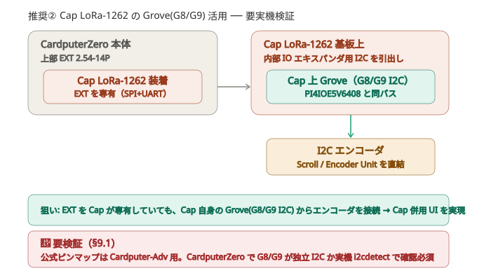

# HANDOFF: CardputerZero 開発ガイド

> **作成日**: 2026-05-24 / **最終更新**: 2026-06-19（UI入力デバイス検討の追記）  
> **対象デバイス**: M5Stack CardputerZero (Raspberry Pi CM0 搭載)  
> **開発者**: 総司 (osprey74)  
> **開発方針**: Spec-Driven / Claude Code + czdev ワークフロー  
> **リポジトリ予定**: `osprey74/cardputerzero-apps`

| 更新日 | 変更内容 |
|--------|----------|
| 2026-05-24 | 初版作成 |
| 2026-05-27 | KS 開始確認・§2.5 Tailscale 連携・§2.6 日本語入力 追記 |
| 2026-05-27 | Cap B (Hacker Cap: CC1101+NFC) 詳細仕様追記・App 03/04 更新・App 08/09 追加 |
| 2026-05-27 | 公式ドキュメント確認・Cap B ピンマップ確定・App 10 (SDR 広帯域受信) 追加・TODO 更新 |
| 2026-05-27 | App 10: RTL-SDR V4 USB-C 専用ドライバ手順・トラブルシューティング追記 |
| 2026-05-27 | App 11 (LAN 調査ツール) 追加・法令テーブル・CLAUDE.md 更新 |
| 2026-06-06 | App 12 (汎用電波受信アプリ) 追加 |
| 2026-06-07 | AppStore URL 確定（CardputerZeroRepository）・Cap LoRa-1262 技適メモ・C6L ゲートウェイ・App02 LoRa 構成・App05 二系統受信に再設計・MSYS2 Windows 対応・HANDOFF2 統合 |
| 2026-06-07 | App 12 を App 10 の「自作統合モニターモード」として吸収（重複解消） |
| 2026-06-07 | 入力デバイス拡張（Scroll Unit / Chain Encoder）追記・App 10 物理 UI 拡張サブセクション追加 |
| 2026-06-07 | App 01 に Sky Plot（天球図）表示仕様を追加（LCD 分割ビュー + HDMI フルスクリーン） |
| 2026-06-07 | `shared/input_encoder/` 共通入力ドライバを新設（App01 / App10 / App11 で共有） |
| 2026-06-07 | Scroll Unit を仕様から外し Chain Encoder 一本化・App 11 に Chain Encoder 連携機能を追加 |
| 2026-06-07 | §10 購入リスト・見積もり、§11 Phase ロードマップ を新設 |
| 2026-06-11 | App 13 (テスター) 追加・INA226-10A (絶縁型±10A) + PaHUB v2.1 構成確定・Chain Encoder 経路を Grove → 2.54mm UART ヘッダに変更・結線図 (ポンチ画) 追記・`shared/ina226/` 新設・§10 購入リスト・§11 Phase 1.5 更新 |
| 2026-06-11 | App 13 「接続パターン」サブセクション追記（内部構造図 + パターン 1: 直列挿入 / パターン 2: 電圧プローブ / パターン 3: 導通チェック）・機能一覧をパターン別に再構成・§9.1 に端子物理ラベル確認・IN 浮き挙動・1kΩ 治具製作 TODO 追加 |
| 2026-06-11 | INA226-10A 公式回路図 V0.3 確認反映: 内部構造図を実回路（B0505S + ADuM1250 + PTC ヒューズ + R10 + 5mΩ shunt）に差替・**端子トポロジを 4 端子（IN+/IN-/OUT+/OUT-）→ 3 端子 + NC（PIN1=NC / PIN2=+V_IN / PIN3=GND / PIN4=+V_OUT）に訂正**・接続パターン 3 つを新トポロジに更新・§8 に回路図 PDF/PNG・INA226 データシート URL 追加 |
| 2026-06-11 | §1.2 に「Grove (HY2.0-4P) 配色規約」サブセクション追加: M5Stack 全製品共通の配色（黒=GND / 赤=5V / 黄=SDA or RX or IO1 / 白=SCL or TX or IO2）を Port A/B/C モード別表で整理、PaHUB CH1～5 増設時の配線ガイドとして記録 |
| 2026-06-11 | **INA226-10A 実機写真確認による端子トポロジ最終確定**: 「3 機能 + 1 NC」誤読を訂正し、**4 端子すべて機能（PIN1=INPUT + / PIN2=INPUT - / PIN3=OUTPUT - / PIN4=OUTPUT +）**に修正。I2C 絶縁チップを **CA-IS3020S**（Chipanalog 製、実機裏面ブロック図にて確認）に訂正。§9 に「情報源の優先順位ポリシー」§9.0 を新設し、今後は実機写真・テスタ計測を最優先とすることを明文化 |
| 2026-06-11 | App 13 PoC 整備: 事前検証用 Python スクリプト [`apps/tester/tests/ina226_terminal_check.py`](apps/tester/tests/ina226_terminal_check.py) を新規作成（PaHUB CH0 選択 + INA226 初期化 + V/I/P 連続読み出し + Mfg ID/Die ID 検証）。§3 App 13 に「動作確認手順」サブセクション追加（4 ステップでの段階的検証手順を明記）。§11 Phase 1.5 完了基準を 3 条件に細分化 |
| 2026-06-13 | App 13 INA226-10A の VH3.96-4P 端子台を**着脱式（プラガブル）ネジ式 cage clamp** タイプと確定（総司確認）。§3 App 13 ユニット仕様表・§9.1 確認済み項目・§10 購入リストに反映。1kΩ 治具製作要件に**用途別端子台モジュール化**運用案を追加 |
| 2026-06-13 | App 13 §3 接続パターンに「**プラガブル端子台によるモジュール運用**」「**結線の本質理解（補足解説）**」サブセクションを追加。INA226 ハイサイド方式の概念、INPUT/OUTPUT 端子名の意味、VBUS ピンが shunt 出力側にあるためパターン 2 が OUTPUT 側受けとなる根拠、信号線を経由させない原則を明文化 |
| 2026-06-13 | **EXT 2.54-14P ヘッダの完全ピンマップを §1.2 に追加**（公式ドキュメント画像より確定）。Pin 4=GND, Pin 6=5V OUT, Pin 8=G2/SDA, Pin 10=G3/SCL, Pin 12=G15/RX, Pin 14=G14/TX。§3 App 13 パターン 3 の給電経路を Pin 6 / Pin 4 として確定。§9.1 関連 TODO を確認済み (`[x]`) に移行。§8 関連リンクに公式ドキュメント URL を追記 |
| 2026-06-13 | **App 14 (QR コードリーダー / アナライザー `qr-toolkit`) 追加**。標準版搭載 IMX219 8MP CSI カメラ + `picamera2` + `pyzbar` + Google Safe Browsing API 構成。総司様作 QR 構造学習ウェブアプリ [osprey74.com/qr-anatomy.html](https://osprey74.com/qr-anatomy.html) をネイティブ移植する「ナレッジモード」（バージョン・モジュール数・ECC・8 種マスクパターン・データ領域可視化）を仕様化 |
| 2026-06-13 | **App 15 (非接触温度計 `ncir-thermometer`) 追加**。M5Stack NCIR Unit (Melexis MLX90614 / Grove I2C) を PaHUB v2.1 CH1 経由で接続。業務（機材点検 / CPU・GPU サーマル）と個人（料理補助）の 3 用途に絞ったプリセット温度・閾値判定・ログ機能を仕様化。`shared/mlx90614/` 共通ドライバ新設 |
| 2026-06-13 | **App 10 に BCL ログモード（UpNote 連携）追加**。総司様が RTL-SDR V4 + 15m ロングワイヤーで短波放送受信を開始（最初の特定局: ラジオ NIKKEI 第1）。UpNote 公式 API は不在のため、`x-callback-url` URL スキーム経由で Tailscale 接続中の Mac Mini で `open` コマンドを実行し UpNote.app に `BCL_LogBook` ノートブックへの自動投稿を実現。オフライン耐性のため microSD への一旦保存 → 接続復帰時の一括同期方式を採用。既知局データベース (`data/bcl_stations.yaml`) を内蔵 |
| 2026-06-13 | **BCL ログモードの確定値を反映**: BCL_LogBook の `notebookId` = `019ecfdf-7134-7428-aa52-4aa6eaa18d3f`、Mac Mini Tailscale 固定 IP = `100.108.134.69`、初回受信ノート（ラジオ NIKKEI 第1）の `noteId` = `019ecfe3-f686-7612-93d0-3685b7e9057d`。設定ファイル `~/.config/cardputerzero/bcl_config.yaml` の構造を仕様化。Python サンプルに MagicDNS フォールバックロジック (`resolve_ssh_target()`) を追加 |
| 2026-06-13 | **BCL ログモードの実機検証 4 回で UpNote x-callback-url 仕様を確定**: (1) `note/new` の正しいパラメータは **`notebook`（名前指定）** であり `notebookId` ではない、(2) `tag` パラメータは公式ドキュメント未記載だが**実機で必須**、(3) **`tag` は URL 末尾に配置**しないと title/text が文字化け、(4) 本文中の `#BCL` のみではタグ自動認識されない、(5) 連続投稿時の確認ダイアログなし。Python サンプルを `list of tuples` 版に刷新 |
| 2026-06-13 | **BCL ログモードの全仕様確定（運用方針 A〜⑤ 全パラメータ決定）**: 1 受信 1 ノート方式・案 ③（録音は Mac Mini に scp 転送して永続保存・CZ 側削除）・アンテナはプリセット選択方式・SFI は NOAA SWPC から 1 時間キャッシュ・App 01 GPS 連携で受信地点座標取得。Markdown テンプレート最終確定（機材 + 受信記録 + 録音ファイル Mac Mini パス記載）。既知局 DB 初期 15 局（日本短波・北海道中波・国際短波局）登録。UI フロー設計確定（ノブA でフロー進行、ノブB で SINPO 値） |
| 2026-06-13 | **App 13 パターン 3 給電経路を EXT Pin 4/6 → PaHUB CH5 に変更**（総司様ご指摘より）。当初設計では EXT 2.54-14P の Pin 4 (GND) / Pin 6 (5V OUT) から端子台 C への給電を想定していたが、これらは Chain Encoder #1 の電源ピンとして占有されており物理的にバッティングするため、PaHUB v2.1 の空きチャネル CH5 から Grove ケーブル経由で 5V/GND を取り出す方式に変更。結線図ポンチ画・配線サマリー表・パターン 3 結線図・用途別端子台モジュール表を更新。§9.1 に「PaHUB の電源スルー配線確認」TODO を追加 |
| 2026-06-13 | **PaHUB v2.1 の電源スルー配線を公式回路図で確認・確定**。[公式回路図 PNG](https://static-cdn.m5stack.com/resource/docs/products/unit/Unit-PaHub2.1/img-103440a9-d7e4-4aab-b784-825aa9b35614.png) を直接読解し、各 Grove 出力ポート J1〜J6 の VCC/GND が全 CH 共通バスとしてスルー配線されていること、入力 J7 の 5V がそのまま CH0〜CH5 の Pin 3 へ届くことを確認。HT7533 LDO で生成される 3.3V は PCA9548A 内部 + SDA/SCL プルアップ専用で Grove ポートには出力されない。§9.1 該当 TODO を ✅ 確認済みに移行。§8 に PaHUB 公式ドキュメント・回路図 PNG・PCA9548A データシート URL を追加。App 13 パターン 3 結線図の注記から「※要実機確認」を確定情報に格上げ |
| 2026-06-19 | **【重大訂正】Cap と Chain Encoder の同時併用は不可能であることが公式ピンマップ照合で判明**。3 点の公式ドキュメント（[CardputerZero](https://docs.m5stack.com/ja/CardputerZero) / [Cap LoRa-1262](https://docs.m5stack.com/en/cap/Cap_LoRa-1262) / [Cap CC1101](https://docs.m5stack.com/en/cap/Cap_CC1101)）を直接読解した結果、従来「上部 Cap スロット」と「2.54mm UART ヘッダ（EXT 2.54-14P）」を**別ポートとして扱っていたのは誤り**であり、両者は**同一の 14 ピン物理バス（= Cap-Bus = EXT 2.54-14P）**であることが確定。Cap 装着時はこのバスの全ピン（SPI/UART/I2C/電源）が Cap に占有されるため、同じ Pin 12/14（G15/G14 = UART）を使う Chain Encoder と**物理的に共存できない**。特に Cap LoRa-1262 は GPS が G14/G15 UART を使用し Chain Encoder と完全衝突。§1.2〜1.4 を全面改訂し「Cap-Bus = EXT 同一」「Cap 常駐時 Chain Encoder 併用不可」を明記。§1.4 早見表の CC1101 受信感度・アンテナ等を公式値に訂正。代替案（Grove UART / キーボード操作 / I2C エンコーダ）を §1.5 として新設。Chain Encoder を前提とする App01/10/11 の物理 UI 記述に「Cap 非装着時のみ」の条件を付記。§9.1 に回路図 PDF での Grove/EXT UART 排他確認 TODO を追加（総司様ご指摘より） |
| 2026-06-19 | **App13 導通チェックの 5V 取得を CoreS3 Port B（黒・Grove 電源ライン）から行う構成を追加**。公式マニュアルで CoreS3 の Port A/B/C が GND/5V/GPIO 結線と確認（Grove は全ポート共通で 5V/GND を持つ）。Port B のデータピン（G8/G9）を使わず**電源ライン 5V/GND のみを App13 パターン 3（端子台 C）の給電に流用**できる。これにより PaHUB CH5 からの 5V 取得（直結方式の名残）が不要になり、App13 が CoreS3 完結型に。§1.6.1 の接続表・構成図・ポイント整理、App13 パターン 3 配線・端子台 C モジュール表を更新（第一推奨=CoreS3 Port B / 代替=PaHUB CH5）。⚠️ Port B 5V は常時出力の電源ライン（GPIO 制御不可）・供給電流上限は実機確認・DUT が CoreS3 電源系と導通する点に注意 |
| 2026-06-19 | **HANDOFF 全体査読し「CoreS3 併用案＝第一推奨」で齟齬を解消**。方針決定（CoreS3 フロントエンド方式を第一推奨／直結方式は代替・旧案として残す）に基づき以下を修正: §1.6 冒頭にアーキテクチャ方針バナーを追加／§1.5 を「直結方式（代替/旧案）の運用方針」と位置づけ明記／App10 物理 UI に CoreS3 経由（第一推奨）と EXT 直結（代替）の 2 構成を併記／App13 に接続方式の方針注記を追加し PaHUB・端子台系を「直結方式の参照情報」と明記／App01 衛星リスト送りを「CoreS3 経由なら Cap A 使用でも可」に更新／`shared/` ツリーに `cores3_bridge/` を追加し input_encoder・ina226 を 2 バックエンド化（CoreS3 経由＝第一推奨 / 直結＝代替）／CLAUDE.md のデバイス接続・制約・共有ドライバを更新／§9.4 ドライバ API 設計を多バックエンド化／購入リストに CoreS3・データ専用ケーブルを追加し PaHUB・変換ハーネスを「直結方式の場合のみ」と注記／Phase 1.5 を CoreS3 経由優先に改訂し Phase 1.55（CoreS3 連携確立）を新設／Cap B 表記を公式名「Cap CC1101」に統一 |

---

## 1. ハードウェア概要

### 1.1 本体スペック

| 項目 | 仕様 |
|------|------|
| SoC | Broadcom BCM2837 (Raspberry Pi CM0) |
| CPU | Quad-core Cortex-A53 @ 1GHz |
| GPU | VideoCore-IV @ 400MHz |
| RAM | 512MB LPDDR2 |
| ストレージ | microSD (標準版: 32GB 付属) |
| ディスプレイ | 1.9" LCD ST7789V2 (320×170) |
| キーボード | 46キー マトリクス |
| バッテリー | 3.7V 1500mAh Li-Po |
| Wi-Fi | 2.4GHz 802.11 b/g/n |
| Bluetooth | 4.2 / BLE |
| 有線LAN | 10/100M Ethernet |
| USB | USB-C × 2 (Host/Slave 切替) + USB-A × 1 |
| カメラ (標準版) | Sony IMX219 8MP (CSI) |
| IMU (標準版) | Bosch BMI270 6軸 |
| RTC | Epson RX8130CE |
| HDMI | 最大 1080p30 出力 |
| サイズ | 85 × 54mm (クレジットカードサイズ) |

### 1.2 拡張インターフェース

| ポート | 仕様 | 主な用途 |
|--------|------|----------|
| Grove (HY2.0-4P) | I2C / UART 切替（内蔵電子スイッチ・既定は UART） | GNSS, センサー類 |
| **EXT 2.54-14P（= Cap-Bus）** | **2.54mm 2 列 14 ピンヘッダ（本体上部）** | **SPI / I2C / UART / USB / GPIO / 5V / GND をすべて集約。Cap モジュールはここに装着される** |
| CSI | カメラコネクタ | IMX219 |

> 🔴 **最重要（2026-06-19 訂正）**: **「上部 Cap スロット」と「EXT 2.54-14P（2.54mm UART ヘッダ）」は同一の物理ヘッダ**である。
> 公式ドキュメントでは Cap モジュールの接続バスを **「Cap-Bus」** と呼ぶが、これは本体側の **EXT 2.54-14P** そのものを指す。
> したがって **Cap（A/B）を装着すると EXT 2.54-14P の 14 ピンは Cap に占有され、同じヘッダに依存する Chain Encoder とは併用できない**（詳細は §1.3・§1.5）。

#### EXT 2.54-14P（Cap-Bus）ピンマップ（公式ドキュメントより確定・2026-06-19 訂正）

本体上部の 2.54mm 2 列 14 ピンヘッダ。SPI/I2C/UART/USB/電源すべてが集約されており、
**Cap モジュールはこのヘッダに装着される（Cap-Bus）**。Cap 非装着時は App 13 (テスター) 等で
本ヘッダから 5V 給電・GND・I2C・UART を取り出せる。

| Pin | 信号 | 主な用途 / 備考 |
| --- | --- | --- |
| 1 | HAT_P0 (USB4_D_P / G26) | USB / GPIO 切替（既定 GPIO26） |
| **2** | **5V IN** | 外部給電入力 |
| 3 | HAT_P1 (USB4_D_N / G23) | USB / GPIO 切替（既定 GPIO23） |
| **4** | **GND** | グランド |
| 5 | G22 | GPIO |
| **6** | **5V OUT** | 5V 出力 |
| 7 | G11 / SPI0_CLK | SPI クロック |
| 8 | **G2 / SDA** | **I2C データ**（I2C1_SDA） |
| 9 | G10 / SPI0_MOSI | SPI MOSI |
| 10 | **G3 / SCL** | **I2C クロック**（I2C1_SCL） |
| 11 | G9 / SPI0_MISO | SPI MISO |
| 12 | **G15 / UART_RXD** | **UART 受信**（Cap LoRa-1262 では GPS-TX が接続。Chain Encoder の入力と競合） |
| 13 | G7 / SPI0_CS1 | SPI チップセレクト |
| 14 | **G14 / UART_TXD** | **UART 送信**（Cap LoRa-1262 では GPS-RX が接続。Chain Encoder の出力と競合） |

- ピン番号は左から「上段 → 下段 → 上段 → 下段 …」の交互順
- Pin 1/3（HAT_P0/P1）は `M5IOE1` の `PYG1_HAT_SW` で USB Hub(USB4) / GPIO を切替（既定 GPIO）
- ⚠️ **Pin 12/14（G15/G14 UART）は Cap LoRa-1262 の GPS UART と同一**。Cap 装着時はこの UART が Cap に占有される
- 出典: [CardputerZero 公式ドキュメント (M5Stack 公式)](https://docs.m5stack.com/ja/CardputerZero)
- ヘッダ近傍には microSD スロット（Raspberry Pi OS 書き込み済み標準版）が配置

#### Grove (HY2.0-4P) 配色規約

M5Stack の Grove ケーブル配色は**全製品共通の規約**として固定されており、
PaHUB v2.1 経由で複数センサーを増設する際も配線ミスが起きにくい。
モード（Port A / B / C）により黄/白ピンの信号意味のみが変わる:

| ピン | 色 | Port A (I2C) | Port C (UART) | Port B (ADC/IO) |
|------|----|-------------|--------------|----------------|
| 1 | **黒** | GND | GND | GND |
| 2 | **赤** | 5V | 5V | 5V |
| 3 | **黄** | SDA | RX | IO1 / ADC |
| 4 | **白** | SCL | TX | IO2 / ADC |

- 黒=GND・赤=5V は**全モード共通**（配線ミス時の安全性を確保）
- 黄/白の信号線の意味のみがモードで変化
- INA226-10A（App 13）/ PaHUB v2.1 / Chain Encoder はすべて HY2.0-4P コネクタを採用
  - INA226-10A・PaHUB は **Port A (I2C)** モード
  - Chain Encoder は **Port C (UART)** モード（→ EXT 2.54-14P の Pin 12/14 経由で接続。**Cap 非装着時のみ利用可** — §1.5 参照）
- 将来 PaHUB CH1～5 にセンサー増設する際も、Port A 系統センサーであれば Grove ケーブルそのままで接続可能

### 1.3 装着確認済みモジュール

| モジュール | 接続方式 | 確認方法 |
|------------|----------|----------|
| **Cap A**: Cap LoRa-1262 (SX1262 + ATGM336H-6N@AT6668) | **EXT 2.54-14P（Cap-Bus）に装着** | ✅ [公式ドキュメント](https://docs.m5stack.com/en/cap/Cap_LoRa-1262)でピンマップ確認 / ⚠️ 技適番号は実機到着後に要確認 |
| **Cap B**: Cap CC1101 (CC1101 + ST25R3916 NFC) | **EXT 2.54-14P（Cap-Bus）に装着** | ✅ [公式ドキュメント](https://docs.m5stack.com/en/cap/Cap_CC1101)でピンマップ確認 / ⚠️ CC1101 技適は実機到着後に要確認 |
| Grove センサー 100+種 | Grove HY2.0-4P | ✅ 互換 |

> 🔴 **Cap-Bus 占有制約（2026-06-19 全面訂正・総司様ご指摘より）**
>
> 1. **Cap A と Cap B は同一の EXT 2.54-14P（Cap-Bus）を使う**ため、従来どおり**同時装着は不可**（用途に応じて付け替え運用）。
> 2. **【新たに判明】Cap 装着時は Chain Encoder と併用できない**。Chain Encoder は EXT 2.54-14P の Pin 12/14（G15/G14 = UART）を使うが、**Cap も同じ 14 ピンバスを占有**するため物理的に衝突する。
>    - 特に **Cap LoRa-1262 は GPS(AT6668) が G14/G15 の UART を使用**しており、Chain Encoder の UART と**完全に同一ピン**。回避不能の衝突。
>    - Cap CC1101 も同バスの SPI/制御ピンを占有するため、同様に Chain Encoder と共存不可。
> 3. 従来 HANDOFF では「上部 Cap スロット」と「2.54mm UART ヘッダ」を別ポートと誤認していた。**両者は同一ヘッダ**であり、この前提は撤回する。
>
> → **対処方針は §1.5「Cap と入力デバイスの排他関係・代替案」を参照**。

#### 公式ピンマップ照合の根拠（2026-06-19）

| 観点 | CardputerZero 本体 EXT 2.54-14P | Cap LoRa-1262 Cap-Bus | Cap CC1101 Cap-Bus |
|------|-------------------------------|----------------------|--------------------|
| Pin 12 (G15) | UART_RXD | GPS_TX | （SPI/NFC 制御に割当） |
| Pin 14 (G14) | UART_TXD | GPS_RX | （SPI/NFC 制御に割当） |
| SPI (Pin 7/9/11/13) | SPI0 CLK/MOSI/MISO/CS | LoRa SX1262 の SPI | CC1101 + ST25R3916 の SPI |

- いずれも**同一 14 ピンバス**を共有しており、Cap 装着で全ピンが Cap 機能に割り当てられる
- 出典: [CardputerZero](https://docs.m5stack.com/ja/CardputerZero) / [Cap LoRa-1262 PinMap](https://docs.m5stack.com/en/cap/Cap_LoRa-1262) / [Cap CC1101 PinMap](https://docs.m5stack.com/en/cap/Cap_CC1101)

#### 関連デバイス（自宅 LoRa ゲートウェイ用）

| デバイス | 役割 | 主な仕様 |
|----------|------|----------|
| [M5Stack C6L Meshtastic Unit](https://www.switch-science.com/products/10809) | 自宅 LoRa ゲートウェイ（App02 §家側） | SX1262 + ESP32-C6 / Wi-Fi 6 (2.4GHz) / Meshtastic 対応 / USB-C 給電 / ¥4,290 |

- CardputerZero の Cap LoRa-1262 と**同一の SX1262** を搭載しているため LoRa レイヤで完全互換
- Wi-Fi 内蔵のため**デスクトップ PC への接続は必須ではない**。USB 充電器に挿すだけで MQTT ⇔ LoRa ブリッジとして稼働可能（構成A）
- 必要なら USB Serial 経由で PC からカスタム制御も可能（構成B、§3 App02 参照）
- ⚠️ 技適番号は Cap LoRa-1262 と同様、実機購入後にラベル確認 → 総務省データベース照合が必要

#### 関連デバイス（入力デバイス拡張）

App 10（SDR 受信機）の周波数選択、その他 LCD 上での一覧スクロールやズーム操作に
利用するロータリーエンコーダモジュール。

| デバイス | 役割 | 主な仕様 |
|----------|------|----------|
| [M5Stack Chain Encoder](https://www.switch-science.com/collections/m5stack/products/10919) | 多ノブ入力（採用）| UART デイジーチェーン (2× HY2.0-4P) / STM32G031 内蔵 / AB 相 / ノブ押下検知 / WS2812 RGB / ¥1,122 |

- **エンコーダ方式**: AB 相**増分（incremental）エンコーダ**で、機械的なストッパーがなく**物理的には無限回転**する。回転検出はソフトウェア側でパルスを積算する方式
- **採用構成**: **Chain Encoder × 2 個デイジーチェーン**（ノブA = 周波数粗調整 / ノブB = 周波数微調整 or ゲイン）。UART 1 系統だけで多ノブ運用が可能
- **接続経路**: 本体の **EXT 2.54-14P（Cap-Bus）の Pin 12/14（G15/G14 = UART）**に接続。HY2.0-4P コネクタは Grove ケーブルを切断改造、もしくはピンソケット変換アダプタで配線
- 🔴 **Cap との排他制約（2026-06-19 訂正）**: Chain Encoder が使う EXT の UART ピンは **Cap-Bus と同一**である。**Cap（A/B）を装着するアプリ（App01/02/03/04/05/08/09 等）では Chain Encoder を併用できない**。Chain Encoder を前提とする物理 UI は **Cap 非装着のアプリ（App10 SDR / App11 LAN Scanner / App13 テスター 等）でのみ有効**。代替案は §1.5 を参照
- **他アプリへの転用**: App 10（SDR 受信機: 周波数選択）、App 11（LAN Scanner: ホストリスト送り）等、**Cap を使わない LCD 一覧操作**にも利用
- **設計指針**: アプリ側は `shared/input_encoder/` 共通ドライバ経由で抽象 API（`RotateDelta` / `ButtonPress` / `LedSet`）を扱う。Cap 使用アプリでは本ドライバを無効化し、キーボード操作にフォールバックする

#### Cap LoRa-1262 技適状況メモ（2026-06-07 時点）

| 情報源 | 技適番号 | 最大出力（仕様） | 備考 |
|--------|----------|------------------|------|
| [M5Stack 公式 docs (ja)](https://docs.m5stack.com/ja/cap/Cap_LoRa-1262) | 記載なし | +22dBm | 製品スペック上の最大値 |
| [スイッチサイエンス販売ページ](https://www.switch-science.com/products/10940) | 記載なし | 22dBm | 国内代理店扱い |
| [個人ブログ (note.com / moridenki_note)](https://note.com/moridenki_note/n/n6de42aa276b1) | 番号なし | — | 「技適も通っている」との記述のみ（補助情報） |

**確実性**: 一次情報源には技適番号の明記なし。国内代理店で販売されている事実は技適取得の可能性を示唆するが証明ではない（送信機能を使わなければ技適不要で販売可能のため）。

**実機到着後の確認手順**:

1. モジュール本体・パッケージの技適マーク・番号表記を目視確認
2. 番号を [総務省 電波利用ホームページ 技術基準適合証明等を受けた機器の検索](https://www.tele.soumu.go.jp/giteki/SearchServlet) で照合
3. 結果を本ドキュメント §1.3 に追記（技適番号・有効周波数・出力上限）

### 1.4 Cap 構成早見表

| | Cap A: Cap LoRa-1262 | Cap B: Cap CC1101 |
|---|---|---|
| SKU | U214 | U219 |
| 無線チップ | SX1262 (LoRa 専用変調) | CC1101 (汎用 Sub-GHz) |
| 対応周波数 | 868〜923 MHz | 315 / 433 / 868 / 915 MHz |
| 変調方式 | FSK / GFSK / MSK / LoRa / OOK | 2-FSK / 4-FSK / GFSK / MSK / ASK / OOK |
| 送信出力 | 最大 +22 dBm（日本では要技適確認・出力制限要） | 最大 +10 dBm |
| 受信感度 | -147 dBm (LoRa 低速) | 最大 -99.5 dBm |
| 測位チップ | AT6668 GNSS (GPS/QZSS/BD2/BD3/GAL/GLO) | なし |
| NFC チップ | なし | ST25R3916 (13.56 MHz) |
| NFC プロトコル | なし | NFC-A/B (ISO14443A/B) · NFC-F (FeliCa) · NFC-V (ISO15693) |
| NFC 動作モード | なし | R/W · カードエミュレーション (NFC-A/F) |
| NFC 最大読取距離 | なし | 45mm |
| 接続バス | EXT 2.54-14P（Cap-Bus）+ HY2.0-4P(I2C) | EXT 2.54-14P（Cap-Bus）+ Grove |
| RF アンテナ | RP-SMA（LoRa）+ 内蔵セラミック（GPS） | RP-SMA（315/433/868 用ラバーアンテナ 3 本付属） |
| LoRa I/F | SPI | — |
| GPS I/F | UART (115200bps, G14/G15) | — |
| RF I/F | — | SPI |
| 主用途 | GPS ロガー / Meshtastic / BSAF | NFC 解析 / RF スニファー |

> 補足: 旧版で「Hacker Cap」と通称していたモジュールは公式名 **Cap CC1101 (SKU: U219)** である。受信感度・NFC 動作モード等を公式スペックに訂正済み。
> 出典: [Cap LoRa-1262 公式](https://docs.m5stack.com/en/cap/Cap_LoRa-1262) / [Cap CC1101 公式](https://docs.m5stack.com/en/cap/Cap_CC1101)

### 1.5 UI 入力デバイスのアプリ別運用方針（2026-06-19 確定）

> 🟡 **位置づけ（2026-06-19 更新）**: 本節は **CoreS3 を使わない「直結方式」（= 代替/旧案）** における入力デバイスの運用方針を扱う。**第一推奨は §1.6 の CoreS3 フロントエンド方式**であり、そちらでは Cap 装着の有無に関わらず入力系が使えるため、本節の「Cap 装着時は Chain Encoder 不可」等の制約は CoreS3 を使わない場合にのみ当てはまる。CoreS3 を使わない最小構成・暫定運用の参照用として本節を残す。

#### 前提となる物理制約（直結方式の場合）

1. **右側面 HY2.0-4P（Grove）と上部 EXT 2.54-14P（Cap-Bus）は同一信号を共有**する。公式ピンマップ上、UART は両者とも **G14/G15**、I2C は両者とも **G2/G3** であり、本体内蔵の電子スイッチ（`G4_I2C/UART_SW`）で切り替えて引き出している。
   - → **Cap を装着すると上部 EXT が Cap に専有され、同じ信号を引く右側面 Grove も実質的に使えなくなる**。
2. **Chain Encoder は UART デバイス**（STM32G031・UART デイジーチェーン）。直結方式での接続経路は EXT 2.54-14P の Pin 12/14（G14/G15 UART）一択。
3. **第一の判断軸は「I2C の有無」ではなく「Cap を装着するか否か」**。Cap 装着時点で UART 系（Chain Encoder）はどの経路でも使えなくなる（直結方式の場合。CoreS3 経由ならこの制約は無い）。

#### 運用方針マトリクス（確定版・2026-06-19 改訂）

| アプリ分類 | 第一推奨 (CoreS3 経由) | 代替 (直結方式) |
|-----------|------------------------|-----------------|
| **テスター（App13）** | **Chain Encoder ×2**（CoreS3 Port C UART → USB CDC・§1.6.1） | EXT 2.54-14P UART 直結（Cap 非装着時のみ・要 HY2.0 変換ハーネス） |
| **Cap 非装着アプリ（App10 SDR / App11 LAN Scanner）** | **Chain Encoder ×2**（CoreS3 Port C UART → USB CDC） | EXT 2.54-14P UART 直結 |
| **Cap 使用アプリ（App01-05 / 08 / 09）** | **Chain Encoder ×2**（CoreS3 Port C UART → USB CDC） | **キーボード**（Cap が EXT UART を専有するため直結方式での Chain Encoder 不可） |

> 📌 **方針の整理（2026-06-19）**: CoreS3 をフロントエンドにすれば Cap 装着の有無に関わらず Chain Encoder ×2 が全アプリで素直に使えるため、**全アプリ共通の標準入力デバイスを Chain Encoder ×2 (CoreS3 経由) に統一**する。
> 当初検討していた **Scroll Unit ×2 (PaHUB CH1/CH2 分離) 構成** は、CoreS3 経由方式の採用により Cap 装着時の制約が無くなったため不要となり、不採用とした（経緯は本節末尾「検討したが不採用」表に追記）。

#### ポート占有図 + PaHUB チャネル割当


本体は **EXT（UART/SPI・上部・Cap 装着口）** と **Grove（I2C・右側面・PaHUB 接続口）** の 2 系統。Grove → PaHUB v2.1（0x70）で I2C を 6ch に分岐し、各チャネルへ機器を割り当てる。

| CH | 割当 | 用途 |
|----|------|------|
| CH0 | INA226-10A（要実機アドレス確認） | 電流/電圧測定（App13 テスター・直結方式時のみ） |
| CH1 | MLX90614（NCIR・0x5A） | 非接触温度測定（App15・直結方式時のみ） |
| CH2 | 予備 | 将来 I2C センサ拡張 |
| CH3 | 予備 | 将来 I2C センサ拡張 |
| CH4 | 予備 | 将来 I2C センサ拡張 |
| CH5 | 5V/GND 給電 | App13 パターン3 給電取出し（直結方式時のみ） |

> ℹ️ **PaHUB の位置づけ（2026-06-19 更新）**: 上記割当は **直結方式（代替/旧案）** 専用。第一推奨の **CoreS3 経由方式**では、INA226 と MLX90614 を CoreS3 Port A の I2C バスに **Hub Unit (U006)** で 1→3 分岐して同居させるため PaHUB は不要（両者の I2C アドレスが 0x40-0x4F と 0x5A で衝突しないため MUX が不要・§1.6.1 参照）。
> 旧 CH1/CH2 への Scroll Unit 割当（粗・微 2 ノブ構成）は CoreS3 経由 Chain Encoder ×2 に置換され不採用となった。

#### Cap 使用アプリで多ノブ操作を実現する代替策（優先度順）

**【推奨①】I2C 接続エンコーダを使う（本命だが前提に重要な訂正あり）**

> 🔴 **回路図確認による前提訂正（2026-06-19）**: 当初「Cap が占有するのは UART/SPI のみで I2C は独立」と記載していたが、**公式回路図で否定された**。実際は次のとおり。
> - CardputerZero の **Grove(I2C) と HAT Port(EXT/Cap-Bus) の I2C は同一の I2C1 バス（G2=SDA / G3=SCL）**。Grove の電子スイッチ（GROVE_SW: L=UART / H=I2C1）は Grove ポートのモード切替であり、別バスを作るものではない。
> - **Cap LoRa-1262 は装着時にこの I2C1 を内部で使用する**（GPS モジュール GP-02 の SCL/SDA、IO エキスパンダ PI4IOE5V6408 の SCL/SDA が I2C1 にぶら下がる）。
> - したがって I2C エンコーダ／PaHUB／後述の CoreS3 は、いずれも**「独立 I2C」ではなく「Cap が使用中の I2C1 バスへの相乗り」**になる。

成立条件は **(1) 追加デバイスの I2C アドレスが Cap 内部デバイス（GP-02 / PI4IOE5V6408）と衝突しないこと**、**(2) 共有バスのプルアップ合成値・容量・タイミングが安定範囲に収まること**。これらを満たせば、Cap 装着のまま I2C エンコーダを相乗りできる。PaHUB を噛ませると、PaHUB 自身（0x70）が I2C1 上の 1 デバイスとなり、その配下は別チャネルに分離できるため、**アドレス衝突回避の観点では PaHUB 経由が安全**。

| ユニット | SKU | I2C アドレス | 分解能 / 形状 | アドレス変更 | 備考 |
|----------|-----|-------------|----------------|:---:|------|
| Unit 8Encoder | U153 | 0x41 | 8 ノブ + トグル + 8×RGB | 可 | 5V→3.3V DC-DC 内蔵。多ノブ用途の最有力 |
| Unit Encoder | U135 | 0x40 | 30 ポジション + ボタン + 2×RGB | 不可 | Chain Encoder 同等のノブ型 |
| Unit Scroll | U186 | 0x40 | 12 パルス/回転 ホイール + ボタン + RGB | 不可 | スクロール/一覧送りに好適 |
| Unit ExtEncoder | U161 | 0x59 | 外部エンコーダ依存（AB/ABZ） | 可 | 高級エンコーダを自前接続 |

> ⚠️ **アドレス衝突注意**: Unit Encoder と Unit Scroll はともに **0x40 固定**。同時使用や同一バス上の他 0x40 機器がある場合は、必ず **PaHUB の別チャネル**に分離する。複数同時運用なら 8Encoder(0x41)/ExtEncoder(0x59) が無難。INA226-10A の実アドレスは実機 `i2cdetect` で要確認。

**【推奨②・要検証】Cap LoRa-1262 の Grove(G8/G9 I2C) を活用**

[Cap LoRa-1262 公式ピンマップ](https://docs.m5stack.com/en/cap/Cap_LoRa-1262)によれば、本 Cap は内部 IO エキスパンダ（PI4IOE5V6408）用の **I2C(SDA=G8 / SCL=G9)** を **HY2.0-4P ポートとして外部に引き出している**。

- もしこの G8/G9 I2C が CardputerZero 上で独立 I2C として機能するなら、**Cap LoRa-1262 を装着したまま Cap 上の Grove に I2C エンコーダを直結**できる（App01 GPS ロガー等で多ノブ UI が可能に）。
- 🔴 **ただし当該ピンマップは Cardputer-Adv（ESP32-S3 機）用**。CardputerZero（CM0 機）では G8/G9 が LCD-CS / SPI0-MISO 等に割当られている可能性があり、**動作保証なし → §9.1 で実機検証必須**。
- PI4IOE5V6408 の I2C アドレスとエンコーダ(0x40)の衝突有無も要確認。
- **Cap CC1101 の Grove は I2C ピンアサインが公式非公開**のため、現時点では設計に組み込めない（公式問い合わせ TODO）。



**【代替③】USB-UART 変換で独立 UART を増設（Chain Encoder 資産を活かす場合）**

Chain Encoder（UART）を Cap 併用のまま使いたい場合は、本体 USB(Host) に **USB-シリアル(TTL)変換器**を挿し、`/dev/ttyUSB0` 等の独立 UART を生やす。

- 変換器候補: CP2102 / CH340 / FT232 系モジュール、または純正 **ESP32 Downloader Kit (A105, CP2104/CH9102)**
- ⚠️ **3.3V ロジック**を厳守（STM32G031 は 3.3V 系。5V 直結は損傷リスク）。TX/RX はクロス結線
- ⚠️ USB は **Host モード固定**が前提（Slave 時は左 USB・HAT USB・Ethernet が無効）
- ソフトは `shared/input_encoder/` の接続先を `/dev/ttyAMA0`（内蔵）→ `/dev/ttyUSB0`（変換器）に変えるだけで流用可

**【代替④】キーボード操作（追加ハード不要・確実）**

CardputerZero 内蔵の 46 キーマトリクスキーボードで周波数調整・一覧送りを代替。確実に動作する最終フォールバック。

#### 検討したが不採用の選択肢（参考記録）

| 製品 | 機能 | 不採用理由 |
|------|------|-----------|
| Grove Converter (U208) | 2→1 受動結合 + USB 給電 | 信号パススルーのみ。USB-UART 変換機能なし。9.8mm 間隔制約あり |
| USB TypeC2Grove | USB→5V 給電のみ | データ通信不可。給電補助にしか使えない |
| Scroll Unit ×2 構成（PaHUB CH1/CH2 分離） | I2C 0x40 ホイール ×2 を粗・微 2 ノブとして使う | CoreS3 経由 Chain Encoder ×2（§1.6.1）が第一推奨に格上げされ、Cap 装着時の制約が解消したため不要となった（2026-06-19 撤回）。直結方式時のフォールバックとしても CoreS3 不使用なら Chain Encoder ×2 を EXT 直結すれば足りる |
| Grove T (U039-B) | 1→2 受動 Y 分岐 | 新規通信経路を作らない。同一信号を分けるだけ |
| PaHUB v2.1 | I2C 1→6ch MUX | （これは採用。ただし I2C アドレス衝突回避用であり UART 増設はできない） |

> ⚠️ いずれの推奨策も実機・回路図での裏取りが必要。現時点で**追加ハード無しで確実に動くのはキーボード操作のみ**。
> Grove(UART) と EXT(UART) の排他/独立、および Cap LoRa-1262 の G8/G9 I2C の CardputerZero での可否は、[CardputerZero 回路図 V0.3 PDF](https://m5stack-doc.oss-cn-shenzhen.aliyuncs.com/1243/C154-CardputerZERO_SCHE_PRJ_V0.3_20260430.pdf) の `G4_I2C/UART_SW` 結線確認と実機 `i2cdetect` で確定する。

---

### 1.6 CoreS3 併用構成（フロントエンド/サブシステム連携）

> 🟢 **アーキテクチャ方針（2026-06-19 決定）**: 入力・計測デバイス（Chain Encoder / INA226 等）は **CoreS3 をフロントエンドにして接続し、USB 経由で CardputerZero へ流す方式を第一推奨**とする。これにより Cap 装着の有無に関わらず入力系が使え、CardputerZero の EXT/Grove も消費しない。
> 従来の「Chain Encoder を CardputerZero の EXT UART に直結」「INA226 を PaHUB(Grove I2C) 経由で CardputerZero に直結」という**直結方式は「代替/旧案」として残す**（CoreS3 を使わない最小構成や、CoreS3 到着前の暫定運用向け）。直結方式には Cap 非装着時のみ・配線改造が必要等の制約があるため、§1.5 の各記述には「直結方式の場合」という条件が付く点に注意。

CardputerZero（Raspberry Pi CM0 = Linux 機）と **M5Stack CoreS3（ESP32-S3 マイコン + タッチ液晶）** を併用し、CoreS3 を「入力・センサ・表示のフロントエンド」、CardputerZero を「処理・ネットワーク・集約のバックエンド」として役割分担する構成。CoreS3 が UART/I2C ユニットを受け、整形した値を CardputerZero へ流し込む。

#### CoreS3 ポート割当（公式確定 2026-06-19）

| ポート | 色 | 機能 | GPIO | 排他関係 |
|--------|----|------|------|----------|
| Port A | 赤 | I2C | SDA=G2 / SCL=G1 | 独立（Port B/C と同時使用可） |
| Port B | 黒 | GPIO/ADC・DAC | G8 / G9 | 独立 |
| Port C | 青 | UART | RX=G18 / TX=G17 | 独立 |

> ✅ **CardputerZero との決定的な違い**: CardputerZero の Grove は I2C/UART が同一ピン（G2/G3・G14/G15）で**排他**だったが、**CoreS3 は Port A(I2C)・Port C(UART) が別 GPIO のため同時使用できる**。これが CoreS3 をフロントエンドにする最大の利点。
> 内蔵デバイス（BMI270=0x68 / AXP2101 / AW9523 / BMM150 等）は**別系統の内部 I2C バス**にあり、外部 Port A(G1/G2) とは分離。外部 I2C ユニット追加時のアドレス衝突は原則回避される（最終確認は実機 `i2cdetect`）。
> 出典: [ESPHome CoreS3](https://devices.esphome.io/devices/m5stack-cores3/)（Port A=G2/G1, B=G9/G8, C=G18/G17）／ [M5Stack Community](https://community.m5stack.com/topic/5583/)（実機: GPIO1/2=外部I2C, PC_RX=G18/PC_TX=G17=2nd serial）
>
> 🔬 **実機確定（2026-06-24）**: CoreS3 + INA226 + MLX90614（Hub Unit U006 経由・Port A）を `firmware/cores3-frontend/` のスキャンファームで検証。**Port A の I2C ピン順は `SDA=G2 / SCL=G1`**（ESPHome 記述が正、当初の表記 `SDA=G1/SCL=G2` は誤りだったため訂正）。この順で **INA226=0x41 / MLX90614=0x5A** を検出（アドレス衝突なし・Hub Unit 同居 OK）。逆順では検出ゼロ。

#### 役割分担の考え方

| | CardputerZero (CM0/Linux) | CoreS3 (ESP32-S3) |
|---|---|---|
| 得意 | Python・ネットワーク・デーモン・重い処理 | リアルタイム制御・センサ常時読み・タッチ UI |
| 役割 | バックエンド（集約・クラウド連携・最終処理） | フロントエンド（ユニット受け・前処理・表示） |

#### 連携経路の評価（CardputerZero ← CoreS3）

| 経路 | 概要 | Cap 併用との両立 | 遅延 | 評価 |
|------|------|:---:|:---:|------|
| **A: Wi-Fi（MQTT/HTTP/WS）** | CoreS3 の Wi-Fi で CardputerZero(Linux) のブローカ/サーバへ送信 | ✅ 物理配線ゼロで完全両立 | 中（数〜数十ms） | **本命**。既存のクラウド/BSAF 資産と親和。拡張性最大 |
| **B: USB シリアル** | CoreS3(自己給電) 内蔵 USB を CardputerZero(USB Host) に接続、`/dev/ttyACM*` 等で受信。USB はデータ専用 | ✅ EXT/Grove/I2C1 を一切消費せず完全両立 | 低 | **第一推奨**。CoreS3 自己給電で給電競合・電流制限を回避。途中で値整形・集約も可 |
| **C: I2C（CoreS3=スレーブ）** | CoreS3 を I2C スレーブ化し Grove(I2C) に接続 | ⚠️ 条件付き（下記） | 低 | 回路図確認の結果、**独立バスではなく Cap 占有 I2C1 への相乗り**。非推奨寄り |
| **D: UART 直結** | CoreS3 ↔ CardputerZero の Grove/EXT UART を直結 | ❌ Cap 装着時 UART は Cap 専有 | 低 | Cap 併用とは両立不可 |

#### 🔴 経路 C（I2C）の回路図確定事項（重要）

経路 C を本命にしたいという検討があったが、**公式回路図の確認により、当初の期待（Cap を避けた独立 I2C 経路）は成立しないことが判明した**。

- CardputerZero の **Grove(I2C) と HAT Port(EXT) の I2C は同一の I2C1 バス（G2/G3）**。Grove の `GROVE_SW`（L=UART / H=I2C1）はモード切替であり別バスを生成しない。
- **Cap LoRa-1262 装着時、I2C1 は Cap 内部の GPS（GP-02）と IO エキスパンダ（PI4IOE5V6408）が使用中**。よって Grove(I2C) に CoreS3 を挿しても「独立経路」にはならず、**Cap 占有 I2C1 バスへの相乗り**になる。
- 相乗り自体は I2C のバス特性上、**(1) CoreS3 のスレーブアドレスが GP-02 / PI4IOE5V6408 と衝突しない**、**(2) プルアップ合成値・バス容量・タイミングが安定範囲**、を満たせば理論上は可能。ただし「使用中の共有バスへの相乗り」であり、安定性・プルアップ重複のリスクを伴うため**設計としては非推奨寄り**。
- ⚠️ Cap CC1101 の I2C 使用状況は回路図未確認（別途要確認）。GP-02 / PI4IOE5V6408 の正確な I2C アドレスも各データシートで要確認。

#### 推奨構成（CoreS3 自己給電を前提に更新 2026-06-19）

**前提**: CoreS3 は**内蔵バッテリー＋モバイルバッテリーで自己給電**する。これにより CardputerZero 側の USB 給電容量（USBA+USBC_L: 1A 制限）や給電競合警告（USBC_R と EXT_5VIN の同時給電禁止）の影響を受けない。

- **第一推奨: 経路 B（USB-A シリアル・データ専用）**。CoreS3 を自己給電とし、CardputerZero(USB-A Host) とは **USB をデータ通信のみ**に使う。電源は各機独立のため給電競合・電流制限を完全に回避。Cap 占有 I2C1 とも UART とも独立した経路で、Cap 併用と完全両立。低遅延で CoreS3 側からの自発送信（イベント駆動入力）も可能。**最もクリーンで安全な構成**。
- **代替: 経路 A（Wi-Fi）**。物理ケーブルすら不要にしたい場合や、CardputerZero から離れた位置に CoreS3 を置く場合に有効。既存のクラウド/BSAF/MQTT 資産とも親和。
- 経路 C（I2C 相乗り）/ D（UART 直結）は Cap 併用時の制約・バス安定性リスクが大きく、積極採用しない。

> 💡 **給電分離のポイント**: CoreS3 自己給電なら、USB は「データ線中心」で扱える。給電競合を確実に避けたい場合は、VBUS(5V) を結線しない**データ専用 USB ケーブル**の利用も検討（要動作確認）。USB CDC のデータ線（D+/D-）と GND が繋がっていれば通信は成立する。

#### CoreS3 側の実装メモ

- **モード**: CardputerZero を **USB Host モード**に固定（Slave 時は USB-A 等が無効）。CoreS3 はデバイス側。
- **デバイス名**: CoreS3 の ESP32-S3 ネイティブ USB を使えば CDC-ACM として `/dev/ttyACM*`、UART ブリッジ経由なら `/dev/ttyUSB*`。実機 `dmesg` / `ls /dev/tty*` で確認。
- 経路 B: CoreS3 はシリアル送信（JSON over serial 等）。CardputerZero 側は `pyserial` で `/dev/ttyACM*` を読む。`shared/input_encoder/` に「CoreS3 経由バックエンド」を 1 つ追加する形が綺麗。CoreS3 側で複数 UART/I2C ユニットを集約し、デバウンス・加速・単位変換まで前処理して整形済みの値だけ渡せる。
- 経路 A: CoreS3 は MQTT publisher または HTTP client。CardputerZero(Linux) 側に Mosquitto 等のブローカ、または FastAPI 等のエンドポイントを立てる。
- CoreS3 は AXP2101 電源管理・タッチ液晶・内蔵バッテリーを搭載。**現在値をタッチ液晶に表示しつつ USB で送信するハイブリッド UI** が可能。
- 給電は CoreS3 自己給電（内蔵バッテリー / モバイルバッテリー）、CardputerZero は別途給電。**USB はデータ専用**とし給電競合を回避。

> 出典: CardputerZero 回路図 P08（USBA "Only Output"、USBA+USBC_L 1A 制限、USBC_R/EXT_5VIN 同時給電禁止、GROVE_SW=L:UART/H:I2C1）／ Cap LoRa-1262 回路図（P1 の SDA/SCL が GP-02・PI4IOE5V6408・Grove に接続）／ [M5Stack CoreS3 公式](https://docs.m5stack.com/en/core/CoreS3)

#### 1.6.1 確定構成例：CoreS3 入力フロントエンド（INA226 + Chain Encoder ×2）

CoreS3 に以下のユニットを接続し、CardputerZero へ USB 経由で値を流し込む確定構成。CardputerZero 側は Cap 装着の有無に関わらず（EXT/Grove を消費しないため）この入力系を利用できる。

**接続ユニット**

| 接続先ポート | ユニット | 台数 | 通信 | CoreS3 GPIO |
|--------------|----------|:---:|------|-------------|
| **Port A（赤・I2C）** | M5Stack INA226 電流電圧測定ユニット ±10A レンジ | 1 | I2C | SDA=G2 / SCL=G1 |
| **Port C（青・UART）** | M5Stack Chain Encoder（デイジーチェーン） | 2 | UART | RX=G18 / TX=G17 |
| **Port B（黒・GPIO）** | （App13 導通チェック用）5V/GND 電源取り出し | — | 電源ラインのみ | 5V / GND（G8/G9 は未使用） |

> 💡 **Port B の 5V 活用**: M5Stack の Grove は全ポート共通で 4 線のうち 1 本が **5V**、1 本が GND（公式マニュアルで CoreS3 の Port A/B/C が GND/5V/GPIO 結線と確認済み）。Port B のデータピン（G8/G9）を使わず、**電源ライン（5V/GND）だけを App13 の導通チェック（端子台 C）給電に流用できる**。これにより従来の「PaHUB CH5 から 5V 取得」（直結方式の名残）が不要になり、App13 が CoreS3 だけで完結する。

**全体構成図**


```
[INA226 ±10A]──I2C──┐
                     ├─ CoreS3 Port A (G1/G2)
                     │
[Chain Encoder #1]   │
   └[Chain Encoder #2]──UART デイジーチェーン── CoreS3 Port C (G17/G18)

[App13 端子台C]──5V/GND──── CoreS3 Port B (5V/GND・G8/G9未使用)
                                                     │
                                          CoreS3（ESP32-S3）
                                          ・INA226 を I2C で読取
                                          ・Encoder ×2 を UART で読取
                                          ・Port B から導通チェック用 5V 供給
                                          ・タッチ液晶に現在値表示
                                          ・値を整形し JSON 化
                                                     │ USB-C (OTG/CDC)
                                                     │ ※CoreS3 は内蔵バッテリ/モバイルバッテリ自己給電
                                                     │ ※USB はデータ専用
                                          ┌──────────┘
                                   CardputerZero (USB-A Host)
                                   ・/dev/ttyACM* で受信（pyserial）
                                   ・Cap 装着可（EXT/Grove 非消費）
```

**ポイント整理**

1. **同時稼働**: INA226（Port A=I2C）と Chain Encoder ×2（Port C=UART）は別 GPIO のため**同時に動作**する（CoreS3 の Port A/C は独立）。
2. **Chain Encoder ×2 のデイジーチェーン**: Chain Encoder は UART デイジーチェーン対応のため、Port C 1 系統に 2 台を数珠つなぎできる。粗調整ノブ A / 微調整ノブ B として役割分担（§1.5 の 2 ノブ構成と同じ思想）。
3. **INA226 ±10A レンジ**: 1 台を Port A に直結。CoreS3 内蔵 I2C デバイスとは別系統のため、アドレス（INA226 既定 0x40〜0x4F 帯）の衝突は原則回避（実機 `i2cdetect` で確認）。
4. **CardputerZero との独立性**: この入力系は CoreS3 ＋ USB で完結し、CardputerZero の EXT(Cap-Bus)・Grove(I2C1) を一切使わない。よって **Cap LoRa-1262 / CC1101 を装着したままでも、この INA226 計測値と Encoder 操作を CardputerZero で受けられる**。
5. **給電**: CoreS3 は自己給電（内蔵バッテリ / モバイルバッテリ）。USB はデータ専用とし給電競合を回避。
6. **App13 導通チェック 5V を Port B から取得**: Port B の Grove 電源ライン（5V/GND）を、App13 のパターン 3（導通チェック）端子台 C の給電に流用。1kΩ 制限抵抗は従来どおり直列に入れる。これにより **PaHUB CH5 からの 5V 取得が不要**になり、App13 が CoreS3 完結型になる。
   - ⚠️ Port B の「V」は GPIO 制御の 5V ではなく**常時出力の Grove 電源ライン**（CoreS3 の AXP2101 電源経路由来）。導通チェックのような常時 5V 用途には合致するが、GPIO で ON/OFF はできない。
   - ⚠️ Port B 5V の最大供給電流は公式未確認。パターン 3 は 1kΩ 制限の微小電流のため問題ないと見込まれるが、実機で電圧・電流確認のこと。
   - ⚠️ 導通チェックの 5V は DUT（被測定物）側に流れるため、CoreS3 電源系と DUT が電気的に繋がる（CardputerZero からは USB により絶縁）。DUT の電位状態に注意。

**データフロー（実装イメージ）**

- CoreS3 側（ESP32-S3 / Arduino or M5Unified）:
  - `Wire.begin(1, 2)` で Port A の I2C を初期化し INA226 を読取（電圧/電流/電力）。
  - `Serial2.begin(baud, SERIAL_8N1, 18, 17)` で Port C の UART を初期化し Chain Encoder ×2 を読取。
  - 両者を 1 つの JSON（例: `{"ina":{"v":..,"i":..,"p":..},"enc":[{"id":0,"delta":..,"btn":..},{"id":1,...}]}`）にまとめ、`Serial`（USB CDC）へ定期送信。
  - タッチ液晶に現在値（電圧/電流、ノブ位置）を表示。
- CardputerZero 側（Linux / Python）:
  - `pyserial` で `/dev/ttyACM*` を開き、JSON 行を読んでパース。
  - `shared/input_encoder/` に「CoreS3 経由バックエンド」を追加し、Encoder 値を既存の抽象 API（`RotateDelta` / `ButtonPress`）へマッピング。
  - INA226 計測値はテスター系アプリ（App13 相当）やロギングへ。

> ⚠️ INA226 の実 I2C アドレス、Chain Encoder のデイジーチェーン UART プロトコル（コマンド/識別）、Port C の baud は実機で確定。CoreS3 を **USB Host 側の CardputerZero に対してデバイス（CDC）として認識**させるため、CardputerZero は Host モード固定。
> 出典: [M5Stack CoreS3 公式](https://docs.m5stack.com/en/core/CoreS3) ／ [Chain Encoder 公式](https://docs.m5stack.com/en/chain/Chain_Encoder) ／ ESPHome CoreS3 ポート割当 ／ M5Stack 製品 I2C アドレス表

---

## 2. ソフトウェア環境

### 2.1 OS・Launcher

- **OS**: Raspberry Pi OS (Debian Linux ベース)
- **Launcher**: GUI ランチャー搭載 (1.9" LCD 上でグラフィカル起動)
- **AppBuilder フレームワーク**: LVGL (Light and Versatile Graphics Library)
- **AppStore**: `https://github.com/m5stack/CardputerZeroRepository` (公式 Debian apt リポジトリ / GitHub Pages 配信)
  - 配布形式: `.deb` パッケージ (GitHub Release アセットとして保管)
  - インストール: デバイス上から `apt install` で直接導入可能
  - 信頼性: GPG 署名 (`KEY.gpg`) による検証

### 2.2 開発ツールチェーン

```
# czdev CLIのセットアップ (Mac / Linux)
sudo apt install -y build-essential cmake pkg-config \
  libsdl2-dev libsdl2-image-dev libsdl2-mixer-dev libfreetype-dev

# Rust ツールチェーン
curl --proto '=https' --tlsv1.2 -sSf https://sh.rustup.rs | sh

# AppBuilder リポジトリ
git clone --recursive https://github.com/m5stack/CardputerZero-AppBuilder.git
cd CardputerZero-AppBuilder
cargo build --release -p czdev
```

### 2.3 開発ワークフロー

```
1. PC 上で Claude Code を使い設計・実装
   ↓
2. czdev エミュレータで 320×170 LCD 画面を確認 (デバイス不要)
   ↓
3. SSH でデバイスへデプロイ & 実機テスト
   ↓
4. AppStore へ登録 → Launcher から起動
```

### 2.4 Claude Code 統合

```bash
# SSH 経由で CardputerZero に直接 Claude Code セッション
ssh pi@cardputerzero.local
claude  # デバイス上で直接実行 (軽量タスク向け)

# または PC 側から SSH リモートとして利用 (推奨: 512MB RAM 節約)
# PC 側で claude → SSH 経由でデプロイ
```

### 2.5 Tailscale VPN 経由 Claude 連携

CardputerZero の 512MB RAM ではフル Claude モデルのローカル実行は現実的でない。
自宅の Mac Mini を Tailscale でピアツーピア接続し、Claude Code をリモート実行する構成を標準とする。

#### アーキテクチャ

```
CardputerZero (フィールド)
  └── tailscale up        # 自宅 Mac Mini とピアツーピア接続
       └── [WireGuard トンネル / NAT 越え自動]
            └── Mac Mini @ 自宅 (Tailscale ノード)
                 ├── claude code  (フル Sonnet / Opus)
                 ├── Rust / czdev ビルド環境
                 └── scp → CardputerZero へデプロイ
```

#### セットアップ (CardputerZero 側)

```bash
# Tailscale インストール (Raspberry Pi OS / Debian)
curl -fsSL https://tailscale.com/install.sh | sh
sudo tailscale up

# 接続確認
tailscale status          # Mac Mini の 100.x.x.x を確認
ping mac-mini             # Tailscale MagicDNS 名で疎通確認

# Claude Code セッション開始
ssh mac-mini              # Mac Mini へ SSH
claude                    # フルモデルで起動
```

#### ユースケース別の使い分け

| シーン | 手段 | Tailscale 要否 |
|--------|------|---------------|
| フィールドでコード生成・相談 | SSH → Mac Mini の claude | ✅ 必要 |
| GPS ロガー単独動作 | CardputerZero ローカルアプリ | ❌ 不要 |
| BSAF 受信 (停電時) | CardputerZero ローカル (オフグリッド) | ❌ 不要 |
| アプリビルド | Mac Mini でクロスコンパイル → scp 転送 | ✅ 必要 |
| LTE テザリング時 | Tailscale が NAT 越えを自動処理 | ✅ 透過的 |

#### ポートフォワーディング (claude.ai Web UI)

1.9" LCD (320×170) での Web ブラウザ操作は実用困難。
フィールドでの Claude 操作は **SSH + CLI が基本**。
HDMI 外部モニター接続時のみ Chromium Web UI が現実的。

### 2.6 日本語入力環境

#### 結論: 動作は可能だが制約あり

CardputerZero はフル Linux (Raspberry Pi OS) なので、
`fcitx5-mozc` を導入すれば日本語かな漢字変換は**技術的に動作する**。
ただし 46 キーの特殊レイアウトと 1.9" の極小画面に起因する
実用上の制約が複数存在する。

#### インストール手順

```bash
# パッケージ導入
sudo apt update
sudo apt install -y fcitx5-mozc \
  fonts-noto-cjk \
  fonts-noto-cjk-extra

# ロケール設定
sudo raspi-config
# → Localisation Options → Locale → ja_JP.UTF-8
# → Localisation Options → Keyboard → Generic 104-key (後述のカスタムマップで上書き)

# 入力メソッド設定
im-config -n fcitx5

# 再起動
sudo reboot
```

#### IME 切替キーの問題と対処

CardputerZero の 46 キーには **半角/全角キーが存在しない**。
デフォルトの切替キーは `Ctrl+Space` だが、
これは claude / vim 等と競合する場合がある。

```bash
# fcitx5 の切替キーをカスタマイズ
# ~/.config/fcitx5/config を編集
[Hotkey]
TriggerKeys=Super+Space   # Win/Cmd 相当キー + Space に変更
                           # CardputerZero の Fn キーとの組み合わせで要検証
```

#### 46 キーレイアウトとキーマップ

CardputerZero のキーボードは独自 USB HID デバイスとして認識される見込み。
キーマップが正しく設定されないと、`@` や `[` などの記号が
期待通りに入力できない可能性がある。

```bash
# キーマップ確認
xev   # キー入力イベントを確認
# → KeySym が期待値と異なる場合、カスタム xkb ルールを作成

# 暫定対処: US 配列として設定
setxkbmap us
# その後 fcitx5-mozc で日本語入力レイヤーを追加
```

#### 実用シナリオ別の評価

| シナリオ | 実用性 | 備考 |
|----------|--------|------|
| **HDMI 外部モニター + USB キーボード接続** | ◎ 快適 | 1080p 表示でIME候補も見やすい |
| **1.9" 本体 LCD + 46 キー入力** | △ 厳しい | 変換候補ウィンドウが極小、画面占有率大 |
| **SSH 先 (Mac Mini) で日本語入力** | ◎ 快適 | Mac 側の IME を使うため問題なし |
| **CLI のみ (vim / nano)** | ○ 可能 | fcitx5 + Ctrl+Space で切替 |
| **LVGL アプリ内日本語入力** | ✗ 要実装 | fcitx5 は X11/Wayland 向け、LVGL は独自対応が必要 |

#### LVGL アプリへの日本語入力統合 (要開発)

Launcher (LVGL) アプリ内での日本語入力は fcitx5 が使えないため、
アプリ側で IME 相当を実装する必要がある。

```
実装方針案:
  A) 簡易ローマ字→かな変換テーブルをアプリ内に組み込む (軽量)
  B) Unix ドメインソケット経由で fcitx5 プロセスと通信 (高品質)
  C) 入力が必要な場面は SSH → Mac Mini 側に委譲 (最も現実的)
```

GPS ロガー / BSAF クライアント等、**日本語入力が不要なアプリを優先開発**し、
日本語入力が必要な用途（メッセージ送信など）は
Mac Mini への Tailscale SSH セッションを使うことを推奨。

---

## 3. アプリ開発仕様

### App 01: GPS ロガー (`gps-logger`)

**優先度**: ★★★★★ (最優先)

#### 概要
Cap LoRa 1262 の AT6668 GNSS チップを使い、走行・サイクリングルートを記録するツール。Launcher から起動し、1.9" 画面上でリアルタイム表示。

#### 技術スタック

| レイヤー | 採用技術 |
|----------|----------|
| GPS 受信 | `/dev/ttyS*` UART → NMEA 解析 |
| パースライブラリ | `pynmea2` (Python) または `nmea` crate (Rust) |
| ログ形式 | GPX 1.1 / GeoJSON / CSV |
| ストレージ | `/mnt/sdcard/gps_logs/` (microSD) |
| UI フレームワーク | LVGL (czdev) |
| Sky Plot 描画 | LVGL 円グラフィック + 仰角/方位角 → 極座標変換 |
| 地図表示 (将来) | MapLibre GL (HDMI 外部出力時) |

#### 機能一覧

- [ ] NMEA センテンス受信・パース (GGA, RMC, GSV)
- [ ] リアルタイム座標・速度・高度表示 (LCD)
- [ ] GPX ファイル記録 (microSD)
- [ ] トラック統計 (総距離・平均速度・最高速度・累積標高)
- [ ] 衛星捕捉数・精度 (HDOP) 表示
- [ ] 起動時の衛星ロック待機画面
- [ ] 記録開始 / 一時停止 / 終了 操作
- [ ] Rindo (りんどう) との GPX インポート連携
- [ ] **天球図（Sky Plot）表示**: 円形ビュー（170×170）+ 衛星リスト分割
- [ ] 衛星カラーコード（GPS / QZSS / GLO / GAL / BDS の 5 色）
- [ ] SNR をドットサイズで可視化
- [ ] 衛星リスト送り・プロット連動ハイライト（入力は **CoreS3 経由の Chain Encoder/エンコーダ**（第一推奨、`shared/input_encoder/` の CoreS3 バックエンド）。App01 は Cap A 使用のため EXT 直結は不可だが、CoreS3 経由なら利用可。CoreS3 非使用時はキーボードにフォールバック）
- [ ] HDMI 接続時は PRN ラベル付きフルスクリーン Sky Plot に切替

#### Sky Plot（天球図）表示仕様

GPS 衛星の天球上の見え方を視覚化するビュー。1.9" LCD では分割ビューを基本仕様、
HDMI 外部出力時はフルスクリーン詳細プロットへ自動切替する。

##### 基本仕様: 分割ビュー（LCD 320×170）

```
┌────────────────┬──────────────────┐
│      N         │ G07 ███████ 32   │
│  ●         ●   │ G15 ████    28   │
│ ●  ○○●        │ R12 ██████  29   │
│●   ●  ●    ●   │ E11 ██      18   │
│●  ●  ●     ●   │ Q01 █       12   │ ← Q=QZSS みちびき
│ ●  ○○●        │ ──────────────── │
│  ●         ●   │ Total: 12 / Fix: │
│      S         │ 3D / HDOP: 1.4   │
└────────────────┴──────────────────┘
   170×170          150×170
```

- **左 170×170**: 円形プロット（衛星はカラードットのみ、ラベルなし）
  - 中心 = 天頂（仰角 90°）/ 外周 = 水平線（仰角 0°）
  - 北 = 上、東 = 右
  - SNR をドットサイズで表現（強信号 = 大 / 弱信号 = 小）
- **右 150×170**: PRN / SNR バー / 仰角リスト（Chain Encoder ノブで選択スクロール）
- 選択行の衛星はプロット上で**白縁取り表示**して紐付け

##### 衛星系カラー割り当て

| 系統 | PRN プレフィックス | 色 | NMEA Talker ID |
|------|-------------------|-----|---------------|
| GPS | G | 緑 | $GPGSV |
| QZSS (みちびき) | Q | 赤 | $QZGSV |
| GLONASS | R | 青 | $GLGSV |
| Galileo | E | 黄 | $GAGSV |
| BeiDou | B | 紫 | $BDGSV / $GBGSV |

##### フォールバック: HDMI フルスクリーン Sky Plot

HDMI 外部モニター接続検出時は自動切替。1080p で全衛星 PRN ラベル付きの
詳細プロットを描画する。LCD 側は「ロック中衛星数」「HDOP」だけ大きく
表示する**運用判断モード**となり、フィールドでは LCD、解析時は HDMI、と使い分け。

##### 極座標変換ロジック

```python
import math
from dataclasses import dataclass

@dataclass
class Satellite:
    prn: str       # "G07", "Q01" 等
    elev: float    # 仰角 0-90°
    azim: float    # 方位角 0-360° (北=0, 東=90)
    snr: int       # 0-99 dBHz
    talker: str    # "GP" / "QZ" / "GL" / "GA" / "GB"

def to_lcd_xy(sat: Satellite, cx: int = 85, cy: int = 85,
              radius: int = 80) -> tuple[int, int]:
    """仰角・方位角を LCD のピクセル座標に変換 (左 170x170 ビュー基準)"""
    # 仰角 90° → 中心 / 0° → 外周
    r = radius * (1.0 - sat.elev / 90.0)
    # 方位角: 北=上=-Y方向、時計回り
    theta = math.radians(sat.azim - 90)  # 北を 12 時方向に
    x = cx + r * math.cos(theta)
    y = cy + r * math.sin(theta)
    return int(x), int(y)

def snr_to_dot_size(snr: int) -> int:
    """SNR を 3-8px のドット直径にマッピング"""
    if snr < 15:  return 3
    if snr < 25:  return 4
    if snr < 35:  return 6
    return 8
```

#### デバイスパス (仮)

```python
GPS_UART  = "/dev/ttyS0"   # AT6668 NMEA 出力
GPS_BAUD  = 9600            # デフォルト (変更可: 115200)
LOG_DIR   = "/mnt/sdcard/gps_logs"
```

#### LoRa 位置共有 (拡張)

```python
LORA_SPI  = "/dev/spidev0.0"   # SX1262
LORA_FREQ = 920.8              # MHz (日本 920MHz 帯)
# Meshtastic POSITION パケットで周囲ノードへブロードキャスト
```

---

### App 02: LoRa Meshtastic ノード (`lora-mesh-node`)

**優先度**: ★★★★☆

#### 概要
SX1262 を使い CardputerZero を Meshtastic 互換のオフグリッド通信ノードとして動作させる。BSAF プロトコルの送受信にも対応。

#### 機能一覧

- [ ] Meshtastic 互換パケット送受信
- [ ] 近隣ノードマップ表示 (LCD)
- [ ] テキストメッセージ送信 (キーボード入力)
- [ ] GPS 座標の自動ブロードキャスト (App01 連携)
- [ ] BSAF v1 アラートパケット受信・表示
- [ ] 中継 (Router) モード動作
- [ ] Wi-Fi ゲートウェイ (LoRa ↔ MQTT ブリッジ)

#### 自宅 LoRa ゲートウェイ構成

App02 を実用化するには、インターネット ↔ LoRa の橋渡しをする**自宅側ゲートウェイ**が必要。
推奨ハードウェアは **M5Stack C6L Meshtastic Unit**（§1.3 関連デバイス表参照）。

##### 構成A: C6L 単独ゲートウェイ（推奨）

```
[bsaf-jma-bot (Fly.io)]
       ↓ MQTT publish
[MQTT Broker (HiveMQ / Mosquitto)]
       ↓ MQTT subscribe (Wi-Fi 経由)
[C6L (自宅・USB充電器給電)]
       ↓ LoRa 920MHz 送信 (≤ +13dBm)
[CardputerZero (外出先)]
```

- PC 起動不要・24 時間稼働・消費電力数 W
- C6L の Meshtastic ファームウェア標準機能で MQTT ⇔ LoRa ブリッジが完結

##### 構成B: デスクトップ PC + C6L（カスタム制御）

```
[bsaf-jma-bot] → [デスクトップ PC (custom bridge)] → USB Serial → [C6L] → LoRa → [CardputerZero]
```

- BSAF パケットのフィルタリング・整形を PC 側で柔軟に実施可能
- PC ダウン時にゲートウェイ停止する点に注意

#### 想定到達距離（日本国内・SX1262 / 13dBm / SF12-BW125kHz）

| 環境 | 実用到達距離 |
|------|--------------|
| 都市部（札幌中心部）| 500m〜2km |
| 郊外住宅地 | 2〜5km |
| 田園・農地 | 5〜10km |
| 見通し条件（山岳・海上）| 10〜30km |

メッシュ拡張により 3〜5 ホップで実効カバレッジ拡大可能。Rindo サイクリング想定スコープ
（道央圏 札幌〜近郊）であれば自宅ゲートウェイ 1 + 中継 1〜2 ノードで実用範囲を確保できる。

#### 周波数・電波法注意事項

```
日本国内での使用可能帯域:
  920.6 MHz ～ 928.0 MHz (ARIB STD-T108 特定小電力無線)
  最大出力: 20mW (= 13dBm) ※特定小電力の上限
※ SX1262 モジュールの技適番号を事前確認すること
※ アマチュア無線局免許では使用不可 (特小扱い)
```

⚠️ **Cap LoRa-1262 の出力に関する注意**:

- モジュール仕様上の最大出力は **+22dBm（約158mW）**（M5Stack 公式 / スイッチサイエンス記載値）
- これは中国・欧州向けの仕様値であり、**そのまま日本で送信すれば違法**
- 一般に海外仕様モジュールでも、国内向け技適は「+13dBm 以下に絞った状態」で取得されるケースが多い
- 実装側で SX1262 のレジスタ設定により出力を **+13dBm 以下に制限**すること（推測ですが、ファームウェアレベルでの強制設定を推奨）
- 詳細な技適状況・出力上限は §1.3「Cap LoRa-1262 技適状況メモ」を参照

---

### App 03: NFC セキュリティツール群 (`nfc-toolkit`)

**優先度**: ★★★★☆  
**必要ハードウェア**: Cap B (Cap CC1101) — ST25R3916 NFC チップ

#### 概要
Cap CC1101 に内蔵の ST25R3916 (13.56 MHz NFC) を使い、カードの読み取り・書き込み・エミュレーションを行う実践的セキュリティ学習ツール。教育・研究・ペネトレーションテスト学習を目的とする。**EXT 2.54-14P（Cap-Bus）経由で SPI 接続される点に注意**（Grove 接続の Unit NFC とは別構成）。本アプリは Cap-Bus を占有するため **Chain Encoder は併用不可**（入力はキーボード操作）。

#### ハードウェア接続（公式回路図 V0.3 より）

```
Cap CC1101 — ST25R3916 (NFC)
  接続バス: SPI (Cap-Bus 共有 / 公式 PinMap)
  ピンアサイン:
    NFC_IRQ: G4
    NFC_CS:  G6
    SCLK: G40 / MOSI: G14 / MISO: G39 （CC1101 と共有）
  ※ MOSI=G14 は本体 EXT の UART_TXD と同一ピン → Chain Encoder と排他
```

#### サポートプロトコル

| プロトコル | 用途 |
|------------|------|
| ISO 14443A | Mifare Classic, NTAG2xx, Mifare DESFire |
| ISO 14443B | 一部住基カード・運転免許証 |
| FeliCa | Suica / PASMO / nanaco (読み取り学習) |
| ISO 15693 | HF-RFID (物流タグ・図書館カード等) |

#### 機能一覧

- [ ] カード UID 読み取り・表示 (LCD)
- [ ] NDEF メッセージ読み取り / 書き込み
- [ ] カードエミュレーションモード (アクセスバッジ学習)
- [ ] UID スプーフィング (教育目的・自己所有カードのみ)
- [ ] パケットキャプチャ・カスタムプロトコルダンプ
- [ ] Mifare Classic セクター解析 (MFCUK / Mfoc 学習)
- [ ] FeliCa サービスコード探索 (自己所有カードのみ)
- [ ] ログ記録 (JSON 形式 → microSD)

#### ライブラリ

```python
# Python: nfcpy (ISO 14443A/B, FeliCa, ISO 15693)
# ST25R3916 の nfcpy 対応状況は実機確認後に検証
pip install nfcpy

# 代替: libst25r3916 公式 C ライブラリ + Python ctypes バインディング
# ST25R3916 Linux ドライバ (STMicroelectronics 公式)
# https://github.com/STMicroelectronics/st25r3916

# Rust: libnfc-sys クレート (nfc-nci バックエンド)
cargo add libnfc-sys
```

#### ⚠️ 法的注意事項

```
・他者所有のカードへの無断アクセスは不正アクセス禁止法に抵触する可能性あり
・Suica 等交通系カードへの書き込みは電子計算機損壊等業務妨害罪に該当する可能性あり
・本ツールは自己所有カードの学習・研究目的にのみ使用すること
・ペネトレーションテストは書面による事前合意がある場合のみ実施
・FeliCa の仕様は Sony が非公開部分を含む — 逆解析は利用規約に注意
```

---

### App 04: Sub-GHz スニファー (`subghz-sniffer`)

**優先度**: ★★★☆☆  
**必要ハードウェア**: Cap B (Cap CC1101) — CC1101 Sub-GHz チップ

#### 概要
Cap CC1101 に内蔵の CC1101 を使い、Sub-GHz 帯の無線信号を受信・解析する。Flipper Zero の Sub-GHz 機能に相当するが、フル Linux 上で動作するため Python で高度な解析が可能。**EXT 2.54-14P（Cap-Bus）経由で SPI 接続**するため Chain Encoder は併用不可（入力はキーボード操作）。

#### CC1101 チップ詳細スペック

| 項目 | 仕様 |
|------|------|
| 対応周波数 | 315 / 433 / 868 / 920 MHz (マルチバンド) |
| 変調方式 | 2-FSK / 4-FSK / GFSK / MSK / ASK / OOK |
| 受信感度 | 最大 -99.5 dBm（公式値） |
| 送信出力 | 最大 +10 dBm |
| インターフェース | SPI (4線式・Cap-Bus 共有) |
| データレート | 0.6 〜 600 kbps |

#### ハードウェア接続（公式回路図 V0.3 より）

```python
# CC1101 SPI 接続 (Cap CC1101 経由 / 公式 PinMap)
CC1101_CS    = "G5"    # SPI Chip Select
CC1101_SCLK  = "G40"
CC1101_MOSI  = "G14"   # ※ 本体 EXT UART_TXD と同一ピン → Chain Encoder と排他
CC1101_MISO  = "G39"
CC1101_RF_SW0 = "G13"  # RF スイッチ制御
CC1101_GDO0  = "G15"   # 割り込み出力 ※ 本体 EXT UART_RXD と同一ピン → Chain Encoder と排他
```

#### 対応周波数と用途 (日本国内)

| バンド | 主な用途 | 変調 | 備考 |
|--------|----------|------|------|
| 315 MHz | 旧式リモコン類 | OOK/ASK | 受信のみ推奨 |
| 433 MHz | 欧州 IoT センサー・温湿度計 | OOK/FSK | 受信のみ |
| 868 MHz | 欧州 LoRa / 特小 | FSK | 参考観測 |
| 920 MHz | 日本特小・スマートメーター | FSK | 受信のみ |

#### 機能一覧

- [ ] 信号受信・RSSI グラフ表示 (LCD / HDMI)
- [ ] OOK / ASK / FSK / GFSK デコード
- [ ] 信号ダンプ・保存 (`.sub` 形式 / Flipper Zero 互換)
- [ ] 周波数スキャン (受信レベルヒートマップ)
- [ ] 温湿度センサー (433MHz) プロトコル自動解析
- [ ] rtl_433 互換デコーダー統合
- [ ] スペクトラムアナライザーモード (HDMI 出力時)
- [ ] リプレイ送信 (自己所有デバイスへの教育目的のみ)

#### ライブラリ

```bash
# Python: pyCC1101 / smbus2 (SPI 経由)
pip install pyCC1101 smbus2

# rtl_433 互換デコーダー (多数のセンサープロトコル対応)
sudo apt install rtl-433
# CC1101 バックエンドで動作させるには要パッチ (コミュニティ実装あり)

# Rust: cc1101 crate
cargo add cc1101
```

#### ⚠️ 法的注意事項

```
・電波の受信は原則合法 (ただし通信の秘密侵害に注意)
・送信は技術基準適合証明 (技適) 取得済み機器でのみ可能
  CC1101 単体は技適未取得のため「送信」は行わないこと
・他者の通信内容の傍受・漏洩は電波法・通信傍受法に抵触する可能性あり
・スマートメーター信号の受信は合法だが内容の利用には注意
・リプレイ送信は自己所有システムへの教育目的のみとする
```

---

### App 05: BSAF 防災受信クライアント (`bsaf-client`)

**優先度**: ★★★★☆

#### 概要
BSAF v1 アラートパケット（気象警報・地震情報）を受信し、画面表示する。
**Wi-Fi 経由（主系統）と Meshtastic LoRa 経由（副系統）の二系統受信**に対応する。

#### 受信経路設計

BSAF の本来の配信チャネルは Bluesky（AT Protocol / HTTPS）であり、LoRa から直接
インターネットには接続できない。そのため受信経路は以下の二系統で構成する。

##### 主系統: Wi-Fi 経由（MQTT 購読）

```
[bsaf-jma-bot (Fly.io)] → MQTT publish → [MQTT Broker] → CardputerZero (Wi-Fi で購読)
```

- 通常時の主経路。低遅延・高信頼
- 前提: bsaf-jma-bot 側に MQTT publish 機能の追加が必要（§9 関連 TODO 参照）

##### 副系統: Meshtastic LoRa 経由（オフライン耐性）

```
[bsaf-jma-bot] → MQTT → [自宅 C6L ゲートウェイ] → LoRa → CardputerZero
```

- Wi-Fi 未接続エリア（サイクリング中・郊外）でも受信可能
- 自宅 C6L が稼働している限り、メッシュ経由で外出先まで届く
- App02 (`lora-mesh-node`) と共通の LoRa ドライバを利用
- ⚠️ 大規模停電で自宅ゲートウェイ・MQTT ブローカー共にダウンする場合は受信不可
  （完全オフグリッド受信には別途専用送信局が必要で、個人開発の範囲を超える）

#### BSAF v1 タグ構造

```json
{
  "bsaf": "v1",
  "type": "earthquake",
  "value": "7",
  "time": "2026-05-24T09:00:00Z",
  "target": "北海道",
  "source": "JMA"
}
```

#### 機能一覧

- [ ] BSAF v1 パケット受信・パース（MQTT / LoRa 共通フォーマット）
- [ ] Wi-Fi 経由 MQTT 購読（主系統）
- [ ] Meshtastic LoRa 経由受信（副系統、App02 と共通ドライバ）
- [ ] 二系統重複受信時の de-duplication（同一 BSAF パケットの重複表示防止）
- [ ] 地震情報表示 (震度・震源地・時刻)
- [ ] 津波警報表示 (bsaf-jma-bot 対応後)
- [ ] 気象警報表示
- [ ] アラート音・バイブレーション (スピーカー経由)
- [ ] 受信ログ保存
- [ ] 接続状態インジケータ（Wi-Fi / LoRa / 両系統 / どちらも切断）

#### 関連リポジトリ・依存

- `bsaf-protocol` (仕様): `osprey74/bsaf-protocol`
- `bsaf-jma-bot` (供給側): MQTT publish 機能の追加が必要（§9 関連 TODO）
- App02 (`lora-mesh-node`): 共通 LoRa / Meshtastic ドライバを `shared/` に切り出し

---

### App 06: Edge AI アシスタント (`edge-ai`)

**優先度**: ★★★☆☆

#### 概要
OpenClaw 等の軽量 LLM エッジツールを使い、オフラインでのコード補完・質問応答を実現。

#### 候補フレームワーク

| ツール | 特徴 |
|--------|------|
| OpenClaw | M5Stack 公式推奨 |
| llama.cpp | Llama 3 / Phi-3 対応 |
| whisper.cpp | 音声認識 (マイク活用) |

#### 制約

```
RAM: 512MB → モデルは Q4_K_M 量子化 1B 以下推奨
ストレージ: microSD に格納 (読み込み速度がボトルネック)
```

---

### App 07: Wi-Fi 解析ツール (`wifi-analyzer`)

**優先度**: ★★★☆☆

#### 概要
Linux の `iw` / `hostapd` / `aircrack-ng` 系ツールを活用した Wi-Fi 環境解析・ペネトレーションテスト学習環境。

#### 機能一覧

- [ ] 周辺 AP スキャン・チャンネルマップ表示
- [ ] RSSI グラフ (時系列)
- [ ] WPA ハンドシェイクキャプチャ (自己所有 AP のみ)
- [ ] アクセスポイントモード (Wi-Fi ホットスポット化)
- [ ] Wireshark リモート連携 (SSH 経由)

---

### App 08: NFC × GPS チェックポイント (`nfc-checkpoint`)

**優先度**: ★★★☆☆  
**必要ハードウェア**: Cap A (GPS記録) + Cap B (NFC読取) を場面ごとに交換

#### 概要
サイクリング・ハイキング中に各スポットへ設置した NFC タグをタッチ→ GPS 座標と組み合わせてチェックポイントとして記録する。Michi-Navi の道の駅スタンプラリーとの連携も視野に入れる。

```
動作フロー:
  NFC タグ読取 (Cap B) → UID / NDEF 取得
  → GPS 座標記録 (Cap A / 既取得座標) と紐付け
  → GeoJSON / GPX にチェックポイントとして書き込み
  → Rindo / Michi-Navi へエクスポート
```

#### 機能一覧

- [ ] NFC タグ UID スキャン
- [ ] チェックポイント名・メモの NDEF 読み取り
- [ ] GPS 座標と紐付けて記録 (GeoJSON)
- [ ] チェックポイント一覧表示 (LCD)
- [ ] Rindo / Michi-Navi 向け GPX エクスポート
- [ ] Cap 交換ガイド UI (「Cap A に交換してください」等の案内)

---

### App 09: NFC × LoRa オフグリッド認証 PoC (`nfc-lora-auth`)

**優先度**: ★★☆☆☆ (研究・学習用途)  
**必要ハードウェア**: Cap A (LoRa) + Cap B (NFC) を場面ごとに交換

#### 概要
NFC でバッジ認証 → LoRa で管理ノードへ結果を中継する、インターネット不要の入退場管理プロトタイプ。既存インフラのない野外イベント・災害時等での利用を想定した PoC。

```
認証フロー:
  参加者 NFC バッジ読取 (Cap B)
  → UID ハッシュを LoRa パケットへ変換 (Cap A)
  → Meshtastic ノードが中継
  → 管理端末 (別の CardputerZero) で受信・ログ
```

#### ⚠️ 注意事項

```
・本 App は研究・PoC 目的のみ
・実運用での個人認証システムとしての利用には
  個人情報保護法・不正アクセス禁止法への適合が必要
・専門家への法的確認を推奨
```

---

### App 10: SDR 広帯域受信 (`sdr-receiver`)

**優先度**: ★★★★☆  
**必要ハードウェア**: RTL-SDR V4 ドングル (USB-C ポートへ接続、M5Stack 純正品不要)

#### 概要

Cap LoRa-1262 (868-923 MHz) と Cap CC1101 (315/433/868/915 MHz) は特定バンドの
狭帯域トランシーバーであり、アマチュア無線受信機のような広帯域受信には対応しない。
CardputerZero の USB-C ポートに **RTL-SDR V4 ドングル** を接続することで、
500 kHz〜1.75 GHz の全帯域をカバーするソフトウェア無線受信環境を構築できる。
Raspberry Pi OS は librtlsdr を標準サポートしており、追加ドライバ不要で動作する。

#### 推奨ハードウェア

| 機器 | 型番 / 型式 | 周波数範囲 | 価格目安 |
|------|------------|-----------|---------|
| **RTL-SDR Blog V4** (推奨) | RTL2832U + R828D + 1PPM TCXO | 500 kHz〜1.75 GHz | $30〜40 |
| Nooelec NESDR Smart v5 | RTL2832U + R820T2 + TCXO | 25 MHz〜1.75 GHz | $25〜35 |
| HackRF One (送受信が必要な場合) | HackRF | 1 MHz〜6 GHz | $300〜 |

> RTL-SDR V4 の HF 受信 (500 kHz 〜) は R828D チューナーと 1PPM TCXO により
> 同価格帯で最高の性能を発揮する。アンテナキット同梱版を推奨。

#### 接続構成

```
CardputerZero
  └── USB-C ポート
       └── RTL-SDR V4 ドングル (SMA-F コネクタ)
            ├── RP-SMA → SMA 変換アダプタ (Cap のアンテナ共用可)
            ├── 付属ディスコーンアンテナ (広帯域受信)
            └── 帯域別専用アンテナ (ADS-B: 1090 MHz、気象衛星: 137 MHz 等)
```

#### 受信可能帯域と用途

| 帯域 | 周波数 | 内容 | ソフトウェア |
|------|--------|------|------------|
| 中波 AM | 535〜1705 kHz | AM ラジオ (要アップコンバーター) | GQRX / SDR++ |
| 短波 HF | 3〜30 MHz | 国際放送・アマチュア無線 (要アップコンバーター) | GQRX |
| FM ラジオ | 76〜108 MHz | FM ステレオ受信 | rtl_fm / GQRX |
| 航空 VHF | 118〜137 MHz | 管制交信・ATIS (航空情報放送) | GQRX / dump1090 |
| 気象衛星 | 137〜138 MHz | NOAA APT 画像受信 | WXtoImg / noaa-apt |
| 船舶 AIS | 161〜162 MHz | 近海船舶追跡 | rtl_ais |
| 特小・業務 | 400〜470 MHz | 簡易無線・業務無線 (傍受のみ) | GQRX |
| 920 MHz IoT | 920 MHz 帯 | スマートメーター・特小 | rtl_433 |
| ADS-B 航空機 | 1090 MHz | 航空機位置追跡 | dump1090 / readsb |

#### ⚠️ V4 USB-C 版の重要注意事項

> RTL-SDR Blog V4 (USB-C 版) は **`apt install rtl-sdr` の標準ドライバでは動作しない**。
> R828D チューナー対応の RTL-SDR Blog 専用ドライバが必須。
> 標準ドライバを入れた状態で接続しても「信号が受信できない」となるため、
> 必ず以下の手順でセットアップすること。

#### ステップ 0: 事前準備（CardputerZero を USB-C ケーブルで接続する前に実施）

```bash
# 既存の標準 rtl-sdr パッケージが入っている場合は先に削除
sudo apt purge -y rtl-sdr
sudo apt autoremove -y

# DVB ドライバのブラックリスト登録（必須）
# これをしないとカーネルが先に掴んでしまい RTL-SDR が認識されない
echo 'blacklist dvb_usb_rtl28xxu' | sudo tee /etc/modprobe.d/blacklist-rtlsdr.conf
echo 'blacklist rtl2832'          | sudo tee -a /etc/modprobe.d/blacklist-rtlsdr.conf
echo 'blacklist rtl2830'          | sudo tee -a /etc/modprobe.d/blacklist-rtlsdr.conf
sudo update-initramfs -u

# ビルド依存パッケージのインストール
sudo apt install -y git cmake build-essential libusb-1.0-0-dev pkg-config
```

#### ステップ 1: RTL-SDR Blog 専用ドライバのビルド・インストール

```bash
# RTL-SDR Blog 公式リポジトリ（V4 R828D 対応版）をクローン
git clone https://github.com/rtlsdrblog/rtl-sdr-blog.git
cd rtl-sdr-blog

# ビルド
mkdir build && cd build
cmake .. -DINSTALL_UDEV_RULES=ON
make -j$(nproc)
sudo make install
sudo ldconfig

# udev ルール反映（USB 認識権限の設定）
sudo cp ../rtl-sdr.rules /etc/udev/rules.d/
sudo udevadm control --reload-rules
sudo udevadm trigger
```

#### ステップ 2: 再起動・接続確認

```bash
# 再起動（ブラックリストとドライバを確実に反映）
sudo reboot

# 再起動後、V4 USB-C を USB-C ケーブルで CardputerZero に接続してから確認
rtl_test -t
# 正常時の出力例:
#   Found 1 device(s):
#     0:  Realtek, RTL2838UHIDIR, SN: 00000001
#   Using device 0: Generic RTL2832U OEM
#   Found Rafael Micro R828D tuner   ← R828D と表示されれば成功

# デバイス情報詳細確認
rtl_eeprom
```

#### ステップ 3: アプリケーションのインストール

```bash
# GQRX (GUI スペクトラムアナライザー) — HDMI 外部出力推奨
sudo apt install -y gqrx-sdr

# 起動コマンド (SSH X11 転送 or HDMI 直接)
gqrx

# SDR++ (軽量代替、低リソース消費)
# GitHub Releases から ARM64 バイナリを取得
wget https://github.com/AlexandreRouma/SDRPlusPlus/releases/latest/download/sdrpp_debian_bookworm_arm64.deb
sudo dpkg -i sdrpp_debian_bookworm_arm64.deb

# ADS-B 航空機追跡 (新千歳・丘珠の発着確認)
sudo apt install -y dump1090-fa
sudo systemctl enable dump1090-fa
sudo systemctl start dump1090-fa
# → http://cardputerzero.local:8080 でブラウザ地図表示

# 気象衛星 NOAA APT 画像受信
pip install noaa-apt --break-system-packages
# 受信周波数:
#   137.500 MHz → NOAA-15
#   137.620 MHz → NOAA-18
#   137.912 MHz → NOAA-19
# 衛星通過予測: https://www.n2yo.com/?s=25338 (NOAA-15)

# 船舶 AIS
sudo apt install -y rtl-ais
# 起動: rtl_ais -n (標準出力にデコード結果)

# IoT センサー自動デコード (Cap CC1101 との役割補完)
sudo apt install -y rtl-433
# 起動: rtl_433 -f 433.92M -A (433MHz 帯の自動デコード)

# FM ラジオ (CLI 音声再生)
# ※ CardputerZero にスピーカー / イヤフォンジャック要確認
rtl_fm -f 76.1M -M wbfm -s 200000 | aplay -r 48000 -f S16_LE
```

#### ステップ 4: V4 動作確認チェックリスト

```
□ rtl_test -t で "Found Rafael Micro R828D tuner" が表示される
□ rtl_test -t で "No samples were lost" が表示される (サンプルロスなし)
□ GQRX 起動後、FM 放送帯 (76-108 MHz) でスペクトラムが表示される
□ dump1090-fa 起動後、ブラウザで航空機が表示される
□ USB バスパワーが安定している (V4 は約 320mA 消費)
   → 不安定な場合は USB-C 充電しながら使用
```

#### トラブルシューティング

| 症状 | 原因 | 対処 |
|------|------|------|
| `No RTL-SDR devices found` | DVB ドライバが掴んでいる | ステップ 0 のブラックリスト設定を確認・再起動 |
| `R820T` と表示される | 標準ドライバが使われている | `apt purge rtl-sdr` 後に専用ドライバを再インストール |
| 信号が全く受信できない | R828D 未対応ドライバ | rtlsdrblog リポジトリのドライバを使っているか確認 |
| サンプルロスが多い | USB 帯域不足・電力不足 | USB ハブを外す・充電しながら使用 |
| GQRX が起動しない | X11/Wayland 未設定 | SSH の `-X` オプション使用、または HDMI 直接接続 |

#### LVGL Launcher アプリとしての統合

1.9" LCD (320×170) でのリアルタイム受信は表示解像度の制約上、
既存ツール経由のテキスト情報表示と自作統合 UI 経由のスペアナ表示を
モード切替で使い分ける。

```
受信モード選択画面 (LCD):
  [1] ADS-B 航空機追跡          ← dump1090 連携
  [2] FM ラジオ (音声)          ← rtl_fm 連携
  [3] 気象衛星スケジュール表示  ← noaa-apt 連携
  [4] AIS 船舶追跡              ← rtl_ais 連携
  [5] IoT センサーデコード      ← rtl_433 連携
  [6] 統合モニターモード        ← 自作 UI（次節）
  → 選択後は LCD 簡易表示 or HDMI 出力で起動
```

#### 自作統合モニターモード（`sdr-monitor` mode）

スペクトラムアナライザー・周波数スイムレーン・自動信号分類・最強信号の大型表示を
1つの画面に統合した汎用電波受信モード。HDMI 接続時にフル機能を発揮し、
1.9" LCD では簡易モード（大型周波数表示 + 検出リスト）で動作する。

```
画面構成（HDMI フルスクリーン）:
  ┌─────────────────────────────────┐
  │ [最強信号] 137.912 MHz  気象衛星 │  ← 42px 大型表示
  │ RSSI: -58 dBm  ● 受信中         │
  ├──────────────┬──────────────────┤
  │ スペアナ波形  │ 自動検出リスト   │
  │ (2.4MHz幅)   │ (RSSI 強順)      │
  ├──────────────┴──────────────────┤
  │ スイムレーン (25 MHz ─ 1.1 GHz) │
  └─────────────────────────────────┘
```

##### 技術スタック

| レイヤー | 採用技術 |
|----------|---------|
| SDR バックエンド | `pyrtlsdr` (RTL-SDR Python バインディング) |
| FFT 処理 | `numpy.fft` |
| 自動分類 DB | 周波数→用途マッピング JSON (自作) |
| RSSI 検出 | FFT ピーク検出アルゴリズム |
| LCD UI (1.9") | LVGL (czdev) — 簡易モード |
| HDMI UI | PyQt6 / GTK4 — フルスクリーン |

##### 周波数分類データベース (抜粋)

```json
[
  {"range": [76.0, 108.0], "label": "FM ラジオ",     "badge": "fm",  "color": "#1D9E75"},
  {"range": [108.0, 137.0],"label": "航空 VHF",      "badge": "air", "color": "#378ADD"},
  {"range": [137.0, 138.0],"label": "気象衛星",      "badge": "wx",  "color": "#7F77DD"},
  {"range": [161.0, 162.5],"label": "船舶 AIS",      "badge": "ais", "color": "#EF9F27"},
  {"range": [400.0, 470.0],"label": "業務/特小",     "badge": "sig", "color": "#D85A30"},
  {"range": [915.0, 928.0],"label": "920MHz IoT",    "badge": "iot", "color": "#639922"},
  {"range": [1089.5,1090.5],"label":"ADS-B",         "badge": "ads", "color": "#E24B4A"}
]
```

##### コアロジック (Python)

```python
import numpy as np
from rtlsdr import RtlSdr
import json

FREQ_DB = json.load(open("freq_db.json"))

def classify(freq_mhz: float) -> dict:
    for entry in FREQ_DB:
        lo, hi = entry["range"]
        if lo <= freq_mhz <= hi:
            return entry
    return {"label": "不明", "badge": "unknown", "color": "#888"}

def scan_peaks(sdr: RtlSdr, center_mhz: float, bw_mhz: float = 2.4) -> list[dict]:
    sdr.center_freq = center_mhz * 1e6
    sdr.sample_rate = bw_mhz * 1e6
    sdr.gain = "auto"

    samples = sdr.read_samples(256 * 1024)
    fft = np.abs(np.fft.fftshift(np.fft.fft(samples)))
    fft_db = 20 * np.log10(fft + 1e-12)
    freqs = np.fft.fftshift(
        np.fft.fftfreq(len(samples), 1 / sdr.sample_rate)
    ) / 1e6 + center_mhz

    # ピーク検出 (簡易: ノイズフロア + 15dB 以上)
    noise_floor = np.percentile(fft_db, 30)
    threshold = noise_floor + 15
    peaks = []
    for i in range(1, len(fft_db) - 1):
        if fft_db[i] > threshold and fft_db[i] >= fft_db[i-1] and fft_db[i] >= fft_db[i+1]:
            freq = round(freqs[i], 3)
            rssi = round(fft_db[i], 1)
            peaks.append({
                "freq_mhz": freq,
                "rssi_dbm": rssi,
                **classify(freq)
            })
    return sorted(peaks, key=lambda x: -x["rssi_dbm"])
```

##### モニターモード機能一覧

- [ ] FFT スペクトラムアナライザーリアルタイム表示
- [ ] 25 MHz〜1.1 GHz スイムレーン (帯域ガイド)
- [ ] 自動ピーク検出・周波数用途分類
- [ ] 検出信号の RSSI 強順リスト表示
- [ ] 最強信号の大型周波数表示 (HDMI: 42px / LCD: 24px)
- [ ] 受信信号ログ保存 (JSON → microSD)

#### 物理 UI 拡張（Chain Encoder × 2 デイジーチェーン）

CardputerZero の 46 キーキーボードだけでは SDR の周波数微調整が困難。**M5Stack Chain Encoder × 2** をデイジーチェーン接続し、Flipper Zero ライクな物理ノブ操作を実現する。

> 🟢 **第一推奨は CoreS3 経由（§1.6.1）**: Chain Encoder ×2 を **CoreS3 の Port C（UART）に接続**し、CoreS3 が読取・整形して **USB 経由で CardputerZero へ**流す。この方式なら配線改造不要で、Cap 装着の有無にも左右されない。App10 では INA226 等を同時に CoreS3 Port A に載せることも可能。
>
> 🟡 **代替/旧案: EXT 直結方式**: CoreS3 を使わない最小構成では、本体の **EXT 2.54-14P（Cap-Bus）の Pin 12/14（UART）**に Chain Encoder を直結する。App 10 は Cap を装着しない（RTL-SDR は USB 接続）ため EXT UART が空いており直結可能。ただし HY2.0-4P → 2.54mm 変換ハーネスの自作が必要。Cap を装着するアプリ（App01〜05/08/09）では EXT UART が Cap に占有され直結不可（§1.5 参照）。

> 実装は **`shared/input_encoder/` 共通入力ドライバ**経由で行う（App11 ホストリスト送りと同じ抽象 API を使う）。ドライバは **CoreS3 経由バックエンド（第一推奨）／ EXT UART 直結バックエンド（代替）** を切り替えられる設計とする。抽象 API 仕様は §9.4 共通モジュール設計 参照。

##### 推奨ハードウェア構成（第一推奨: CoreS3 経由）

```
[Chain Encoder #1 (粗調整)]
   └[Chain Encoder #2 (微調整)] ──UART デイジーチェーン── CoreS3 Port C (G17/G18)
                                                              │ USB (CDC)
                                                       CardputerZero (USB-A Host, /dev/ttyACM*)
```

##### 代替ハードウェア構成（旧案: EXT 直結）

```
CardputerZero
  └── EXT 2.54-14P Pin 12/14 (UART_RX / UART_TX) + Pin 4/6 (GND / 5V)
       └── 自作 HY2.0-4P 変換ハーネス
            └── Chain Encoder #1 (粗調整)
                 └── Chain Encoder #2 (微調整)  ← デイジーチェーン
```

| ノブ | 役割 | 押下時の動作 |
|------|------|--------------|
| ノブA (#1) | 周波数 **粗調整** （1 MHz 刻み / バンド送り） | プリセット確定・モード戻る |
| ノブB (#2) | 周波数 **微調整** （10 kHz 刻み）または ゲイン | センター周波数リセット |

> ℹ️ Chain Encoder は AB 相**増分エンコーダ**のため**物理的には無限回転**する
> （回転角の上限なし）。ノブ位置は STM32G031 が累積パルスとして保持し、
> ホスト側ソフトウェアでオーバーフロー処理する。
> 必要に応じて「最大周波数で停止」「ラップアラウンドして反対端へ」等の
> 挙動はソフトウェアでカスタマイズする。

##### Python 読み取りサンプル

```python
import serial, struct

# 第一推奨(CoreS3経由): /dev/ttyACM* を開く / 代替(EXT直結): /dev/ttyAMA0
# ※下記は EXT 直結時の例。CoreS3 経由なら CoreS3 が整形した JSON を /dev/ttyACM* から読む（§1.6.1）
ser = serial.Serial("/dev/ttyAMA0", baudrate=115200, timeout=0.1)

def read_encoders():
    """デイジーチェーン上の全 Chain Encoder の状態を取得"""
    ser.write(b"\xAA\x55\x01")          # 状態取得コマンド (仮)
    raw = ser.read(8)                    # ノブ A/B の状態を 4byte ずつ受信
    if len(raw) < 8:
        return None
    knobA_delta, knobA_btn, knobB_delta, knobB_btn = struct.unpack("<hBhB", raw)
    return {"A": {"delta": knobA_delta, "btn": bool(knobA_btn)},
            "B": {"delta": knobB_delta, "btn": bool(knobB_btn)}}

# 周波数チューニングループ
center_mhz = 137.5
while True:
    s = read_encoders()
    if s is None: continue
    center_mhz += s["A"]["delta"] * 1.0       # ノブA: 1 MHz 刻み
    center_mhz += s["B"]["delta"] * 0.01      # ノブB: 10 kHz 刻み
    center_mhz = max(25.0, min(1750.0, center_mhz))  # V4 受信帯域内に clamp
    if s["A"]["btn"]:
        confirm_preset()
```

> ⚠️ 上記コマンド仕様（0xAA55... 8byte レスポンス）は **仮**。
> 実機到着後に Chain Encoder の公式 Arduino ライブラリを参照し、
> Linux ホストからアクセスする UART プロトコルを確定する必要あり（§9.1 TODO 参照）。

##### 統合モニターモードでのキー割り当て

| 入力 | アクション |
|------|----------|
| ノブA 回転 | 中心周波数 粗調整 (1 MHz / 1 step) |
| ノブB 回転 | 中心周波数 微調整 (10 kHz / 1 step) |
| ノブA 押下 | バンドプリセット 1 周（FM → 航空 → AIS → ADS-B → IoT → 戻る） |
| ノブB 押下 | ゲイン Auto / Manual トグル |
| 両ノブ同時押下 | モニターモード終了 |
| 46 キー | コマンド入力・録音開始/停止 |

#### BCL ログモード（UpNote 連携）

短波放送 (BCL: Broadcasting Listening) 趣味のための受信記録モード。
RTL-SDR で受信中の放送局情報・SINPO レポート・受信状況をその場で記録し、
**Tailscale 経由で自宅 Mac Mini の UpNote アプリへ 1 受信 1 ノートとして
リアルタイム自動投稿**する。録音した音声ファイルは Mac Mini に転送・永続保存。
オフライン時は microSD に蓄積し、次回 Tailscale 接続時に未送信分を一括同期する。

##### 運用方針（2026-06-13 確定）

| 項目 | 確定方針 |
| --- | --- |
| ノート粒度 | **1 受信 1 ノート**・リアルタイム投稿（案 B） |
| ノートタイトル | `YYYY-MM-DD HH:MM — 局名 (周波数 kHz)` |
| アンテナ選択 | アプリ起動時のみ選択、以降は記憶（明示変更で切替） |
| 「内容」入力 | 空欄のまま `ノブA 押下` で次へ進める（シンプル運用） |
| 音声録音 | BCL ログ作成時に自動 60 秒録音 → 投稿時に Mac Mini へ scp 転送 → CZ 側削除（案 ③） |
| 録音転送失敗時 | 即時諦めて `_pending/` 蓄積、次回モード起動時に再試行 |
| 録音ファイル命名 | `YYYY-MM-DD_HHMMSS_<freq>kHz_<station_slug>.mp3`（秒精度で衝突回避） |
| SFI / K-index 取得 | 起動時 + 1 時間ごとキャッシュ（NOAA SWPC） |
| オフライン伝搬条件 | キャッシュ済み最新値を使用（取得時刻併記） |
| BCL ログモード起動 | App 10 内のモード切替方式 |

##### 背景・きっかけ

総司様が **RTL-SDR V4 + 15m ロングワイヤーアンテナ + Mac Mini + GQRX** で
短波放送受信を始められ、最初の特定局として **ラジオ NIKKEI 第1** を受信
（2026-06-13）。BCL 趣味として継続するため、受信記録を **UpNote の
`BCL_LogBook` ノートブック**に簡便に投稿する仕組みを App 10 に組み込む。

##### アーキテクチャ

UpNote には **公式 REST API は存在しない**が、**`x-callback-url` 経由の
URL スキーム**が公式サポートされており（[公式ドキュメント](https://help.getupnote.com/resources/x-callback-url-endpoints)
参照）、これを活用してノート自動作成を実現する。

URL スキーム (`upnote://`) は **OS の URL ハンドラ機構**に依存するため、
CardputerZero (Linux) からは直接呼び出せず、**Mac Mini (macOS) 経由が必須**。
本プロジェクトの Tailscale 連携 (§2.5) を活用する。

```
[CardputerZero (フィールド)]
   ① 受信開始 → 60 秒自動録音
       └─ 一時保存: /mnt/sdcard/bcl_recordings/<filename>.mp3
   ② ユーザがログ入力（局名 / SINPO / QSL / 内容）
   ③ NOAA SWPC キャッシュから SFI/K-index 取得
   ④ App 01 GPS から受信地点座標取得（可能なら）
   ⑤ Tailscale 接続中?
       ├─ YES → scp で Mac Mini へ録音転送
       │         └─ /Users/so4330/BCL_Recordings/<filename>.mp3
       │         └─ 転送成功時 microSD 側削除
       │         └─ UpNote へ note/new 投稿
       │              └─ ノート本文に Mac Mini 内パス記載
       │
       └─ NO  → /mnt/sdcard/bcl_logs/_pending/ に蓄積
                 録音は microSD に保持（接続復帰時に転送）
```

##### UpNote x-callback-url パラメータ仕様（実機検証で確定）

| パラメータ | 用途 | 本機能での値 |
| --- | --- | --- |
| `title` | ノートタイトル | `YYYY-MM-DD HH:MM — 局名 (周波数 kHz)` |
| `text` | ノート本文（Markdown） | 後述テンプレート |
| `notebook` | 投稿先ノートブック**名** | `BCL_LogBook` |
| `markdown` | Markdown 解釈フラグ | `true` |
| `tag` | タグ | `BCL` |

> ⚠️ **実装上の重要な制約（実機検証 v3-v4 で確定）**: `tag` パラメータは **必ず
> URL の末尾**に配置する必要がある。これより前に置くと、`title` と `text` の
> URL デコードが機能せず本文が文字化けする（UpNote 側の挙動）。Python では
> `dict` ではなく **`list of tuples`** で `params` を構築し、`("tag", "BCL")` を
> 末尾に置くこと。
>
> ⚠️ **公式ドキュメント未記載だが実機で必須なパラメータ**: `tag` パラメータは
> 公式 `note/new` テンプレートには記載がないが、**指定しないとタグ自動認識が
> 動作しない**（本文中に `#BCL` を書いてもタグ化されないことを 2026-06-13 v4-B で検証済み）。

##### 機材情報の取得方針

| 項目 | 取得方法 |
| --- | --- |
| **受信機** | 設定ファイルから固定取得（`RTL-SDR Blog V4 + GQRX`） |
| **アンテナ** | プリセット選択方式（電気的判別不可なため手動選択、Chain Encoder で切替） |
| **受信地点** | App 01 GPS 連携 or 設定ファイルの `default_location` |
| **SFI / K-index / A-index** | NOAA SWPC API (`services.swpc.noaa.gov/text/wwv.txt`) から取得・1 時間キャッシュ |

##### 自動入力 / 手動入力 / 後入力 の分類

| 分類 | 項目 | 取得元 |
| --- | --- | --- |
| **自動入力** | 受信機 / 受信地点 / 伝搬条件 / 周波数 / 時刻 / モード / バンド | 設定 / App 01 / NOAA SWPC / SDR 状態 / RTC |
| **アプリ側選択** | アンテナ / QSL 状況 | プリセットから Chain Encoder で選択 |
| **CardputerZero 入力** | 局名（DB 候補補完）/ SINPO / 内容（任意） | 46 キー + Chain Encoder |
| **UpNote 側で後入力** | 言語 / 番組 / 混信状況 | 空欄で送信、Mac で追記 |
| **既知局 DB から自動補完** | 国 / 地域 / 送信所 / 出力 | 局名選択時に DB 参照 |

##### Markdown テンプレート（UpNote ノート本文・確定版）

```markdown
## 機材
- **受信機**: RTL-SDR Blog V4 + GQRX
- **アンテナ**: 15m ロングワイヤー
- **受信地点**: 札幌市 (43.0618, 141.3545)
- **伝搬条件**: SFI 142 / K-index 2 / A-index 8 (取得: 2026-06-15 14:30 UTC)

## 受信記録
- **周波数**: 3925 kHz (75m バンド / 短波)
- **時刻**: 2026-06-15 14:32:11 JST
- **モード**: AM
- **局名**: ラジオ NIKKEI 第1
- **国 / 地域**: 日本
- **言語**: 日本語
- **送信所 / 出力**: 千葉県長柄町 / 50 kW
- **SINPO**: 45433
- **番組**:
- **混信状況**:
- **QSL**: 未送付
- **録音ファイル**: /Users/so4330/BCL_Recordings/2026-06-15_143211_3925kHz_radio_nikkei_1.mp3
- **内容**:

#BCL
```

##### UI フロー設計

```text
[BCL ログモード進入]
  ① 周波数・モード・時刻は SDR 状態 + RTC から自動取得（画面表示）
        ↓
  ② 局名候補リスト（既知局 DB から周波数近傍局を抽出）
        ノブA で選択 / 押下で確定
        DB に該当なしなら 46 キーで新規入力
        ↓
  ③ SINPO 入力（S を 5/4/3/2/1 で選択、ノブB / I,N,P,O も順次）
        ↓
  ④ QSL 状況選択（プリセット: 未送付 / 送付済 / 受領済 / 不要）
        ↓
  ⑤ 「内容」入力エリア（任意）
        テキスト入力、46 キー入力
        空欄のまま ノブA 押下で次へ
        ↓
  ⑥ 確認画面（タイトル + テンプレートサマリ表示）
        ↓
  ⑦ NOAA SFI キャッシュ取得 + GPS 座標取得 + Markdown 生成
        ↓
  ⑧ Tailscale 接続中?
        YES → 録音 scp 転送 → CZ 側録音削除 → UpNote 投稿
        NO  → _pending/ 蓄積（録音は保持）
```

##### Python 実装サンプル（確定版）

```python
import urllib.parse
import subprocess
from datetime import datetime
from pathlib import Path

BCL_LOGBOOK_NAME    = "BCL_LogBook"
BCL_TAG             = "BCL"
SSH_TARGET_PRIMARY  = "mac-mini"        # Tailscale MagicDNS
SSH_TARGET_FALLBACK = "100.108.134.69"  # Mac Mini Tailscale 固定 IP
LOCAL_REC_DIR       = Path("/mnt/sdcard/bcl_recordings")
REMOTE_REC_DIR      = "/Users/so4330/BCL_Recordings"
LOG_DIR             = Path("/mnt/sdcard/bcl_logs")
PENDING_DIR         = LOG_DIR / "_pending"

def resolve_ssh_target() -> str:
    """MagicDNS が解決できれば優先、失敗時は Tailscale 固定 IP を使用"""
    try:
        subprocess.run(
            ["ping", "-c", "1", "-W", "1", SSH_TARGET_PRIMARY],
            check=True, capture_output=True, timeout=2,
        )
        return SSH_TARGET_PRIMARY
    except (subprocess.CalledProcessError, subprocess.TimeoutExpired):
        return SSH_TARGET_FALLBACK

def recording_filename(now: datetime, freq_khz: float, station: str) -> str:
    """秒精度・局名 slug 付きでファイル名衝突を回避"""
    slug = station.replace(" ", "_").lower()
    return f"{now:%Y-%m-%d_%H%M%S}_{int(freq_khz)}kHz_{slug}.mp3"

def transfer_recording(local_path: Path, ssh_target: str) -> str | None:
    """microSD → Mac Mini へ scp 転送。成功時は Mac Mini 側パスを返す
    Q-β: 失敗時は即時諦めて None を返す（リトライしない）"""
    remote_path = f"{REMOTE_REC_DIR}/{local_path.name}"
    try:
        subprocess.run(
            ["scp", str(local_path), f"{ssh_target}:{remote_path}"],
            check=True, timeout=30,
        )
        local_path.unlink(missing_ok=True)   # 転送成功 → CZ 側削除
        return remote_path
    except (subprocess.CalledProcessError, subprocess.TimeoutExpired):
        return None

def build_upnote_url(*, title: str, body: str) -> str:
    # ⚠️ tag は必ず末尾配置 (UpNote URL パーサーの挙動)
    # list of tuples で順序を保証する
    params = [
        ("title",    title),
        ("text",     body),
        ("notebook", BCL_LOGBOOK_NAME),
        ("markdown", "true"),
        ("tag",      BCL_TAG),        # ★必ず末尾
    ]
    qs = urllib.parse.urlencode(params, quote_via=urllib.parse.quote)
    return f"upnote://x-callback-url/note/new?{qs}"

def send_to_upnote(url: str, ssh_target: str) -> bool:
    try:
        subprocess.run(
            ["ssh", ssh_target, "open", url],
            check=True, timeout=10,
        )
        return True
    except (subprocess.CalledProcessError, subprocess.TimeoutExpired):
        return False
```

##### 設定ファイル全体像（確定版）

確定値は CardputerZero 側の設定ファイルに集約。コード本体は値を環境変数 or
YAML 経由で読み込む構成とし、引っ越し・端末追加時の修正範囲を最小化する。

```yaml
# ~/.config/cardputerzero/bcl_config.yaml

mac_mini:
  hostname: mac-mini              # Tailscale MagicDNS
  ip:       100.108.134.69        # Tailscale 固定 IP（MagicDNS 不通時フォールバック）
  user:     so4330

upnote:
  notebook: BCL_LogBook           # note/new は名前指定（notebookId ではない）
  tag:      BCL                   # URL 末尾配置必須

bcl:
  default_receiver: RTL-SDR Blog V4 + GQRX
  default_location:
    name: 札幌市
    lat:  43.0618
    lng:  141.3545

  # アンテナプリセット（起動時のみ選択、以降は current_antenna に記憶）
  antennas:
    - id: longwire_15m
      name: 15m ロングワイヤー
      notes: 屋外、北西方向
    - id: dipole_7mhz
      name: 7MHz ダイポール
      notes: 自作、給電点 3m
    - id: active_loop
      name: アクティブループ
      notes: MLA-30+ ループ、室内設置
    - id: whip
      name: 付属ホイップ
      notes: ドングル直付
  current_antenna: longwire_15m   # 最後に選択したものを記憶

  qsl_status_options:
    - 未送付
    - 送付済
    - 受領済
    - 不要

  recording:
    enabled: true
    local_dir:                    /mnt/sdcard/bcl_recordings
    remote_dir:                   /Users/so4330/BCL_Recordings
    format:                       mp3
    bitrate:                      64k
    duration_sec:                 60
    transfer_method:              scp
    cleanup_local_after_transfer: true     # 転送成功時に CZ 側削除
    retry_on_failure:             false    # Q-β: 即時諦めて _pending/ へ

  propagation:
    enabled:       true
    source:        https://services.swpc.noaa.gov/text/wwv.txt
    cache_ttl_min: 60                      # 1 時間キャッシュ
    offline_use_cache: true                # Q5: オフライン時もキャッシュ使用

storage:
  log_dir:     /mnt/sdcard/bcl_logs
  pending_dir: /mnt/sdcard/bcl_logs/_pending
```

##### 既知局データベース（初期 15 局・確定版）

短波・中波の主要局を内蔵 YAML で持ち、Chain Encoder で局名候補を
スクロール選択できるようにする。各局には初回受信ノートへのダイレクトリンクも
保持し、過去の記録への素早いアクセスを可能とする。

```yaml
# data/bcl_stations.yaml (初期版)
stations:
  # ─── 日本国内（短波）───────────────────────────────
  - name: ラジオ NIKKEI 第1
    country: 日本
    languages: [日本語]
    transmitter_site: 千葉県長柄町
    power_kw: 50
    frequencies:
      - { freq_khz: 3925, band: 75m, active_time: 夜間 }
      - { freq_khz: 6055, band: 49m, active_time: 昼間 }
    first_reception:
      date: 2026-06-13
      location: 札幌市
      antenna: 15m ロングワイヤー
      receiver: RTL-SDR Blog V4 + GQRX
      upnote_link: upnote://x-callback-url/openNote?noteId=019ecfe3-f686-7612-93d0-3685b7e9057d
      note: 総司様の BCL 趣味初日の特定局（記念すべき 1 局目）

  - name: ラジオ NIKKEI 第2
    country: 日本
    languages: [日本語]
    transmitter_site: 千葉県長柄町
    power_kw: 50
    frequencies:
      - { freq_khz: 3945, band: 75m }
      - { freq_khz: 6115, band: 49m }

  - name: NHK ワールド・ラジオ日本
    country: 日本
    languages: [日本語, 英語, 多言語]
    transmitter_site: 茨城県八俣
    power_kw: 300
    frequencies:
      - { freq_khz: 5910,  band: 49m }
      - { freq_khz: 6045,  band: 49m }
      - { freq_khz: 9560,  band: 31m }
      - { freq_khz: 11945, band: 25m }
      - { freq_khz: 15445, band: 19m }

  # ─── 北海道地区（中波）─────────────────────────────
  - name: NHK 札幌 第1
    country: 日本
    languages: [日本語]
    frequencies: [{ freq_khz: 567, band: 中波 }]
  - name: NHK 札幌 第2
    country: 日本
    languages: [日本語]
    frequencies: [{ freq_khz: 747, band: 中波 }]
  - name: HBC ラジオ（北海道放送）
    country: 日本
    languages: [日本語]
    frequencies: [{ freq_khz: 1287, band: 中波 }]
  - name: STV ラジオ（札幌テレビ放送）
    country: 日本
    languages: [日本語]
    frequencies: [{ freq_khz: 1440, band: 中波 }]

  # ─── 国際短波局（アジア）──────────────────────────
  - name: KBS World Radio
    country: 韓国
    languages: [日本語, 韓国語, 英語]
    transmitter_site: 韓国・華城
    frequencies:
      - { freq_khz: 7235, band: 41m }
      - { freq_khz: 9580, band: 31m }
      - { freq_khz: 9745, band: 31m }
  - name: 中国国際放送 (CRI)
    country: 中国
    languages: [日本語, 中国語, 多言語]
    frequencies:
      - { freq_khz: 7325,  band: 41m }
      - { freq_khz: 9410,  band: 31m }
      - { freq_khz: 11650, band: 25m }
  - name: Radio Taiwan International
    country: 台湾
    languages: [日本語, 中国語, 英語]
    frequencies:
      - { freq_khz: 9740,  band: 31m }
      - { freq_khz: 11550, band: 25m }
  - name: 朝鮮の声 (Voice of Korea)
    country: 北朝鮮
    languages: [日本語, 朝鮮語, 多言語]
    frequencies:
      - { freq_khz: 7235,  band: 41m }
      - { freq_khz: 9445,  band: 31m }
      - { freq_khz: 11680, band: 25m }

  # ─── 国際短波局（欧米）────────────────────────────
  - name: BBC World Service
    country: イギリス
    languages: [英語]
    frequencies:
      - { freq_khz: 5970,  band: 49m }
      - { freq_khz: 9410,  band: 31m }
      - { freq_khz: 11945, band: 25m }
      - { freq_khz: 15400, band: 19m }
  - name: Voice of America (VOA)
    country: アメリカ
    languages: [英語, 多言語]
    frequencies:
      - { freq_khz: 7480,  band: 41m }
      - { freq_khz: 9760,  band: 31m }
      - { freq_khz: 15580, band: 19m }
  - name: Radio Romania International
    country: ルーマニア
    languages: [日本語, 英語, ルーマニア語, 多言語]
    transmitter_site: ルーマニア・ティギナ
    frequencies:
      - { freq_khz: 7330, band: 41m }
      - { freq_khz: 9540, band: 31m }
  - name: Radio Free Asia
    country: アメリカ（対アジア向け）
    languages: [中国語, 朝鮮語, ビルマ語等]
    frequencies:
      - { freq_khz: 9355,  band: 31m }
      - { freq_khz: 11750, band: 25m }
```

> ⚠️ 各局の周波数・送信所・出力は 2026 年時点の推測情報を含みます。BCL では
> 国際短波局の周波数は季節（A/B 季節シーズン）で変動するため、実機受信時に
> 都度修正していく運用とします。

##### BCL ログモード機能一覧

**自動取得・キャッシュ**

- [ ] 現在の SDR 中心周波数・モード・時刻の自動取得
- [ ] バンド自動判定（中波 / 短波 / FM / 業務無線等）
- [ ] NOAA SWPC API から SFI / K-index / A-index 取得（起動時 + 1 時間ごとキャッシュ）
- [ ] App 01 GPS 連携で受信地点座標自動取得（連携不可時は設定ファイル `default_location` 使用）
- [ ] 既知局 DB から国 / 言語 / 送信所 / 出力の自動補完

**ユーザ入力**

- [ ] アプリ起動時にアンテナプリセット選択 → 以降は記憶
- [ ] Chain Encoder ノブで局名候補スクロール（DB 候補補完）
- [ ] SINPO 入力 UI（S 値を 5/4/3/2/1 で選択）
- [ ] QSL 状況プリセット選択（未送付 / 送付済 / 受領済 / 不要）
- [ ] 「内容」自由入力（46 キー、空欄も可）
- [ ] 既知局 DB に該当なしの場合の新規局手動登録

**録音機能（案 ③）**

- [ ] BCL モード進入時に自動 60 秒録音開始（mp3 64kbps）
- [ ] ファイル名: `YYYY-MM-DD_HHMMSS_<freq>kHz_<station_slug>.mp3`（秒精度で衝突回避）
- [ ] 投稿時に Tailscale 経由 Mac Mini へ scp 転送
- [ ] 転送成功時に microSD 側を自動削除
- [ ] 転送失敗時は即時諦めて `_pending/` 蓄積（リトライしない）
- [ ] UpNote ノート本文に Mac Mini 内パスを記載（`/Users/so4330/BCL_Recordings/...`）

**投稿・同期**

- [ ] Markdown 生成 → microSD `/mnt/sdcard/bcl_logs/` 保存
- [ ] Tailscale 接続中なら `note/new` 経由で UpNote へリアルタイム投稿
- [ ] オフライン時は `_pending/` 蓄積
- [ ] 接続復帰時に未送信分一括同期（録音転送 + UpNote 投稿）

**UI フィードバック**

- [ ] LED フィードバック（緑=成功 / 黄=オフライン保存 / 赤=失敗）
- [ ] Chain Encoder のモード切替（統合モニター ⇔ BCL ログ）

##### 物理入力（Chain Encoder 連携）

| 入力 | アクション |
| --- | --- |
| ノブA 回転 | 局名候補スクロール（既知局 DB + 受信中周波数で自動絞込） |
| ノブA 押下 | フロー進行（局名確定 → SINPO → QSL → 内容 → 確認 → 投稿） |
| ノブB 回転 | SINPO 値切替（S→I→N→P→O 順、ノブで 5→4→3→2→1） |
| ノブB 押下 | モード切替（統合モニター ⇔ BCL ログ） |
| 両ノブ同時押下 | 未送信 `_pending/` の一括再送 |
| 46 キー | 局名手動入力 / 「内容」フリーテキスト入力 |

##### 事前準備事項（進捗）

| 項目 | 状態 | 備考 |
| --- | --- | --- |
| `BCL_LogBook` の `notebook` 名（`note/new` は名前指定） | ✅ 確定（2026-06-13） | `BCL_LogBook`（公式テンプレートに合わせ修正、`notebookId` は別アクション用） |
| Mac Mini Tailscale 固定 IP | ✅ 確定（2026-06-13） | `100.108.134.69` / MagicDNS 名 `mac-mini` |
| 初回受信ノートリンク | ✅ 確定（2026-06-13） | `noteId=019ecfe3-f686-7612-93d0-3685b7e9057d` を `data/bcl_stations.yaml` に紐付け |
| `text` パラメータの Markdown 動作 | ✅ 検証済み（2026-06-13） | `markdown=true` 指定時に Markdown 装飾が正しくレンダリングされる |
| `tag` パラメータの URL 末尾配置必須 | ✅ 検証済み（2026-06-13） | 末尾以外に置くと title/text が文字化け（UpNote 側の挙動） |
| 連続投稿時の UpNote 挙動 | ✅ 検証済み（2026-06-13） | 確認ダイアログなし、自動でノート作成（連続投稿可能） |
| Mac Mini 側 `BCL_Recordings/` フォルダ | ✅ 作成済み（2026-06-13） | `/Users/so4330/BCL_Recordings/` |
| Mac Mini SSH 鍵設定 | ⏳ 未検証 | CardputerZero → Mac Mini が鍵認証でパスフレーズなしで `ssh open ...` / `scp ...` 実行可能 |
| `rtl_fm` での録音 + mp3 変換パイプライン | ⏳ 未検証 | `rtl_fm` → `lame` or `ffmpeg` のチェーン確立要 |
| NOAA SWPC `wwv.txt` パース処理 | ⏳ 未検証 | 取得 → 正規表現で SFI/K/A 抽出 → キャッシュ JSON 保存 |

#### Cap との役割分担

| シナリオ | RTL-SDR | Cap CC1101 | Cap LoRa-1262 |
|----------|---------|-----------|--------------|
| 広帯域スキャン・傍受 | ✅ 主役 | ✗ | ✗ |
| IoT 433MHz 受信 | ✅ 可能 | ✅ 双方向 | ✗ |
| LoRa パケット送受信 | ✗ | ✗ | ✅ 主役 |
| GPS 測位 | ✗ | ✗ | ✅ 主役 |
| NFC カード操作 | ✗ | ✅ 主役 | ✗ |
| 信号リプレイ (送信) | ✗ | ✅ (教育目的) | ✗ |

#### ⚠️ 法的注意事項

```
・電波の受信は原則合法 (電波法に受信規制なし)
・受信した通信内容の第三者への漏洩は電波法・通信傍受法に抵触する可能性あり
・暗号化されていない業務無線・航空無線の傍受は合法だが内容の公開は不可
・RTL-SDR は受信専用のため送信による電波法違反のリスクなし
・HackRF 等の送受信機を使う場合は技適取得済み機器であることを確認すること
・アマチュア無線の送信には第三・四級以上のアマチュア無線技士免許が必要
```

---

### App 11: LAN 調査ツール (`lan-scanner`)

**優先度**: ★★★★☆  
**必要ハードウェア**: 本体内蔵 Wi-Fi / 有線 LAN (Ethernet) — 追加モジュール不要

#### 概要

業務で日常的に使用するネットワーク調査ツールを CardputerZero に集約する。
Wi-Fi と有線 LAN の両インターフェースを持つ CardputerZero は、
現場への持ち込みや素早い接続切替が可能なポケットサイズのネット診断機として機能する。
`nmap` を核とし、IP アドレス・MAC アドレス・OS・開放ポート・稼働サービスを
1.9" LCD に一覧表示、結果を JSON/CSV で microSD へ保存する。

```
典型的な業務ユースケース:
  現場ネットワークへ有線 LAN 接続
  → ホスト発見スキャン (arp-scan / nmap -sn)
  → 対象ホストの OS・ポート・サービス特定 (nmap -O -sV)
  → 結果を LCD 一覧表示 & microSD に保存
  → 帰社後 PC で詳細レポートを確認
```

#### ネットワークインターフェース構成

| I/F | デバイス名 (仮) | 用途 |
|-----|----------------|------|
| 有線 LAN (Ethernet 100M) | `eth0` | 調査対象ネットワークへの有線接続 |
| Wi-Fi 2.4GHz | `wlan0` | 調査対象 AP への無線接続 / 管理接続 |
| Tailscale VPN | `tailscale0` | 自宅 Mac Mini へのリモートアクセス |

#### 機能一覧

**ホスト発見**
- [ ] ARP スキャン (`arp-scan`) による高速ホスト一覧取得
- [ ] ICMP Ping スイープ (`nmap -sn`) によるサブネット全体スキャン
- [ ] ホスト名 (mDNS / NetBIOS / DNS) 解決・表示
- [ ] MAC アドレスベースのベンダー名解決 (OUI データベース)

**詳細調査**
- [ ] OS フィンガープリント (`nmap -O`)
- [ ] 開放ポートスキャン (`nmap -sS` / `-sT`)
- [ ] サービス・バージョン検出 (`nmap -sV`)
- [ ] よく使うポートのクイックスキャンプリセット
  - Web: 80/443/8080/8443
  - 管理: 22/23/3389/5900
  - DB: 3306/5432/1433/6379
  - IoT: 1883/8883 (MQTT), 502 (Modbus)

**結果管理**
- [ ] LCD 一覧表示 (IP・MAC・ホスト名・OS・主要ポート)
- [ ] JSON / CSV 保存 (microSD → `/mnt/sdcard/lan_scans/`)
- [ ] スキャン履歴比較 (前回との差分ハイライト)
- [ ] Tailscale 経由で Mac Mini へ結果を自動転送

**UI (LCD / HDMI)**
- [ ] スキャン対象 CIDR 入力 (例: `192.168.1.0/24`)
- [ ] プリセット選択: [クイック] [標準] [詳細] [カスタム]
- [ ] リアルタイム進捗表示 (発見ホスト数・残り時間)
- [ ] ホスト詳細ドリルダウン画面

**物理入力 (Chain Encoder 連携)**
- [ ] Chain Encoder（`shared/input_encoder/` 経由）でホストリスト送り
  - ノブA 回転: ホストリスト送り (1 件 / 1 step)
  - ノブA 押下: 選択ホストの詳細ドリルダウン表示
  - ノブB 回転: 列スクロール（IP / MAC / ホスト名 / OS / 主要ポートの表示切替）
  - ノブB 押下: スキャンプリセット切替 (クイック → 標準 → 詳細 → カスタム → 戻る)
- [ ] LED フィードバック (`LedSet`) でスキャン進捗を可視化（緑=完了 / 黄=進行中 / 赤=失敗）

#### 技術スタック

```bash
# コアスキャンエンジン
sudo apt install -y nmap arp-scan netdiscover

# OUI ベンダーデータベース更新
sudo nmap --script-updatedb

# Python バインディング (LVGL アプリから呼び出し)
pip install python-nmap --break-system-packages

# mDNS / Bonjour 解決
sudo apt install -y avahi-utils
avahi-browse -a  # mDNS サービス一覧

# ネットワーク詳細情報
sudo apt install -y net-tools iproute2 tcpdump
```

#### 主要コマンドリファレンス

```bash
# ① 高速ホスト発見 (ARP、有線 LAN 向け)
sudo arp-scan --localnet --interface eth0

# ② Ping スイープ (Wi-Fi / 有線共通)
sudo nmap -sn 192.168.1.0/24 --oJ /mnt/sdcard/lan_scans/$(date +%Y%m%d_%H%M).json

# ③ OS + サービス + ポート (標準調査)
sudo nmap -O -sV -T4 192.168.1.1 \
  --oX /mnt/sdcard/lan_scans/detail_$(date +%Y%m%d_%H%M).xml

# ④ よく使うポートのクイックスキャン
sudo nmap -p 22,80,443,3389,8080 192.168.1.0/24 --open

# ⑤ IoT デバイス向け (MQTT/Modbus)
sudo nmap -p 1883,8883,502 192.168.1.0/24 --open -sV

# ⑥ 前回スキャンとの差分確認
ndiff /mnt/sdcard/lan_scans/prev.xml /mnt/sdcard/lan_scans/latest.xml
```

#### Python ラッパー (LVGL アプリから呼び出す想定)

```python
import nmap
import json
from pathlib import Path
from datetime import datetime

def quick_scan(cidr: str, iface: str = "eth0") -> list[dict]:
    """ARP + OS フィンガープリントによる標準スキャン"""
    nm = nmap.PortScanner()
    nm.scan(hosts=cidr, arguments=f"-sn -O --interface {iface}")

    results = []
    for host in nm.all_hosts():
        results.append({
            "ip":       host,
            "mac":      nm[host]["addresses"].get("mac", "N/A"),
            "vendor":   nm[host].get("vendor", {}).get(
                        nm[host]["addresses"].get("mac",""), "Unknown"),
            "hostname": nm[host].hostname(),
            "os":       nm[host].get("osmatch", [{}])[0].get("name", "Unknown"),
            "state":    nm[host].state(),
        })

    # microSD へ自動保存
    out = Path(f"/mnt/sdcard/lan_scans/{datetime.now():%Y%m%d_%H%M}.json")
    out.parent.mkdir(parents=True, exist_ok=True)
    out.write_text(json.dumps(results, ensure_ascii=False, indent=2))

    return results
```

#### インターフェース切替ヘルパー

```bash
# 有線 LAN (eth0) を使ってスキャン
sudo ip route add 192.168.1.0/24 dev eth0
scan_target="192.168.1.0/24"

# Wi-Fi (wlan0) に切替してスキャン
sudo ip route add 10.0.0.0/24 dev wlan0
scan_target="10.0.0.0/24"
```

#### ⚠️ 法的・倫理的注意事項

```
・ネットワークスキャンは管理権限のあるネットワークのみ実施すること
・他者のネットワークへの無断スキャンは不正アクセス禁止法に抵触する
  (ポートスキャン自体は違法ではないが、
   不正アクセスの意図があると見なされる場合がある)
・業務利用では情報セキュリティポリシー・ISMS 規程に基づいた
  適切な手順と承認のもとで実施すること
・スキャン結果に含まれる IP・MAC・OS 情報は機密情報として扱うこと
・Polaris Solutions の ISMS 認証範囲内での利用は社内手順に従うこと
```

---

### App 13: テスター (`tester`)

**優先度**: ★★★★☆  
**必要ハードウェア**:
- [M5Stack Unit INA226-10A（絶縁型 ±10A 電流電圧測定ユニット）](https://docs.m5stack.com/en/unit/Unit_INA226-10A)
- [M5Stack Port A I2C 拡張ハブユニット PaHUB v2.1](https://www.switch-science.com/products/10192)
- いずれも Grove HY2.0-4P 接続

> 🟢 **接続方式の方針（2026-06-19）**: 本アプリの INA226-10A と Chain Encoder は、**第一推奨では CoreS3 をフロントエンドにして接続**する（INA226 → CoreS3 Port A / Chain Encoder → CoreS3 Port C、CoreS3 が USB で CardputerZero へ送信。§1.6.1 の確定構成例がそのまま App13 の構成に対応）。この方式なら CardputerZero 側で Cap 装着の有無に関わらずテスター機能が使え、PaHUB や EXT 直結配線・変換ハーネスが不要。
> 🟡 **代替/旧案: 直結方式**: CoreS3 を使わない場合は、INA226 を PaHUB(Grove I2C) 経由で、Chain Encoder を EXT 2.54-14P UART 直結で CardputerZero に繋ぐ（以降の結線図・端子台設計はこの直結方式の詳細）。App13 は Cap 非装着のため直結も成立するが、配線・変換ハーネスの手間がかかる。以降の PaHUB チャネル割当・ポンチ画・端子台モジュールは**直結方式を採る場合の参照情報**として残す。

#### 概要

ブレッドボードでの電子工作のお供となる簡易テスター。Raspberry Pi / Arduino /
各種センサーを組み立てている際の「この線、5V 来てる？」「このセンサー
何 mA 食ってる？」「導通あるか確認したい」といった日常的な通電チェック
用途に特化したユーティリティアプリ。

INA226-10A ユニット（INA226 IC + 5mΩ シャント + **絶縁回路** + 自己復帰
ヒューズ内蔵）を Grove I2C 経由で読み取り、LCD 320×170 にデカ文字で
電圧・電流・電力を表示する。市販マルチメータの代替ではなく、**電子工作机に
常駐させるクイック確認用ツール**という位置付け。

PaHUB v2.1（PCA9548A、6ch I2C マルチプレクサ）を CardputerZero と INA226-10A の
間に挟むことで、将来追加する他の I2C センサー（温湿度・気圧・加速度等）も
同一の Grove ポート経由で収容できる拡張性を確保する。

#### 想定ユースケース

| シーン | 機能 |
|---|---|
| 「この電源線、5V 来てる？」 | リアルタイム電圧表示（3.3V / 5V プリセット判定） |
| 「このセンサー、何 mA 食ってる？」 | 電流・消費電力リアルタイム表示 |
| 「I2C 動かない、3.3V 来てる？」 | 電圧 OK / NG 閾値判定（緑 / 赤 LED フィードバック） |
| 「ジャンパー線、断線してない？」 | 導通判定モード（電圧降下 < 閾値でブザー） |
| 「電源投入時の突入電流見たい」 | 直近 30 秒の電圧・電流ロガー（LCD グラフ） |
| 「USB ケーブルの給電能力は？」 | 負荷時電圧降下の長時間モニタ |

#### INA226-10A ユニット仕様

| 項目 | 仕様 |
|------|------|
| 電流センサ IC | Texas Instruments INA226AIDGSR (U2) |
| バス | I2C (Grove HY2.0-4P) / **固定アドレス 0x41**（A0=VS, A1=GND ハードウェア配線、ジャンパー不可） |
| 電圧測定範囲 | DC 0–30V |
| 電流測定範囲 | **±10A** 双方向 |
| 内蔵シャント抵抗 | **5mΩ** R11（変更不可） |
| 電流分解能 | **0.32mA** LSB |
| ADC | 16bit |
| 駆動電源 | DC 5.01V @ 16.55mA (Grove 5V バスパワー) |
| **電源絶縁** | M1: **B0505S-2W-W5**（5V→絶縁 5V、2W 出力、絶縁 DC-DC コンバータ） |
| **I2C 信号絶縁** | U1: **CA-IS3020S**（Chipanalog 製、実機裏面ブロック図で確認） |
| 過電流保護 | FUSE1: **BSMD120GC-2120T**（PTC 自己復帰ヒューズ）|
| 入力フィルタ | R10: 1Ω 1%（測定誤差低減フィルタ）|
| 出力過電圧保護 | LEDSDZ5.0CMT1G（TVS ダイオード）|
| ノイズ対策 | L1（120Ω@100MHz フェライトビーズ）+ L2（6.8μH インダクタ）|
| 測定端子 | **着脱式（プラガブル）ネジ式 cage clamp 端子台 VH3.96-4P**（付属、PIN1=**INPUT +** / PIN2=**INPUT -** / PIN3=**OUTPUT -** / PIN4=**OUTPUT +** — 実機シルク印刷で確認済み。基板から脱着可能、線材は被覆剥き単線または棒端子（フェルール）で挿入してネジ固定する一般的な工業用端子台形式。**用途別に複数個用意することでプローブを差し替えずに脱着運用が可能**） |
| インジケータ | 青色 LED（Grove 5V 電源表示） |
| サイズ | 58.0 × 24.0 × 10.2 mm |
| Grove ピン配 | GND (黒) / 5V (赤) / SDA (黄) / SCL (白) |

> 通常版「INA226-1A」は同じ筐体で **シャント 50mΩ / ±1A / 32μA LSB** の高分解能版。
> 一般的な電子工作用途では幅広いレンジを取れる **10A 版**を採用。

#### 結線図（ポンチ画）

> 🟡 **この結線図は「直結方式（代替/旧案）」の詳細図**である。第一推奨は §1.6.1 の CoreS3 経由構成（INA226→Port A / Chain Encoder→Port C / 5V→Port B / USB で CardputerZero へ）であり、その場合 PaHUB・EXT 直結・変換ハーネスは不要。以下は CoreS3 を使わない最小構成の参照図として残す。

CardputerZero ↔ PaHUB ↔ INA226-10A、および Chain Encoder × 2 を含む
全体の接続構成（直結方式）。Grove ポートは I2C モード固定で運用し、UART デバイス
（Chain Encoder）は本体の **EXT 2.54-14P（Cap-Bus）の Pin 12/14（UART）**で配線する。
App13 は Cap を装着しないため EXT-UART が空いており、直結方式でも Chain Encoder を利用できる。

```text
┌────────────────────────────────────────────────────────────────────┐
│                  CardputerZero (Raspberry Pi CM0)                  │
│                                                                    │
│   [Grove HY2.0-4P]         [EXT 2.54-14P]                          │
│    (I2C mode 固定)          ヘッダ                                 │
│       │                       │                                    │
└───────┼───────────────────────┼────────────────────────────────────┘
        │ I2C                   │ Pin 4 (GND) / Pin 6 (5V) / Pin 12 (RX) / Pin 14 (TX)
        │ SDA/SCL/5V/GND        │ ─ HY2.0-4P 変換ハーネス
        ▼                       ▼
┌──────────────────────────┐  ┌─────────────────────────┐
│   PaHUB v2.1             │  │ Chain Encoder #1        │
│   PCA9548A I2C MUX 6ch   │  │ (ノブA: モード切替)     │
│   Addr: 0x70~0x77 (DIP)  │  │ Grove IN  ◀─────────────┤
│   ※電源は全 CH 共通バス │  │ Grove OUT ─┐            │
├──┬──┬──┬──┬──┬──┬────────┤  └────────────┼────────────┘
│CH│CH│CH│CH│CH│CH│        │               │ daisy chain
│0 │1 │2 │3 │4 │5 │        │               ▼
└┬─┴┬─┴┬─┴┬─┴┬─┴┬─┘        │       ┌─────────────────────────┐
 │  │  │  │  │  │                  │ Chain Encoder #2        │
 │  │  │  │  │  └ (端子台 C 給電) ←─┤ (ノブB: 閾値・レンジ)   │
 │  │  │  │  └─── (空き)            │ 終端 (OUT は未使用)     │
 │  │  │  └────── (空き)            └─────────────────────────┘
 │  │  └───────── (空き)
 │  └──────────── CH1 → MLX90614 (App 15 NCIR)
 ▼ CH0
┌──────────────────────────────┐
│  INA226-10A                  │      ↑↑
│  絶縁型 ±10A / 30V           │      ││ パターン 3 用
│  I2C addr: 0x41 (固定)       │      ││ 端子台 C 給電
│  5mΩ shunt + PTC fuse        │      ││ (5V/GND のみ)
│  CA-IS3020S + B0505S 絶縁    │      ││
└─┬───────┬───────┬───────┬────┘      ││
  PIN1    PIN2    PIN3    PIN4 ◀──────┘│
 INPUT+  INPUT-  OUTPUT- OUTPUT+       │
   │       │       │       │           │
   ▼       ▼       ▼       ▼           │
┌────────────────────────────────────────┐
│  被測定回路 (DUT)                       │
│  ブレッドボード / センサーモジュール /  │
│  Raspberry Pi 等                        │
│                                         │
│  電源 (+) ──→ PIN1 (INPUT +)            │
│  電源 (-) ──→ PIN2 (INPUT -)            │
│  負荷 (-) ←── PIN3 (OUTPUT -)           │
│  負荷 (+) ←── PIN4 (OUTPUT +)           │
│                                         │
│  ※INA226-10A は絶縁型のため DUT GND と │
│   CZ GND は完全分離給電も可             │
│  ※INPUT/OUTPUT の負極は内部直結だが、   │
│   配線上は別端子として利用可能          │
└────────────────────────────────────────┘
```

**配線サマリー**

| 接続元 | 経路 | 接続先 | 用途 |
|--------|------|--------|------|
| CZ Grove (I2C) | HY2.0-4P ケーブル | PaHUB v2.1 IN | I2C バス本線 |
| PaHUB CH0 | HY2.0-4P ケーブル | INA226-10A | 電圧/電流測定 |
| PaHUB CH1 | HY2.0-4P ケーブル | MLX90614 (App 15 NCIR) | 非接触温度測定 |
| **PaHUB CH5** | **HY2.0-4P ケーブル（黄白は未使用）** | **パターン 3 端子台 C** | **5V/GND 給電（Chain Encoder と EXT Pin 4/6 競合を回避）** |
| PaHUB CH2〜CH4 | (将来追加) | 各種 I2C センサ | 拡張枠 |
| CZ EXT 2.54-14P (Pin 4/6/12/14) | HY2.0-4P 変換ハーネス | Chain Encoder #1 IN | 物理 UI 入力（5V/GND + UART） |
| Chain Encoder #1 OUT | HY2.0-4P ケーブル | Chain Encoder #2 IN | デイジーチェーン |
| INA226-10A PIN1 (INPUT +) | 端子台 | DUT 電源 +側 | ハイサイド電流測定（入力 +）|
| INA226-10A PIN2 (INPUT -) | 端子台 | DUT 電源 -側 | リターン経路（入力 -、PIN3 と内部直結）|
| INA226-10A PIN3 (OUTPUT -) | 端子台 | DUT 負荷 -側 | リターン経路（出力 -、PIN2 と内部直結）|
| INA226-10A PIN4 (OUTPUT +) | 端子台 | DUT 負荷 +側 | ハイサイド電流測定（出力 +）|

**通信プロトコル概要**

```
[CZ] ──I2C──▶ [PaHUB 0x70] ──(CH0 enable)──▶ [INA226-10A 0x41]
                            ──(CH1 enable)──▶ [未来センサ 0x44 等]
                            ...
```

PaHUB は制御レジスタへの 1 バイト書き込みで有効チャネルを切り替える。
複数チャネルの同時 enable も可能だが、I2C アドレス衝突がない場合のみ。
INA226-10A 単独で運用する初期段階では CH0 のみ enable で固定運用。

#### 接続パターン（DUT との結線）

INA226-10A は **「電源ライン直列挿入型ハイサイド電力モニタ」** が本来の用途。
ただし「電圧だけ見たい」「導通だけ見たい」場合は変則運用も可能。
アプリ側ではモード選択に応じて DUT 側結線をユーザに案内する。

##### INA226-10A 内部構造（公式回路図 V0.3 + **実機写真**確認済み）

[公式回路図 PDF](https://m5stack-doc.oss-cn-shenzhen.aliyuncs.com/1171/SCH_Unit_ina226-10A_SCH_Main_V0.3_20250625_2025_08_11_11_28_32.pdf)
および**実機表裏写真**（裏面に簡易ブロック図プリント済み）を確認した結果、
実構造は以下の通り（2026-06-11 最終確定）:

```
┌─── Grove (HOST) 側 ─────────┐          ┌─── 測定 (絶縁) 側 ──────┐
│                              │ガルバ完全│                          │
│ [Grove HY2.0-4P J1]          │ 絶縁     │                          │
│  HOST_5V ─→ U4 LDO ─→ 3V3    │          │                          │
│  D2 (青LED 電源表示)         │          │                          │
│                              │          │                          │
│  SDA/SCL                     │          │                          │
│   ├─ R3,R12 4.7K プルアップ  │          │                          │
│   ↓                          │          │                          │
│  [U1 CA-IS3020S]             │  I2C     │  4.7K プルアップ        │
│   Chipanalog I2C 絶縁IC      │ ────────→│   ↓                      │
│                              │          │  [INA226AIDGSR U2]      │
│  HOST_5V ─→ [M1 B0505S-2W-W5]│ 5V→絶縁5V│   I2C addr 0x41 (固定)  │
│              絶縁 DC-DC      │ ────────→│   A0=VS / A1=GND        │
│                              │          │   ALERT 出力あり        │
│                              │          │                          │
│                              │          │  L1 (120Ω@100MHz)       │
│                              │          │  L2 (6.8μH)             │
│                              │          │  LEDSDZ5.0 (TVS)        │
│                              │          │  U3 LDO → 絶縁 3V3      │
└──────────────────────────────┘          └──────────────────────────┘

  測定端子側 (VH3.96-4P J2、実機シルク印刷確認済み):
  ┌──────────────────────────────────────────────────────────┐
  │ PIN1      PIN2      PIN3       PIN4                      │
  │ INPUT +   INPUT -   OUTPUT -   OUTPUT +                  │
  │   │         │          │          ▲                      │
  │   ▼         │          │          │                      │
  │  R10        │          │          │                      │
  │ (1Ω)        │          │          │                      │
  │   │         │          │          │                      │
  │   ▼         │          │          │                      │
  │  FUSE1      │          │          │                      │
  │  BSMD120GC  │          │          │                      │
  │   │         │          │          │                      │
  │   ▼         │          │          │                      │
  │  R11 ─────→─────────→──────────→──┘                      │
  │ (5mΩ shunt) │          │                                 │
  │   │ │       │          │                                 │
  │   │ └→ INA226 IN- / VBUS                                 │
  │   └─→ INA226 IN+                                         │
  │                                                          │
  │  PIN2 (INPUT -) ─── 内部直結 ─── PIN3 (OUTPUT -)         │
  │     └─→ INA226 GND（測定側基準、絶縁側）                  │
  │                                                          │
  │  ※ PIN2 ⇄ PIN3 の内部直結は実機テスタで要最終確認       │
  └──────────────────────────────────────────────────────────┘
```

**主要部品**:

| 機能 | 部品 | 型番 |
|------|------|------|
| 電源絶縁 DC-DC | M1 | B0505S-2W-W5（5V→絶縁 5V、2W 出力）|
| I2C 信号絶縁 | U1 | **CA-IS3020S**（Chipanalog 製、実機シルク印刷で確認）|
| 電流センサ IC | U2 | INA226AIDGSR（I2C 0x41 固定）|
| 入力フィルタ | R10 | 1Ω 1%（測定誤差低減）|
| 過電流保護 | FUSE1 | BSMD120GC-2120T（PTC 自己復帰ヒューズ）|
| シャント抵抗 | R11 | **5mΩ 1%**（内蔵、変更不可）|
| 出力 TVS | LEDSDZ5.0CMT1G | 過電圧保護 |
| LDO | U3, U4 | XC6228D332VR-G × 2（HOST 側・絶縁側）|
| ノイズ対策 | L1, L2 | 120Ω@100MHz ビーズ + 6.8μH インダクタ |
| 電源表示 | D2 | 青色 LED 0603（Grove 5V 印加時に点灯）|

**重要な構造ポイント**:

- **完全ガルバニック絶縁**: 信号（CA-IS3020S）と電源（B0505S-2W-W5）の二重絶縁で、DUT 側と CardputerZero 側の GND を完全分離可能
- **端子は 4 ポート構成**: PIN1 = INPUT +、PIN2 = INPUT -、PIN3 = OUTPUT -、PIN4 = OUTPUT +（実機シルク印刷で確認済み）
- **PIN2 (INPUT -) と PIN3 (OUTPUT -) は内部直結**: 実機裏面のブロック図プリントより、負極側はシャントを介さず直接配線。配線上は別端子として用意されているため、INPUT ペア / OUTPUT ペアそれぞれで配線可能
- **電流経路**: PIN1 (INPUT +) → R10 → FUSE1 → 5mΩ shunt → PIN4 (OUTPUT +) という直列構成（負極側 PIN2 ⇄ PIN3 は直結）
- **INA226 IC 内部接続**: VIN+ ピンが shunt の入力側、VIN- ピン（= VBUS）が shunt の出力側 / OUTPUT + 相当

> ✅ **PIN1～4 の物理ラベル確認済み**（2026-06-11、実機写真にて）: INPUT + / INPUT - / OUTPUT - / OUTPUT + が表面ステッカーに明記。
> 残る確認事項は PIN2 ⇄ PIN3 の内部直結の最終テスタ確認のみ（§9.1 TODO）。

##### パターン 1: V/I 同時測定（推奨・本来の用途）

```
[電源 +]─→ [PIN1 INPUT +]                    [PIN4 OUTPUT +] ─→ [DUT +]
              │                                    ▲
              ▼                                    │
          R10(1Ω) → FUSE1 → 5mΩ shunt ─────────────┘

[電源 -]─→ [PIN2 INPUT -] ── 内部直結 ── [PIN3 OUTPUT -] ─→ [DUT -]
```

- 4 端子すべて使用、**DUT の電源ラインに直列挿入**
- V（DUT バス電圧）と I（消費電流）と P（電力）を同時取得
- INPUT ペア（PIN1/PIN2）と OUTPUT ペア（PIN3/PIN4）でそれぞれ独立配線できるため、太い電源線を二回りに分けて取り回せる
- 主な用途: センサー消費電流測定、突入電流ログ、電源モジュール出力モニタ
- アプリ側モード: V / A / W / 統合 / ログ
- 絶縁機能を活かす場合は DUT の電源を CZ から完全分離して給電（DUT 電源は別系統）

##### パターン 2: 電圧プロービングのみ（簡易テスター用途）

```
[テストポイント +]──→ [PIN4 OUTPUT +]
[テストポイント -]──→ [PIN3 OUTPUT -]

PIN1 (INPUT +) と PIN2 (INPUT -) は未接続・浮き
```

- **PIN4 (OUTPUT +) と PIN3 (OUTPUT -) のみ**をプローブ・クリップとして使う
- バス電圧のみ読める（電流値は無意味 → アプリ側で非表示にする）
- 主な用途: 「この電源線、5V 来てる？」「I2C プルアップ電圧出てる？」
- アプリ側モード: 電圧プローブモード（V のみ表示・I/P は非表示）
- ⚠️ INPUT + 浮き時の IC 内部挙動（VIN+ ピンが PTC 経由で浮いた状態）は実機検証要（§9.1 TODO）
- INA226 の VBUS ピンは shunt の出力側（OUTPUT + 相当）に接続されており、シャント両端電圧（電流値）に関わらず VBUS 電圧は読み取り可能なため、原理的にこのパターンは成立する

##### パターン 3: 導通チェック（電流リミッタ必須）

```
[PaHUB v2.1 CH5 (空き)] ─ Grove ケーブル ┬─ 5V → [外付 1kΩ] → [PIN1 INPUT +]
                                          │                          │
                                          │                    R10 → FUSE → 5mΩ shunt
                                          │                          │
                                          │                    [PIN4 OUTPUT +] ──→ [赤プローブ] ──→ [DUT +]
                                          │                                                            │
                                          │                                                        被測定物
                                          │                                                            │
                                          │                    [PIN3 OUTPUT -] ←── [黒プローブ] ←── [DUT -]
                                          │                          │
                                          │                    内部直結
                                          │                          │
                                          └─ GND ────────────── [PIN2 INPUT -]
```

> ⚠️ **設計改訂（2026-06-13）**: 当初は EXT 2.54-14P の Pin 4 (GND) / Pin 6 (5V OUT)
> から給電を取る設計だったが、これらは **Chain Encoder #1 の電源ピン**として
> 既に占有されており物理的にバッティングするため、**PaHUB v2.1 の空きチャネル
> （CH5 等）から Grove ケーブル経由で 5V/GND を取り出す方式に変更**した。
>
> ✅ **PaHUB v2.1 公式回路図にて電源スルー配線を確認済み**（2026-06-13）。
> 各 Grove 出力ポート J1〜J6 の VCC/GND は全 CH 共通バスとしてスルー配線、
> 入力 J7 の 5V がそのまま CH0〜CH5 の Pin 3 へ届く構造。
> HT7533 LDO で生成する 3.3V は PCA9548A 内部用のみで Grove ポートには出力されない。

- **電流制限抵抗（1kΩ 程度）を必ず 5V 供給源と PIN1 の間に直列に入れる**
- 線が断線していなければ約 3.3mA 程度が流れる → 「OK」判定
- 流れなければ「NG」判定（INA226 が 0A 近傍を報告）
- リターン経路は PIN3 (OUTPUT -) または PIN2 (INPUT -) のどちらでも可（内部直結のため等価）
- 解釈 A 採用時の推奨配線（プラガブル端子台 C モジュール内）:
  - 🟢 **第一推奨（CoreS3 経由）**: **PIN1** ← 1kΩ ← 赤線 → **CoreS3 Port B の 5V（Grove ピン 2 赤）** ／ **PIN2** ← 黒線 → **CoreS3 Port B の GND（Grove ピン 1 黒）**
  - 🟡 **代替（直結方式）**: **PIN1** ← 1kΩ ← 赤線 → **PaHUB CH5 の 5V** ／ **PIN2** ← 黒線 → **PaHUB CH5 の GND**
  - **PIN3** ← 黒 IC グラバー → DUT - 側（被測定物の戻り端）
  - **PIN4** → 赤 IC グラバー → DUT + 側（被測定物の入力端）
  - ⚠️ Grove ケーブルの SDA/SCL（黄/白）は未使用、切断改造するか未接続のまま放置
- アプリ側モード: 導通チェックモード（I 監視、閾値超過でブザー or LED）
- ⚠️ リミッタなしで 5V を直接 PIN1 にかけると、内蔵 5mΩ shunt にいきなり数 A 流れ、PTC ヒューズが作動する可能性
- ⚠️ 導通治具を作るなら **1kΩ 抵抗付きの専用ケーブル**を別途用意（プローブクリップ + 1kΩ 直列構造）
- ⚠️ CoreS3 Port B 5V を使う場合、5V は DUT 側に流れるため CoreS3 電源系と DUT が電気的に繋がる（CardputerZero からは USB で絶縁）。Port B 5V の供給電流上限は実機確認

##### 用途とポートの対応表

| 用途 | 使用端子 | アプリモード | 外付け部品 |
|------|---------|-------------|----------|
| 電源電圧の確認（通電チェック） | PIN4 (OUTPUT +) / PIN3 (OUTPUT -) | 電圧プローブ | プローブクリップのみ |
| 信号線の電圧確認 | PIN4 / PIN3 | 電圧プローブ | 同上 |
| 電圧レベル判定 (3.3V/5V/12V) | PIN4 / PIN3 | 電圧判定 | 同上 |
| センサー消費電流測定 | PIN1/PIN2 (INPUT ±) と PIN3/PIN4 (OUTPUT ±) | A / W / 統合 | DUT 電源ラインに直列挿入 |
| 突入電流ロギング | 同上 4 端子 | ログ | 同上 + microSD |
| 配線の導通テスト | PIN1 (INPUT +) と PIN3/PIN4 (OUTPUT 側) | 導通チェック | **1kΩ 制限抵抗必須**（PIN1 側に直列） |

##### アプリ側のモード切替仕様

ユーザがモードを変更するたびに LCD 上部に「**結線パターン X を使用してください**」の
ガイダンスを 3 秒表示する。誤結線による DUT 短絡を防ぐためのソフトウェア側ガード。

- ノブA 回転で **モード切替**: V プローブ → 電圧判定 → V/A/W 統合 → ログ → 導通
- モード遷移時にパターン番号と結線図ミニアイコンを表示
- 導通モード進入時は「外付け 1kΩ 抵抗を確認しましたか？ノブA 押下で続行」の
  確認ダイアログを必須化

##### プラガブル端子台によるモジュール運用

VH3.96-4P 端子台は基板から脱着可能なため、結線パターン別のプローブを
それぞれ別の端子台に常時固定し、本体側で差し替える「モジュール運用」が可能。
プローブの組み直し作業が不要となり、誤結線リスク・配線変更の手間ともに
大幅に低減できる。

```
[本体 INA226-10A]
      ▲▼ プラガブル接続部
      │
  ┌───┴────┐  ┌───┴────┐  ┌───┴────┐
  │ 端子台 A│  │ 端子台 B│  │ 端子台 C│
  │ パターン1│ │ パターン2│ │ パターン3│
  │ 4 端子全│  │ PIN3/4  │ │ 1kΩ内蔵│
  │ 直列   │  │ プローブ│  │ 導通   │
  └────────┘  └────────┘  └────────┘
```

| モジュール | 用途 | 内蔵部品 | 推奨先端 | 結線 |
| --- | --- | --- | --- | --- |
| 端子台 A | パターン 1 (V/I/W 同時測定) | なし | ワニ口クリップ × 4 | PIN1 ～ PIN4 に赤黒のワニ口クリップを2対 |
| 端子台 B | パターン 2 (電圧プローブ) | なし | IC グラバー × 2 (赤/黒) | PIN3、PIN4 に赤黒のICグラバー1対 |
| 端子台 C | パターン 3 (導通チェック) | 赤側 (PIN1 ライン) に **1kΩ + 熱収縮チューブ** 内蔵 | Grove ケーブル赤黒、IC グラバー赤黒 1 対 | 🟢 **第一推奨（CoreS3 経由）**: **PIN1 → 1kΩ → CoreS3 Port B の 5V（Grove ピン 2 赤）**、**PIN2 → CoreS3 Port B の GND（Grove ピン 1 黒）**<br />🟡 **代替（直結方式）**: **PIN1 → 1kΩ → PaHUB CH5 の 5V**、**PIN2 → PaHUB CH5 の GND**<br />いずれも **PIN3** に黒 IC グラバー（被測定物マイナス）、**PIN4** に赤 IC グラバー（被測定物プラス）<br />⚠️ CardputerZero の EXT Pin 4/6 は（直結方式時）Chain Encoder #1 に占有されるため使用不可 |

- VH3.96-4P プラガブル端子台は単体で 1 個 ¥100〜200 程度で入手可能
- 追加 ¥500 程度で 3 用途分のモジュールが揃う
- アプリ側のモード切替と端子台モジュールが一対一対応するため、ユーザ混乱が起きにくい

##### 結線の本質理解（補足解説）

各パターンを正しく運用するための基礎概念整理。
初心者向けに教育的観点で記述する。

###### 「INPUT / OUTPUT」の意味

端子名の「INPUT / OUTPUT」は **INA226 から見た電流の流れる向き** を指す。
被測定回路 (DUT) の入出力という意味ではない点に注意。

```
[電源] ──→ [INPUT (PIN1/PIN2)] → INA226 内部 → [OUTPUT (PIN3/PIN4)] ──→ [DUT]
            ↑                                    ↑
       電源供給元から                       DUT へ電流を
       来た線を受ける側                       出す側
```

###### パターン 1 の本質: 電源ラインに「割り込ませる」

INA226-10A は **ハイサイド電力モニタ** 方式。
DUT が普段 1 本の電源ケーブルで動いているのを、INA226 経由に切り替えるイメージ。

```
Before (INA226 なし):
  [電源 +] ──────────────────→ [DUT VCC]
  [電源 -] ──────────────────→ [DUT GND]

After (パターン 1 = INA226 を割り込ませる):
  [電源 +] ─→[PIN1]…shunt…[PIN4]─→ [DUT VCC]
  [電源 -] ─→[PIN2]══直結══[PIN3]─→ [DUT GND]
```

家庭用「ワットチェッカー」を冷蔵庫の電源プラグとコンセントの間に挟むのと
同じ発想。対象が DC 低電圧になっただけ。

⚠️ **信号線 (I2C / SPI / UART / GPIO 等) は INA226 を経由させない**。
電源ライン (+ / -) のみを割り込ませる。信号線を通すと電圧降下・ノイズで
通信品質が劣化する。

###### パターン 2 が OUTPUT 側で受ける理由

INA226 IC の **VBUS ピン（バス電圧読み取り端子）は shunt の「出力側」**
に接続されている（公式回路図 V0.3 参照）。

```
[PIN1 INPUT+] → R10 → FUSE → ┃5mΩ shunt┃ → [PIN4 OUTPUT+]
                              ↑              ↑
                          VIN+ ピン       VIN- / VBUS ピン
                          (電流測定用)    (電圧測定用) ★ここで電圧を読む
```

そのためパターン 2 (電圧プローブ) では:

- ✅ **PIN4 (OUTPUT+) と PIN3 (OUTPUT-) にプローブを当てる**と、VBUS ピンに
  電位差が直接伝わり、バス電圧として読み取れる
- ❌ PIN1 (INPUT+) に当てても、INPUT- (PIN2) が浮いている状態では
  shunt に電流が流れず、VBUS ピンには電位が伝わらない

INPUT 側はあくまで「電源供給元からの引き込み口」であり、電圧測定の検出点
ではない点に注意。

###### ハイサイド方式の選択理由

INA226-10A はハイサイド方式（電源 + 側に shunt を挿入）を採用。
ローサイド方式（GND 側に shunt 挿入）と比較して以下の利点がある:

- DUT の GND が真の 0V を維持できる（ローサイドは shunt 分の電位上昇がある）
- DUT の動作に与える影響が最小
- ただし shunt 両端電位が高い側にあるため、INA226 IC 側は高電圧入力に
  対応している必要がある（INA226 は最大 36V まで対応）

#### 機能一覧

**基本測定モード（パターン 1: 直列挿入）**
- [ ] 電圧 (V) リアルタイム表示（デカ文字）
- [ ] 電流 (A / mA 自動切替) 表示
- [ ] 電力 (W / mW 自動切替) 表示
- [ ] V / A / W 統合表示モード（縦並びデカ文字）

**プローブモード（パターン 2: OUT+ / OUT- のみ）**
- [ ] 電圧プローブモード（V のみ表示、I/P は非表示）
- [ ] 電圧レベル判定（3.3V / 5V / 12V プリセット、±5% を緑表示・逸脱で赤）
- [ ] Min / Max / 平均 保持（手動リセット可）

**導通チェックモード（パターン 3: 外付け 1kΩ 必須）**
- [ ] 導通判定モード（電流値で判定: しきい値超過で「OK」、未達で「NG」）
- [ ] ブザー or LED アラート（OK 時の音 / NG 時の無音）
- [ ] **モード進入時の外付け抵抗確認ダイアログ**（誤結線防止のソフトウェアガード）

**ロガー機能**
- [ ] 直近 30 秒の電圧・電流グラフ表示（LCD 折れ線）
- [ ] CSV 保存 (`/mnt/sdcard/tester_logs/YYYYMMDD_HHMM.csv`)
- [ ] 突入電流キャプチャモード（最小サンプリング周期は INA226 平均化設定に依存）

**校正・設定**
- [ ] 内蔵シャント抵抗 5mΩ で初期化（INA226-10A の固定値、ユーザ変更不可）
- [ ] ゼロオフセット校正（無負荷時の電流オフセットを補正）
- [ ] 平均化サンプル数切替（応答性 vs ノイズ低減のトレードオフ）

**ガイダンス UI**
- [ ] モード切替時に**結線パターン番号と結線ミニアイコン**を 3 秒表示
- [ ] パターン 1 → パターン 2 等、結線変更が必要な遷移では「結線変更してください」表示

**物理入力（Chain Encoder 連携）**

> 入力は `shared/input_encoder/` 経由。第一推奨は **CoreS3 経由**（Chain Encoder を CoreS3 Port C に接続。§1.6.1）、代替は EXT UART 直結。以下のノブ機能割当はバックエンドに依存せず共通。

- [ ] ノブA 回転: モード切替（V プローブ → 電圧判定 → V/A/W 統合 → ログ → 導通）
- [ ] ノブA 押下: Min/Max リセット、モード進入確認ダイアログの OK
- [ ] ノブB 回転: 閾値・レンジ・プリセット電圧（3.3 / 5 / 12V）の調整
- [ ] ノブB 押下: ログ記録の開始 / 停止
- [ ] LED フィードバック（`LedSet`）でモード可視化（緑=測定 / 赤=NG / 青=ログ中 / 紫=要結線変更）

#### 技術スタック

| レイヤー | 採用技術 |
|----------|----------|
| I2C ドライバ | Linux `i2c-dev` (`/dev/i2c-1`) |
| Rust 側 | `linux-embedded-hal` + `ina226` crate（または自作レジスタ操作） |
| Python 側（代替） | `smbus2` + 自作レジスタ操作 |
| UI フレームワーク | LVGL (czdev) |
| ログ形式 | CSV (`timestamp_ms, voltage_v, current_a, power_w`) |
| ストレージ | `/mnt/sdcard/tester_logs/` |

```rust
// 想定コード片 (Rust + linux-embedded-hal)
use linux_embedded_hal::I2cdev;
use ina226::INA226;

let i2c = I2cdev::new("/dev/i2c-1")?;
let mut ina = INA226::new(i2c, 0x40);
ina.calibrate(0.1, 0.8)?;  // 100mΩ シャント、想定最大 0.8A

let v_bus = ina.bus_voltage()?;  // V
let i     = ina.current()?;       // A
let p     = ina.power()?;         // W
```

#### UI レイアウト (LCD 320×170)

```
┌──────────────────────────────────┐
│  V              5.018 V          │
│                                  │
│  I              234.6 mA         │
│                                  │
│  P              1.177 W          │
│                                  │
│ [V] [A] [W] [統合] [導通] [LOG]  │ ← Chain Encoder ノブA で選択
└──────────────────────────────────┘
```

- 統合モード: V / A / W を縦並びデカ文字で同時表示
- ロガーモード: 下部に折れ線グラフ（横軸 30 秒スライディング）
- 導通モード: 上半分に「OK / NG」大文字、下半分に電圧降下値

#### 共通ドライバ (`shared/ina226/`)

App 13 専用ではあるが、将来 App 02 (LoRa) や App 10 (SDR) の
消費電流測定にも転用しうるため、`shared/ina226/` として独立させる。

```
shared/ina226/
├── Cargo.toml
├── src/
│   ├── lib.rs           # INA226 抽象 API (read_voltage / read_current / read_power)
│   ├── registers.rs     # レジスタ定数 (CONFIG / SHUNT_V / BUS_V / POWER / CURRENT / CAL / MASK / ALERT)
│   └── calibration.rs   # シャント値からキャリブレーション値計算
└── tests/
    └── i2c_mock_test.rs
```

#### 動作確認手順（実機到着後の PoC）

INA226-10A の端子（PIN1～PIN4）が物理ラベル通りに動作することを、
段階的に確認するための手順。本格実装の前に必ず全 4 ステップを完了させる。

事前準備済みスクリプト: [`apps/tester/tests/ina226_terminal_check.py`](apps/tester/tests/ina226_terminal_check.py)

```bash
# CardputerZero 上で:
pip install smbus2 --break-system-packages
cd apps/tester
sudo python3 tests/ina226_terminal_check.py
```

| ステップ | 配線 | 期待値 | 確認事項 |
|---------|------|--------|---------|
| **1. ベースライン** | 何も繋がず | V ≈ 0V / I ≈ 0A | PaHUB → INA226 の I2C 通信が成立、Mfg ID = 0x5449 (TI) / Die ID = 0x2260 を確認 |
| **2. 電圧プローブ** | PIN4 (+) と PIN3 (-) に乾電池 1.5V or USB 5V を直結 | V ≈ 1.5V or 5V / I ≈ 0A | パターン 2（電圧プローブモード）の動作確認 |
| **3. 電流測定** | USB 5V (+) → PIN1 → PIN4 → 100Ω 抵抗 → PIN3 → USB GND | V ≈ 5V / I ≈ +50mA / P ≈ 250mW | パターン 1（直列挿入）の動作確認・電流は **正の値** |
| **4. 極性反転確認** | ステップ 3 の PIN1 と PIN4 を入れ替え（PIN4 から入って PIN1 から出る）| V ≈ 5V / **I ≈ -50mA** | INA226 が双方向計測であること、シルク印刷通りの極性であることの確認 |

**ステップ 4 まで完了すれば**:

- ✅ PIN1～PIN4 の物理ラベルと内部結線の整合性が確認できる
- ✅ I2C 通信・PaHUB チャネル選択・Calibration が正しく動作している
- ✅ 双方向電流計測（パターン 1 / 3 共通）の挙動が把握できる
- ✅ パターン 2（INPUT 側浮き）の電圧値が信頼できる挙動か判定できる

> 💡 **電子工作初心者向けポイント**: INA226 は双方向電流計測のため、配線の +/- を逆にしても**電流値の符号がひっくり返るだけ**でハード破損には繋がりません。さらに本ユニットは**自己復帰 PTC ヒューズと完全絶縁**を備えているため、5V や 3.3V の小信号テストなら気軽に試行錯誤できます。

#### 注意事項

- DC 専用。商用 AC 100V は絶縁耐圧（バス電圧 30V Max）の観点から**対象外**
- 最大電流は **±10A**（内蔵 5mΩ シャント固定、変更不可）
- ハイサイド測定のため、被測定回路の電源線（+ 側）に直列に挿入する必要あり
- 校正用標準器がないため**絶対精度は INA226 公称値に依存**（典型 ±0.1%）
- 市販マルチメータの代替ではなく、「電子工作中のクイック確認」用ツールとして割り切る

---

### App 14: QR コードリーダー / アナライザー (`qr-toolkit`)

**優先度**: ★★★★☆
**必要ハードウェア**: 本体内蔵 Sony IMX219 8MP CSI カメラ（**標準版限定**）— 追加モジュール不要

#### 概要

CardputerZero 標準版に搭載されている IMX219 8MP CSI カメラを活用し、
QR コードの読み取り・種別判定・構造解析を行う総合ツール。
**業務での現場確認用途・セキュリティ学習・QR 仕様学習** の 3 用途を一体化させる。

`libcamera` + `pyzbar` (zbar バインディング) でリアルタイムデコードし、
LCD 320×170 にファインダー画面 + デコード結果を表示。
ナレッジモードでは QR の内部構造（バージョン・誤り訂正レベル・マスクパターン・
データ領域）をビジュアル化して学習用途に活用する。

> ⚠️ 本アプリは **CardputerZero 標準版限定** （Lite 版はカメラ非搭載）。

#### 想定ユースケース

| シーン | 機能 | カテゴリ |
| --- | --- | --- |
| 業務現場で QR を読み取って内容確認 | リアルタイムデコード + 種別判定 | 業務 |
| 不審な QR コードの安全性を事前確認 | URL 安全性チェック (Google Safe Browsing) | セキュリティ |
| Wi-Fi QR からの自動接続 | Wi-Fi QR デコード + `nmcli` 接続 | 業務 |
| 出先で読み取った URL を作業 PC へ転送 | Tailscale 経由 Mac Mini への送信 | 業務 |
| QR コードの内部構造を学習 | ナレッジモード (バージョン・マスク・誤り訂正の可視化) | 教育 |
| 名刺の vCard を読み取って保存 | vCard デコード + microSD 保存 | 業務 |
| QR の仕様を実機で実験 | テキスト入力 → リアルタイム QR 生成 + 構造解説 | 教育 |

#### 機能一覧

**基本デコード機能**

- [ ] カメラプレビュー (LCD 320×170 にライブ映像表示)
- [ ] リアルタイム QR コード自動検出 (`pyzbar` 連続スキャン)
- [ ] シャッターモード (手動撮影 + デコード)
- [ ] 複数 QR コード同時検出
- [ ] 検出失敗時のヒント表示 (照明・距離・角度のガイダンス)

**種別判定 (QR ペイロード形式)**

- [ ] URL (`http://`, `https://`)
- [ ] Wi-Fi QR (`WIFI:T:WPA;S:SSID;P:password;;`)
- [ ] vCard (連絡先)
- [ ] mailto (メール送信先)
- [ ] tel (電話番号)
- [ ] geo (位置情報・Michi-Navi 連携候補)
- [ ] SMS
- [ ] イベント (`BEGIN:VEVENT`)
- [ ] プレーンテキスト

**セキュリティ機能**

- [ ] URL 安全性チェック (Google Safe Browsing API v4)
- [ ] 短縮 URL の展開 (HEAD リクエストで Location ヘッダ追跡)
- [ ] 不審ドメイン警告 (ドメイン年齢・SSL 証明書チェック)
- [ ] 危険判定時の LCD 赤色アラート + 開封確認ダイアログ

**ナレッジモード (QR 構造可視化)**

- [ ] QR バージョン表示 (1〜40)
- [ ] モジュール数 (21×21 〜 177×177)
- [ ] 誤り訂正レベル表示 (L=7% / M=15% / Q=25% / H=30%)
- [ ] 8 種マスクパターン (0〜7) の可視化・切替
- [ ] エンコードモード判定 (数字 / 英数字 / バイナリ / 漢字)
- [ ] データ領域・予約領域のカラー塗り分け
- [ ] ファインダーパターン / アライメントパターン / タイミングパターンのハイライト
- [ ] 文字マッピング表示 (デコードされた文字列が QR のどのデータ領域に対応するか)
- [ ] LCD 上でカラーオーバーレイ、HDMI 接続時はフルスクリーン詳細表示

**外部連携機能**

- [ ] Wi-Fi QR → `nmcli connection add` による自動接続
- [ ] URL → Tailscale 経由 Mac Mini ブラウザでオープン (SSH `open` コマンド)
- [ ] vCard → microSD `/mnt/sdcard/qr_contacts/` へ保存
- [ ] geo → Michi-Navi へ座標エクスポート (App 01 と同じ GeoJSON 形式)
- [ ] デコード結果を JSON ログとして保存 (`/mnt/sdcard/qr_logs/`)

**生成機能 (ナレッジ用)**

- [ ] テキスト入力からの QR コード生成 (`qrcode` Python ライブラリ)
- [ ] 誤り訂正レベル L/M/Q/H 切替プレビュー
- [ ] マスクパターン 0〜7 切替プレビュー
- [ ] 生成 QR を microSD に PNG 保存

**物理入力 (Chain Encoder 連携)**

- [ ] ノブA 回転: モード切替 (デコード → 種別 → 安全性 → ナレッジ → 生成 → ログ)
- [ ] ノブA 押下: シャッター撮影 / 検出 QR の確定
- [ ] ノブB 回転: ナレッジモード時のマスクパターン切替 (0〜7)、生成モード時は ECC レベル切替
- [ ] ノブB 押下: 検出結果を microSD へログ保存
- [ ] LED フィードバック (`LedSet`): 緑=安全 / 黄=未確認 / 赤=危険検出 / 青=ログ保存中

#### 技術スタック

| レイヤー | 採用技術 |
|----------|----------|
| カメラ制御 | `picamera2` (libcamera ベース・Python 公式) |
| QR デコード | `pyzbar` (zbar バインディング) |
| QR 生成 | `qrcode` (Python) または `qrcodegen` (Rust) |
| 画像処理 | `opencv-python` (前処理・歪み補正・ROI 抽出) |
| URL 安全性 | Google Safe Browsing API v4 / `requests` |
| Wi-Fi 接続 | `nmcli` (NetworkManager) |
| UI フレームワーク | LVGL (czdev) |
| ナレッジ可視化 | LVGL Canvas + 自作 QR モジュールパーサー |
| ストレージ | `/mnt/sdcard/qr_logs/` (JSON) / `qr_contacts/` (vCard) / `qr_generated/` (PNG) |

```python
# カメラ初期化とデコードのコア処理 (Python)
from picamera2 import Picamera2
from pyzbar.pyzbar import decode
import cv2

picam = Picamera2()
picam.configure(picam.create_preview_configuration(main={"size": (640, 480)}))
picam.start()

while True:
    frame = picam.capture_array()
    gray = cv2.cvtColor(frame, cv2.COLOR_BGR2GRAY)
    codes = decode(gray)
    for code in codes:
        payload = code.data.decode("utf-8")
        kind    = classify_payload(payload)   # URL / Wi-Fi / vCard / ...
        print(f"Type: {code.type} / Kind: {kind} / Data: {payload}")
```

```bash
# Wi-Fi QR 自動接続例 (デコード結果が WIFI:T:WPA;S:MyAP;P:pass;; だった場合)
nmcli device wifi connect "MyAP" password "pass"

# Tailscale 経由 Mac Mini のブラウザでデコード URL を開く
ssh mac-mini "open '<decoded_url>'"
```

#### UI レイアウト (LCD 320×170)

##### デコードモード

```
┌────────────────────────────┬──────┐
│                            │ TYPE │
│   カメラプレビュー         │ URL  │
│   (200×170)                │ ──── │
│   検出 QR を緑枠でハイライト│ v 7  │
│                            │ ECC: │
│                            │ M    │
│                            │ ──── │
│                            │ SAFE │ ← Safe Browsing 結果
└────────────────────────────┴──────┘
```

##### ナレッジモード（osprey74 ウェブ版相当）

```
┌────────────────────────────┬──────┐
│                            │ v 7  │
│   QR 構造ビジュアル        │ 45×45│
│   (200×170)                │ ECC: │
│   ・ファインダー = 赤      │ M    │
│   ・アライメント = 黄      │ MODE:│
│   ・タイミング   = 青      │ Byte │
│   ・データ領域   = グレー  │ MASK:│
│   ・マスクパターン重畳     │ 3/8  │
└────────────────────────────┴──────┘
```

ノブB でマスクパターンを 0〜7 切替し、QR の見え方の変化を学習可能。
HDMI 接続時は 1080p で詳細描画（osprey74 ウェブ版に近い情報密度を実現）。

#### ナレッジモード設計（osprey74 ウェブ版の組込）

総司様作の QR 構造学習ウェブアプリ
[osprey74.com/qr-anatomy.html](https://osprey74.com/qr-anatomy.html)
の主要機能を CardputerZero ネイティブアプリへ移植する。

| ウェブアプリ機能 | アプリへの移植方針 |
| --- | --- |
| テキスト入力 → QR 生成 | キーボード入力 → `qrcode` (Python) でリアルタイム生成 |
| 誤り訂正レベル L/M/Q/H 切替 | ノブB ロータリーで切替 |
| QR コード表示 / 構造表示 / 文字マッピング 切替 | ノブA でタブ切替 |
| 8 種マスクパターン可視化 | ノブB で 0〜7 切替 + 重畳表示 |
| データ領域・予約領域のカラー区別 | LVGL Canvas のレイヤー塗り |
| バージョン / モジュール数 / ECC / モード表示 | 右サイドバーに常時表示 |
| エクスポート機能 | microSD への PNG 保存 |

#### エコシステム連携

- **Michi-Navi**: geo QR（観光案内・道の駅 QR 等）の位置情報を Michi-Navi へ転送
- **Rindo (りんどう)**: GPX 経由ではなく geo QR を読み取って即座にルート登録
- **App 03 (`nfc-toolkit`)**: 同じセキュリティ学習枠として並列運用（NFC は近接通信、QR は光学）
- **App 11 (`lan-scanner`)**: 業務用途の現場ツール枠（QR で機材タグ読取 + LAN スキャン）

#### ⚠️ 法的・倫理的注意事項

```text
・他者所有の QR コード（決済 QR・他人の vCard 等）の解析は本アプリの対象外
・QR 決済 (PayPay / d 払い等) のリバースエンジニアリングは利用規約に抵触する
  可能性があるため、本アプリでは扱わない方針
・読み取った個人情報を含む QR (vCard 等) は外部送信・第三者共有を行わない
・読み取った URL は Safe Browsing API で危険判定したうえで、ユーザの明示的
  操作なしには自動アクセスしない
・Google Safe Browsing API の利用は無料枠の範囲内で個人利用とする
・業務利用時は所属組織の情報セキュリティポリシーに従うこと
```

---

### App 15: 非接触温度計 (`ncir-thermometer`)

**優先度**: ★★★☆☆
**必要ハードウェア**:

- [M5Stack 非接触温度センサユニット (NCIR / MLX90614)](https://www.switch-science.com/products/5220) — Grove HY2.0-4P 接続
- **第一推奨**: [M5Stack Hub Unit (U006)](https://www.switch-science.com/products/5696) — CoreS3 Port A I2C を 1→3 受動分岐し、INA226 (App13) と同居させる
- 代替: [PaHUB v2.1](https://www.switch-science.com/products/10192) — App 13 と共有（CH1 を本アプリに割当・**直結方式時のみ**）

#### 概要

Melexis **MLX90614** を搭載した M5Stack NCIR ユニットを使い、対象物の表面温度を
非接触で測定する簡易温度計アプリ。**業務用機材の発熱点検・PC/GPU サーマルチェック・
料理補助** を主な用途とする。

**接続方式（2026-06-19 更新）**:

- **第一推奨: CoreS3 Port A I2C 同居方式**（§1.6.1）。MLX90614 (I2C 0x5A) と
  App13 の INA226 (I2C 0x40-0x4F 帯) は**アドレスが衝突しない**ため、CoreS3 Port A
  の I2C バスに **Hub Unit (U006・受動 1→3 分岐)** を介して同居させられる。
  PaHUB のような MUX は不要。CoreS3 が両センサを同一ループで読み取り、JSON にして
  USB CDC で CardputerZero に流す。
- **代替: PaHUB v2.1 経由方式**（直結方式時）。CoreS3 を使わない最小構成では、
  PaHUB v2.1 の CH1 に NCIR を挿し、CH0 の INA226 と MUX で分離して使う。
  ハードウェア追加負担はセンサーユニット本体のみ。

#### 想定ユースケース（採用機能）

| シーン | 機能 | カテゴリ |
| --- | --- | --- |
| サーバラック・配電盤の接点温度上昇早期発見 | 単点温度 + 高温アラート閾値 | 業務（機材点検） |
| 業務 PC・自宅 PC の CPU/GPU 発熱モニタ | サーマルプリセット（CPU 75℃ / GPU 80℃ で警告） | 業務（サーマル） |
| 料理中のフライパン油温・オーブン表面温度確認 | プリセット温度（油 180℃ / 湯 100℃）と比較表示 | 個人（料理補助） |

> 体温測定・医療用途は本アプリの対象外（後述「法的注意事項」参照）。

#### MLX90614 仕様（Switch Science / Melexis データシートより）

| 項目 | 仕様 |
| --- | --- |
| センサ IC | Melexis **MLX90614** |
| バス | I2C（Grove HY2.0-4P） |
| I2C アドレス | **0x5A**（デフォルト、データシート準拠・実機確認要） |
| 検出範囲 | **-70℃ ～ +380℃**（物体温度） |
| 精度 | ±0.5℃（室温） |
| 視野角 (FOV) | 90°（広角タイプ） |
| 動作環境温度 | -40 ～ +125℃ |
| 取得値 | **物体温度 (T_obj)** + **環境温度 (T_amb)** の 2 系統 |

#### 機能一覧

**基本測定モード**

- [ ] 物体温度 (T_obj) リアルタイム表示（デカ文字）
- [ ] 環境温度 (T_amb) サブ表示（小文字、参考値）
- [ ] 単位切替 (℃ / ℉)
- [ ] Min / Max / 平均 保持（手動リセット可）
- [ ] 数値の安定化（移動平均ウィンドウ可変）

**プリセット・閾値判定モード**

- [ ] **業務プリセット**: CPU 70/80/90℃, GPU 75/85℃, サーバ機器 60/70℃ 等
- [ ] **料理プリセット**: 油揚げ 180℃, 焼く 200℃, 湯 100℃, 冷蔵 5℃ 等
- [ ] **カスタム閾値**: ユーザ定義の上限・下限値を保存（複数プリセット）
- [ ] 閾値超過時の LCD 赤表示 + アラート音（任意）
- [ ] 正常範囲時の緑表示

**ログ・履歴モード**

- [ ] 直近 30 秒 / 5 分 / 30 分の温度推移グラフ（LCD 折れ線、横軸スライディング）
- [ ] CSV 保存 (`/mnt/sdcard/ncir_logs/YYYYMMDD_HHMM.csv`)
- [ ] 複数測定点の比較（チェックポイント保存、最大 8 点）

**物理入力 (Chain Encoder 連携)**

- [ ] ノブA 回転: モード切替（単点 → プリセット → ログ → 比較）
- [ ] ノブA 押下: 測定値のチェックポイント保存（比較モード時）
- [ ] ノブB 回転: プリセット選択（CPU / GPU / 油 / 湯 等）または閾値調整
- [ ] ノブB 押下: Min/Max/平均 リセット
- [ ] LED フィードバック（`LedSet`）: 緑=正常 / 黄=注意 / 赤=閾値超過 / 青=ログ中

#### 技術スタック

| レイヤー | 採用技術 |
| --- | --- |
| 第一推奨: 入力経路 | **CoreS3 経由（USB CDC・JSON）** `shared/cores3_bridge/` で受信。CoreS3 側で I2C 読取・整形 |
| 代替: 入力経路 | Linux `i2c-dev` (`/dev/i2c-1`) + `smbus2` で PaHUB v2.1 CH1 enable → MLX90614 直読 |
| Rust 側 (代替経路) | `mlx9061x` crate (`embedded-hal` 経由) |
| PaHUB 制御 (代替経路) | `shared/pahub/` 共通ドライバ（CH1 enable・直結方式時のみ） |
| UI フレームワーク | LVGL (czdev) |
| ログ形式 | CSV (`timestamp_ms, t_obj_c, t_amb_c, preset_name`) |
| ストレージ | `/mnt/sdcard/ncir_logs/` |

##### 第一推奨経路（CoreS3 → USB CDC）

CoreS3 側 ESP32-S3 が Port A の I2C バス（Hub Unit 経由で INA226 と同居）から MLX90614 を読み、JSON 化して USB CDC で CardputerZero に流す。CardputerZero 側は `pyserial` で `/dev/ttyACM*` を開いてパースするだけ。MUX 制御コードは不要。

```c
// CoreS3 側 (Arduino / M5Unified) 抜粋
Wire.begin(1, 2);  // Port A: SDA=G1 / SCL=G2
// INA226 (0x40-0x4F 帯) と MLX90614 (0x5A) はアドレス衝突しないため
// Hub Unit (U006) で 1→3 受動分岐して同居読取可能
uint16_t raw = readWord(MLX_ADDR, REG_T_OBJ);
float t_obj_c = raw * 0.02f - 273.15f;
Serial.printf("{\"ncir\":{\"t_obj\":%.2f}}\n", t_obj_c);
```

##### 代替経路（CardputerZero 直結・PaHUB v2.1 CH1）

CoreS3 を使わない最小構成での参考実装。`shared/pahub/` で CH1 を enable してから MLX90614 を読む。

```python
# Python サンプル (smbus2 経由・PaHUB CH1 enable 想定・直結方式時のみ)
import smbus2

I2C_BUS = 1
PAHUB_ADDR = 0x70
MLX_ADDR = 0x5A
REG_T_OBJ = 0x07
REG_T_AMB = 0x06

bus = smbus2.SMBus(I2C_BUS)
bus.write_byte(PAHUB_ADDR, 0x02)  # CH1 enable

raw = bus.read_word_data(MLX_ADDR, REG_T_OBJ)
t_obj_k = raw * 0.02            # K (ケルビン)
t_obj_c = t_obj_k - 273.15      # ℃
print(f"Object: {t_obj_c:.2f}℃")
```

#### UI レイアウト (LCD 320×170)

##### 単点測定モード

```
┌──────────────────────────────────┐
│  ●●●                              │
│   55.2 ℃         ← T_obj（デカ文字）│
│                                  │
│  環境: 23.1 ℃    ← T_amb（小文字） │
│  Min: 24.5  Max: 78.2  Avg: 51.3 │
│                                  │
│ [単点][プリセット][ログ][比較]    │ ← Chain Encoder ノブA
└──────────────────────────────────┘
```

##### プリセットモード（CPU 例）

```
┌──────────────────────────────────┐
│  CPU 温度監視 (閾値: 80℃)        │
│                                  │
│        72.8 ℃    ← 緑表示（正常）│
│        ▒▒▒▒▒▒▒░░░░░  91%        │
│                                  │
│  ピーク: 78.4 ℃  到達回数: 0     │
└──────────────────────────────────┘
```

#### エコシステム連携

- **App 13 (`tester`)**: 第一推奨経路では **CoreS3 Port A I2C バスを共有**（Hub Unit U006 で 1→3 受動分岐し INA226 と同居・MUX 不要）。電圧/電流/温度を CoreS3 が同一ループで読取り JSON 化、CardputerZero 側は USB CDC から両者を同時受信できるため、**「電子工作モニタ」モード** の統合実装が容易。代替（直結方式）時のみ PaHUB v2.1 CH0=INA226 / CH1=MLX90614 で共有
- **`shared/cores3_bridge/`**: 第一推奨経路の USB CDC / JSON 受信ドライバ（App 13 / App 15 共通）
- **`shared/pahub/`**: 代替経路（直結方式）の I2C MUX 制御ドライバ（App 13 と共通）
- **`shared/mlx90614/`**: 本アプリ用 MLX90614 ドライバ（2 バックエンド: CoreS3 経由 = JSON フィールド読取 / PaHUB 直結 = `smbus2` + `pahub` CH1 enable）。将来 App 06 Edge AI のサーマル推論など、他アプリでの転用余地

#### ⚠️ 法的・倫理的注意事項

```text
・本アプリは「物体表面温度」の測定用途であり、医療機器ではない
・体温測定 (人体への使用) は薬機法・医薬部外品認可の対象となるため、
  本アプリの対象外とする
・UI 上に「物体温度測定用途・医療用ではない」旨を常時表示
・業務用機材の点検結果は機密情報として扱い、外部漏洩を行わない
・料理用途では食品衛生・火傷リスクに十分注意（センサ自体は接触しないが、
  測定対象物が高温の場合がある）
```

---

## 4. Launcher 登録仕様

### 4.1 アプリメタデータ形式 (AppStore)

```yaml
# app.yaml (各アプリルートに配置)
name: "GPS Logger"
id: "com.osprey74.gps-logger"
version: "1.0.0"
description: "AT6668 GNSS による GPX ロガー"
author: "osprey74"
category: "navigation"
icon: "assets/icon.png"         # 48x48 PNG
requires:
  - cap_lora_1262
entry: "src/main"               # czdev エントリポイント
```

### 4.2 Launcher 登録手順

```bash
# 1. ビルド (.deb パッケージ生成)
czdev build

# 2. ローカル開発時: デバイスへ直接転送・インストール
scp dist/*.deb pi@cardputerzero.local:/tmp/
ssh pi@cardputerzero.local "sudo apt install /tmp/<app-name>.deb"

# 3. AppStore 公開: czdev upload で公式リポジトリへ投稿
czdev upload   # m5stack/CardputerZeroRepository へ提出 (CI 検証 → 公開)
# 公開後、エンドユーザは「apt install <app-id>」または Launcher AppStore から取得
```

---

## 5. リポジトリ構成

```
osprey74/cardputerzero-apps/
├── CLAUDE.md                   # Claude Code 設定
├── HANDOFF_cardputerzero.md    # 本ドキュメント
├── apps/
│   ├── gps-logger/             # App 01 [Cap A]
│   │   ├── app.yaml
│   │   ├── src/
│   │   │   ├── main.rs
│   │   │   ├── gnss.rs         # NMEA パーサー
│   │   │   ├── gpx.rs          # GPX 出力
│   │   │   └── ui.rs           # LVGL 画面
│   │   └── tests/
│   ├── lora-mesh-node/         # App 02 [Cap A]
│   ├── nfc-toolkit/            # App 03 [Cap B]
│   ├── subghz-sniffer/         # App 04 [Cap B]
│   ├── bsaf-client/            # App 05 [Cap A + Wi-Fi]
│   ├── edge-ai/                # App 06 [本体]
│   ├── wifi-analyzer/          # App 07 [本体]
│   ├── nfc-checkpoint/         # App 08 [Cap A + Cap B 交互]
│   ├── nfc-lora-auth/          # App 09 [Cap A + Cap B 交互] PoC
│   ├── sdr-receiver/           # App 10 [RTL-SDR USB] (旧 App 12 統合済み・BCL ログモード内蔵)
│   │   ├── bcl_log/            # BCL ログモード関連
│   │   │   ├── upnote_sender.py    # x-callback-url 構築 + Tailscale SSH 送信
│   │   │   ├── recorder.py         # rtl_fm → mp3 録音 + scp 転送
│   │   │   ├── propagation.py      # NOAA SWPC SFI/K-index 取得・キャッシュ
│   │   │   ├── antenna_selector.py # アンテナプリセット選択 UI
│   │   │   ├── pending_sync.py     # 未送信 _pending/ の一括再送
│   │   │   └── stations_db.py      # 既知局データベース読込・補完
│   │   └── data/
│   │       └── bcl_stations.yaml   # 既知局データベース（15 局初期登録）
│   ├── lan-scanner/            # App 11 [本体 Wi-Fi / 有線 LAN]
│   ├── tester/                 # App 13 [Grove I2C INA226]
│   ├── qr-toolkit/             # App 14 [本体 IMX219 カメラ・標準版限定]
│   └── ncir-thermometer/       # App 15 [第一推奨=CoreS3 Port A I2C (Hub Unit U006 経由・INA226 同居) / 代替=PaHUB CH1 直結]
├── firmware/
│   └── cores3-frontend/        # CoreS3(ESP32-S3) 入力フロントエンド・ファーム (PlatformIO / Arduino + M5Unified)。§1.6.1。INA226+MLX90614+Chain Encoder を読み USB CDC で JSON 送信。CardputerZero 側 shared/cores3_bridge/ の送信元
├── shared/
│   ├── lora_sx1262/            # SX1262 共通ドライバ [Cap A]
│   ├── gnss_at6668/            # AT6668 共通ドライバ [Cap A]
│   ├── nfc_st25r3916/          # ST25R3916 共通ドライバ [Cap B]
│   ├── rf_cc1101/              # CC1101 共通ドライバ [Cap B]
│   ├── input_encoder/          # 入力デバイス共通ドライバ。第一推奨=CoreS3 経由(USB CDC)／代替=EXT 2.54-14P UART 直結。バックエンド切替式
│   ├── ina226/                 # INA226-10A 共通ドライバ。第一推奨=CoreS3 経由(USB CDC)／代替=Grove I2C(PaHUB CH0) 直結
│   ├── cores3_bridge/          # CoreS3 フロントエンド連携ドライバ (USB CDC / JSON 受信・パース)。input_encoder/ina226 のバックエンドとして使用
│   ├── pahub/                  # PCA9548A I2C MUX 共通ドライバ (PaHUB v2.1)。直結方式の場合のみ使用
│   ├── camera_imx219/          # IMX219 共通カメラドライバ [picamera2 ラッパー]
│   ├── mlx90614/               # MLX90614 共通ドライバ。第一推奨=CoreS3 経由 (USB CDC JSON フィールド) / 代替=Grove I2C + PaHUB CH1 直結。バックエンド切替式
│   └── ui_theme/               # 共通 UI テーマ (osprey74 カラー)
└── scripts/
    ├── setup_device.sh         # デバイス初期セットアップ
    ├── setup_rtlsdr.sh         # RTL-SDR 環境セットアップ (App 10)
    ├── swap_cap_a.sh           # Cap A 用デバイスパス切替ヘルパー
    ├── swap_cap_b.sh           # Cap B 用デバイスパス切替ヘルパー
    └── deploy_all.sh           # 全アプリ一括デプロイ
```

---

## 6. 開発環境セットアップ

### 6.1 PC 側 (開発機)

#### macOS

```bash
# 1. Rust
curl --proto '=https' --tlsv1.2 -sSf https://sh.rustup.rs | sh
rustup target add aarch64-unknown-linux-gnu   # クロスコンパイル

# 2. SDL2 (エミュレータ用)
brew install sdl2 sdl2_image sdl2_mixer

# 3. CardputerZero AppBuilder
git clone --recursive https://github.com/m5stack/CardputerZero-AppBuilder.git
cd CardputerZero-AppBuilder
cargo build --release -p czdev
export PATH="$PATH:$(pwd)/target/release"

# 4. エミュレータ起動テスト
czdev run examples/hello_cz
```

#### Linux (Debian / Ubuntu)

```bash
# 1. 依存パッケージ
sudo apt install -y build-essential cmake pkg-config \
  libsdl2-dev libsdl2-image-dev libsdl2-mixer-dev libfreetype-dev

# 2. Rust
curl --proto '=https' --tlsv1.2 -sSf https://sh.rustup.rs | sh
rustup target add aarch64-unknown-linux-gnu

# 3. AppBuilder (macOS と同じ手順)
git clone --recursive https://github.com/m5stack/CardputerZero-AppBuilder.git
cd CardputerZero-AppBuilder
cargo build --release -p czdev
```

#### Windows 11

AppBuilder は **MSYS2 MINGW64 シェル**経由で公式サポート対象
（AppBuilder リポジトリの `DESKTOP_DEV.md §4` Windows-specific notes 参照）。

```powershell
# 1. MSYS2 インストール (https://www.msys2.org/)
#    インストール後、MSYS2 MINGW64 シェルを起動して以下を実行

# 2. MSYS2 MINGW64 シェル上で:
pacman -Syu
pacman -S --needed base-devel mingw-w64-x86_64-toolchain \
  mingw-w64-x86_64-cmake mingw-w64-x86_64-pkg-config \
  mingw-w64-x86_64-SDL2 mingw-w64-x86_64-SDL2_image mingw-w64-x86_64-SDL2_mixer \
  mingw-w64-x86_64-freetype mingw-w64-x86_64-rust

rustup target add aarch64-unknown-linux-gnu

# 3. AppBuilder クローン・ビルド
git clone --recursive https://github.com/m5stack/CardputerZero-AppBuilder.git
cd CardputerZero-AppBuilder
cargo build --release -p czdev
```

> 補足: WSL2 (Ubuntu) を使えば Linux 手順がそのまま使えるが、SDL2 エミュレータの
> ウィンドウ表示には WSLg または X サーバが必要。MSYS2 ネイティブ実行のほうが
> エミュレータの表示は安定する。

### 6.2 デバイス側 初期セットアップ

```bash
# SSH でデバイスに接続
ssh pi@cardputerzero.local  # デフォルトホスト名 (要確認)

# 必要パッケージ
sudo apt update && sudo apt install -y \
  python3-pip \
  gpsd gpsd-clients \
  python3-gps \
  nfcpy \
  wireshark-common

# SPI 有効化 (raspi-config または config.txt)
sudo raspi-config  # Interface Options → SPI → Enable
# または /boot/config.txt に追記:
# dtparam=spi=on

# UART 有効化 (GPS 用)
# /boot/config.txt:
# enable_uart=1
# dtoverlay=disable-bt  # BT との競合回避

# GPS デーモン起動
sudo systemctl enable gpsd
sudo systemctl start gpsd
```

### 6.3 Claude Code 設定 (CLAUDE.md)

```markdown
# CLAUDE.md - CardputerZero Apps

## プロジェクト概要
CardputerZero 向けアプリ群。Rust (czdev/LVGL) + Python で実装。

## 開発コマンド
- ビルド: `czdev build`
- エミュレータ: `czdev run`
- デプロイ: `./scripts/deploy.sh <app-name>`
- テスト: `cargo test`

## デバイス接続
- SSH: `ssh pi@cardputerzero.local`
- ポート: `22`
- CoreS3 フロントエンド連携（第一推奨）: CardputerZero を USB Host モードにし、CoreS3 を USB-A に接続。`/dev/ttyACM*` から JSON を受信（INA226 計測値・Chain Encoder 入力）。CoreS3 は自己給電・USB はデータ専用。

## 重要な制約
- LCD 解像度: 320×170 px (LVGL)
- RAM: 512MB (エッジAI は 1B モデル以下)
- LORA 周波数: 920MHz 帯のみ (日本)・出力 13dBm 以下に制限
- NFC/Sub-GHz: 自己所有デバイスへの教育目的のみ
- LAN スキャン: 管理権限のあるネットワークのみ / ISMS 規程に従うこと
- **入力/計測デバイスは CoreS3 経由が第一推奨**。EXT/Grove 直結は代替/旧案（Cap 非装着時のみ・配線改造要）

## 共有ドライバ
- SX1262: `shared/lora_sx1262/`
- AT6668: `shared/gnss_at6668/`
- ST25R3916: `shared/nfc_st25r3916/`
- CC1101: `shared/rf_cc1101/`
- 入力エンコーダ: `shared/input_encoder/`（第一推奨=CoreS3 経由 / 代替=EXT UART 直結）
- INA226: `shared/ina226/`（第一推奨=CoreS3 経由 / 代替=Grove I2C 直結）
- CoreS3 連携: `shared/cores3_bridge/`（USB CDC / JSON 受信）
```

---

## 7. 日本国内の法令・技術基準

| 項目 | 規制内容 | 対応 |
|------|----------|------|
| LoRa 送信 | 920MHz 帯特定小電力 (最大 20mW) | 技適番号確認必須・出力 13dBm 以下に制限 |
| Sub-GHz 送信 | 技適取得済み機器のみ | CC1101 は受信のみ推奨 |
| NFC 書き込み | 他者カードへの無断書き込み禁止 | 自己所有のみ |
| Wi-Fi 解析 | 他者ネットワークへの接続禁止 | 自己所有 AP のみ |
| 通信傍受 | 電波法・通信傍受法 | 受信のみ・内容漏洩禁止 |
| GPS | 受信は無制限 | 問題なし |
| RTL-SDR 受信 | 受信専用のため送信規制なし | 内容の第三者漏洩は不可 |
| アマチュア無線送信 | 三・四級以上のアマ無線技士免許 | 送信する場合は免許取得 |
| LAN スキャン | 他者ネットワークへの無断スキャン禁止 | 管理権限のあるネットワークのみ |

> ⚠️ **専門家確認推奨**: セキュリティツールの業務利用・社外利用については、弁護士または技術士への確認を推奨します。

---

## 8. 関連リンク・出典

| リソース | URL |
|----------|-----|
| Kickstarter | https://www.kickstarter.com/projects/m5stack/cardputerzero |
| M5Stack 公式ストア | https://shop.m5stack.com/pages/m5-cardputerzero |
| **CardputerZero 公式ドキュメント (ja) — EXT 2.54-14P ピン配出典** | [docs.m5stack.com/ja/CardputerZero](https://docs.m5stack.com/ja/CardputerZero) |
| AppBuilder GitHub | https://github.com/m5stack/CardputerZero-AppBuilder |
| AppStore (公式 apt リポジトリ) | https://github.com/m5stack/CardputerZeroRepository |
| Cap LoRa 1262 公式ドキュメント (Cap A) | https://docs.m5stack.com/ja/cap/Cap_LoRa-1262 |
| Cap LoRa 1262 国内代理店 | https://www.switch-science.com/products/10940 |
| Cap CC1101 公式ドキュメント (Cap B) | https://docs.m5stack.com/en/cap/Cap_CC1101 |
| Cap CC1101 回路図 V0.3 | https://m5stack-doc.oss-cn-shenzhen.aliyuncs.com/1250/SCH_Cap_CC1101_SCH_V0.3_20260528.pdf |
| M5Stack C6L Meshtastic Unit (家側ゲートウェイ) | https://www.switch-science.com/products/10809 |
| M5Stack Chain Encoder (UART デイジーチェーン) | https://www.switch-science.com/collections/m5stack/products/10919 |
| M5Stack Unit INA226-10A (絶縁型 ±10A 電流電圧測定 / App 13) | https://docs.m5stack.com/en/unit/Unit_INA226-10A |
| M5Stack Unit INA226-10A 公式回路図 V0.3 (PDF) | https://m5stack-doc.oss-cn-shenzhen.aliyuncs.com/1171/SCH_Unit_ina226-10A_SCH_Main_V0.3_20250625_2025_08_11_11_28_32.pdf |
| M5Stack Unit INA226-10A 公式回路図 V0.3 (PNG) | https://m5stack-doc.oss-cn-shenzhen.aliyuncs.com/1171/SCH_Unit_ina226-10A_SCH_Main_V0.3_20250625_2025_08_11_11_28_32_page_01.png |
| INA226 IC データシート (TI) | https://m5stack-doc.oss-cn-shenzhen.aliyuncs.com/1171/INA226.pdf |
| M5Stack Unit INA226-10A 国内代理店 | https://www.switch-science.com/products/10735 |
| M5Stack PaHUB v2.1 (Port A I2C 拡張ハブ / App 13) | https://www.switch-science.com/products/10192 |
| M5Stack Unit Scroll (U186 / ホイール型 I2C エンコーダ 0x40 / テスター UI) | https://docs.m5stack.com/en/unit/UNIT-Scroll |
| M5Stack Unit Encoder (U135 / ノブ型 I2C エンコーダ 0x40) | https://docs.m5stack.com/en/unit/encoder |
| M5Stack Unit 8Encoder (U153 / 8 ノブ I2C エンコーダ 0x41・アドレス可変) | https://docs.m5stack.com/en/unit/8Encoder |
| M5Stack Unit ExtEncoder (U161 / 外部エンコーダ収集 I2C 0x59・アドレス可変) | https://docs.m5stack.com/en/products/sku/U161 |
| M5Stack 製品 I2C アドレス一覧表（エンコーダ各種の衝突確認用） | https://docs.m5stack.com/en/product_i2c_addr |
| M5Stack ESP32 Downloader Kit (A105 / USB-UART 変換・代替策③) | https://shop.m5stack.com/products/usb-ttl-uart-serial-adapter |
| M5Stack PaHUB v2.1 公式ドキュメント | [docs.m5stack.com/en/unit/Unit-PaHub v2.1](https://docs.m5stack.com/en/unit/Unit-PaHub%20v2.1) |
| M5Stack PaHUB v2.1 公式回路図 PNG（電源スルー配線確認・App 13 パターン 3 CH5 給電根拠） | [static-cdn.m5stack.com/.../img-103440a9-....png](https://static-cdn.m5stack.com/resource/docs/products/unit/Unit-PaHub2.1/img-103440a9-d7e4-4aab-b784-825aa9b35614.png) |
| PCA9548A データシート（PaHUB 搭載 I2C MUX IC） | [m5stack.oss-cn-shenzhen.aliyuncs.com/.../pca9548a.pdf](https://m5stack.oss-cn-shenzhen.aliyuncs.com/resource/docs/datasheet/unit/pahub2/pca9548a.pdf) |
| RTL-SDR Blog V4 (推奨ドングル) | https://www.rtl-sdr.com/rtl-sdr-blog-v4-dongle-initial-release/ |
| dump1090-fa (ADS-B) | https://github.com/flightaware/dump1090 |
| GQRX SDR (スペクトラムアナライザー) | https://gqrx.dk |
| SDR++ (軽量 SDR フロントエンド) | https://github.com/AlexandreRouma/SDRPlusPlus |
| noaa-apt (気象衛星受信) | https://noaa-apt.mbernardi.com.ar |
| rtl-ais (船舶 AIS) | https://github.com/dgiardini/rtl-ais |
| Hacker Cap (Cap B) — M5Stack X 発表 | https://x.com/M5Stack/status/1947947317614846284 |
| ST25R3916 データシート | https://www.st.com/en/nfc/st25r3916.html |
| CC1101 データシート | https://www.ti.com/product/CC1101 |
| ST25R3916 Linux ドライバ | https://github.com/STMicroelectronics/st25r3916 |
| rtl_433 (Sub-GHz デコーダー) | https://github.com/merbanan/rtl_433 |
| nfcpy (Python NFC ライブラリ) | https://nfcpy.readthedocs.io |
| 総務省 技術基準適合証明検索 | https://www.tele.soumu.go.jp/giteki/SearchServlet |
| LinuxGizmos スペック詳細 | https://linuxgizmos.com/m5stack-previews-cardputerzero-handheld-raspberry-pi-cm0-system/ |
| Hackster.io レビュー | https://www.hackster.io/news/m5stack-unveils-the-cardputerzero-... |
| BSAF プロトコル | https://github.com/osprey74/bsaf-protocol |
| Rindo (りんどう) | HANDOFF_cycling-nav.md 参照 |
| QR Anatomy（osprey74 自作 QR 構造学習ウェブアプリ / App 14 ナレッジモード参照元） | [osprey74.com/qr-anatomy.html](https://osprey74.com/qr-anatomy.html) |
| picamera2 (Raspberry Pi 公式カメラライブラリ / App 14) | [github.com/raspberrypi/picamera2](https://github.com/raspberrypi/picamera2) |
| pyzbar (Python QR/バーコードデコーダ / App 14) | [github.com/NaturalHistoryMuseum/pyzbar](https://github.com/NaturalHistoryMuseum/pyzbar) |
| Google Safe Browsing API v4 (App 14 セキュリティ機能) | [developers.google.com/safe-browsing/v4](https://developers.google.com/safe-browsing/v4) |
| Sony IMX219 データシート | [datasheetspdf.com/IMX219](https://www.sony-semicon.com/en/products/IS/camera/imx219.html) |
| M5Stack NCIR Unit (MLX90614 / App 15) — Switch Science | [switch-science.com/products/5220](https://www.switch-science.com/products/5220) |
| M5Stack NCIR Unit 公式ドキュメント | [docs.m5stack.com/en/unit/ncir](https://docs.m5stack.com/en/unit/ncir) |
| Melexis MLX90614 公式ページ・データシート | [melexis.com/en/product/MLX90614](https://www.melexis.com/en/product/MLX90614/Digital-Plug-Play-Infrared-Thermometer-TO-Can) |
| UpNote x-callback-url エンドポイント仕様（App 10 BCL ログモード） | [help.getupnote.com/resources/x-callback-url-endpoints](https://help.getupnote.com/resources/x-callback-url-endpoints) |
| x-callback-url 規格仕様 | [x-callback-url.com](http://x-callback-url.com/) |
| NOAA SWPC 宇宙天気予測センター WWV 短波伝搬データ（App 10 BCL ログモードの SFI/K-index 取得元） | [services.swpc.noaa.gov/text/wwv.txt](https://services.swpc.noaa.gov/text/wwv.txt) |
| NOAA SWPC ホームページ | [swpc.noaa.gov](https://www.swpc.noaa.gov/) |

---

## 9. 既知の未確認事項・TODO

### 9.0 情報源の優先順位ポリシー

ハードウェア仕様確認時の情報源の優先順位（2026-06-11 制定）:

1. **実機写真・実機テスタ計測**（最優先）— 物理シルク印刷、裏面ブロック図、端子間導通の実測
2. **公式回路図・データシート**（PDF / PNG）— 部品型番、ネット名、内部結線の根拠
3. **公式ドキュメント本文**（docs サイト・商品ページ）— スペック値、用途、対応モード
4. **代理店の商品紹介・ユーザブログ等**（参考）— 用途のイメージ補助
5. **AI による推測**（最終手段）— 上記が全て参照不能な場合のみ、必ず「確実性: 中/低」と明記

> ⚠️ **教訓**: 公式回路図 PDF を読み取った際、J2 端子台の PIN1 を「NC」と誤読し、
> 結果として「3 機能 + 1 NC」という誤った内部構造を一時的に記述してしまった
> （2026-06-11 訂正）。実機写真が示す「PIN1=INPUT + / PIN2=INPUT - / PIN3=OUTPUT - / PIN4=OUTPUT +」
> が真の構成。回路図の文字解像度に依存した推測より、実機表面のラベルを最優先とする。

### 9.1 ハードウェア検証（実機到着後）

#### Cap A: Cap LoRa-1262

- [x] **[Cap A]** 公式ドキュメント・ピンマップ確認済み → [docs.m5stack.com/en/cap/Cap_LoRa-1262](https://docs.m5stack.com/en/cap/Cap_LoRa-1262)。**EXT 2.54-14P（Cap-Bus）接続**を確定。GPS は UART(G14/G15)、LoRa は SPI を使用
- [ ] Cap LoRa-1262 の日本向け技適番号確認（実機ラベル → 総務省データベース照合、§1.3 参照）
- [ ] Cap LoRa-1262 の SPI CE (Chip Enable) ピン番号（公式: LoRa_NSS=G5）
- [ ] AT6668 (ATGM336H-6N) と Linux gpsd の互換性テスト
- [ ] SX1262 レジスタ設定で日本の技適範囲内に出力制限する手順の検証
- [x] **[Cap A]** Chain Encoder との排他確認済み（2026-06-19）: GPS の UART(G14/G15) が EXT-UART と同一ピンのため**併用不可**を確定

#### Cap B: Cap CC1101（旧称 Hacker Cap）

- [x] **[Cap B]** 公式ドキュメント確認済み → [docs.m5stack.com/en/cap/Cap_CC1101](https://docs.m5stack.com/en/cap/Cap_CC1101)
- [x] **[Cap B]** CC1101 SPI ピンアサイン確認済み (回路図 V0.3 より: CS=G5, RF_SW0=G13, G0=G15, SCLK=G40, MOSI=G14, MISO=G39)
- [x] **[Cap B]** ST25R3916 SPI 接続確認済み (NFC_IRQ=G4, NFC_CS=G6, 共有 SPI バス)
- [x] **[Cap B]** Chain Encoder との排他確認済み（2026-06-19）: MOSI=G14 / G0=G15 が EXT-UART と同一ピンのため**併用不可**を確定
- [ ] **[Cap B]** CC1101 の技適状況確認 (送信可否の判断に必要)
- [ ] **[Cap B]** nfcpy の ST25R3916 対応確認 (未対応の場合は libst25r3916 C バインディングを検討)

#### その他

- [x] **CardputerZero EXT 2.54-14P ヘッダのピン配確認済み**（2026-06-13、公式ドキュメント画像）: Pin 4=GND / Pin 6=5V OUT / Pin 8=G2/SDA / Pin 10=G3/SCL / Pin 12=G15/RX / Pin 14=G14/TX。詳細は §1.2「EXT 2.54-14P ピンマップ」参照
- [ ] Grove (HY2.0-4P) コネクタ側の SDA/SCL ピン番号は EXT Pin 8/10 (G2/G3) と共通か独立かの実機確認
- [ ] M5Stack C6L Meshtastic Unit の日本向け技適番号確認（同上）
- [ ] **[App 10]** RTL-SDR V4 と CardputerZero USB-A ポートの給電能力確認 (USB バスパワー 500mA 要件)
- [ ] **[App 10]** RTL-SDR アンテナと Cap LoRa-1262 SMA アンテナの共用可否 (RP-SMA 変換アダプタ)
- [x] **[App 13]** INA226-10A 公式回路図 V0.3 確認済み（2026-06-11）— 主要部品・絶縁構成判明
- [x] **[App 13]** INA226-10A の **VH3.96-4P 端子台 PIN1～4 の物理シルク印刷ラベル確認済み**（2026-06-11、実機写真）: PIN1=**INPUT +** / PIN2=**INPUT -** / PIN3=**OUTPUT -** / PIN4=**OUTPUT +**
- [x] **[App 13]** I2C 絶縁チップ型番確認済み（2026-06-11、実機裏面ブロック図）: **CA-IS3020S**（Chipanalog 製）
- [x] **[App 13]** VH3.96-4P 端子台形式確認済み（2026-06-13、総司確認）: **着脱式（プラガブル）ネジ式 cage clamp** タイプ、基板から脱着可能。用途別プローブを別個の端子台に常時固定し、本体側で差し替えるモジュール運用が可能
- [ ] **[App 13]** PIN2 (INPUT -) と PIN3 (OUTPUT -) が内部直結であることのテスタ導通確認（裏面ブロック図からは直結に見えるが、実機で最終確認）
- [ ] **[App 13]** CA-IS3020S の公式データシート入手・絶縁耐圧・I2C 速度上限の確認
- [ ] **[App 13・第一推奨]** CoreS3 経由構成（INA226 → CoreS3 Port A / Chain Encoder → CoreS3 Port C / 導通チェック 5V → CoreS3 Port B / USB で CardputerZero へ）の PoC。成功すれば以下の PaHUB・変換ハーネス・直結系 TODO は不要になる（CoreS3 非使用の最小構成向けに残置）
- [ ] **[App 13・第一推奨]** CoreS3 Port B の Grove 5V ラインの電圧・供給電流上限を実機確認（パターン 3 導通チェックの 1kΩ 経由微小電流で安定供給できるか）。DUT が CoreS3 電源系と導通する点の安全確認も併せて実施
- [ ] **[App 13]** INA226-10A の I2C アドレス（0x41 固定）と PaHUB v2.1 のアドレス（0x70～0x77、DIP スイッチ）の組合せ確認 ※直結方式の場合
- [ ] **[App 13]** Rust `ina226` crate の `linux-embedded-hal` 対応確認 / 非対応の場合は自作レジスタ操作 or Python `smbus2` 実装に切替
- [ ] **[App 13]** PaHUB v2.1 (PCA9548A) のチャネル切替プロトコル実装（制御レジスタ 1byte 書込）
- [x] **[App 13]** CardputerZero 2.54mm UART ヘッダのピン配確認済み（2026-06-13）: EXT 2.54-14P の **Pin 12 (G15/RX) / Pin 14 (G14/TX)**。電圧レベル（3.3V/5V）・使用可能 UART デバイス名（`/dev/ttyAMA0` 等）は実機検証で確定すること
- [ ] **[App 13]** Chain Encoder 用 HY2.0-4P → 2.54mm ピンソケット変換ハーネスの製作（Grove ケーブル切断 or ジャンパーワイヤー）
- [ ] **[App 13]** PaHUB CH0 経由で INA226-10A から V/I/P 読み取り PoC（実機到着後）
- [ ] **[App 13]** INA226-10A 絶縁機能（B0505S + ADuM1250）の実利用方法調査（DUT GND 完全分離給電の動作確認、絶縁耐圧の実測）
- [ ] **[App 13]** **パターン 2（PIN1 INPUT + 浮き）運用時の電流値挙動の実機検証**（PTC ヒューズ経由の浮き状態で IC が 0A 近傍を返すか、ノイズで揺れるか）
- [ ] **[App 13]** **パターン 3（導通チェック）の外付け 1kΩ 制限抵抗治具**の設計・製作（PIN1 側に 1kΩ 直列のプローブケーブル、プラガブル端子台に固定して用途別モジュールとして運用）
- [ ] **[App 13]** **用途別プローブ端子台モジュールの製作**: パターン 1（4 端子直列挿入）/ パターン 2（PIN3・PIN4 のみの電圧プローブ）/ パターン 3（PIN1 に 1kΩ 内蔵の導通治具）の 3 枚を VH3.96-4P プラガブル端子台にそれぞれ固定し、本体側に差し替えるだけで結線パターン切替が完結する運用
- [x] **[App 13]** **PaHUB v2.1 の電源スルー配線確認済み**（2026-06-13、[公式回路図 PNG](https://static-cdn.m5stack.com/resource/docs/products/unit/Unit-PaHub2.1/img-103440a9-d7e4-4aab-b784-825aa9b35614.png) 直接確認）: 各 Grove 出力ポート J1〜J6 の VCC/GND は全 CH 共通バスとしてスルー配線、入力 J7 の 5V がそのまま CH0〜CH5 の Pin 3 へ届く構造。HT7533 LDO で生成する 3.3V は PCA9548A 内部用のみで Grove ポートには出力されない。**CH5 を端子台 C 給電専用ポートとして使用する設計が確定**
- [ ] **[App 13]** ガイダンス UI（結線パターン切替案内）の LVGL 実装方針（ミニアイコン素材の作成 or テキスト表示）

#### カメラ（App 14）

- [ ] **[App 14]** IMX219 が CardputerZero 標準版で `libcamera-hello` / `picamera2` から認識されるか実機確認
- [ ] **[App 14]** `pyzbar` の aarch64 (RPi OS Bookworm) でのビルド・動作確認
- [ ] **[App 14]** `picamera2` のフレームレート計測（LCD プレビュー 30fps を目標）
- [ ] **[App 14]** カメラ + LVGL Canvas のメモリ占有調査（512MB RAM 制約下での動作確認）
- [ ] **[App 14]** Google Safe Browsing API v4 のキー取得・無料枠（1 日 10,000 URL）の動作確認
- [ ] **[App 14]** Wi-Fi QR の `WIFI:T:WPA;S:...;P:...;;` パース → `nmcli connection add` 自動生成スクリプトの検証
- [ ] **[App 14]** ナレッジモードの QR モジュールパーサー実装（`qrcode` ライブラリ内部からマスクパターン・データ領域情報を抽出）
- [ ] **[App 14]** osprey74 ウェブ版 ([qr-anatomy.html](https://osprey74.com/qr-anatomy.html)) からの機能移植優先度確定（テキスト→生成 / マスク 0-7 切替 / 文字マッピング の 3 機能を最優先）
- [ ] **[App 14]** `shared/camera_imx219/` 共通カメラドライバの API 設計（picamera2 のラッパー、将来 App 06 Edge AI の画像認識でも転用想定）

#### I2C センサ拡張（App 15）

- [ ] **[App 15]** M5Stack NCIR Unit (MLX90614) を Switch Science で発注（在庫確認済み・¥3,729）
- [ ] **[App 15・第一推奨]** Hub Unit (U006) を Switch Science で発注（CoreS3 Port A I2C 1→3 分岐用・¥528）。INA226 と MLX90614 を Port A I2C バスに同居させる物理結線確定
- [ ] **[App 15・第一推奨]** CoreS3 側 ESP32-S3 スケッチで MLX90614 (0x5A) を I2C 読取し T_obj / T_amb を JSON フィールドに含めて USB CDC 送信する実装。INA226 同居読取と同一ループで処理
- [ ] **[App 15・第一推奨]** CardputerZero 側 `shared/mlx90614/` の CoreS3 経由バックエンド実装（USB CDC JSON から `t_obj` / `t_amb` フィールド抽出）
- [ ] **[App 15・代替]** Python `smbus2` ベースで T_obj / T_amb 読み出し PoC（PaHUB CH1 enable → MLX90614 0x07/0x06 読出・直結方式時のみ）
- [ ] **[App 15・代替]** PaHUB CH0 (INA226) + CH1 (MLX90614) の同時 enable 運用確認（アドレス衝突なしのため成立するはず・直結方式時のみ）
- [ ] **[App 15]** MLX90614 の実機 I2C アドレス確認（デフォルト 0x5A・実機での確認要）
- [ ] **[App 15]** Rust `mlx9061x` crate の `linux-embedded-hal` 対応確認 / 非対応の場合は自作レジスタ操作 or Python に切替
- [ ] **[App 15]** プリセット温度の妥当性確認（CPU/GPU 警告閾値 / 料理温度の実用範囲）
- [ ] **[App 15]** UI 上の「医療用ではない」注意表記の常時表示位置確定（LCD 上端 or プリセット切替時のガイダンス）

#### 入力デバイス拡張（Chain Encoder / I2C エンコーダ）

- [x] **[UART]** CardputerZero の EXT 2.54-14P UART ピン配確認済み（2026-06-19 訂正）: **Pin 12 = G15/RXD / Pin 14 = G14/TXD**。これは「2.54mm UART ヘッダ」= EXT 2.54-14P = Cap-Bus と同一であることが判明。電圧レベル・デバイス名（`/dev/ttyAMA0` 等）は実機検証で確定
  - 🔴 **Cap（A/B）装着時はこの UART が Cap に占有されるため Chain Encoder は併用不可**（§1.5）
  - Chain Encoder が使えるのは **Cap 非装着アプリ（App10 / App11 / App13）のみ**
  - HY2.0-4P → 2.54mm ピンソケット変換ハーネスの製作要件確定
- [x] **[I2C エンコーダ採用方針 (撤回 2026-06-19)]** 当初は Cap 使用アプリの多ノブ UI を I2C エンコーダ（Unit Encoder/Scroll/ExtEncoder）+ PaHUB 構成とする方針だったが、**CoreS3 経由 Chain Encoder ×2 の第一推奨化（§1.6.1）により撤回**。直結方式（CoreS3 不使用）でも、Cap 使用アプリではキーボード操作にフォールバックする方針に変更
- [ ] **[I2C・直結方式時のみ]** INA226-10A（CH0）と MLX90614/NCIR（CH1）の同一 PaHUB バス上での衝突有無を実機 `i2cdetect` で確認。INA226-10A の実 I2C アドレスも併せて確定（CoreS3 経由方式では PaHUB を使わないため本 TODO は直結フォールバック運用時にのみ実施）
- [ ] **[Cap-Grove・要検証]** [Cap LoRa-1262](https://docs.m5stack.com/en/cap/Cap_LoRa-1262) の **HY2.0-4P（G8/G9 I2C・PI4IOE5V6408 用）** が CardputerZero（CM0 機）で独立 I2C として機能するか実機検証。機能すれば Cap 装着のまま Cap 上 Grove に I2C エンコーダを直結できる。⚠️ 公式ピンマップは Cardputer-Adv 用のため動作保証なし。PI4IOE5V6408 のアドレスとエンコーダ 0x40 の衝突有無も確認
- [ ] **[Cap-Grove]** [Cap CC1101](https://docs.m5stack.com/en/cap/Cap_CC1101) の Grove インターフェースの I2C ピンアサインを M5Stack 公式へ問い合わせ（ドキュメント非公開）
- [x] **[回路図確定 2026-06-19]** CardputerZero 回路図 P08 を読解し、**Grove(I2C/UART) と EXT(Cap-Bus) は同一の I2C1(G2/G3)・UART(G14/G15) を共有**することを確定。`GROVE_SW` は L=UART / H=I2C1 のモード切替。→ Cap 装着時は UART も I2C1 も Cap 経由の同一バスとなる
- [x] **[回路図確定 2026-06-19]** Cap LoRa-1262 回路図を読解し、**装着時に I2C1 を Cap 内部の GP-02(GPS) と PI4IOE5V6408(IO エキスパンダ) が使用**することを確定。→ Grove(I2C) に挿す機器は「独立 I2C」ではなく「Cap 占有 I2C1 への相乗り」
- [ ] **[I2C・相乗り検証]** GP-02 / PI4IOE5V6408 の I2C アドレスをデータシートで確定し、追加 I2C 機器（エンコーダ 0x40 / PaHUB 0x70 / CoreS3 スレーブ）との衝突有無を確認。実機 `i2cdetect` でバス上の全アドレスを把握
- [ ] **[I2C・相乗り検証]** Cap 装着 + 追加 I2C 機器を相乗りさせた際の**バス安定性**（プルアップ合成値・容量・通信タイミング）を実機確認
- [ ] **[Cap CC1101]** Cap CC1101 の I2C 使用状況を回路図で確認（LoRa-1262 と同様に I2C1 を内部使用するか）
- [ ] **[CoreS3 連携・経路A]** CoreS3 → CardputerZero の Wi-Fi 連携（MQTT/HTTP）PoC。CardputerZero 側にブローカ/エンドポイントを立て、CoreS3 から値を送信
- [ ] **[CoreS3 連携・経路B]** CoreS3 内蔵 USB を CardputerZero(USB Host) に接続し `/dev/ttyACM*` で受信できるか検証。CoreS3 を UART/I2C ユニットの受け＋前処理に使う構成の PoC
- [ ] **[UART・代替策]** Grove(UART) と EXT(UART) は同一 G14/G15（回路図確定済み）。Cap 装着時は UART 経路での Chain Encoder/CoreS3 直結は不可。USB-UART 変換（代替策③）でのみ Cap 併用可能
- [ ] **[USB-UART・代替策]** USB-シリアル変換器（CP2102/CH340 または純正 ESP32 Downloader Kit A105）経由で `/dev/ttyUSB0` を生やし、Cap 併用のまま Chain Encoder を使えるか検証。3.3V ロジック・TX/RX クロス・Host モード固定が前提
- [ ] **[App 10]** Chain Encoder のデイジーチェーン UART プロトコル仕様確認
  - 公式 Arduino ライブラリのソースを参照し、Linux Python からアクセス可能な実装を確定
  - HANDOFF §3 App10「Python 読み取りサンプル」のコマンド仕様（0xAA55... 8byte）は**仮**のため要更新
- [ ] **[App 10]** Chain Encoder × 2 連結時のアドレス割り当て・識別ロジックの検証
- [ ] **[共通]** `shared/input_encoder/` の抽象 API が **CoreS3 経由バックエンド（USB CDC / JSON）と EXT UART 直結バックエンド（Chain Encoder）の両方**を切り替えられる設計になっているか早期検証（第一推奨= CoreS3 経由・App10/App13/App15 共通 / 代替= EXT UART 直結・Cap 非装着アプリのみ）

### 9.2 ソフトウェア・ツールチェーン検証

- [ ] czdev の ARM クロスコンパイル設定の検証（macOS / Linux / Windows MSYS2 の3環境）
- [ ] Launcher の `app.yaml` スキーマ正式仕様 (AppBuilder リポジトリ要確認)
- [ ] `czdev upload` による CardputerZeroRepository への投稿フロー検証
- [ ] `.deb` パッケージ生成とデバイス側 `apt install` の動作確認
- [x] **[App 10]** V4 USB-C 専用ドライバ手順確定 (rtlsdrblog リポジトリ + DVB ブラックリスト)
- [ ] **[App 10]** GQRX / SDR++ の RPi CM0 (BCM2837) でのパフォーマンス検証
- [ ] **[App 10]** dump1090-fa の ARM 向けビルド確認

#### BCL ログモード（App 10 / UpNote 連携）

- [x] **[App 10 BCL]** UpNote Mac 版で `BCL_LogBook` ノートブック作成完了（2026-06-13、ただし `note/new` は名前指定の `notebook` パラメータを使用、`notebookId` は他アクション専用）
- [x] **[App 10 BCL]** `text` パラメータの Markdown 解釈動作 検証済み（2026-06-13、`markdown=true` で正常レンダリング）
- [x] **[App 10 BCL]** `tag` パラメータの URL 配置位置確定（2026-06-13、URL 末尾必須）
- [x] **[App 10 BCL]** 連続投稿時の UpNote 確認ダイアログ確認（2026-06-13、ダイアログなしで連続投稿可能）
- [x] **[App 10 BCL]** 既知局データベース `data/bcl_stations.yaml` 初期 15 局登録（2026-06-13）
- [ ] **[App 10 BCL]** Mac Mini に CardputerZero から SSH 鍵認証 + `open` / `scp` 実行可能な設定
- [ ] **[App 10 BCL]** `rtl_fm` → `lame`/`ffmpeg` での 60 秒 mp3 録音パイプライン確立
- [ ] **[App 10 BCL]** 録音ファイルの scp 転送 → CZ 側自動削除のフロー実装
- [ ] **[App 10 BCL]** NOAA SWPC `wwv.txt` のパース処理実装（正規表現で SFI/K/A 抽出 + JSON キャッシュ）
- [ ] **[App 10 BCL]** アンテナプリセット選択 UI 実装（起動時のみ、`current_antenna` 記憶）
- [ ] **[App 10 BCL]** App 01 GPS 連携で受信地点座標自動取得（連携 IPC 設計含む）
- [ ] **[App 10 BCL]** QSL 状況プリセット切替 UI 実装（4 状態）
- [ ] **[App 10 BCL]** 「内容」自由入力 UI 実装（46 キー、空欄も可）
- [ ] **[App 10 BCL]** `_pending/` ディレクトリの一括再送スクリプトの設計（接続復帰検知の方法含む）
- [ ] **[App 10 BCL]** 既知局 DB 拡充（受信実績に応じてユーザが追加するワークフロー）
- [ ] **[2.6]** fcitx5-mozc + 46 キーレイアウトでの IME 切替動作検証
- [ ] **[2.6]** LVGL アプリ内日本語入力の実装方針確定 (簡易ローマ字 / fcitx5 IPC / Mac 委譲のいずれか)

### 9.3 外部プロジェクト連携 TODO

- [ ] **bsaf-jma-bot に MQTT publish 機能を追加**（App05 副系統・App02 LoRa ブリッジの前提）
  - 既存の Bluesky ポスト処理に並列で MQTT publish を実装
  - 配信トピック設計（例: `bsaf/v1/{type}/{target}`）
  - 認証情報管理（Fly.io secrets）
- [ ] MQTT Broker 選定（HiveMQ Cloud Free / Mosquitto セルフホスト等）
- [ ] BSAF v1 パケットの LoRa 最適化エンコーディング検討（Meshtastic ペイロード上限 約237byte）
- [ ] Tailscale ノード命名規則の整理 (Mac Mini / CardputerZero / iPhone 各端末)
- [ ] Rindo / Michi-Navi との GPX エクスポートフォーマット整合性確認 (App01 / App08)

### 9.4 共通モジュール設計

- [ ] `shared/lora_sx1262/` ドライバの API 設計（App02 と App05 で共有）
- [ ] `shared/gnss_at6668/` ドライバの API 設計（App01 で使用）
- [ ] `shared/nfc_st25r3916/` ドライバの API 設計 (App03 / App08 / App09 で共有)
- [ ] `shared/rf_cc1101/` ドライバの API 設計 (App04 で使用)
- [ ] `shared/ina226/` ドライバの API 設計（App 13 で使用、将来 App 02 / App 10 の消費電流測定に転用検討）
  - **バックエンド 2 系統**: 第一推奨=CoreS3 経由（`shared/cores3_bridge/` から JSON で電圧/電流/電力を受信）／ 代替=Grove I2C 直結（PaHUB CH0 経由）
- [ ] `shared/cores3_bridge/` ドライバの API 設計（**CoreS3 フロントエンド連携・第一推奨経路**）
  - USB CDC (`/dev/ttyACM*`) を開き、CoreS3 が送る JSON（`{"ina":{...},"enc":[...]}`）を行単位でパース
  - `input_encoder` / `ina226` のバックエンドとして値を供給
  - 再接続・タイムアウト・不正行スキップのハンドリング
  - CardputerZero は USB Host モード固定が前提
- [ ] `shared/pahub/` ドライバの API 設計（PCA9548A チャネル切替、`select_channel(ch)` / `enable_channels(mask)` 等）※**直結方式の場合のみ使用**
- [ ] `shared/input_encoder/` 共通入力ドライバの API 設計
  - **バックエンド 2 系統（切替式）**: 第一推奨=**CoreS3 経由**（`shared/cores3_bridge/` 経由で Encoder 値を受信。Cap 装着の有無に関わらず利用可）／ 代替=**EXT 2.54-14P UART 直結**（Cap 非装着アプリのみ）
  - 想定利用元: App10 (周波数選択) / App11 (ホストリスト送り) / App13 (テスター)。CoreS3 経由なら App01〜09（Cap 使用アプリ含む）でも利用可
  - 抽象 API 要件:
    - イベント型: `RotateDelta(idx, ±N)` / `ButtonPress(idx)` / `ButtonRelease(idx)` / `LedSet(idx, rgb)`
    - 多ノブ識別: デイジーチェーン上の連番 (`idx = 0, 1, 2, ...`)
    - 非同期通知 (LVGL イベントループへのコールバック登録)
    - **バックエンド抽象化**: CoreS3 経由 / EXT UART 直結 / （将来）I2C 系エンコーダ を切り替えられる設計
- [ ] `shared/camera_imx219/` 共通カメラドライバの API 設計（App 14 で使用、将来 App 06 Edge AI / App 08 NFC×GPS チェックポイントの画像保存等に転用想定）
  - バックエンド: `picamera2` (libcamera) Python ラッパー
  - 抽象 API: `capture_frame()` / `start_preview(callback)` / `stop_preview()` / `set_resolution(w, h)`
  - LVGL Canvas への直接描画パスと、numpy ndarray 取得パスの両方をサポート
- [ ] `shared/mlx90614/` 共通ドライバの API 設計（App 15 で使用、将来 App 06 Edge AI のサーマル推論などに転用想定）
  - **バックエンド 2 系統**: 第一推奨=CoreS3 経由（`shared/cores3_bridge/` 経由で T_obj/T_amb を JSON 受信）／ 代替=Grove I2C 直結（PaHUB CH1 経由・smbus2）
  - バックエンド: `smbus2` (Python) / `mlx9061x` crate (Rust)
  - 抽象 API: `read_object_temp() -> ℃` / `read_ambient_temp() -> ℃` / `set_emissivity(0.0-1.0)`
  - PaHUB v2.1 経由のチャネル選択を呼び出し側に依存させる（`shared/pahub/` と分離）
- [ ] BSAF パケットの de-duplication ロジック設計（MQTT / LoRa 二系統受信時）
- [ ] Cap A / Cap B 交換時のデバイスパス再検出ヘルパー (`scripts/swap_cap_*.sh`)

---

## 10. 購入リスト・見積もり

実機到着後・実装開始までに揃えたい機材一覧（2026-06-07 時点の価格）。
**`購入` 列にチェック (`[x]`) を付けて入手状況を管理する**（購入済み・KS 出資済み・既存所有を含む）。

### 必須（本体到着済み前提・最小構成）

| 購入 | # | 品目 | 数量 | 単価 (税込) | 小計 | 用途 |
|------|---|------|------|-----------|------|------|
| [x] | 1 | CardputerZero 標準版 (KS 出資済み) | 1 | (出資済) | — | 本体 |
| [x] | 2 | Cap LoRa-1262 (Cap A) (KS 出資済み) | 1 | (出資済)  | - | App 01 / 02 / 05 |
| [x] | 3 | Cap CC1101 (Cap B)  (KS 出資済み)| 1 | (出資済)  | - | App 03 / 04 / 08 / 09 |
| [x] | 4 | M5Stack Chain Encoder | 2 | ¥1,122 | ¥2,244 | 物理 UI（第一推奨=CoreS3 Port C 接続 / 代替=EXT 直結。App 01 / 10 / 11 / 13 / 15） |
| [x] | 4b | M5Stack CoreS3（入力フロントエンド・第一推奨） | 1 | ¥?,??? | ¥?,??? | INA226 / Chain Encoder / MLX90614 を集約し USB で CardputerZero へ（§1.6.1）。内蔵バッテリ自己給電 |
| [x] | 4c | USB-A↔USB-C データケーブル（CoreS3↔CardputerZero） | 1 | ¥500 | ¥500 | CoreS3 フロントエンド連携。給電競合回避のためデータ専用が望ましい |
| [x] | 4d | [M5Stack Hub Unit (U006・受動 1→3 Grove 分岐ハブ)](https://www.switch-science.com/products/5696) | 1 | ¥528 | ¥528 | **CoreS3 Port A I2C を 1→3 受動分岐**し INA226 (App13) と MLX90614 (App15) を同居させる。受動 (チップなし) のためソフト変更不要・アドレス衝突がない本構成では MUX 不要 |
| [ ] | 5 | M5Stack C6L Meshtastic Unit | 1 | ¥4,290 | ¥4,290 | 自宅 LoRa ゲートウェイ (App 02 / 05) |
| [x] | 6 | RTL-SDR Blog V4 (アンテナキット同梱版) | 1 | $30–40 (≒¥4,500–6,000) | ¥6,000 | App 10 SDR 受信 |
| [ ] | 7 | USB-C 充電器 + ケーブル (C6L 常時給電用) | 1 | ¥1,000 | ¥1,000 | C6L 常時稼働 |
| [x] | 13a | [M5Stack Unit INA226-10A (絶縁型 ±10A)](https://www.switch-science.com/products/10735) | 1 | ¥1,584 | ¥1,584 | App 13 テスター（第一推奨=CoreS3 Port A 接続 / 代替=PaHUB I2C 直結） |
| [ ] | 13b | [M5Stack PaHUB v2.1 (Port A I2C 拡張ハブ)](https://www.switch-science.com/products/10192) | 1 | ¥1,122 | ¥1,122 | ※**直結方式の場合のみ必須**。CoreS3 経由なら不要（将来 I2C センサ多数拡張時に有用） |
| [ ] | 13c | HY2.0-4P → 2.54mm ピンソケット変換ハーネス（自作 or 市販 Grove ケーブル切断） | 1 | ¥300 | ¥300 | ※**EXT 直結方式の場合のみ**。Chain Encoder を EXT 2.54-14P UART (Pin 12/14) に接続。CoreS3 経由なら不要 |
| [ ] | 13d | IC テストフック（グラバークリップ）赤・黒 | 2 本 | ¥300〜600 | ¥600 | App 13 プローブ先端（IC ピン・基板ランド掴み） |
| [ ] | 13e | カーボン抵抗 1kΩ 1/4W（または金属皮膜 1%） | 100 本 | ¥100 | ¥100 | App 13 パターン 3 導通チェック用電流制限 |
| [ ] | 13f | 熱収縮チューブ φ3〜5mm | 少量 | ¥200 | ¥200 | App 13 抵抗内蔵部の絶縁 |
| [ ] | 13g | リード線 AWG22 単線 赤・黒 | 各 50cm | ¥300 | ¥300 | App 13 プローブケーブル本体 |
| [ ] | 13h | 棒端子（フェルール）AWG22 用 + 簡易圧着工具 | 1 セット | ¥2,000 | ¥2,000 | App 13 端子台への線端処理（撚り線使用時推奨） |
| [x] | 13i | VH3.96-4P プラガブル端子台 単体（**用途別モジュール化用**） | 2〜3 個 | ¥150 | ¥450 | App 13 結線パターン別プローブの常時固定用（INA226-10A 付属品と同形状、別途入手） |
| [x] | 15a | [M5Stack NCIR Unit (MLX90614)](https://www.switch-science.com/products/5220) | 1 | ¥3,729 | ¥3,729 | App 15 非接触温度計（第一推奨=CoreS3 Port A I2C 同居・Hub Unit 経由 / 代替=PaHUB CH1 直結で App 13 と並列運用） |
| | | **必須小計** | | | **約 ¥27,000 + Cap B 価格** | |

### 推奨（あると便利）

| 購入 | # | 品目 | 数量 | 単価 (税込) | 小計 | 用途 |
|------|---|------|------|-----------|------|------|
| [ ] | 8 | 5dBi 920MHz SMA 外付けアンテナ | 1 | ¥1,500–3,000 | ¥2,500 | LoRa 到達距離向上 |
| [ ] | 9 | RP-SMA → SMA 変換アダプタ | 1 | ¥500 | ¥500 | RTL-SDR と LoRa アンテナの共用検証 |
| [ ] | 10 | HDMI ミニケーブル + 外部モニター (既存可) | 1 | — | — | App 10 GQRX / App 12 Sky Plot 詳細表示 |
| [ ] | 11 | microSDXC カード (64GB 以上、標準版付属 32GB の予備) | 1 | ¥1,500 | ¥1,500 | ログ保存余裕用 |
| [ ] | 12 | USB ハブ (セルフパワー型) | 1 | ¥2,000 | ¥2,000 | RTL-SDR + 他周辺機器の電力安定化 |
| | | **推奨小計** | | | **約 ¥6,500** | |

### 将来検討（実装フェーズに応じて）

| 購入 | # | 品目 | 想定価格 | 用途 |
|------|---|------|---------|------|
| [ ] | - | アマチュア無線技士免許 (3 級以上) | 受験料 ¥5,400 | App 10 / App 04 で送信運用したい場合 |
| [ ] | - | HackRF One | 約 ¥50,000 | RTL-SDR では受信できない用途 (要送信時) |
| [ ] | - | NFC 検証用ダミーカード (NTAG215 等) | ¥500 × 数枚 | App 03 / 08 の安全な試験 |
| [ ] | - | Sub-GHz 温湿度センサー (433MHz) | ¥1,000 | App 04 rtl_433 デコード検証用 |

### 合計目安

- **最低限スタート**: 約 ¥19,100 + Cap B 価格
- **標準構成**: 約 ¥25,600 + Cap B 価格
- **アマチュア無線免許取得込み**: +¥5,400

### 購入順序の推奨

1. **Phase 0 (Kickstarter 到着前)**: なし — 仕様書整備に集中
2. **Phase 1 (CardputerZero 到着直後・第一推奨経路)**: Cap A、Chain Encoder × 2、C6L、**CoreS3 (4b) + USB-A↔USB-C データケーブル (4c) + Hub Unit U006 (4d) + INA226-10A (13a) + NCIR (15a)** (App 13 / App 15 早期検証 + 物理 UI 立上げ用)
3. **Phase 1 (代替経路・CoreS3 不使用時)**: 上記の代わりに **PaHUB v2.1 (13b) + HY2.0-4P→2.54mm 変換ハーネス (13c) + INA226-10A + NCIR** で直結構成。CoreS3 経由方式を採用しない場合に発注
4. **Phase 2 (App 10 着手前)**: RTL-SDR Blog V4
5. **Phase 3 (Cap B 発売後)**: Cap CC1101
6. **Phase 4 (運用拡張時)**: 推奨群

> ⚠️ 価格・在庫はスイッチサイエンス・M5Stack 公式ストア・RTL-SDR Blog 等の
> 2026-06-07 時点の情報。実購入時に最新価格を確認すること。

---

## 11. Phase ロードマップ

実機到着前後の作業フェーズ整理。各 Phase 完了基準・想定期間も併記。

| Phase | 想定期間 | 主要作業 | 完了基準 |
|-------|---------|---------|---------|
| **Phase 0** | KS 到着前 (現在) | 仕様書整備・依存ライブラリ予習・Mac Mini 環境構築・買い物リスト確定 | HANDOFF 完成・Tailscale 開通 |
| **Phase 1** | KS 到着〜2週間 | ハードウェア検証 (§9.1)・Grove ピンアサイン確定・技適番号確認・czdev エミュレータ動作 | §9.1 ハードウェアチェックリストの 80% 消化 |
| **Phase 2** | Phase 1 完了後〜1ヶ月 | App 01 (GPS ロガー) 実装 + 共通ドライバ `gnss_at6668` / `input_encoder` 確立 | App 01 が microSD に GPX 記録できる |
| **Phase 3** | Phase 2 完了後〜1ヶ月 | App 10 (SDR 受信) 実装 + `setup_rtlsdr.sh` 完成 + 統合モニター UI | RTL-SDR V4 で FM ラジオ受信 + GQRX 表示 |
| **Phase 3.5** | Phase 3 完了後〜2 週間 | App 10 BCL ログモード（UpNote 連携・1 受信 1 ノート・録音 scp 転送・SFI 自動取得）実装 | (a) UpNote x-callback-url で `BCL_LogBook` にリアルタイム投稿成功（タイトル + Markdown + #BCL タグ）、(b) 60 秒録音 → scp 転送 → CZ 側削除のフロー動作、(c) NOAA SWPC SFI/K-index 自動取得・キャッシュ動作、(d) アンテナプリセット選択 + 既知局 DB 自動補完動作、(e) オフライン保存→接続復帰時の自動同期動作 |
| **Phase 4** | Phase 3 完了後〜2ヶ月 | App 02 (LoRa Meshtastic) + C6L ゲートウェイ連携 + bsaf-jma-bot MQTT publish 機能追加 (外部プロジェクト) | 自宅 C6L → 外出先 CardputerZero で Meshtastic メッセージ到達 |
| **Phase 5** | Phase 4 完了後〜2ヶ月 | App 05 (BSAF 二系統受信) 実装 | Bluesky 投稿 → MQTT → LoRa → CardputerZero LCD 表示 |
| **Phase 6** | Cap B 入手後 | App 03 / 04 (NFC / Sub-GHz) 実装 | nfcpy で自己所有 Suica の UID 読取 + rtl_433 で温湿度センサーデコード |
| **Phase 7** | 業務利用前 | App 11 (LAN Scanner) 実装 + ISMS 規程との整合性確認 | 自宅 LAN を nmap でスキャンし JSON 保存 |
| **Phase 1.5** | Phase 1 と並行可 | App 13 (テスター) 実装 + `shared/ina226/` + `shared/cores3_bridge/` 確立（第一推奨: CoreS3 経由）。代替として `shared/pahub/` + EXT UART 変換ハーネス（直結方式） | (a) `tests/ina226_terminal_check.py` のステップ 1～4 全完了で端子動作確認、(b) **CoreS3 経由**で INA226-10A の電圧/電流/電力を `/dev/ttyACM*` から受信しリアルタイム表示（または代替: PaHUB CH0 直結で表示）、(c) **CoreS3 Port C に接続した Chain Encoder × 2** を CoreS3 経由で認識（または代替: EXT 2.54-14P UART 直結で認識・Cap 非装着時） |
| **Phase 1.55** | Phase 1.5 と並行可 | CoreS3 フロントエンド連携の確立: CoreS3 側スケッチ（INA226 I2C 読取 + Chain Encoder UART 読取 + JSON 送信 + タッチ表示）+ CardputerZero 側 `shared/cores3_bridge/`（USB CDC 受信・パース） | (a) CoreS3 が Port A の INA226 と Port C の Chain Encoder ×2 を同時読取、(b) JSON を USB-C(CDC) で送信、(c) CardputerZero が USB-A Host モードで `/dev/ttyACM*` から受信・パース成功、(d) Cap 装着状態でも入力系が機能することを確認 |
| **Phase 1.6** | Phase 1 と並行可 | App 14 (QR コードリーダー / アナライザー) 実装 + `shared/camera_imx219/` 確立 + osprey74 ウェブ版ナレッジモード移植 | (a) `pyzbar` で IMX219 のリアルタイム QR デコード成功、(b) Wi-Fi QR から `nmcli` 自動接続 PoC 完了、(c) ナレッジモードでバージョン/ECC/マスクパターン 0-7 切替の可視化が動作 |
| **Phase 1.7** | Phase 1.5 / 1.55 完了後または並行 | App 15 (非接触温度計) 実装 + `shared/mlx90614/` 確立（第一推奨: CoreS3 経由 / 代替: PaHUB CH1 経由） | (a) MLX90614 から T_obj/T_amb のリアルタイム読出成功、(b) CPU/GPU/料理プリセットでの閾値判定動作、(c) **第一推奨**: CoreS3 Port A I2C バスに Hub Unit (U006) で INA226 と MLX90614 を同居させた状態で両者同時読取成功 (CoreS3 → USB CDC → CardputerZero パース)、または **代替**: PaHUB CH0 (INA226) と CH1 (MLX90614) の同時運用確認 (直結方式) |
| **Phase 8** | 任意 | App 06 / 07 / 08 / 09 実装 | 個別に完了 |
| **Phase 9** | 各 App 完成時 | `czdev upload` で CardputerZeroRepository に投稿 | 公式 AppStore で `apt install` 可能になる |

> App 13 はハードウェア依存が Grove I2C のみで Cap A/B 非依存のため、
> Phase 1 のハードウェア検証期間中に並行実装する「電子工作補助ツール」枠とする。
> 完成すれば以降の Phase で他アプリのデバッグにも使える。
>
> App 14 もハードウェア依存が本体内蔵 IMX219 カメラのみで Cap A/B 非依存のため、
> Phase 1.5 と並行して進められる「日常利用ツール」枠。標準版限定のため Lite 版では動作しない。
>
> App 15 は App 13 と同じ I2C センサ群（電流・電圧・温度）の一員として、
> 第一推奨では CoreS3 Port A 同居（Hub Unit U006 で 1→3 分岐）、代替では
> Phase 1.5 で確立した `shared/pahub/` ドライバの再利用（PaHUB CH1）。
> Cap A/B 非依存・カメラ非依存のため Lite 版でも動作する。

### 11.1 法令・スキル別 Phase 配置の考え方

| Phase 群 | カテゴリ | 法令要求事項 |
| --- | --- | --- |
| Phase 1.5 / 1.6 / 1.7 / 2 / 3 / 3.5 | 個人利用・受信専用・電子工作 | なし（合法） |
| Phase 4 / 5 | LoRa 送信あり | 技適番号確認・出力 13dBm 以下制限 |
| Phase 6 | NFC / Sub-GHz | 自己所有デバイス限定・通信傍受法に留意 |
| Phase 7 | LAN スキャン | ISMS 規程・管理権限のあるネットワーク限定 |

### Phase 0 の具体的アクション

- [ ] Mac Mini に Tailscale 導入・Magic DNS 確認
- [ ] Mac Mini に Rust ツールチェーン + aarch64 ターゲット導入
- [ ] CardputerZero-AppBuilder を Mac Mini でビルドし `czdev run examples/` で動作確認
- [ ] LVGL の基本 API を予習 (公式チュートリアル)
- [ ] pynmea2 / pyrtlsdr / nfcpy の API ドキュメント熟読
- [ ] Bluesky で CardputerZero 関連情報をフォロー
- [ ] 購入リスト Phase 1 の発注タイミング検討

---

*このドキュメントは Kickstarter 到着・実機検証後に更新予定*  
*最終更新: 2026-06-07 by 総司 (osprey74)*
