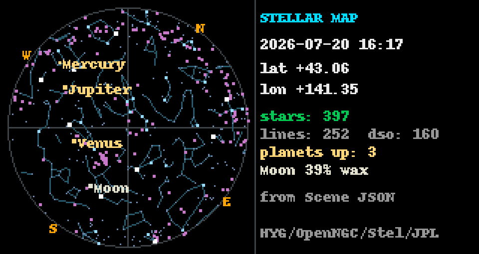

# App 16 星座盤 (`stellar-map`)

CardputerZero (Raspberry Pi CM0 / Linux) 向けの**オフライン星座盤**。指定した日時・観測地点の
恒星・星座線・深宇宙天体・惑星・月を 1.9" LCD (320×170) に描く。設計の一次資料は
[`../../HANDOFF_cardputerzero.md`](../../HANDOFF_cardputerzero.md) §3 App 16。



> 実機（uConsole・2026-07-20）でのライブ表示。地磁気（BMM150）で自機の向きを画面上に固定して
> 全天図を回転（方式A・N/S/E/W が現在の向きに追従）、惑星（Mercury/Jupiter/Venus）と月相を表示。

## アーキテクチャ（Python サイドカー ＋ 薄い UI）

天体計算・投影・色/サイズ決定は**すべて Python 側**で行い、320×170 の**デバイス座標
プリミティブ（Scene）**に落として JSON で渡す。UI（Rust/LVGL）は Scene を受け取り
**四角・線・文字を描くだけ**の薄い実装にする。

```
[HYG/OpenNGC/Stellarium 中間形式]  [Skyfield + DE421]
            │                            │
            └──────────┬─────────────────┘
                       ▼
   sidecar/stellar_sidecar.py  ── Scene JSON (1行/フレーム・JSON Lines) ──▶  ui/ (Rust/LVGL)
   (時刻=RTC/NTP/GNSS, 位置=GNSS,                                          「描くだけ」
    方位=CoreS3 BMM150)
```

- **共通コア** [`shared/star_catalog`](../../shared/star_catalog/): カタログ読込・座標変換・
  `build_scene()`（Scene 生成）。
- **サイドカー** [`sidecar/stellar_sidecar.py`](sidecar/stellar_sidecar.py): Scene を JSON Lines で stdout 出力。
- **前処理/検証** [`tools/`](tools/): データ取込ツール群と PC 検証レンダラ
  （`render_catalog.py` = 直接描画 / `render_scene.py` = Scene JSON から描画してプロトコル検証）。
- **UI（CardputerZero 実機）** [`ui_fb/stellar_fb.py`](ui_fb/stellar_fb.py): **フレームバッファ直描画**の Python UI。
  実機の LCD は `/dev/fb0`（320×170・RGB565）へ直接描く構成で SDL/Wayland が使えないため、
  Scene を `tools/render_scene.py` で描いて RGB565 で書き込む。キーボードは evdev（`tca8418c`）を直接読む。
  依存は工場出荷イメージに入っている Pillow と numpy のみ。
- **UI（SDL2・検証用）** [`ui/`](ui/): Rust＋SDL2 版。uConsole での先行検証に使用。**CardputerZero の LCD には出ない**。

## Scene JSON プロトコル（サイドカー → UI の契約）

1 フレーム = 1 行の JSON。座標は 320×170 の整数デバイス画素。地平線下の要素は含まない
（UI は素直に描くだけ）。

```jsonc
{
  "w":320, "h":170,
  "chrome": { "circle":[85,85,80], "circle_color":[60,66,70],
              "dir_color":[255,165,0], "dirs":[[x,y,"N"], ...] },
  "lines": [[x1,y1,x2,y2], ...],           // 星座線
  "line_color": [40,90,110],
  "points": [[x,y,side,r,g,b], ...],       // 星/DSO/惑星/月（side=四角の一辺 px）
  "labels": [[x,y,"Vega",r,g,b], ...],     // 天体名
  "meta": { "time_local":"...", "lat":.., "lon":..,
            "moon":{"frac":..,"waxing":..,"phase":".."},
            "counts":{"stars":..,"lines":..,"dso":..,"planets":..} }
}
```

描画順（UI）: `chrome`(円+方位) → `lines` → `points`(配列順=DSO→星→惑星→月) → `labels` → 情報パネル(`meta`)。
描画方針は **四角ドット＋AA 無し＋等倍**（低解像度 LCD で最も鮮明・HANDOFF §App16 決定）。

## 使い方（PC・実機なしで検証）

```bash
pip install -r tools/requirements.txt          # Pillow + skyfield

# 1) データ取込（HYG/OpenNGC/Stellarium・自動DL・生成物は非コミット）
python tools/build_star_catalog.py
python tools/build_constellations.py
python tools/build_dso.py

# 2) サイドカー → Scene JSON → PNG（プロトコル検証）
python sidecar/stellar_sidecar.py --dt 2026-07-08T03:30 | python tools/render_scene.py

# 直接描画版（モード比較・四角/AA無し等）
python tools/render_catalog.py --shape square --no-aa
```

## UI キー割当（`ui_fb`・`ui` 共通）

| キー | 動作 |
| --- | --- |
| `L` | 星座線 表示 ON/OFF（既定 ON） |
| `D` | DSO（深宇宙天体）表示 ON/OFF（既定 ON） |
| `P` | 惑星・月の名前 表示 ON/OFF（既定 ON） |
| `C` | 星座名 表示 ON/OFF（既定 OFF・低解像度での混雑回避） |
| `S` | スクリーンショット PNG 保存（`STELLAR_SHOTS_DIR` → `$HOME/stellar_shots`） |
| `Q` | 終了（`ui_fb` のみ。標準ランチャーの ESC 長押しでも終了できる） |

## Chain Encoder 操作（星座 / 惑星・月 のリスト・拡大表示）

5 モードの状態機械（サイドカー側）。赤起点＝星座系、青起点＝惑星系で対称。

**星座（赤起点）**

| 操作 | 動作 |
| --- | --- |
| 星座盤で **赤 押込** | 星座リスト（IAU略号＋ラテン名・`up`/`--`＝地平線上か） |
| リストで **赤 回転** | カーソル移動（感度 `enc_sensitivity`） |
| リストで **青 押込** | その星座を「今見えている角度で」拡大表示 |
| 拡大表示で **青 回転** | 拡大／縮小（目印星も同倍率） |
| 拡大表示で **青 押込** | リストへ戻る |
| リストで **赤 押込** | 星座盤へ戻る |

**惑星・月・1等星（青起点・星座と逆操作）**

| 操作 | 動作 |
| --- | --- |
| 星座盤で **青 押込** | 惑星・月・1等星リスト（`up`/`--` 付き） |
| リストで **青 回転** | カーソル移動 |
| リストで **赤 押込** | その天体を中心に拡大表示 |
| 拡大表示で **赤 回転** | 拡大／縮小 |
| 拡大表示で **赤 押込** | リストへ戻る |
| リストで **青 押込** | 星座盤へ戻る |

- 拡大表示（星座/天体とも）では、探す目安として周囲の**明るい星（1等星＝3×3十字 / 2等星＝1ドット）**、および**天球外周円＋方角 N/S/E/W**（画面端にコンパス表示）を重ねる。
- 1等星が星座に属する場合、その拡大表示で**星座線と星座名**も表示する。

## キーボード操作（Chain Encoder 非接続時・CardputerZero 単体）

Chain Encoder が無くてもキーボードで同じ状態遷移ができる（UI がサイドカーを子プロセス
起動し、キー操作を stdin で送る運用＝launcher の子プロセス起動モード）。

| キー | 動作 |
| --- | --- |
| `Enter` | 一段深く（星座盤→星座リスト / リスト→拡大表示） |
| `Tab` | 星座盤→惑星・月・1等星リスト |
| `↑` / `↓` | リストでカーソル移動 / 拡大表示で拡大・縮小（↑=拡大）。CardputerZero では `fn`＋`F` / `fn`＋`X` |
| `Esc` | 一段戻る（拡大→リスト→星座盤） |

レイヤトグル `L`/`D`/`P`/`C`・スクショ `S` はどちらの運用でも有効。

方位は地磁気（BMM150）で自機の向きを画面上に固定（方式A）。個体・取付依存の較正／姿勢
オフセットは `~/.config/cardputerzero/stellar_map.json`（例 `config/stellar_map.json.example`＝CoreS3 経由／
`config/stellar_map.cz.json.example`＝CardputerZero 内蔵センサ）。

## 方位の較正（CardputerZero 内蔵センサ）

内蔵の BMM150（地磁気）と BMI270（加速度・ジャイロ）は Linux IIO から読める（追加パッケージ不要）。
本体内部の磁気（スピーカーの磁石等）が地磁気より強く出るため、**較正しないと方位は動かない**。
[`tools/calib_iio.py`](tools/calib_iio.py) を実機で実行する。金属・磁石・PC の近くは避ける。

```bash
# 1) 本体を水平に保ったまま、ゆっくり 1 周以上回す（x/y のずれ・振れ幅・回転方向を求める）
python3 calib_iio.py --mode flat --seconds 30 --write
# 2) 上辺（Cap 側）を真北へ向けて水平に置き、静止（方位のずれ補正を求める。北以外なら角度を指定）
python3 calib_iio.py --mode align --true-heading 0 --seconds 10 --write
# 3) （傾き補正を使う場合）あらゆる向きに転がす（z 軸まで較正し、磁気と加速度の軸の向きを合わせる）
python3 calib_iio.py --mode 3d --seconds 45 --write
```

- `QUALITY: OK` のときだけ設定ファイルへ書き込む。初回の書き込みで `mirror_ew: true`（見上げた向き）も入る。
- 表示は「向いている方位が画面の下に来る」。**北を向くと N が下・東が右・西が左**になれば正しい。
- 手順 3 を行うと座標の扱いが変わる（軸符号で揃え、回転向きの反転は不要になる）ため、**手順 3 のあとは手順 2 をもう一度行う**。
- 傾き補正は `shared/compass` の `heading_from_vectors`（加速度で「上」を求め、磁気を水平面へ射影するベクトル式）。
  動かしている最中は方位の更新を止める（`accel_gate`）。
- 2026-11-17 に実機で確認: 水平・傾けた状態・手持ちの角度（30〜45°）のいずれも、ずれは 4〜5° 程度。

## CardputerZero 実機への導入

`.deb` は実機上で生成できる（Python のみでコンパイル不要・`dpkg-deb` は実機に入っている）。

```bash
# 1) 開発機: ソース一式（scripts/pack_deb.sh・shared/{star_catalog,compass}・apps/stellar-map の
#    packaging/ assets/ sidecar/ ui_fb/ data/ と tools/{ephem,render_scene}.py）を実機へ送る
# 2) 実機: パッケージ生成
bash scripts/pack_deb.sh apps/stellar-map        # -> apps/stellar-map/dist-cz/stellar-map_<ver>_arm64.deb
# 3) 実機: 試算で他パッケージに影響しないことを確認してから導入
apt-get -s install ./apps/stellar-map/dist-cz/stellar-map_*.deb
sudo apt install   ./apps/stellar-map/dist-cz/stellar-map_*.deb
# アプリ一覧に出ない場合: systemctl --user restart APPLaunch   / 削除: sudo apt remove stellar-map
```

- 標準ランチャーの一覧から「Stellar Map」を起動する。**SSH から直接起動するとランチャーの表示・キー処理と重なる**ので、動作確認はランチャー経由で行う。
- 2026-11-17 に実機で確認: アイコン表示・描画・星座リスト／惑星 1 等星リスト／拡大・ESC 長押しと `Q` での終了。UI 約 34MB＋サイドカー約 21MB。

## 状態

| 部位 | 状態 |
| --- | --- |
| データ取込（HYG/OpenNGC/星座線） | ✅ 完了（PC 検証済み） |
| 天体計算（Skyfield 惑星/月/月相） | ✅ 完了（PC・uConsole 検証済み）／CardputerZero 実機は skyfield 未導入のため非表示 |
| Scene プロトコル＋サイドカー | ✅ 完了（PC・uConsole・CardputerZero 実機） |
| フレームバッファ UI（`ui_fb`） | ✅ **CardputerZero 実機で動作確認済み**（2026-11-17・標準ランチャーから起動） |
| SDL2 UI（`ui`・Rust） | ✅ uConsole で動作確認済み（CardputerZero の LCD には出ない） |
| 内蔵 BMM150 による方位追従 | ✅ 実機で確認（2026-11-17・`calib_iio.py` で 3D 較正・傾き補正あり・ずれ 4〜5° 程度） |
| RTC/NTP/GNSS 時刻・位置入力、HDMI 切替 | ⬜ 未対応（観測地の既定は札幌） |
